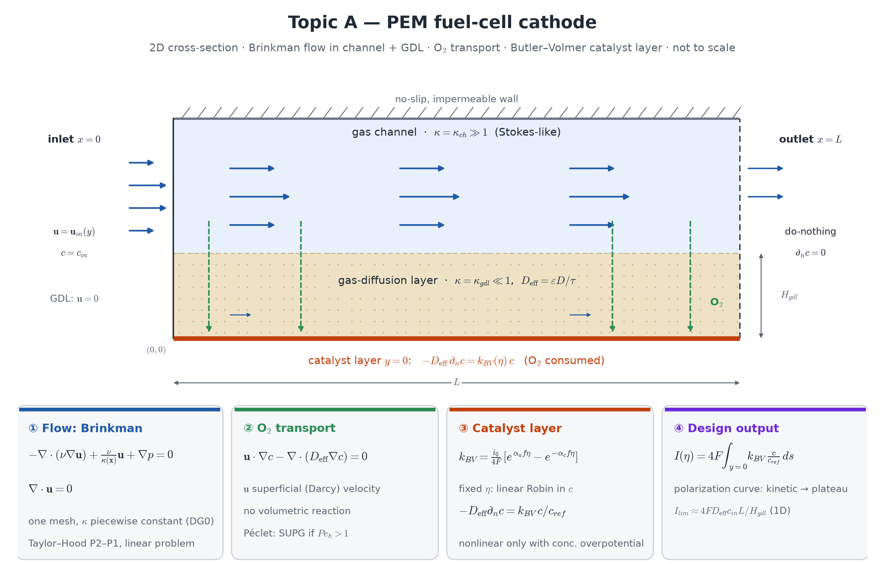

## Motivation

A PEM fuel-cell cathode feeds oxygen from an open gas channel through a porous gas-diffusion layer (GDL) to a thin catalyst layer, where the
oxygen reduction reaction consumes it. The **polarization curve** — current against overpotential — changes from kinetically limited (exponential in
$\eta$) to mass-transfer limited (a plateau set by O₂ delivery through the GDL). You will compute it from one model that covers both regions.

**Course weeks:** 6 (Robin conditions), 11 (Stokes, Taylor–Hood), 12 (Darcy), 13 (advection–diffusion, SUPG). **New:** the Brinkman equation,
Butler–Volmer kinetics.

## Model

2D cross-section $\Omega=[0,L]\times[0,H_{gdl}+H_{ch}]$: GDL $0<y<H_{gdl}$, channel above it; suggested $L=2$, $H_{gdl}=0.1$, $H_{ch}=0.2$.

{width=100%}

**Flow — Brinkman** on the whole domain, one mesh, no interface conditions:
$$
-\nabla\cdot(\nu\nabla\mathbf u)+\frac{\nu}{\kappa(\mathbf x)}\mathbf u+\nabla p=0,\qquad\nabla\cdot\mathbf u=0,
$$
with $\kappa=\kappa_{ch}$ large (e.g. $10^6$: Stokes) in the channel and $\kappa=\kappa_{gdl}$ small (e.g. $10^{-3}$: Darcy-dominated) in the GDL, as a
DG0 coefficient. Inlet profile at $x=0$, no-slip on the walls (and on $y=0$), do-nothing outlet.

**Oxygen** (superficial velocity $\mathbf u$):
$$
\mathbf u\cdot\nabla c-\nabla\cdot(D_\text{eff}(\mathbf x)\nabla c)=0,\qquad D_\text{eff}=D\ \text{(channel)},\quad D_\text{eff}=\varepsilon D/\tau\ \text{(GDL)},
$$
$c=c_\text{in}$ at the channel inlet, zero flux on the walls, natural outflow, and on the catalyst layer $y=0$
$$
-D_\text{eff}\,\partial_nc=k_{BV}(\eta)\,\frac{c}{c_\text{ref}},\qquad k_{BV}(\eta)=\frac{i_0}{4F}\Big[e^{\alpha_af\eta}-e^{-\alpha_cf\eta}\Big],\quad f=\frac F{RT}.
$$

**Design output:** total current $I(\eta)=4F\int_{y=0}k_{BV}(\eta)\,c/c_\text{ref}\,ds$ for $\eta$ from small to large.

::: {.callout-note}
**Analysis question (required).** For a *fixed* $\eta$ the catalyst condition is linear in $c$ — a Robin condition. Show that the O₂ problem is then
coercive (which sign of $k_{BV}$ is needed? what happens to coercivity with the advection term and the outflow boundary?), and state when the
Galerkin solution oscillates (cell Péclet number in the channel). The model becomes genuinely nonlinear with the concentration overpotential
(stretch goal 2).
:::

## Required tasks

1. Brinkman flow alone: show that the channel velocity is Stokes-like and the GDL velocity small and nearly uniform; report the flow split.
2. O₂ transport with the Butler–Volmer condition; polarization curve $I(\eta)$ over the kinetic → mass-transfer-limited range.
3. Mesh independence of $I(\eta)$ at two values of $\eta$ (one kinetic, one near the plateau), on at least two meshes refined near $y=0$.

## Verification specific to this topic

- **Limits of the Brinkman model**: (i) $\kappa\to\infty$ everywhere reproduces Poiseuille flow in the full height (exact, Week 11); (ii) in a long GDL-only
  strip the velocity approaches the Darcy value $\kappa\,\Delta p/(\nu L)$.
- **1D limiting current**: $I_\text{lim}\approx 4F\,D_\text{eff}\,c_\text{in}L/H_{gdl}$ (Fick across the GDL only). Compare with your plateau and explain the
  gap (channel-side resistance, depletion along $x$).
- **MMS**: for the O₂ equation with a given smooth $\mathbf u$ and the Robin condition (predicted P1/P2 rates); for Brinkman with constant $\kappa$
  (Taylor–Hood rates, Week 11).

## Stretch goals

1. **GDL flooding**: reduce $\varepsilon$ and $D_\text{eff}$ in a patch of the GDL; quantify the loss in $I$.
2. **Concentration overpotential**: $\eta=\eta_\text{act}+\frac{RT}{nF}\ln(c_\text{bulk}/c)$ on the catalyst layer — nonlinear in $c$; Newton with
   continuation in $\eta_\text{act}$.
3. **Galvanostatic operation**: prescribe the total current and solve for $\eta$ (one extra scalar unknown).
4. Two or three parallel channels with a common inlet manifold; non-uniform current distribution.

## Milestones

M1 Brinkman flow and its two limits · M2 O₂ with a linear first-order wall reaction · M3 Butler–Volmer and the $\eta$ sweep · M4 mesh study ·
M5 stretch goal.

## Pitfalls

- The inlet Dirichlet boundary and the catalyst boundary meet only at the corner $(0,0)$; check that $I/i_0$ decreases with $i_0$ in the transport-limited
  regime (a corner that leaks current shows a constant ratio).
- The jump of $\kappa$ by nine orders of magnitude: align the mesh with $y=H_{gdl}$, and check the pressure solve (scaling, Week 12).

## References

- J. Larminie, A. Dicks, *Fuel Cell Systems Explained*, 2nd ed., Wiley 2003 — polarization curves.
- D. A. Nield, A. Bejan, *Convection in Porous Media*, Springer — the Brinkman equation.
