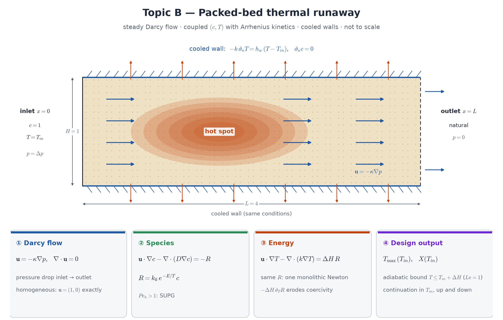

## Motivation

An exothermic reaction in a cooled packed bed heats itself; the heat release grows exponentially with temperature (Arrhenius), the wall removes heat
only linearly. Above a critical inlet temperature the hot spot grows steeply — the classical thermal-runaway / ignition problem (Semenov,
van Heerden, Bilous–Amundson). You will compute the hot-spot temperature and the conversion as functions of the inlet temperature.

**Course weeks:** 8–9 (residual, Newton, continuation), 12 (Darcy), 13 (advection–diffusion, SUPG). **New:** two fields coupled through one
exponential source.

## Model

{width=100%}

Bed $\Omega=[0,4]\times[0,1]$, flow in $+x$. Lumped, dimensionless units ($\rho C_p=1$).

**Flow — Darcy**, homogeneous: $\mathbf u=-\frac{\kappa}{\mu}\nabla p$, $\nabla\cdot\mathbf u=0$; pressure drop between inlet and outlet, no flux through the walls
(mixed form RT×DG as in Week 12, or the pressure Poisson equation and $\mathbf u=-\kappa\nabla p/\mu$ — justify your choice).

**Species and energy**, solved together (one mixed space, one `NonlinearProblem`):
$$
\mathbf u\cdot\nabla c-\nabla\cdot(D\nabla c)=-R(c,T),\qquad
\mathbf u\cdot\nabla T-\nabla\cdot(k\nabla T)=\Delta H\,R(c,T),\qquad R=k_0\,e^{-E/T}\,c,
$$
with $c=1$, $T=T_\text{in}$ at $x=0$; natural outflow at $x=4$; on the walls $y=0,1$: $\partial_nc=0$ and Newton cooling
$-k\,\partial_nT=h_w\,(T-T_\text{amb})$, $T_\text{amb}=T_\text{in}$.

**Design output:** peak temperature $T_{\max}$ and outlet conversion $X=1-\int_\text{out}u\,c\,ds/\int_\text{in}u\,c\,ds$ against $T_\text{in}$.

::: {.callout-note}
**Analysis questions (required).** (i) Linearise the residual at $(c,T)$: which term can destroy coercivity of the Jacobian, and how does its size depend on
$E/T^2$? (ii) **Adiabatic bound:** for equal diffusivities ($D=k$, Lewis number 1) show that $\theta=T+\Delta H\,c$ satisfies a linear
advection–diffusion equation and, with the cooled walls, the maximum principle gives $T\le T_\text{in}+\Delta H$. What can happen when $D\ne k$?
(iii) The cell Péclet number of the suggested parameters — do you need SUPG?
:::

## Suggested parameters

$\kappa/\mu=1$ with a pressure drop giving $|\mathbf u|\approx1$; $D=0.01$, $k=0.05$ (or $D=k$ for the bound check); $\Delta H=2$; $E=10$; $h_w$ and
$k_0$ chosen so that cooling competes with heat release (e.g. start with $k_0=5$, $h_w=5$); $T_\text{in}\in[1,2.5]$. Finding parameters that give a
steep but single-valued curve is part of the task: very steep curves signal multiple steady states (topic E).

## Required tasks

1. Darcy flow, species with a fixed temperature, energy with a prescribed heat source — each verified on its own.
2. The coupled $(c,T)$ problem with Newton and continuation in $T_\text{in}$ (previous solution as the initial guess, Week 9/15).
3. The curves $T_{\max}(T_\text{in})$ and $X(T_\text{in})$, with Newton iteration counts and SNES reasons along the sweep.
4. Mesh independence at the steepest part of the curve (two or more meshes).

## Verification specific to this topic

- **Adiabatic bound** $T_{\max}\le T_\text{in}+\Delta H$, checked at every point of the sweep (with $D=k$ it is a theorem; report what you see for $D\ne k$).
- **Isothermal limit**: $E=0$ gives a linear first-order reaction; for plug flow and negligible axial diffusion $X=1-e^{-k_0L/u}$ (PFR).
- **MMS** for the coupled system with the Arrhenius term (source terms from UFL), predicted rates for your elements.

## Stretch goals

1. Cooling design: sweep $h_w$ at fixed $T_\text{in}$; the smallest $h_w$ that avoids runaway.
2. Hysteresis: approach the same $T_\text{in}$ from a cold and from a hot initial guess.
3. A high-permeability channel through the bed: hotter or cooler?
4. Inverse problem (bonus, §5 of the project guide): estimate $E$ or $k_0$ from synthetic thermocouple data.

## Milestones

M1 Darcy · M2 isothermal species (PFR check) · M3 energy with prescribed source and Robin walls · M4 coupled Newton · M5 sweep and mesh study.

## Pitfalls

- A temperature above the adiabatic bound (for $D=k$) is a bug — usually a sign error in a source term or an unconverged Newton step.
- Newton from $T=T_\text{in}$ everywhere at a high $k_0$ may diverge: continuation in $k_0$ first, then in $T_\text{in}$.
- Bounds: `vinewtonrsls` with $c\ge0$ helps when Newton overshoots.

## References

- O. Levenspiel, *Chemical Reaction Engineering*, 3rd ed., Wiley 1999 — PFR conversion.
- G. F. Froment, K. B. Bischoff, J. De Wilde, *Chemical Reactor Analysis and Design*, 3rd ed., Wiley 2011 — packed-bed hot spots, runaway criteria.
