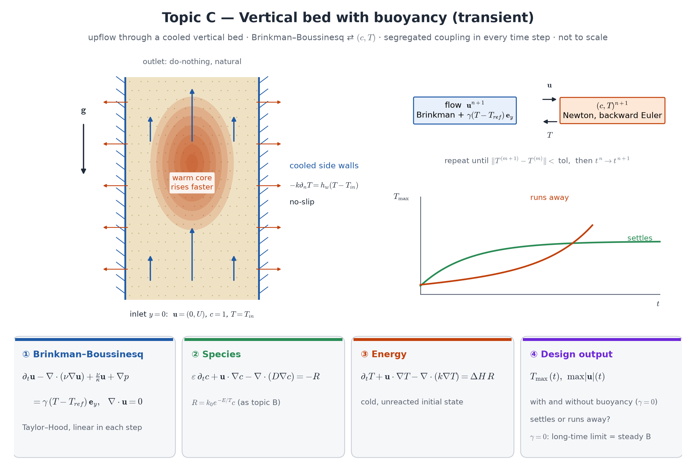

## Motivation

Topic B asks whether a steady operating point exists. The safety question is dynamic: *starting cold, does the bed settle or run away?* And when the
bed heats, buoyancy changes the flow, which changes residence time and cooling — reaction feeds back into the flow field. This is the only topic with
two-way flow–temperature coupling.

**Course weeks:** topic B, plus 10 (θ-method, stability), 11 (Taylor–Hood), 14 (splitting schemes). **New:** Boussinesq coupling, a segregated
iteration inside each time step.

## Model

{width=100%}

Vertical bed $x\in[0,1]$ (cooled side walls), $y\in[0,4]$ (flow upward from $y=0$), gravity $-\hat{\mathbf e}_y$.

**Transient Brinkman–Boussinesq flow:**
$$
\partial_t\mathbf u-\nabla\cdot(\nu\nabla\mathbf u)+\frac\nu\kappa\mathbf u+\nabla p=\gamma\,(T-T_\text{ref})\,\hat{\mathbf e}_y,\qquad\nabla\cdot\mathbf u=0,
$$
$\gamma=\rho_0\beta g$ (lumped buoyancy strength). Inlet velocity at $y=0$, no-slip side walls, do-nothing outlet.

**Species and energy** as in topic B with time derivatives:
$$
\varepsilon\,\partial_tc+\mathbf u\cdot\nabla c-\nabla\cdot(D\nabla c)=-R,\qquad\partial_tT+\mathbf u\cdot\nabla T-\nabla\cdot(k\nabla T)=\Delta H\,R,\qquad R=k_0e^{-E/T}c,
$$
Newton cooling on $x=0,1$; cold, unreacted initial state.

**Time stepping (required baseline):** backward Euler; in each step a **segregated (Picard) iteration** — (1) flow with the current $T$, linear;
(2) coupled $(c,T)$ with that $\mathbf u$, Newton — repeated until $T$ changes by less than a tolerance.

**Design output:** $T_{\max}(t)$ and $\max|\mathbf u|(t)$ for several $T_\text{in}$, with and without buoyancy ($\gamma=0$); classification *settles* vs
*runs away*.

::: {.callout-note}
**Analysis questions (required).** (i) Stability of backward Euler for the linearised energy equation (Week 10) — and why that does not exclude a
physical runaway. (ii) When does the segregated iteration converge? Estimate its contraction factor from your runs and relate it to $\gamma$.
(iii) Inf-sup stability of your flow pair with the Brinkman term (Week 11).
:::

## Required tasks

1. Steady Brinkman–Boussinesq flow with a *prescribed* warm patch: warm fluid rises (sign check).
2. Transient $(c,T)$ without buoyancy; run to steady state.
3. Segregated coupling with buoyancy, increasing $\gamma$ from 0; the $T_\text{in}$ sweep with and without buoyancy. Does buoyancy help or hurt in upflow?
   Decide from your results.
4. Time-step study ($\Delta t$ halved twice).

## Verification specific to this topic

- **Steady cross-check:** with $\gamma=0$ the long-time limit must equal the steady solution of the same model computed directly (your own steady
  Newton solver at the same parameters, i.e. topic B rotated). Report both values and the difference.
- **Transient energy balance:** storage + convection + wall loss = generation, integrated over the domain and over time.
- **MMS in time:** a manufactured solution $\propto e^{-t}$ (or $\sin t$) for the energy equation — first-order temporal rate for backward Euler.
- **Spatial MMS** for the flow with the Boussinesq term (Taylor–Hood rates).

## Stretch goals

1. Monolithic $(\mathbf u,p,c,T)$ Newton instead of the segregated iteration; cost and robustness compared.
2. Downflow: buoyancy opposes the flow — recirculation near the hot spot?
3. Adaptive $\Delta t$ (halve on failure).
4. Critical buoyancy strength at fixed $T_\text{in}$.

## Milestones

M1 flow with a prescribed temperature · M2 transient $(c,T)$, $\gamma=0$, steady cross-check passed · M3 segregated coupling, small $\gamma$ · M4 sweeps,
time-step study · M5 stretch goal. **Do not pass M2 before the steady cross-check agrees.**

## Pitfalls

- "Runaway" must be distinguished from a numerical blow-up: halve $\Delta t$ — a physical runaway stays, an instability moves.
- A cold start at a high $k_0$ needs small first steps.

## References

- D. A. Nield, A. Bejan, *Convection in Porous Media*, Springer — Boussinesq–Brinkman models.
- J. Donea, A. Huerta, *Finite Element Methods for Flow Problems*, Wiley 2003 — time integration of coupled flow problems.
