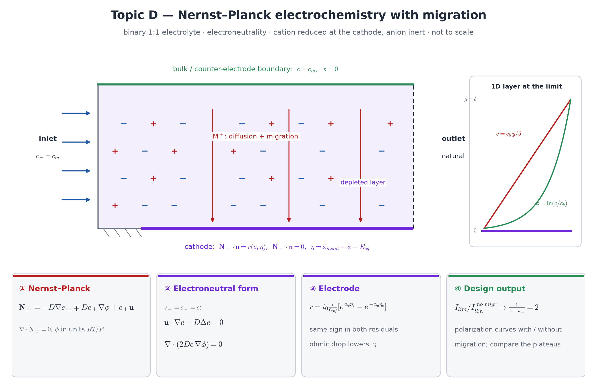

## Motivation

With excess supporting electrolyte, ion transport is plain convection–diffusion and the electrode overpotential can be prescribed (topic A). Without it,
ions also **migrate** in the electric field, and the overpotential depends on the solution potential, which is itself an unknown. For a cation reduced at
a cathode, migration and diffusion cooperate: the limiting current exceeds the diffusion-only value — for a 1:1 electrolyte with equal diffusivities by a
factor of exactly **2**. Your model has to reproduce that number.

**Course weeks:** 8–9 (Newton, continuation), 11 (null spaces, pinning a potential), 13 (advection–diffusion). **New:** migration, a solution-dependent
conductivity, a boundary condition coupling two fields.

## Model

{width=100%}

Binary 1:1 electrolyte $M^+X^-$, cation reduced at the electrode, anion inert. Fluxes ($\phi$ scaled by $RT/F$):
$$
\mathbf N_\pm=-D_\pm\nabla c_\pm\mp D_\pm c_\pm\nabla\phi+c_\pm\mathbf u,\qquad\nabla\cdot\mathbf N_\pm=0 .
$$
**Electroneutrality** $c_+=c_-=:c$ replaces the Poisson equation outside the (unresolved) double layer. Adding and subtracting the two species
equations gives one equation for $c$ and **current conservation** $\nabla\cdot\mathbf i=0$, $\mathbf i\propto\mathbf N_+-\mathbf N_-$, for $\phi$ — derive
both; the conductivity $\propto(D_++D_-)\,c$ depends on the solution. $\phi$ is determined up to a constant: pin it (where? justify) or use a null space.

**Electrode** (e.g. part of the lower wall of a channel): $\mathbf N_-\cdot\mathbf n=0$ and
$$
\mathbf N_+\cdot\mathbf n=-\frac{i_n}{F},\qquad i_n=i_0\,\frac{c}{c_\text{ref}}\Big[e^{\alpha_a\eta}-e^{-\alpha_c\eta}\Big],\qquad
\eta=\phi_\text{metal}-\phi|_\text{electrode}-E_\text{eq},
$$
nonlinear in $c$ **and** $\phi$. $\phi_\text{metal}$ is the control parameter (potentiostatic).

**Design output:** current against $\phi_\text{metal}$, with migration and with migration switched off (supporting-electrolyte model), and their ratio.

::: {.callout-note}
**Analysis questions (required).** (i) Derive the $c$ and $\phi$ equations from the two Nernst–Planck equations under electroneutrality; which terms cancel
in $\mathbf i$ when $D_+=D_-$? (ii) Is the $\phi$ problem coercive? What is its null space, and how does your boundary data remove it? (iii) What happens
to the $\phi$ equation as $c\to0$ at the limiting current?
:::

## Required tasks

1. Nernst–Planck for both ions with a **prescribed** $\phi$ (check the migration term alone).
2. The coupled $(c,\phi)$ problem with a **prescribed** $\eta$ on the electrode.
3. The full electrode condition with $\eta$ from the solved $\phi$; Newton with continuation in $\phi_\text{metal}$.
4. Polarization curves with and without migration; ratio of the limiting currents.

## Verification specific to this topic

- **1D exact solution (required, do this first):** stagnant layer $0<y<\delta$, bulk $c=c_b$, $\phi=0$ at $y=\delta$, electrode at $y=0$. With $D_+=D_-=D$
  the limiting state is $c(y)=c_b\,y/\delta$, $\phi=\ln(c/c_b)$, cation flux $2Dc_b/\delta$: **twice** the supporting-electrolyte value $Dc_b/\delta$.
  Below the limit the profile is still linear in $c$ and logarithmic in $\phi$ — an exact solution for an MMS-free convergence study.
- **Enhancement factor** $I_\text{lim}/I_\text{lim}^\text{no migr}\to1/(1-t_+)=2$ in the 2D model as the cathodic polarization increases — exactly,
  in any geometry, provided no boundary exchanges the inert anion (add the two Nernst–Planck equations to see why). At *small* polarization the
  ratio may well be below 1 (the migration model also carries the ohmic drop); it is the **plateau** that must reach 2. A plateau below 1 means a
  sign error: check the sign of the electrode term in the $\phi$ equation (it must make $\mathbf N_-\cdot\mathbf n=0$) and the sign of $\phi$ in $\eta$.
- **Anion impermeability:** compute the electrode flux of the anion (from the weak-form residual, not from boundary gradients) — it must be
  $\approx0$.
- **Where the current returns:** the $\phi$ Dirichlet boundary is the counter electrode. Make it a bulk boundary ($c$ and $\phi$ prescribed) or the
  inlet; a $\phi$-only condition on a no-flux wall lets that wall exchange anions, and the plateau stalls below 2.
- **Supporting-electrolyte limit (stretch 1)** reproduces the migration-free model.
- **MMS** for the coupled $(c,\phi)$ system in 2D.

## Stretch goals

1. A third, inert ion at increasing concentration: the limiting current moves from the migration value to the supporting-electrolyte value.
2. $D_+\ne D_-$: test $1/(1-t_+)$ in general.
3. Galvanostatic control: prescribe the total current, solve for $\phi_\text{metal}$.
4. Resolve the double layer in a thin sub-region with the Poisson equation.

## Milestones

M1 1D stagnant layer (exact solution, factor 2) · M2 2D with prescribed $\phi$ · M3 2D with prescribed $\eta$ · M4 coupled electrode condition and
continuation · M5 the two polarization curves.

## Pitfalls

- Concentration can go negative during Newton near the limiting current: variational-inequality Newton (`vinewtonrsls`) with $c\ge0$, continuation in
  $\phi_\text{metal}$, and line search.
- `ufl.exp` in a boundary integral defeats the automatic quadrature degree estimate: set `metadata={"quadrature_degree": …}` on the electrode `ds` and check
  that the current does not change when you raise it.

## References

- J. Newman, K. E. Thomas-Alyea, *Electrochemical Systems*, 3rd ed., Wiley 2004 — dilute-solution theory, migration, limiting currents.
- A. J. Bard, L. R. Faulkner, *Electrochemical Methods*, 2nd ed., Wiley 2001.
