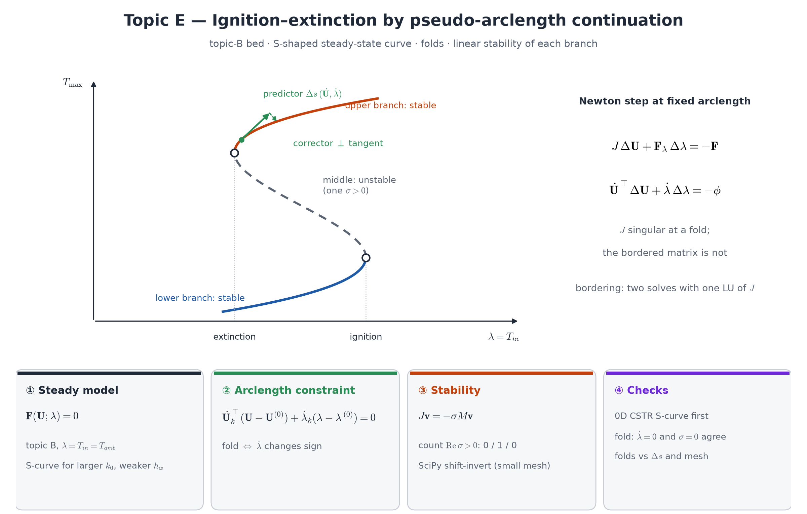

## Motivation

For strong enough heat release, topic B's reactor has **three** steady states over a window of inlet temperatures: a cold (extinguished) one, a hot
(ignited) one, and an unstable one between them. The branch of solutions turns back at two **folds** — the ignition and extinction temperatures. Natural
continuation in $T_\text{in}$ (Weeks 9 and 15) cannot pass a fold however small the step, because the branch is vertical there. Pseudo-arclength
continuation (PAC) parameterises the branch by arclength and traces the whole S-curve.

**Course weeks:** topic B, 8–9 (Newton), 15 (continuation, §A3). **New:** the augmented system, tangent predictor, bordering algorithm, generalized
eigenvalues for stability.

## Model

{width=100%}

Topic B's equations, geometry and boundary conditions; the continuation parameter $\lambda=T_\text{in}=T_\text{amb}$. A reference computation found two
folds for $k_0\approx10^4$, $E\approx16$, $h_w=2$ and more axial heat dispersion ($k=0.2$); finding parameters with a clear S-curve (start from a single-valued curve and
increase $k_0$ or $E$) is part of the task.

**PAC.** With $\mathbf F(\mathbf U;\lambda)=0$ the discrete residual and $(\dot{\mathbf U}_k,\dot\lambda_k)$ the unit tangent at the last point:
predict $\mathbf U^{(0)}=\mathbf U_k+\Delta s\,\dot{\mathbf U}_k$, $\lambda^{(0)}=\lambda_k+\Delta s\,\dot\lambda_k$, then Newton on
$$
\mathbf F(\mathbf U;\lambda)=0,\qquad \dot{\mathbf U}_k^\top(\mathbf U-\mathbf U^{(0)})+\dot\lambda_k(\lambda-\lambda^{(0)})=0 .
$$
**Bordering:** each Newton step solves $J\mathbf v=-\mathbf F$ and $J\mathbf w=-\mathbf F_\lambda$ with the *same* factorised Jacobian, then
$\Delta\lambda=-(\phi+\dot{\mathbf U}_k^\top\mathbf v)/(\dot\lambda_k+\dot{\mathbf U}_k^\top\mathbf w)$, $\Delta\mathbf U=\mathbf v+\Delta\lambda\,\mathbf w$.
$\mathbf F_\lambda$ by a finite difference or exactly (UFL derivative of the forms with respect to a `Constant`; $\lambda$ also enters through Dirichlet data).

**Design output:** the S-curve $T_{\max}(T_\text{in})$ (and $X(T_\text{in})$) through both folds; ignition and extinction temperatures.

::: {.callout-note}
**Analysis questions (required).** (i) Why is $J$ singular at a fold, and why is the bordered matrix not? (ii) Linear stability: perturbations
$e^{\sigma t}\mathbf v$ of the transient model give $J\mathbf v=-\sigma M\mathbf v$ — which branch has a positive $\sigma$? (iii) Why can natural
continuation "jump" to the other branch without any solver failure?
:::

## Required tasks

1. Natural continuation reproduces your topic-B results where the curve is single-valued (consistency check of the PAC code with $\dot\lambda>0$ forced).
2. Tangent computation and sign of $\dot\lambda$ along the branch; PAC through both folds.
3. Stability: the number of eigenvalues with $\mathrm{Re}\,\sigma>0$ of $J\mathbf v=-\sigma M\mathbf v$ at points on each branch (0 / 1 / 0 expected) —
   `slepc4py` (in the `%%fenicsx` environment) or SciPy on a small mesh.
4. Fold locations under refinement of $\Delta s$ **and** of the mesh.

## Verification specific to this topic

- **Branch connectivity:** no gaps; every point a converged FE solution (print residual norms).
- **Fold detection two ways:** sign change of $\dot\lambda$ and an eigenvalue of $J$ crossing zero at the same $T_\text{in}$.
- **0D check:** the CSTR (Semenov/van Heerden) heat balance has an S-curve with closed-form fold conditions — reproduce its qualitative shape with your
  PAC code applied to the 0D model before the PDE.
- **MMS** for the steady topic-B system (as in topic B).

## Stretch goals

1. Adaptive $\Delta s$ from the corrector's iteration count.
2. Direct fold localisation (extended system for $J\dot{\mathbf U}=0$).
3. Two-parameter diagram: fold curves in the $(k_0,T_\text{in})$ plane.
4. Deflation as an alternative way to find the middle branch.
5. Check that the folds are not Hopf points (complex eigenvalues).

## Milestones

M1 0D CSTR S-curve with your PAC code · M2 PDE natural continuation = topic B · M3 PAC through the first fold · M4 full S-curve and stability · M5 stretch goal.

## Pitfalls

- A corrector that needs many iterations while the bordering denominator stays away from zero is stiffness, not a fold — raise the iteration limit.
- Near full conversion the upper branch becomes flat in $T_\text{in}$; trace it with natural continuation from a hot start instead of forcing PAC.
- Scale the unknowns (and $\lambda$) to $O(1)$ in the arclength norm, or $\Delta s$ means nothing.

## References

- H. B. Keller, Numerical solution of bifurcation and nonlinear eigenvalue problems, in *Applications of Bifurcation Theory*, Academic Press 1977.
- Yu. A. Kuznetsov, *Elements of Applied Bifurcation Theory*, Springer — folds and continuation.
- C. van Heerden, Autothermic processes, *Ind. Eng. Chem.* 45 (1953) 1242–1247.
