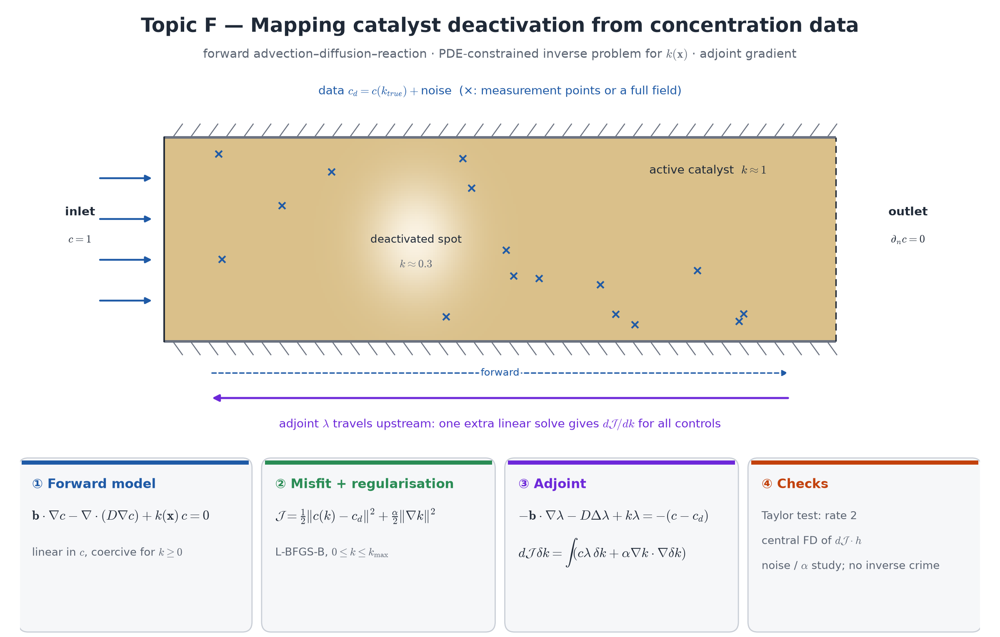

## Motivation

A catalytic bed loses activity non-uniformly (sintering, coking, poisoning near a hot spot). The activity $k(\mathbf x)$ cannot be measured directly,
but the reactant concentration can — at sampling ports, or as a field from imaging. Recovering $k(\mathbf x)$ from $c$ is an **inverse problem**: the
unknown is a *function* (thousands of degrees of freedom), so the gradient of the misfit has to come from an **adjoint** solve — one extra linear solve
instead of one per unknown. This topic is the course's introduction to PDE-constrained optimisation.

**Course weeks:** 5–7 (well-posedness, MMS, rates), 13 (advection–diffusion). **New:** adjoint gradients (`dolfinx-adjoint` / pyadjoint), Tikhonov
regularisation, bound-constrained optimisation.

## Model

{width=100%}

**Forward problem** on the bed $\Omega=[0,4]\times[0,1]$ with a given velocity (plug flow $\mathbf b=(U,0)$, or Darcy flow as in topic B):
$$
\mathbf b\cdot\nabla c-\nabla\cdot(D\nabla c)+k(\mathbf x)\,c=0,\qquad c=1\ \text{at } x=0,\quad \partial_nc=0\ \text{on the walls and the outlet}.
$$
Suggested: $U=1$, $D=0.05$; a "true" activity with a deactivated spot, e.g.
$k_\text{true}=1-0.7\exp\!\big(-[(x-1.5)^2+(y-0.5)^2]/0.08\big)$.

**Inverse problem:** synthetic data $c_d=c(k_\text{true})+\text{noise}$; find $k\ge0$ minimising
$$
\mathcal J(k)=\frac12\int_\Omega(c(k)-c_d)^2\,dx+\frac\alpha2\int_\Omega|\nabla k|^2\,dx ,
$$
with the gradient from the adjoint and L-BFGS-B (`pyadjoint.minimize`, bounds $0\le k\le k_{\max}$).

**Design output:** the reconstructed map $k(\mathbf x)$, its error against $k_\text{true}$, and how it depends on noise level and $\alpha$.

::: {.callout-note}
**Analysis questions (required).** (i) Show that the forward problem is coercive for $k\ge0$ (Lax–Milgram with the advection term: what does
$\nabla\cdot\mathbf b=0$ and the outflow boundary give?), so $c(k)$ is well defined. (ii) Derive the **adjoint equation** by hand
(Lagrangian $\mathcal L=\mathcal J+a(c,\lambda;k)$): which boundary is the "inlet" of the adjoint, and which way does its advection point?
Write the gradient $d\mathcal J/dk$ in terms of $c$ and $\lambda$. (iii) Why is the problem ill-posed without regularisation (what can the data *not*
see — think of regions where $c\approx0$, or where $k$ varies on scales below the diffusion length)?
:::

## Required tasks

1. Forward solver with an MMS convergence study (variable $k(\mathbf x)$; predicted P1/P2 rates); cell Péclet number and SUPG if needed (Week 13).
2. Reduced functional with `dolfinx-adjoint`: **Taylor test** (rate 2 for at least four $\varepsilon$) and a **central finite-difference** check of a
   directional derivative (relative difference printed, at the *same* control value).
3. Recovery from noise-free data: the error of $k$ must go to (nearly) zero.
4. Noise (0.5 %, 1 %, 5 %) and regularisation: error of $k$ against $\alpha$; choose $\alpha$ by the **discrepancy principle** (data misfit ≈ noise level)
   or an L-curve, and explain the choice.
5. Avoid the "inverse crime": generate the data on a finer mesh (or with a different element) than the one used for the inversion, and say how
   this changes the recovered map.

## Verification specific to this topic

- Taylor test **and** FD gradient check (they detect different errors — be ready to explain which).
- Your hand-derived adjoint (analysis question ii): solve it once yourself and compare the gradient with `dolfinx-adjoint`'s.
- Noise-free recovery; the reconstruction error as the mesh is refined.

## Stretch goals (F's bonus)

1. **Sparse data:** only an outlet profile plus a few sampling ports; what can still be recovered?
2. **Optimal design:** given a catalyst budget $\int_\Omega k\,dx=K$, find the distribution $k(\mathbf x)$ that maximises conversion (equality constraint
   or a penalty) — the same adjoint machinery used for design instead of identification.
3. Unknown velocity as well: recover a permeability defect in a Darcy bed from pressure and concentration data.

## Milestones

M1 forward solver and MMS · M2 adjoint gradient: Taylor and FD checks · M3 noise-free recovery · M4 noise and $\alpha$ study, inverse-crime test ·
M5 stretch goal.

## Practical notes

- Install: `week16/W16_render_report.ipynb` §3 (DOLFINx 0.11 on Colab, `--no-deps`). Use `da.Function`, `da.LinearProblem`, `da.assemble_scalar`;
  generate the data inside `with pyadjoint.stop_annotating():`.
- The forward solves are small (seconds); an optimisation with 50–200 iterations fits easily into the 30-minute notebook limit.
- Keep every `LinearProblem` object alive while the tape may replay it.

## References

- F. Tröltzsch, *Optimal Control of Partial Differential Equations*, AMS 2010 — adjoints, first-order conditions.
- C. R. Vogel, *Computational Methods for Inverse Problems*, SIAM 2002 — Tikhonov regularisation, discrepancy principle, L-curve.
- P. E. Farrell, D. A. Ham, S. W. Funke, M. E. Rognes, Automated derivation of the adjoint of high-level transient finite element programs,
  *SIAM J. Sci. Comput.* 35 (2013) C369–C393 — the dolfin-adjoint approach.
- dolfinx-adjoint documentation: <https://scientificcomputing.github.io/dolfinx-adjoint/README.html>
