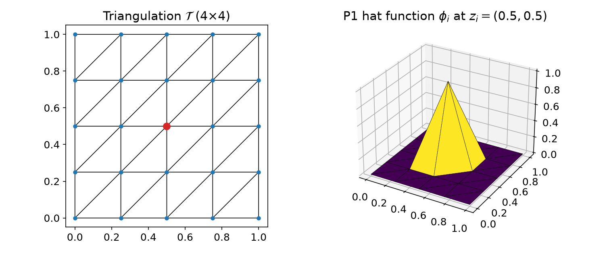
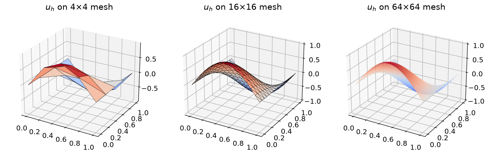
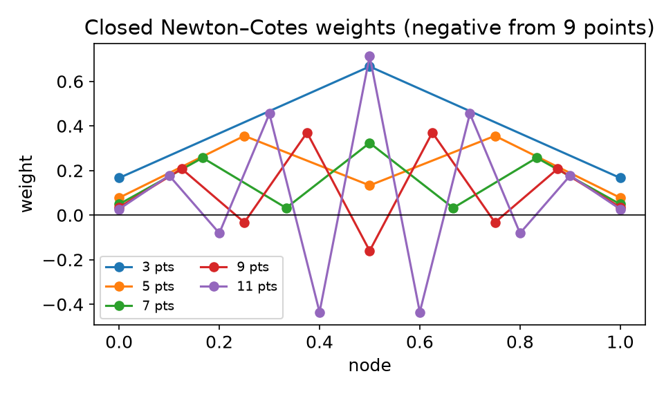
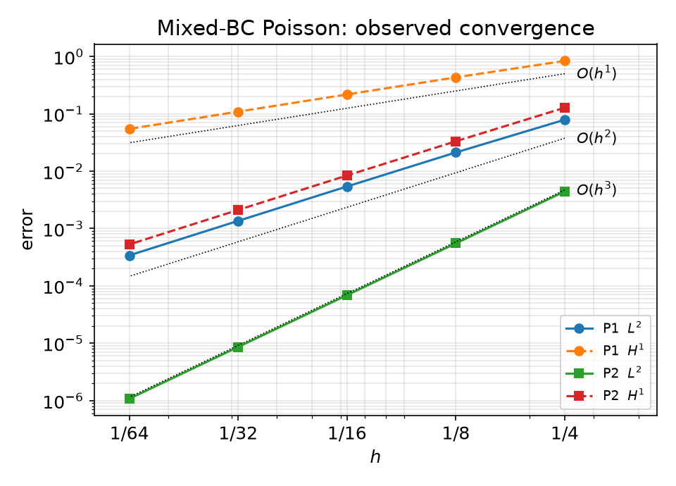

## Today

| Part | Topic | Time |
|---|---|:---:|
| **0** | Course introduction · computing environment · working with LLMs | 25 min |
| **A** | Theory — Poisson's equation, triangulations, P1 space, weak form, linear system | 55 min |
| **B** | Numerical quadrature — exactness, Gauss rules, reference cells, Basix | 40 min |
| **C** | Implementation — the Poisson solver in DOLFINx 0.11, convergence | 40 min |
| **D** | LLM workflow demo · assignments | 20 min |

::: {.box}
Lab notebook: `W01_lab.ipynb` · Assignments: `W01_HW0.ipynb`, `W01_HW1.ipynb` (due before Week 2)
:::

# Part 0 — Course Introduction

## What this course is about

::: {.columns}
::: {.column width="55%"}
**The finite element method, three ways**

1. **Mathematics** — why the method works: well-posedness, stability, convergence rates
2. **Implementation** — how FEniCSx turns a weak form into a sparse linear system
3. **Application** — materials and process problems: diffusion, flow, transport

**AI-based**: you will write most code *with* an LLM assistant —
and you will use the mathematics to **verify** what it produces.
:::
::: {.column width="45%"}
| Course | Focus |
|---|---|
| **I** (this term) | theory + FEniCSx internals + incompressible flow |
| **II** (next term) | solid & structural mechanics + coupled heat/mass transfer |
:::
:::

## Course I roadmap

| Weeks | Block | Highlights |
|:---:|---|---|
| 1–4 | **Finite elements** | weak form, quadrature, Ciarlet's element, meshes, DOF maps, interpolation |
| 5–7 | **Analysis** | Lax–Milgram, boundary conditions, Céa's lemma, Aubin–Nitsche |
| 8–10 | **Nonlinear & transient** | Newton/SNES, θ-method, Cahn–Hilliard |
| 11–13 | **Mixed & stabilized** | Stokes, inf-sup, block preconditioners, SUPG |
| 14–15 | **Navier–Stokes** | IPCS, DFG cylinder benchmark, lid-driven cavity |
| 16 | **Final project presentations** | report + code due; no final exam |

Project proposal in **Week 8**. Weekly quiz (10 min) at the start of each lecture, starting Week 2.

## The FEniCSx toolchain

| Component | Role | You meet it in |
|---|---|---|
| **UFL** | symbolic language for weak forms: `inner(grad(u), grad(v))*dx` | Week 1 |
| **Basix** | reference elements, basis functions, quadrature rules | Weeks 1–2 |
| **FFCx** | compiles UFL forms to C kernels (one cell at a time) | Week 9* |
| **DOLFINx** | meshes, function spaces, assembly, I/O, MPI parallelism | every week |
| **PETSc** | sparse linear algebra, Krylov solvers, preconditioners, SNES | Weeks 1, 9, 12 |

<small>*code generation is discussed when we derive Newton's method.</small>

::: {.fragment}
> We use **DOLFINx 0.11**. Most code on the internet (and in LLM training data) is for older versions — this matters!
:::

## Computing environment: Google Colab only

::: {.columns}
::: {.column width="50%"}
**First cell of every notebook** (≈ 3–5 min, once per runtime):

```python
# SeoulTechPSE/fenicsx-colab Quick Start
DOLFINX_VERSION = '0.11'
%run /content/fenicsx-colab/setup_fenicsx.py ...
```

**Then** DOLFINx code goes in cells that start with

```text
%%fenicsx -np 2
```
:::
::: {.column width="50%"}
**The cell model**

- each `%%fenicsx` cell = a *new* MPI program
- variables do **not** survive between cells
- save results: `np.savez("/tmp/fnx/...")`
- plot in ordinary cells (matplotlib)
- Colab has 2 CPUs: use `-np 1` or `-np 2` for timings
- restart runtime ⇒ re-run the setup cell
:::
:::

## Assessment

| Component | Weight | Notes |
|---|:---:|---|
| Weekly assignments | 30% | executed notebook + results summary + **AI-usage log** |
| Weekly quizzes | 10% | closed-AI, 10 min |
| Midterm exam | 15% | closed-AI, proofs |
| Term project | 40% | proposal (W8) → report + code + presentation |
| Participation | 5% | |

::: {.fragment}
- Assignments are due **before the next lecture**; no late submissions.
- "Restart session and run all" must succeed, otherwise 0.
- Every number must come from a cell you ran and must be **verified**.
:::

## Working with LLM coding assistants

::: {.columns}
::: {.column width="50%"}
**Encouraged** for all coding work. But LLMs typically produce:

- **outdated API** — legacy `fenics`, DOLFINx 0.5–0.10
- **silent math errors** — wrong signs, missing boundary conditions, unstable elements
- **verification theater** — "✅ solver verified" based on nothing
:::
::: {.column width="50%"}
**The workflow you follow every week**

1. **Formulate** the weak form by hand
2. **Prompt with context** (API reference sheet)
3. **Read and annotate** every line
4. **Verify** — MMS rates, benchmarks, `-np 1` = `-np 2`
5. **Log** prompts, failures, fixes
:::
:::

::: {.fragment}
> You are the **author of record**: if you cannot explain a line you submitted, it counts as not done.
:::

# Part A — Poisson's Equation and the Weak Form

## §A1 The model problem

::: {.callout-note title="Model problem"}
Let $\Omega = (0,1)^2$. Given $f$, find $u$ such that
$$-\nabla^2 u = f \quad \text{in } \Omega$$

| Boundary | Type | Condition |
|---|---|---|
| $x = 0$ and $x = 1$ | **Dirichlet** | $u = 0$ |
| $y = 0$ and $y = 1$ | **Neumann** | $\partial u / \partial n = 0$ |
:::

::: {.fragment}
- Steady diffusion: temperature, concentration, electric potential, pressure in Darcy flow
- Two BC types on purpose — FEM treats them **differently**
- Test case this week: $u_{ex} = \sin(\pi x)\cos(\pi y)$, hence $f = 2\pi^2\sin(\pi x)\cos(\pi y)$
:::

## §A2 Triangulations

::: {.columns}
::: {.column width="45%"}
::: {.callout-note title="Definition — Triangulation"}
A set of triangles $\mathcal{T}=\{K_i\}$ with

1. **no overlaps:** $\operatorname{int}K_i\cap\operatorname{int}K_j=\emptyset$
2. **full coverage:** $\bigcup_i K_i=\bar\Omega$
3. **conforming:** no vertex lies inside an edge of another triangle
:::
$h = \max_K \operatorname{diam}(K)$ — the **mesh size**.
:::
::: {.column width="55%"}
{width=100%}
:::
:::

## §A3 The P1 finite element space

::: {.callout-note title="Definition — P1 space"}
$V_h = \{ v \in C^0(\bar\Omega) : v|_K \text{ is linear for every } K\in\mathcal{T}\}$
:::

::: {.fragment}
**Dirichlet conditions are built into the space** (*essential* conditions):
$$\mathring{V}_h = \{ v \in V_h : v(0,y) = v(1,y) = 0 \}$$
Neumann conditions are **not** imposed on the space — they come out of the weak form (*natural* conditions).
:::

::: {.fragment}
**Derivatives.** $v\in V_h$ is not differentiable across edges, but edges have zero area:
the derivative taken **inside each triangle** is a well-defined element of $L^2(\Omega)$,
$$\|f\|_{L^2(\Omega)} = \Big(\int_\Omega |f|^2\,dx\Big)^{1/2}.$$
:::

## §A4 Deriving the weak form

Multiply $-\nabla^2 u = f$ by a test function $v\in\mathring{V}_h$ and integrate:
$$-\int_\Omega v\,\nabla^2 u\,dx = \int_\Omega v f\,dx$$

::: {.fragment}
Integrate by parts (divergence theorem):
$$\int_\Omega \nabla v\cdot\nabla u\,dx - \int_{\partial\Omega} v\,\frac{\partial u}{\partial n}\,ds = \int_\Omega v f\,dx$$
:::

::: {.fragment}
| Boundary | Why the boundary term vanishes |
|---|---|
| $x=0,1$ | $v = 0$ there, because $v \in \mathring{V}_h$ (essential BC) |
| $y=0,1$ | $\partial u/\partial n = 0$ (natural BC) |
:::

## §A4 The finite element approximation

::: {.callout-important title="Galerkin problem"}
Find $u_h \in \mathring{V}_h$ such that
$$\underbrace{\int_\Omega \nabla u_h\cdot\nabla v\,dx}_{a(u_h,\,v)} = \underbrace{\int_\Omega f v\,dx}_{L(v)} \qquad \forall\, v \in \mathring{V}_h$$
:::

::: {.columns}
::: {.column width="50%"}
**Features**

- trial and test functions in the **same** space
- Neumann data enter through $L$ (here: zero)
- Dirichlet data enter through the space
:::
::: {.column width="50%"}
**Questions for this course**

1. Does $u_h$ exist, is it unique? *(Week 5)*
2. How large is $u - u_h$? *(Week 7)*
3. Does it converge as $h\to0$, how fast? *(Week 7)*
4. How do we compute it? *(today)*
:::
:::

## §A5 From the weak form to $K\mathbf{u}=\mathbf{f}$

Nodal (hat) basis: $\phi_i(z_j) = \delta_{ij}$ at the free vertices $z_j$. Write
$u_h = \sum_j u_j\phi_j$ and test with $v = \phi_i$:

$$\sum_j \underbrace{\int_\Omega \nabla\phi_j\cdot\nabla\phi_i\,dx}_{K_{ij}}\;u_j = \underbrace{\int_\Omega f\,\phi_i\,dx}_{f_i}, \qquad i = 1,\dots,\hat M$$

::: {.fragment}
| Property | Consequence |
|---|---|
| $\phi_i$ has **local support** | $K$ is **sparse** (≈ 7 nonzeros per row for P1 in 2D) |
| $K_{ij} = \sum_{K\in\mathcal{T}} \int_K \cdots$ | **assembly**: loop over cells, add local contributions |
| integrands are polynomials (times $f$) | evaluate with **quadrature** — Part B |
| $K$ symmetric positive definite | Cholesky / CG; LU in practice for small problems |
:::

## §A6 What the computation shows

{width=95%}

::: {.fragment}
| Mesh | $\|u-u_h\|_{L^2}$ | rate | $\lvert u-u_h\rvert_{H^1}$ | rate |
|:---:|:---:|:---:|:---:|:---:|
| 8×8 | $2.12\times10^{-2}$ | — | $4.31\times10^{-1}$ | — |
| 16×16 | $5.40\times10^{-3}$ | 1.97 | $2.17\times10^{-1}$ | 0.99 |
| 32×32 | $1.36\times10^{-3}$ | 1.99 | $1.09\times10^{-1}$ | 1.00 |
| 64×64 | $3.40\times10^{-4}$ | 2.00 | $5.45\times10^{-2}$ | 1.00 |

$\|u-u_h\|_{L^2} = O(h^2)$, $|u-u_h|_{H^1} = O(h)$ — **proved in Week 7** (Céa + Aubin–Nitsche).
:::

## §A7 Exercises (pen and paper)

::: {.callout-tip title="Exercise 1.11 — variable coefficient (→ HW0 Part C)"}
$-\nabla\cdot\big((2+\sin 2\pi x)\nabla u\big) = f$ in $\Omega$, $u = 0$ on $\partial\Omega$. Derive the Galerkin problem.
:::

::: {.callout-tip title="Exercise 1.12 — inhomogeneous Dirichlet"}
$-\nabla^2 u = e^{xy}$, $u = x(1-x)$ on $\partial\Omega$. Which space do trial and test functions live in now?
:::

::: {.callout-tip title="Exercise 1.13 — Robin condition"}
$-\nabla^2 u = \frac{1}{1+x^2+y^2}$, $u + \frac{\partial u}{\partial n} = x(1-x)$ on $\partial\Omega$. Where does the Robin term go?
:::

# Part B — Numerical Quadrature

## §B1 Exactness

::: {.callout-note title="Quadrature rule and degree of exactness"}
$$\int_K f(x)\,dx \approx \sum_{q} w_q f(x_q), \qquad \text{exact for all } p\in\mathcal{P}_k(K) \;\Rightarrow\; \text{degree of exactness } k$$
:::

::: {.fragment}
| Rule on $[0,1]$ | Points | Weights | Exactness |
|---|---|---|:---:|
| Midpoint | $1/2$ | $1$ | 1 |
| Simpson | $0,\,1/2,\,1$ | $1/6,\,4/6,\,1/6$ | 3 |
| **Gauss, 2 pts** | $\frac12\pm\frac{1}{2\sqrt3}$ | $1/2,\,1/2$ | **3** |
:::

::: {.fragment}
::: {.callout-important title="Gauss optimality"}
$m$ Gauss points (roots of the Legendre polynomial) are exact up to degree $2m-1$, and no $m$-point rule can do better. *(proof: HW1 Q1)*
:::
:::

## §B2 Why not equally spaced points?

::: {.columns}
::: {.column width="55%"}
{width=100%}
:::
::: {.column width="45%"}
Closed Newton–Cotes weights from the Vandermonde system $\sum_q w_q x_q^j = \frac{1}{j+1}$:

| Points | min weight |
|:---:|:---:|
| 3 | 0.167 |
| 7 | 0.032 |
| 9 | **−0.160** |
| 11 | **−0.435** |

Negative weights ⇒ cancellation, round-off amplification, Runge phenomenon. *(HW1 Q3)*
:::
:::

## §B3 Reference cells

Every integral is pulled back to a **reference cell** $\hat K$:
$$\int_K f(x)\,dx = \int_{\hat K} f\big(F_K(X)\big)\,|\det J_K|\,dX \approx \sum_q w_q\, f\big(F_K(X_q)\big)\,|\det J_K(X_q)|$$

::: {.columns}
::: {.column width="50%"}
| Cell (Basix) | Reference domain | $\sum w_q$ |
|---|---|:---:|
| `interval` | $[0,1]$ | 1 |
| `triangle` | $(0,0),(1,0),(0,1)$ | 1/2 |
| `quadrilateral` | $[0,1]^2$ | 1 |
| `tetrahedron` | unit simplex | 1/6 |
| `hexahedron` | $[0,1]^3$ | 1 |
:::
::: {.column width="50%"}
- points and basis values computed **once** on $\hat K$
- only $J_K$ changes from cell to cell
- straight-sided triangles: $J_K$ is constant
- triangles from squares: **Duffy transform** $x=\hat x,\; y=\hat y(1-\hat x)$
:::
:::

## §B4 Quadrature in Basix

```python
import basix
pts, wts = basix.make_quadrature(basix.CellType.triangle, 4)   # exact for degree ≤ 4
print(pts.shape, wts.sum())                                     # (6, 2) 0.5
```

::: {.fragment}
Default rules in Basix 0.11 — number of points for requested degree $k$:

| $k$ | 1 | 2 | 3 | 4 | 5 | 6 | 8 |
|---|:---:|:---:|:---:|:---:|:---:|:---:|:---:|
| interval | 1 | 2 | 2 | 3 | 3 | 4 | 5 |
| triangle | 1 | 3 | 6 | 6 | 7 | 12 | 16 |
| quadrilateral | 1 | 4 | 4 | 9 | 9 | 16 | 25 |
| tetrahedron | 1 | 4 | 5 | 14 | 15 | 24 | 45 |
:::

::: {.fragment}
> Triangle, degree 6: `default` and `xiao_gimbutas` use 12 points, collapsed `gauss_jacobi` uses 16.
:::

## §B5 Quadrature inside DOLFINx

```python
x = ufl.SpatialCoordinate(msh)
dxq = ufl.Measure("dx", domain=msh, metadata={"quadrature_degree": q})
val = comm.allreduce(fem.assemble_scalar(fem.form(ufl.sin(ufl.pi*x[0]) * ufl.sin(ufl.pi*x[1]) * dxq)))
```

::: {.columns}
::: {.column width="45%"}
$\int_\Omega \sin\pi x\,\sin\pi y = (2/\pi)^2$, 32×32 mesh:

| $q$ | error |
|:---:|:---:|
| 1 | $2.2\times10^{-4}$ |
| 2 | $2.0\times10^{-8}$ |
| 3 | $2.2\times10^{-8}$ |
| 4 | $6.5\times10^{-13}$ |
| 6 | $6.7\times10^{-16}$ |
:::
::: {.column width="55%"}
- default: UFL estimates the polynomial degree of the integrand
- non-polynomial coefficients ($\sin$, $\exp$) → degree is *estimated*
- too low $q$ in a FE solve = **variational crime** *(HW1 Q4)*
- `allreduce`: each rank only integrates its own cells
:::
:::

# Part C — The Poisson Solver in DOLFINx 0.11

## §C1 Math → code

| Mathematics | DOLFINx 0.11 |
|---|---|
| triangulation $\mathcal{T}_h$ of $(0,1)^2$ | `mesh.create_unit_square(comm, N, N)` |
| $V_h$ = continuous P1 | `fem.functionspace(msh, ("Lagrange", 1))` |
| $u_{ex}$, $f=-\Delta u_{ex}$ | `ufl.SpatialCoordinate`, UFL expressions |
| $a(u,v)=\int\nabla u\cdot\nabla v$ | `ufl.inner(ufl.grad(u), ufl.grad(v)) * ufl.dx` |
| $L(v)=\int f v$ | `f * v * ufl.dx` |
| $u_h=0$ on $x=0,1$ (essential) | `locate_entities_boundary` → `locate_dofs_topological` → `dirichletbc` |
| $\partial u/\partial n = 0$ (natural) | **nothing to write** |
| assemble and solve $K\mathbf{u}=\mathbf{f}$ | `LinearProblem(a, L, bcs=[bc], petsc_options_prefix=...).solve()` |
| $\|u-u_h\|_{L^2}$ | `sqrt(allreduce(assemble_scalar(form((uh-u_ex)**2*dx))))` |

## §C2 The complete solver

```python
from mpi4py import MPI
import numpy as np, ufl
from dolfinx import fem, mesh, default_scalar_type
from dolfinx.fem.petsc import LinearProblem

comm = MPI.COMM_WORLD
msh = mesh.create_unit_square(comm, 32, 32)
V = fem.functionspace(msh, ("Lagrange", 1))

x = ufl.SpatialCoordinate(msh)
u_ex = ufl.sin(ufl.pi * x[0]) * ufl.cos(ufl.pi * x[1])
f = 2 * ufl.pi**2 * u_ex                                   # f = -Δu_ex

u, v = ufl.TrialFunction(V), ufl.TestFunction(V)
a = ufl.inner(ufl.grad(u), ufl.grad(v)) * ufl.dx           # a(u, v)
L = f * v * ufl.dx                                         # L(v)

walls = mesh.locate_entities_boundary(msh, 1, lambda x: np.isclose(x[0], 0) | np.isclose(x[0], 1))
bc = fem.dirichletbc(default_scalar_type(0), fem.locate_dofs_topological(V, 1, walls), V)

uh = LinearProblem(a, L, bcs=[bc], petsc_options_prefix="poisson_",
                   petsc_options={"ksp_type": "preonly", "pc_type": "lu"}).solve()

err = np.sqrt(comm.allreduce(fem.assemble_scalar(fem.form((uh - u_ex)**2 * ufl.dx)), op=MPI.SUM))
```

## §C3 Verification by convergence rates

::: {.columns}
::: {.column width="55%"}
{width=100%}
:::
::: {.column width="45%"}
Observed rate between meshes $h_1, h_2$:
$$r = \frac{\log(e_1/e_2)}{\log(h_1/h_2)}$$

| | $L^2$ | $H^1$ |
|---|:---:|:---:|
| P1 | 2.00 | 1.00 |
| P2 | 3.00 | 2.00 |

Same numbers with `-np 1` and `-np 2`.

> **Rates, not pictures,** are the verification. A wrong solver can look smooth.
:::
:::

## §C4 Same cost, different accuracy

| Discretization | DOFs | $\|u-u_h\|_{L^2}$ |
|---|:---:|:---:|
| P1 on 16×16 | 289 | $5.40\times10^{-3}$ |
| P2 on 8×8 | 289 | $5.51\times10^{-4}$ |

::: {.fragment}
- Same number of unknowns, **10×** smaller error — higher order pays off for smooth solutions
- P2 needs a quadrature exact for degree ≥ 2 in the stiffness matrix, otherwise the matrix becomes singular *(HW1 Q4)*
- Why smooth matters, and what happens at corners and singularities → Week 7
:::

# Part D — LLM Workflow and Assignments

## §D1 Live demo: prompting with context

```text
Context: [DOLFINx 0.11 API reference sheet]
Problem: -Δu = f on the unit square, u = 0 on x=0 and x=1, ∂u/∂n = 0 on y=0 and y=1.
Weak form (derived by me): find u in V0 such that ∫∇u·∇v dx = ∫ f v dx for all v in V0.
Spaces: continuous P1 Lagrange.
Task: DOLFINx 0.11 script for %%fenicsx -np 2 that solves the problem with
u_ex = sin(πx)cos(πy), computes the L2 and H1 errors for N = 8, 16, 32, 64,
and prints the observed rates. MPI-safe.
```

::: {.fragment}
**Then check, line by line:**

- [ ] runs on 0.11 without edits? &nbsp; 
- [ ] weak form matches, signs included?
- [ ] Dirichlet on **both** walls, nothing on $y=0,1$? &nbsp; 
- [ ] `allreduce` → `-np 1` = `-np 2`?
- [ ] rates ≈ 2 and ≈ 1?
:::

## §D2 Three kinds of LLM failure — and how to catch them

| Kind | Typical examples (not exhaustive) | Detection |
|---|---|---|
| **Crashes** | `VectorFunctionSpace`, `solve(a == L, u, bc)`, `dolfinx.io.gmshio`, `interpolation_points()` | the error message + API reference sheet §14 |
| **Silent errors** | sign of a source or flux term, BC on the wrong boundary, missing `scatter_forward`, wrong quadrature degree, unstable element pair | MMS: compare with $u_{ex}$, observed rates, plot the BCs, `-np 1` vs `-np 2` |
| **Verification theater** | "✅ verified" from `isfinite`, a pretty plot, a residual of a *different* problem | ask: *would this check fail if the code were wrong?* |

::: {.fragment}
> Crashes cost minutes. Silent errors cost weeks — or a wrong thesis chapter. HW0 Part B contains all three kinds.
:::

## Assignments — due before the Week 2 lecture

::: {.columns}
::: {.column width="50%"}
### HW0 — Environment & LLM debugging
- **A** Colab + MPI check (20)
- **B** debug a broken LLM-generated solver: 2 crashes, 3 silent defects, 1 fake verification (50)
- **C** your own LLM-assisted solver for Exercise 1.11 with MMS verification (30)
:::
::: {.column width="50%"}
### HW1 — Quadrature accuracy
- **Q1** Gauss optimality proofs (20)
- **Q2** what Basix really delivers (25)
- **Q3** Newton–Cotes vs Gauss on the Runge function (25)
- **Q4** variational crimes in a FE solve (30)
:::
:::

::: {.box}
Submit the executed `.ipynb` files (restart & run all) with the AI-usage log filled in. Week 2 opens with a 10-minute quiz on today's material.
:::

## Summary

| Concept | Key idea | DOLFINx |
|---|---|---|
| Weak form | multiply, integrate by parts, use BCs | UFL form |
| Essential vs natural BC | Dirichlet in the space, Neumann in the form | `dirichletbc` vs nothing |
| P1 space, hat functions | continuous, piecewise linear, $\phi_i(z_j)=\delta_{ij}$ | `functionspace(msh, ("Lagrange", 1))` |
| Linear system | $K\mathbf{u}=\mathbf{f}$, sparse, assembled cell by cell | `LinearProblem` |
| Quadrature | Gauss: $m$ points → degree $2m-1$ | `basix.make_quadrature` |
| Verification | observed rates $h^2$ ($L^2$), $h$ ($H^1$) for P1 | `assemble_scalar` + `allreduce` |

::: {.fragment}
### Next week — Ciarlet's finite element
Vandermonde matrices, unisolvence, Lagrange elements of any degree, Hermite and Argyris elements, Basix tabulation.
:::
