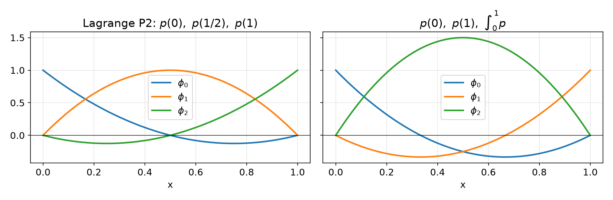
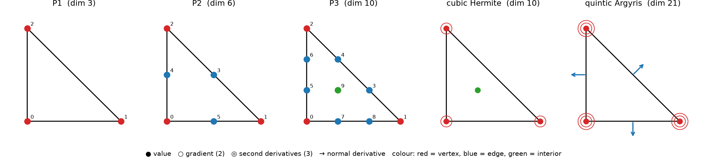
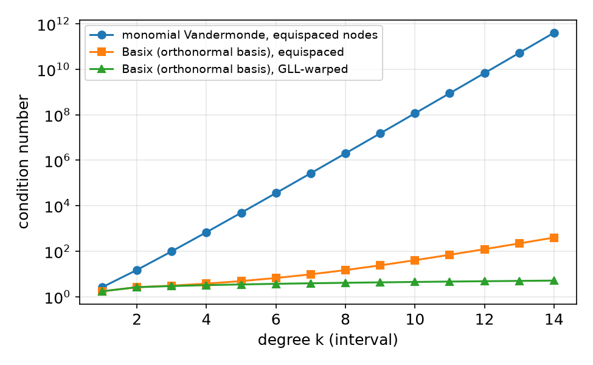
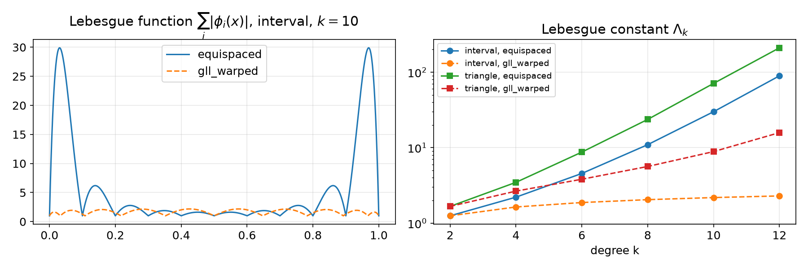
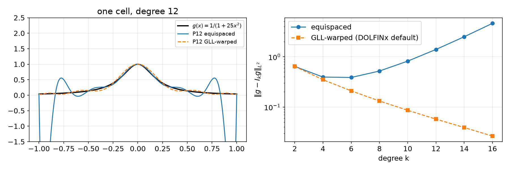

## Today

| Part | Topic | Time |
|---|---|:---:|
| **Quiz** | Week 1 material (closed-AI) | 10 min |
| **A** | Theory — Ciarlet's element, nodal basis, Vandermonde matrix, unisolvence, Hermite and Argyris | 70 min |
| **B** | Basix — creating, inspecting and tabulating elements | 40 min |
| **C** | Lagrange variants — Lebesgue constants, the Runge function in DOLFINx | 35 min |
| **D** | LLM pitfalls with elements · assignment | 15 min |

::: {.box}
Lab notebook: `W02_lab.ipynb` · Assignment: `W02_HW2.ipynb` (due before Week 3)
:::

## Week 1 in one slide

| | |
|---|---|
| Weak form | $\int_\Omega \nabla u_h\cdot\nabla v\,dx = \int_\Omega f v\,dx \quad \forall v\in \mathring V_h$ |
| Linear system | $K_{ij} = \int_\Omega \nabla\phi_j\cdot\nabla\phi_i\,dx$, assembled cell by cell |
| On each cell | $K^{(K)}_{ij} \approx \sum_q w_q\,\nabla\phi_j(X_q)\cdot\nabla\phi_i(X_q)\,|\det J_K|$ |

::: {.fragment}
Quadrature gave us $X_q, w_q$. **This week: where do the $\phi_i$ come from?**

- What exactly *is* a finite element? (Ciarlet)
- How is the basis computed, and when does it exist? (Vandermonde, unisolvence)
- How does Basix store and evaluate it? (`create_element`, `tabulate`)
- Where should the nodes be? (Lagrange variants)
:::

# Part A — Ciarlet's Finite Element

## §A1 The definition

::: {.callout-note title="Definition (Ciarlet, 1978) — Finite element"}
A finite element is a triple $(K, \mathcal{P}, \mathcal{N})$:

1. $K\subset\mathbb{R}^d$ — a bounded closed **cell** (interval, triangle, tetrahedron, …)
2. $\mathcal{P}$ — a finite-dimensional space of **shape functions** on $K$ (usually polynomials)
3. $\mathcal{N}=\{N_0,\dots,N_{n-1}\}$ — a **basis of the dual space** $\mathcal{P}'$: the **nodal variables** (DOFs)
:::

::: {.fragment}
Each $N_i:\mathcal{P}\to\mathbb{R}$ is a linear functional. Examples:

| Nodal variable | Formula | Used by |
|---|---|---|
| point evaluation | $N(p)=p(x_i)$ | Lagrange |
| derivative evaluation | $N(p)=\partial p/\partial x_j\,(x_i)$ | Hermite, Argyris |
| normal derivative | $N(p)=\nabla p(x_i)\cdot n$ | Argyris |
| integral moment | $N(p)=\int_K p\,q\,dx$ | integral DOFs, bubbles |
| normal component | $N(\mathbf p)=\mathbf p(x_i)\cdot n$ | Raviart–Thomas (Course II) |
:::

## §A2 The nodal basis

::: {.callout-note title="Definition — Nodal basis"}
The nodal basis $\{\phi_0,\dots,\phi_{n-1}\}$ of $\mathcal{P}$ is **dual** to $\mathcal{N}$:
$$N_i(\phi_j)=\delta_{ij}.$$
:::

::: {.fragment}
Consequence: every $p\in\mathcal{P}$ is reconstructed from its DOF values,
$$p=\sum_j N_j(p)\,\phi_j .$$
This is why the coefficient vector $\mathbf u$ in $K\mathbf u=\mathbf f$ holds **DOF values**.
:::

::: {.fragment}
**1D Lagrange, degree $k$:** $K=[a,b]$, $\mathcal{P}=\mathcal{P}_k$, $N_i(p)=p(x_i)$, $x_i=a+(b-a)\,i/k$:
$$\phi_i(x)=\prod_{j\ne i}\frac{x-x_j}{x_i-x_j}.$$
For other nodal variables there is no such formula. We need a general recipe.
:::

## §A3 The Vandermonde matrix

Pick **any** basis $\{\psi_0,\dots,\psi_{n-1}\}$ of $\mathcal{P}$ (for example monomials).

::: {.callout-note title="Definition — Vandermonde matrix"}
$$V_{ij}=N_j(\psi_i)$$
:::

::: {.callout-important title="Lemma — Basis transformation"}
Write $\phi_i=\sum_j \mu_{ij}\psi_j$. Then $\mu=V^{-1}$.
:::

::: {.fragment}
**Proof.**
$\delta_{ij}=N_j(\phi_i)=\sum_l\mu_{il}N_j(\psi_l)=\sum_l\mu_{il}V_{lj}=(\mu V)_{ij}$. $\square$
:::

::: {.fragment}
**Recipe:** choose $\psi$ → build $V$ → solve for $\mu$ → $\phi_i=\sum_j\mu_{ij}\psi_j$.
It works for **any** kind of nodal variable, as long as $V$ is invertible.
:::

## §A4 Worked example — two elements on $[0,1]$, same $\mathcal{P}_2$

::: {.columns}
::: {.column width="45%"}
$\psi=\{1,x,x^2\}$

**Lagrange:** $N=\{p(0),\,p(\tfrac12),\,p(1)\}$
$$V=\begin{bmatrix}1&1&1\\0&\tfrac12&1\\0&\tfrac14&1\end{bmatrix},\quad
\begin{aligned}\phi_0&=1-3x+2x^2\\ \phi_1&=4x-4x^2\\ \phi_2&=-x+2x^2\end{aligned}$$

**Integral DOF:** $N=\{p(0),\,p(1),\,\int_0^1p\}$
$$V=\begin{bmatrix}1&1&1\\0&1&\tfrac12\\0&1&\tfrac13\end{bmatrix},\quad
\begin{aligned}\phi_0&=1-4x+3x^2\\ \phi_1&=-2x+3x^2\\ \phi_2&=6x-6x^2\end{aligned}$$
:::
::: {.column width="55%"}
{width=100%}

Same space $\mathcal{P}_2$, **different** elements: the basis depends on $\mathcal N$.
Check: $\int_0^1\phi_2=1$, $\int_0^1\phi_0=\int_0^1\phi_1=0$.
:::
:::

## §A5 Unisolvence

When is $(K,\mathcal{P},\mathcal{N})$ a valid element? $\mathcal N$ must be a basis of $\mathcal P'$.

::: {.callout-important title="Lemma — Equivalent conditions (with $\dim\mathcal P=|\mathcal N|=n$)"}
1. $\mathcal N$ is a basis of $\mathcal P'$
2. the Vandermonde matrix $V$ is invertible
3. if $v\in\mathcal P$ and $N_i(v)=0$ for all $i$, then $v\equiv 0$
:::

::: {.fragment}
::: {.callout-note title="Definition — Unisolvence"}
If (3) holds, $\mathcal N$ **determines** $\mathcal P$; the element is **unisolvent**.
:::
:::

::: {.fragment}
- (2)⇔(3): $V^T\mathbf c=0$ means $N_j(\sum_i c_i\psi_i)=0$ for all $j$. A nonzero $\mathbf c$ gives a nonzero $v$ with all DOFs zero.
- Always check the count $|\mathcal N|=\dim\mathcal P$ first. Then condition (3) is usually the easiest to prove.
- Counterexample: P1 on a "triangle" whose three vertices are **collinear**. The linear function vanishing on that line has all DOFs zero, so the element is not unisolvent.
:::

## §A6 Proving unisolvence — 1D, and a tool for 2D

**1D Lagrange, degree $k$.** $v\in\mathcal P_k$ vanishes at $k+1$ distinct points ⇒ $v\equiv0$. $\square$

::: {.fragment}
In 2D a polynomial can vanish at infinitely many points without being zero. We need:

::: {.callout-important title="Lemma — Vanishing on a hyperplane"}
Let $p\in\mathcal P_k(\mathbb R^d)$, $k\ge1$, vanish on the hyperplane $\Pi_L=\{x: L(x)=0\}$ of a non-degenerate affine $L$.
Then $p=L\,q$ with $q\in\mathcal P_{k-1}$.
:::
:::

::: {.fragment}
**Strategy on a triangle** with edge lines $L_1,L_2,L_3=0$:

1. $p$ restricted to an edge is a 1D polynomial of degree $k$. If it vanishes at $k+1$ edge nodes, it vanishes on the whole edge line.
2. Factor out $L_1$, then $L_2$, then $L_3$.
3. What remains must vanish at the interior nodes. Use induction.
:::

## §A7 Lagrange elements on triangles

{width=100%}

::: {.columns}
::: {.column width="50%"}
::: {.callout-note title="Definition — P$k$ Lagrange element"}
$K$: triangle $z_1,z_2,z_3$; $\mathcal P=\mathcal P_k$, $\dim=\binom{k+2}{2}$; $N_{ij}(v)=v(x_{ij})$,
$x_{ij}=z_1+(z_2-z_1)\tfrac ik+(z_3-z_1)\tfrac jk$, $0\le j\le i\le k$
:::
Numbers in the figure = **Basix local DOF order**: vertices, then edges, then interior. Edge $i$ is **opposite** vertex $i$.
:::
::: {.column width="50%"}
| | vertex | edge | interior | total |
|---|:---:|:---:|:---:|:---:|
| P1 | 3 | 0 | 0 | 3 |
| P2 | 3 | 3 | 0 | 6 |
| P3 | 3 | 6 | 1 | 10 |
| P$k$ | 3 | $3(k-1)$ | $\binom{k-1}{2}$ | $\binom{k+2}{2}$ |
:::
:::

## §A8 Unisolvence of P1 and P2

**P1.** Let $p\in\mathcal P_1$ vanish at $z_1,z_2,z_3$.

- On the line $\Pi_1$ through $z_2,z_3$, $p$ is linear and vanishes twice, so $p=0$ on $\Pi_1$. Hence $p=c\,L_1$.
- $0=p(z_1)=c\,L_1(z_1)$, and $L_1(z_1)\ne0$, so $c=0$. $\square$

::: {.fragment}
**P2.** Let $p\in\mathcal P_2$ vanish at the 3 vertices and 3 edge midpoints.

1. On edge 1, $p$ is quadratic with 3 zeros, so $p=L_1Q_1$ with $Q_1\in\mathcal P_1$.
2. On edge 2, $L_1\ne0$ except at one vertex. So $Q_1$ vanishes at 2 points of $\Pi_2$, $Q_1=0$ on $\Pi_2$, and $p=c\,L_1L_2$.
3. At the midpoint of edge 3, $L_1L_2\ne0$, so $c=0$. $\square$
:::

::: {.fragment}
**P$k$, $k\ge4$** — induction in steps of 3. Factor out $L_1L_2L_3$; the rest is $Q_3\in\mathcal P_{k-3}$.
$Q_3$ vanishes on the interior nodes, which form a P$(k-3)$ lattice. **Base cases** $k=1,2,3$. You will do **P3 in HW2**.
:::

## §A9 Beyond point values — Hermite and Argyris

::: {.columns}
::: {.column width="50%"}
::: {.callout-note title="Cubic Hermite (triangle)"}
$\mathcal P_3$, $\dim=10$:

- value at the 3 vertices (3)
- gradient at the 3 vertices (6)
- value at the centroid (1)
:::
:::
::: {.column width="50%"}
::: {.callout-note title="Quintic Argyris (triangle)"}
$\mathcal P_5$, $\dim=21$:

- value at the 3 vertices (3)
- gradient at the 3 vertices (6)
- all second derivatives at the 3 vertices (9)
- normal derivative at the 3 edge midpoints (3)
:::
:::
:::

::: {.fragment}
- Both are unisolvent. The proof uses the same tool, with derivative conditions forcing **double** zeros on edges.
- Why would anyone want derivative DOFs? Fourth-order problems (plates, Cahn–Hilliard in primal form) need $C^1$ continuity across cells.
- **Which of the two actually gives a $C^1$ space?** It comes down to counting conditions along one edge. You will check it numerically in **HW2 Q4**.
:::

# Part B — Elements in Basix

## §B1 Creating and inspecting an element

```python
import basix
P, T, LV = basix.ElementFamily.P, basix.CellType.triangle, basix.LagrangeVariant
e = basix.create_element(P, T, 2, LV.equispaced)
e.dim              # 6
e.points           # [[0,0],[1,0],[0,1],[0.5,0.5],[0,0.5],[0.5,0]]  ← nodes, Basix order
e.entity_dofs      # [[[0],[1],[2]], [[3],[4],[5]], [[]]]           ← by vertex / edge / cell
```

::: {.fragment}
| Fact (Basix 0.11) | Consequence |
|---|---|
| Degree ≥ 3 Lagrange **needs a variant** | `create_element(P, T, 3)` → `RuntimeError: ... need to be given a variant` |
| Degree ≤ 2 without a variant | silently uses `gll_warped`, which equals equispaced for $k\le2$ |
| DOLFINx `("Lagrange", k)` | uses `gll_warped` for **every** $k$ |
| Vertices come first | P2 on the interval: `points` = `[0, 1, 0.5]`, **not** `[0, 0.5, 1]` |
:::

::: {.fragment}
From a DOLFINx space: `V.element.basix_element`, or `V.ufl_element()` for the UFL wrapper.
:::

## §B2 Tabulation

$T_{qj}=\phi_j(X_q)$ and its derivatives, at any set of reference points:

```python
pts, wts = basix.make_quadrature(T, 4)        # 6 points
tab = e.tabulate(1, pts)                       # derivatives up to order 1
tab.shape                                      # (3, 6, 6, 1)
phi, dphi_dx, dphi_dy = tab[0, :, :, 0], tab[1, :, :, 0], tab[2, :, :, 0]
```

::: {.fragment}
| Axis | Size | Meaning |
|---|---|---|
| 0 | $\binom{n_d+d}{d}$ | derivative: $1$; $\partial_x,\partial_y$; $\partial_{xx},\partial_{xy},\partial_{yy}$; … |
| 1 | $n_{pts}$ | point $X_q$ |
| 2 | $n_{dofs}$ | basis function $\phi_j$ |
| 3 | value size | 1 for scalar elements |
:::

::: {.fragment}
**Two free sanity checks** for any Lagrange element: $\sum_j\phi_j\equiv1$ and $\sum_j\nabla\phi_j\equiv0$ (constants are in $\mathcal P$).
For P3 at 4000 lattice points: $\max|\sum_j\phi_j-1| = 1.0\times10^{-15}$.
:::

## §B3 What Basix stores — and why not monomials

::: {.columns}
::: {.column width="52%"}
Basix stores $\phi_i=\sum_j C_{ij}P_j$, where $\{P_j\}$ is an **orthonormal** polynomial basis on the reference cell (Legendre on intervals, Dubiner on triangles).

```python
C = e.coefficient_matrix                  # (6, 6)
Pj = basix.tabulate_polynomials(
    basix.PolynomialType.legendre, T, 2, pts)
np.abs(e.tabulate(0, pts)[0, :, :, 0] - (C @ Pj).T).max()   # 0.0
```

`coefficient_matrix` is **not** $V^{-1}$ in the monomial basis. Several older tutorials say it is.
:::
::: {.column width="48%"}
{width=100%}

| $k$ | monomial $V$ | Basix, GLL |
|:---:|:---:|:---:|
| 4 | $6.9\times10^{2}$ | 3.2 |
| 8 | $2.0\times10^{6}$ | 4.1 |
| 12 | $6.8\times10^{9}$ | 4.8 |
:::
:::

## §B4 Math → Basix

| Concept | Theory | Basix 0.11 |
|---|---|---|
| cell $K$ | reference cell | `basix.CellType.triangle` |
| element $(K,\mathcal P,\mathcal N)$ | Ciarlet triple | `basix.create_element(family, cell, k, variant)` |
| $\dim\mathcal P$ | $\binom{k+2}{2}$ | `e.dim` |
| nodes $x_i$ (Lagrange) | $N_i(p)=p(x_i)$ | `e.points` |
| geometric decomposition | DOFs per vertex/edge/cell | `e.entity_dofs` |
| $\mu=V^{-1}$ | basis coefficients | `e.coefficient_matrix` (orthonormal basis!) |
| $\phi_j(X_q)$, $\nabla\phi_j(X_q)$ | tabulation | `e.tabulate(n, pts)` → `(·, npts, ndofs, vs)` |
| Hermite | value + gradient DOFs | `basix.create_element(basix.ElementFamily.Hermite, T, 3)` |
| in a DOLFINx space | | `basix.ufl.element(P, msh.basix_cell(), k, variant)` |

# Part C — Where Should the Nodes Be?

## §C1 The Lebesgue constant

Interpolation $I_k g=\sum_i g(x_i)\phi_i$. For any $p\in\mathcal P_k$, $I_kp=p$, so
$$\|g-I_kg\|_\infty\le\big(1+\Lambda_k\big)\inf_{p\in\mathcal P_k}\|g-p\|_\infty,\qquad
\Lambda_k=\max_{x\in K}\sum_i|\phi_i(x)|.$$

::: {.columns}
::: {.column width="62%"}
{width=100%}
:::
::: {.column width="38%"}
| $k$ | interval equi | interval GLL | triangle equi | triangle GLL |
|:---:|:---:|:---:|:---:|:---:|
| 4 | 2.2 | 1.6 | 3.5 | 2.7 |
| 8 | 10.9 | 2.0 | 23.6 | 5.6 |
| 12 | 89.3 | 2.3 | 210 | 15.8 |

*(triangle: max over a 60-division lattice)*
:::
:::

::: {.fragment}
Equispaced nodes: $\Lambda_k$ grows **exponentially**. GLL-warped nodes: $\Lambda_k$ grows **slowly** (1.25 → 2.29 from $k=2$ to $12$ on the interval).
:::

## §C2 Demo — the Runge function in DOLFINx

```python
import basix, basix.ufl
msh = mesh.create_interval(comm, 1, [-1.0, 1.0])           # ONE cell, high degree
el = basix.ufl.element(basix.ElementFamily.P, msh.basix_cell(), 12, basix.LagrangeVariant.equispaced)
V = fem.functionspace(msh, el)
u = fem.Function(V); u.interpolate(lambda x: 1 / (1 + 25 * x[0]**2))
```

::: {.columns}
::: {.column width="65%"}
{width=100%}
:::
::: {.column width="35%"}
| $k$ | equispaced | GLL-warped |
|:---:|:---:|:---:|
| 4 | 0.40 | 0.35 |
| 8 | 0.52 | 0.13 |
| 12 | 1.40 | 0.058 |
| 16 | 4.63 | 0.027 |

$L^2$ interpolation error
:::
:::

## §C3 Does this matter for you?

- **P1, P2:** all variants coincide. Nothing changes.
- **P3–P5** (typical high-order work): the differences are small but real. The default `gll_warped` is the safe choice.
- **$p$-methods, spectral elements, $k\ge 6$:** the node choice matters a great deal, for interpolation *and* for the conditioning of the matrices.
- When reading old code: legacy FEniCS used **equispaced** nodes. The same "P3" can give slightly different numbers in DOLFINx 0.11.

::: {.fragment}
> You can see the variant in `V.ufl_element().lagrange_variant`. Print it whenever results must be reproduced exactly.
:::

# Part D — LLMs and Finite Elements · Assignment

## §D1 Where LLM-generated element code goes wrong

| Kind | Typical examples | Detection |
|---|---|---|
| **Stale API** | Lagrange elements of degree ≥ 3 created without a variant; `ufl.FiniteElement` / `ufl.VectorElement` (removed from UFL); `"CG"` family name (deprecated) | the error message + API sheet |
| **Shape confusion** | dropping or misreading an axis of `tabulate` output; `(npts, ndofs)` vs `(ndofs, npts)` | print shapes; $\sum_j\phi_j=1$ |
| **Ordering assumptions** | assuming nodes in lexicographic order (`[0, 0.5, 1]`); assuming edge $i$ joins vertices $i$ and $i+1$ | compare with `e.points` / `e.entity_dofs` |
| **Wrong meaning** | treating `coefficient_matrix` as the monomial $V^{-1}$; trusting element metadata or a docstring without testing it | evaluate the claim at points: compare with `tabulate` |

::: {.fragment}
**The universal check for element code:** $N_i(\phi_j)=\delta_{ij}$, evaluated **numerically** with your own nodal variables.
:::

## Assignment — HW2, due before the Week 3 lecture

::: {.columns}
::: {.column width="55%"}
### HW2 — Unisolvence and nodal bases (100)
- **Q1** proofs: an integral-DOF element, P3 on a triangle, 1D cubic Hermite (25)
- **Q2** your own Vandermonde code for P$k$ on a triangle, compared with Basix; basis plots; what happens at high degree (25)
- **Q3** when unisolvence fails: six nodes on a circle (20)
- **Q4** LLM-assisted: the cubic Hermite triangle and the question of $C^1$ continuity (30)
:::
::: {.column width="45%"}
::: {.box}
Submit the executed `.ipynb` (restart & run all) with the AI-usage log.

**Reminder:** an error in a `%%fenicsx` cell does **not** stop *Run all*. Read every output before you submit.
:::
:::
:::

## Summary

| Concept | Key idea | Basix / DOLFINx |
|---|---|---|
| Ciarlet element | $(K,\mathcal P,\mathcal N)$, $\mathcal N$ a basis of $\mathcal P'$ | `create_element(family, cell, k, variant)` |
| Nodal basis | $N_i(\phi_j)=\delta_{ij}$ | `tabulate` |
| Vandermonde | $V_{ij}=N_j(\psi_i)$, $\mu=V^{-1}$ | `coefficient_matrix` (orthonormal $\psi$) |
| Unisolvence | $N_i(v)=0\ \forall i\Rightarrow v=0$ | $V$ invertible |
| Lagrange P$k$ | vertex, edge, interior nodes | `points`, `entity_dofs` |
| Variants | node placement controls $\Lambda_k$ | `LagrangeVariant.gll_warped` (default) |

::: {.fragment}
### Next week — from local to global
Geometric decomposition, $C^0$/$C^1$ continuity, DG spaces; mesh topology and the DOF map in DOLFINx.
:::
