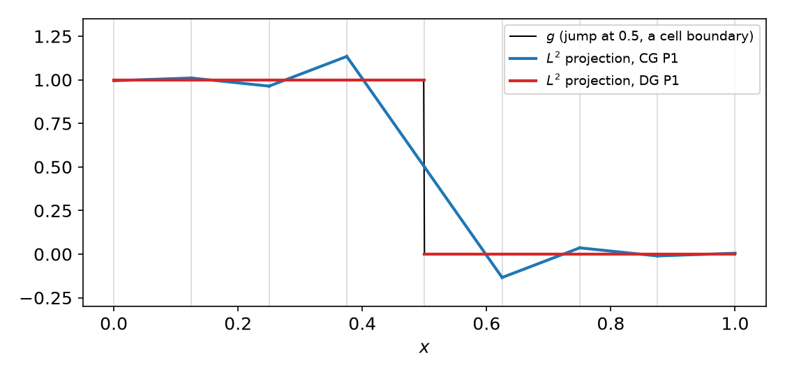
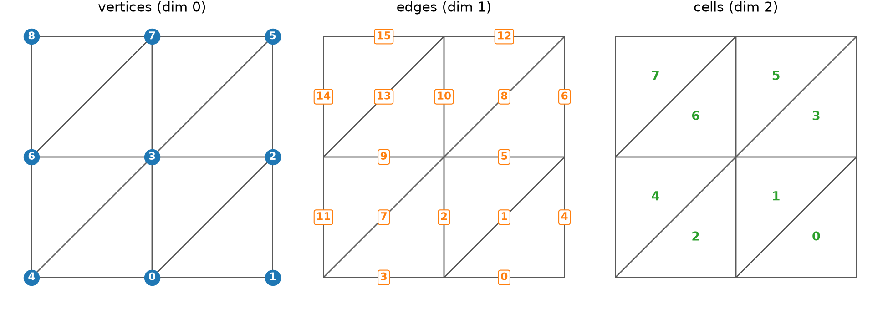
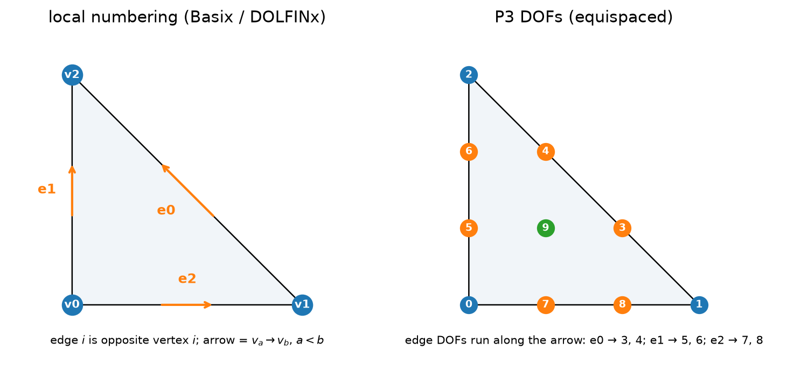
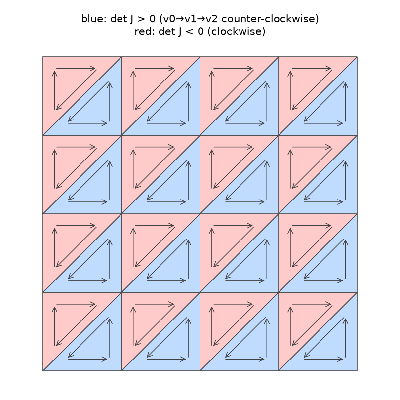
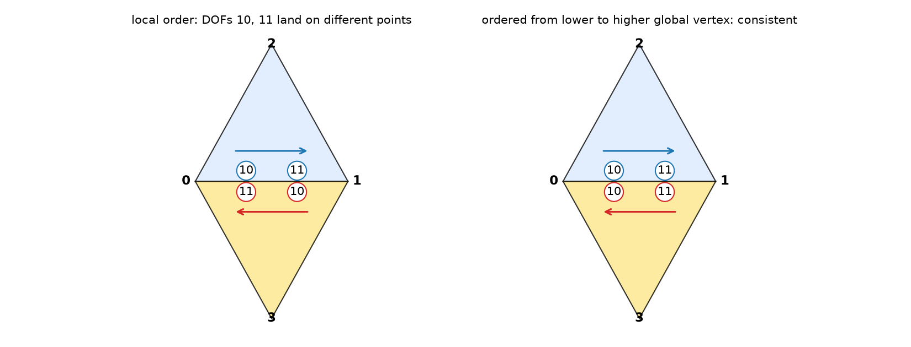
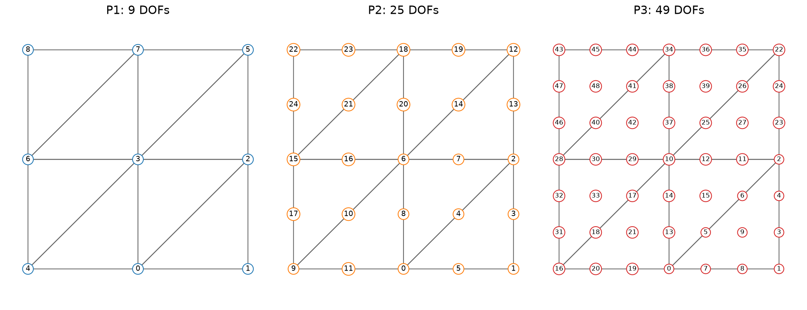
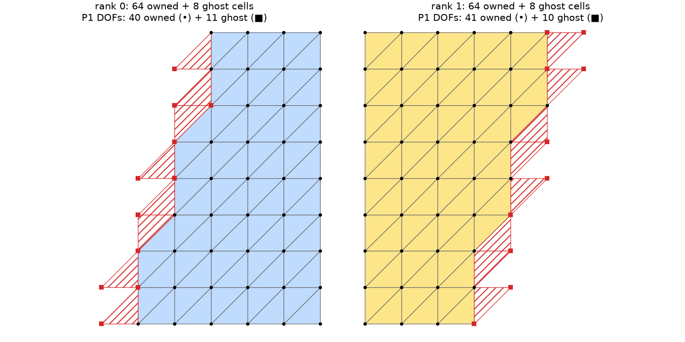

## Today

| Part | Topic | Time |
|---|---|:---:|
| **Quiz** | Week 2 material (closed-AI) | 10 min |
| **A** | Theory — gluing elements: continuity lemma, geometric decomposition, $C^0$/$C^1$, DG spaces | 60 min |
| **B** | Mesh topology in DOLFINx — entities, adjacency, geometry, the sign of $\det J$ | 40 min |
| **C** | The DOF map — cell-node map, edge orientation, vector/mixed spaces, parallel numbering | 45 min |
| **D** | LLM pitfalls with meshes and DOF maps · assignment | 15 min |

::: {.box}
Lab notebook: `W03_lab.ipynb` · Assignment: `W03_HW3.ipynb` (due before Week 4)
:::

## Week 2 in one slide

| | |
|---|---|
| Ciarlet element | $(K,\mathcal P,\mathcal N)$ with $\mathcal N$ a basis of $\mathcal P'$ |
| Nodal basis | $N_i(\phi_j)=\delta_{ij}$, computed from $V_{ij}=N_j(\psi_i)$ |
| Unisolvence | $N_i(v)=0\ \forall i \Rightarrow v\equiv0$ |
| Basix | `create_element`, `tabulate`, `points`, **`entity_dofs`** |

::: {.fragment}
Everything so far lives on **one** reference cell. **This week: how do we glue cells into a global space?**

- When is the glued function continuous ($C^0$)? When is it $C^1$? (geometric decomposition)
- What if we do not glue at all? (DG spaces)
- How does DOLFINx describe the mesh? (topology, geometry)
- How are global DOF numbers assigned, and what can go wrong? (cell-node map, orientation)
:::

# Part A — From Local Elements to a Global Space

## §A1 The gluing problem

On each cell $K$ we have an element $(K,\mathcal P_K,\mathcal N_K)$. A **global** function is defined cell by cell:
$$u|_K=\sum_i u_{K,i}\,\phi_{K,i}\qquad\text{for every } K\in\mathcal T.$$
Which coefficients must agree between neighboring cells so that $u$ is continuous?

::: {.fragment}
::: {.callout-important title="Lemma — Continuity (triangles)"}
Let $u|_K$ be a polynomial on every cell. Then $u\in C^m(\Omega)$ if and only if

1. at every **vertex** $z$, all derivatives of order $\le m$ of $u|_{K}$ agree for all cells $K\ni z$, and
2. on every **interior edge** $e=K_1\cap K_2$, all derivatives of order $\le m$ of $u|_{K_1}$ and $u|_{K_2}$ agree on $e$.
:::
Inside a cell $u$ is a polynomial, hence smooth. Only the **interfaces** matter.
:::

## §A2 Mesh entities and local geometric decomposition

A triangle has 3 vertices (dim 0), 3 edges (dim 1) and 1 cell (dim 2). The mesh has global vertices, edges and cells.

::: {.callout-note title="Definition — Local geometric decomposition"}
Each nodal variable $N_i$ is **associated with one entity** $w$ of $K$ (vertex, edge or cell),
such that $N_i(f)$ depends only on $f$ and its derivatives **on $w$**.
:::

::: {.fragment}
| Element | vertex DOFs | edge DOFs | interior DOFs | total |
|---|:---:|:---:|:---:|:---:|
| P1 | 1 each | — | — | 3 |
| P2 | 1 each | 1 each | — | 6 |
| P3 | 1 each | 2 each | 1 | 10 |
| Hermite (cubic) | 3 each ($f$, $\nabla f$) | — | 1 | 10 |
| Argyris (quintic) | 6 each ($f,\nabla f,\nabla^2 f$) | 1 each ($\partial_n f$) | — | 21 |

Basix P3: `entity_dofs = [[[0],[1],[2]], [[3,4],[5,6],[7,8]], [[9]]]` (vertices, edges, cell).
:::

::: {.fragment}
`entity_dofs` **is** the geometric decomposition — you met it last week.
:::

## §A3 $C^0$ geometric decomposition

::: {.callout-note title="Definition — $C^0$ decomposition"}
For every entity $w$ of $K$, the nodes associated with the **closure** $\bar w$ (the entity and its sub-entities)
determine $f|_w$ uniquely, i.e. they form a unisolvent set for $\mathcal P|_w$.
:::

::: {.fragment}
::: {.callout-important title="Theorem — Lagrange P$k$ is $C^0$"}
For P$k$ Lagrange, the closure of every edge carries $k+1$ nodes (2 vertices + $k-1$ edge nodes) and $f|_e$ is a 1D polynomial of degree $k$.
:::
**Proof.** Let $u\in\mathcal P_k$ vanish at the $k+1$ closure nodes of $e$. Then $u|_e$ is a degree-$k$ polynomial in one variable with $k+1$ distinct zeros,
so $u|_e\equiv0$ (1D unisolvence, Week 2). The vertex case is trivial. $\square$
:::

::: {.fragment}
**Consequence.** If two neighbors **share** the closure DOFs of their common edge, their traces on that edge are the **same** polynomial → $u$ is continuous.
Sharing is exactly what the global numbering must do.
:::

## §A4 $C^1$ geometric decomposition — Hermite vs Argyris

$C^1$ also needs $\partial_n u$ to match along every edge. Along an edge, $\partial_n u$ of a degree-$k$ polynomial is a 1D polynomial of degree $k-1$: it needs **$k$ conditions**.

::: {.fragment}
| | degree | $\partial_n u|_e$ degree | conditions needed | from **shared** DOFs | $C^1$? |
|---|:---:|:---:|:---:|:---:|:---:|
| Cubic Hermite | 3 | 2 | 3 | 2 | **no** |
| Quintic Argyris | 5 | 4 | 5 | 2 + 2 + 1 = 5 | **yes** |

Hermite: $\partial_n u$ at the two end vertices (from $\nabla f$). Argyris: $\partial_n u$ at both ends ($\nabla f$), $\partial_t\partial_n u$ at both ends ($\nabla^2 f$), $\partial_n u$ at the edge midpoint.
:::

::: {.fragment}
You verified the Hermite case numerically in HW2 Q4: the centroid bubble $27\lambda_0\lambda_1\lambda_2$ has a nonzero normal derivative on every edge.
$C^1$ elements are rare in practice; fourth-order problems are usually solved with mixed or C⁰ interior-penalty formulations instead.
:::

## §A5 From local to global

::: {.callout-note title="Definition — Global geometric decomposition"}
For each **global** entity $w$ shared by cells $K_1,\dots,K_{n_w}$: every $K_j$ has the same number $M_w$ of nodes on $w$,
and they can be enumerated so that $N^{w}_{1,i}(u|_{K_1})=\dots=N^{w}_{n_w,i}(u|_{K_{n_w}})$ for smooth $u$, $i=1,\dots,M_w$.
:::

::: {.fragment}
::: {.callout-important title="Lemma"}
A space built by giving all cells around $w$ the **same** global DOFs for $w$ is $C^m$ if the local decomposition is $C^m$.
:::
:::

::: {.fragment}
**Counting.** Each global entity contributes its DOFs **once**:
$$\dim V_h=\sum_{d=0}^{2} n_d\,m_d,\qquad\text{P}k:\quad \dim V_h = n_V + (k-1)\,n_E + \tfrac{(k-1)(k-2)}{2}\,n_T .$$
For the $N\times N$ "right" mesh: $n_V=(N+1)^2$, $n_E=3N^2+2N$, $n_T=2N^2$ ⇒ $\dim V_h=(kN+1)^2$.
Euler's formula $n_V-n_E+n_T=1$ (any triangulation of a simply connected polygon) is a useful check.
:::

## §A6 Discontinuous (DG) spaces

::: {.callout-note title="Definition — Discontinuous space"}
$V_h^{\rm DG}=\{u:\ u|_K\in\mathcal P_k(K)\ \ \forall K\in\mathcal T\}$ — no continuity constraints. Every DOF belongs to the **cell** entity.
:::

::: {.columns}
::: {.column width="52%"}
{width="100%"}
:::
::: {.column width="48%"}
| on 8 cells | DOFs | $L^2$ error |
|---|:---:|:---:|
| CG P1 | 9 | 0.134 |
| DG P1 | 16 | 0.000 |

$\dim V_h^{\rm DG}=n_T\cdot\dim\mathcal P_k$. A jump **at a cell boundary** is represented exactly; CG overshoots by 13 %.

**Uses:** DG0 for piecewise-constant material data; DG methods for advection; post-processing of fluxes; H(div)-DG (Week 15).
:::
:::

# Part B — Mesh Topology in DOLFINx

## §B1 Entities and their numbers

```python
msh = mesh.create_unit_square(MPI.COMM_WORLD, 2, 2)
for d in range(3):
    msh.topology.create_entities(d)                 # edges are not built until asked for
    print(d, msh.topology.index_map(d).size_local)  # → 9, 16, 8
```

{width="88%" fig-align="center"}

::: {.fragment}
| $N\times N$ mesh | vertices | edges | cells | $V-E+F$ |
|---|:---:|:---:|:---:|:---:|
| 4×4 triangles (right) | 25 | 56 | 32 | 1 |
| 4×4 triangles (crossed) | 41 | 104 | 64 | 1 |
| 4×4 quadrilaterals | 25 | 40 | 16 | 1 |
:::

## §B2 Adjacency and the local numbering convention

$\mathrm{Adj}_{d_1,d_2}(i)$ = the $d_2$-entities adjacent to entity $(d_1,i)$. In DOLFINx: `topology.connectivity(d1, d2)`.

```python
msh.topology.create_connectivity(2, 1)              # must be created first
c2e = msh.topology.connectivity(2, 1)               # AdjacencyList: .links(i), .array, .offsets
c2v = msh.topology.connectivity(2, 0)               # cell → vertex exists from the start
c2v.links(0), c2e.links(0)                          # → [0, 1, 2], [4, 1, 0]
```

::: {.columns}
::: {.column width="55%"}
{width="100%"}
:::
::: {.column width="45%"}
- Local **edge $i$ is opposite local vertex $i$**: edges $(v_1v_2),(v_0v_2),(v_0v_1)$ — checked for all cells of the 2×2 mesh.
- `c2e.links(c)[i]` is the global number of local edge $i$.
- Calling `connectivity(2, 1)` before `create_connectivity(2, 1)` → `RuntimeError: Connectivity between dimension 2 and 1 has not been computed`.
- Upward adjacency ($1\to2$): edges with one cell are on the boundary. 3×3 mesh: 33 edges = 21 interior + 12 boundary.
:::
:::

## §B3 Geometry vs topology — and the sign of $\det J$

**Topology** = who is connected to whom. **Geometry** = where the nodes are.

```python
x  = msh.geometry.x                # (n_nodes, 3) — always 3 columns, z = 0 in 2D
gd = msh.geometry.dofmaps[0]       # (n_cells, 3) NumPy array: geometry nodes of each cell
P  = x[gd[c], :2]                  # vertex coordinates of cell c (gd is NumPy: index with [c], not .links(c))
J  = np.column_stack([P[1] - P[0], P[2] - P[0]])
```
`msh.geometry.dofmap` still works in 0.11 but prints a **`DeprecationWarning`**: use `dofmaps[0]`.

::: {.columns}
::: {.column width="30%"}
{width="100%"}
:::
::: {.column width="70%"}
| 4×4 mesh | cells with $\det J<0$ |
|---|:---:|
| `right` | 16 / 32 |
| `left` | 16 / 32 |
| `crossed` | 32 / 64 |

- DOLFINx does **not** orient cells counter-clockwise. Half of the cells have $\det J<0$.
- $\sum\det J/2 = 0$, but $\sum|\det J|/2=1$ (the area).
- Assembly uses $|\det J|$, so this is harmless — **unless your own code assumes $\det J>0$**.
:::
:::

## §B4 Boundaries

```python
fdim = msh.topology.dim - 1
msh.topology.create_connectivity(fdim, msh.topology.dim)   # facet → cell; required
bnd = mesh.exterior_facet_indices(msh.topology)              # facets with exactly one cell
```

- Without `create_connectivity(fdim, tdim)`: `RuntimeError: Facet to cell connectivity has not been computed.`
- 3×3 mesh: 12 boundary facets ($4N$). Geometric selection (`locate_entities_boundary` with a marker function) comes in Week 6.

::: {.fragment}
| Textbook | DOLFINx 0.11 |
|---|---|
| number of entities of dim $d$ | `topology.index_map(d).size_local` (after `create_entities(d)`) |
| $\mathrm{Adj}_{d_1,d_2}(i)$ | `create_connectivity(d1, d2)`; `connectivity(d1, d2).links(i)` |
| vertex coordinates | `geometry.x[:, :gdim]` |
| coordinates of cell $c$ | `geometry.x[geometry.dofmaps[0][c]]` |
| boundary facets | `exterior_facet_indices(topology)` |
:::

# Part C — The DOF Map

## §C1 The cell-node map

::: {.callout-note title="Definition — Cell-node map"}
$M(c,i)$ = global number of the $i$-th local DOF of cell $c$. Assembly uses only $M$: $\;K_{M(c,i),M(c,j)} \mathrel{+}= K^{(c)}_{ij}$.
:::

::: {.fragment}
**Construction (P$k$ on triangles).** Number the global entities, then give each entity its DOFs **once**:

1. vertex $v$ → DOF $v$
2. edge $e$ → DOFs $n_V+(k-1)e,\ \dots,\ n_V+(k-1)e+k-2$
3. cell $c$ → interior DOFs after all edges

and fill $M(c,\cdot)$ by walking over the local entities of $c$ in **Basix order** (`entity_dofs`), using `c2v` and `c2e`.
:::

::: {.fragment}
For P1 and P2 this is all. For P3 there is a catch.
:::

## §C2 The edge-orientation problem ($k\ge3$)

An edge with two DOFs: local DOF 3 lies at $1/3$ of the way **along the local edge** from its lower to its higher **local** vertex.
Two neighbors may run along the shared edge in **opposite** directions.

{width="78%" fig-align="center"}

::: {.fragment}
**Fix:** order the DOFs of a global edge from its lower to its higher **global** vertex. In a cell where the local direction disagrees, reverse them.
:::

## §C2 Orientation — what DOLFINx does

```python
V = fem.functionspace(msh, ("Lagrange", 3))       # 2×2 mesh
V.dofmap.cell_dofs(0)   # → [0, 1, 2,  3, 4,   5, 6,   7, 8,  9]
V.dofmap.cell_dofs(1)   # → [0, 10, 2, 12, 11, 5, 6,  13, 14, 15]   ← edge 0 of cell 1: reversed
```

| Element | Basix `dof_transformations_are_identity` | `are_permutations` | `V.element.needs_dof_transformations` |
|---|:---:|:---:|:---:|
| P2 | True | True | False |
| P3, P4 | **False** | True | False |
| N1curl (Nédélec) | — | — | **True** |

- For Lagrange the fix is a **permutation**, and DOLFINx bakes it into `cell_dofs`. You never see it.
- For H(curl)/H(div) elements it also involves sign changes, applied during assembly (Course I, Week 15).
- Built-in meshes happen to traverse shared edges consistently; meshes read from files (Gmsh) in general do **not**.
  A cell-node map that ignores orientation looks correct on `create_unit_square` and fails on real meshes.

## §C3 The DOLFINx dofmap

{width="80%" fig-align="center"}

```python
dm = V.dofmap
dm.dof_layout.entity_dofs(1, 0)       # local DOFs on local edge 0   (num_entity_dofs was removed in 0.11)
dm.cell_dofs(c)                       # M(c, :)      dm.list → (n_cells, ndofs_per_cell) array
dm.index_map.size_global              # number of (blocked) DOFs
V.tabulate_dof_coordinates()          # (ndofs, 3): where each DOF sits
```

::: {.fragment}
| 4×4 mesh | $k=1$ | $k=2$ | $k=3$ | $k=4$ |
|---|:---:|:---:|:---:|:---:|
| CG: $(4k+1)^2$ | 25 | 81 | 169 | 289 |
| DG: $32\cdot\frac{(k+1)(k+2)}{2}$ | 96 | 192 | 320 | 480 |
:::

## §C4 Vector and mixed spaces

```python
Vv = fem.functionspace(msh, ("Lagrange", 2, (2,)))          # vector P2
Vv.dofmap.index_map.size_global, Vv.dofmap.index_map_bs     # → 81, 2   →  162 scalar DOFs
```
**`size_global` counts blocks (nodes), not scalar DOFs.** Multiply by `index_map_bs`.

::: {.fragment}
```python
P2v = basix.ufl.element("Lagrange", "triangle", 2, shape=(2,))
P1  = basix.ufl.element("Lagrange", "triangle", 1)
W   = fem.functionspace(msh, basix.ufl.mixed_element([P2v, P1]))   # Taylor–Hood
W.dofmap.index_map.size_global          # → 187 = 162 + 25   (bs = 1)
W0, maps0 = W.sub(0).collapse()         # maps0: list of arrays — W0 DOF i is W DOF maps0[0][i]
```

| mesh | velocity (P2²) | pressure (P1) | total |
|---|:---:|:---:|:---:|
| 4×4 | 162 | 25 | 187 |
| 8×8 | 578 | 81 | 659 |

Velocity and pressure DOFs are **interleaved** in $W$; `collapse()` gives the separate space and the index map back into $W$.
:::

## §C5 Parallel: owned and ghost DOFs

{width="62%" fig-align="center"}

- Each rank **owns** some cells and DOFs and keeps **ghost** copies of its neighbors' DOFs (needed to assemble its own cells).
- `index_map.size_local` (owned) · `num_ghosts` · `size_global` = $\sum_{\rm ranks}$ `size_local`. Local numbering: owned first, then ghosts.
- The partition depends on the partitioner and the number of ranks: **never** hard-code local counts.

## §C6 Math → DOLFINx

| Concept | Math | DOLFINx 0.11 |
|---|---|---|
| Geometric decomposition | $N_i\leftrightarrow$ entity | `basix_element.entity_dofs`, `dofmap.dof_layout.entity_dofs(d, i)` |
| Global space | $V_h$, $\dim V_h=\sum n_d m_d$ | `fem.functionspace(msh, ("Lagrange", k))` |
| DG space | no sharing | `("DG", k)` or `basix.ufl.element(..., discontinuous=True)` |
| Cell-node map | $M(c,i)$ | `V.dofmap.cell_dofs(c)[i]`, `V.dofmap.list` |
| DOF positions | Lagrange nodes | `V.tabulate_dof_coordinates()` |
| Vector DOF count | $d\cdot\dim V_h$ | `size_global * index_map_bs` |
| Mixed sub-space | $W=V\times Q$ | `W.sub(i).collapse()` → `(space, [map])` |
| Parallel | owned + ghost | `index_map.size_local`, `num_ghosts`, `size_global` |

# Part D — LLMs, Meshes and DOF Maps · Assignment

## §D1 Where LLM-generated mesh/DOF code goes wrong

| Kind | What it looks like | Detection |
|---|---|---|
| **Stale or deprecated API** | attributes that were renamed or removed between DOLFINx versions | warnings in the output; the API sheet |
| **Wrong data structure** | treating a NumPy array as an `AdjacencyList` or the reverse | `type(...)`; read the error message |
| **Missing setup** | using an adjacency before it has been created | `RuntimeError` naming the missing connectivity |
| **Counting** | blocks vs scalar DOFs; local vs global counts | compare with $\dim V_h$ by hand; run with `-np 2` |
| **Geometric assumptions** | assuming an ordering or orientation of cell vertices that DOLFINx does not guarantee | a check with a known answer (total area = 1) |

::: {.fragment}
**Universal checks:** Euler's formula, $\dim V_h$ by hand, total area, and **serial = parallel**.
:::

## Assignment — HW3, due before the Week 4 lecture

::: {.columns}
::: {.column width="55%"}
### HW3 — Implement a cell-node map (100)
- **Q1** proofs: $C^0$ continuity of global P$k$; the dimension formula; why orientation matters only for $k\ge3$ (20)
- **Q2** your own edge numbering and cell-node map for P1–P3 on a mesh with arbitrary local vertex order; verification against DOLFINx (40)
- **Q3** CG vs DG and the parallel index map (15)
- **Q4** LLM-generated mesh code with planted bugs: find, explain, fix (25)
:::
::: {.column width="45%"}
::: {.box}
Submit the executed `.ipynb` (restart & run all) with the AI-usage log.

**Reminder:** an error in a `%%fenicsx` cell does **not** stop *Run all*. Read every output before you submit.
:::
:::
:::

## Summary

| Concept | Key idea | DOLFINx |
|---|---|---|
| Continuity lemma | only vertices and edges matter | — |
| Geometric decomposition | each DOF ↔ one entity | `entity_dofs` |
| $C^0$ / $C^1$ | closure DOFs determine $u|_w$ (and $\partial_n u|_w$) | Lagrange: $C^0$; Argyris: $C^1$; Hermite: not $C^1$ |
| DG | no sharing, $\dim=n_T\dim\mathcal P_k$ | `("DG", k)` |
| Topology / geometry | adjacency vs coordinates; $\det J$ of either sign | `connectivity`, `geometry.dofmaps[0]` |
| Cell-node map | shared entity ⇒ shared DOF; orient edges for $k\ge3$ | `dofmap.cell_dofs`, `index_map`, `index_map_bs` |

::: {.fragment}
### Next week — interpolation
Local and global interpolation operators, $H^k$ norms, averaged Taylor polynomials, scaling; `fem.Function`, `interpolate`, and $L^2$/$H^1$ errors in DOLFINx.
:::
