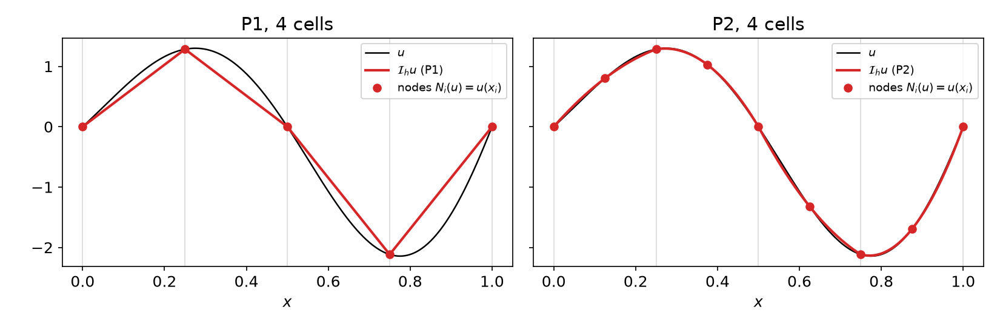
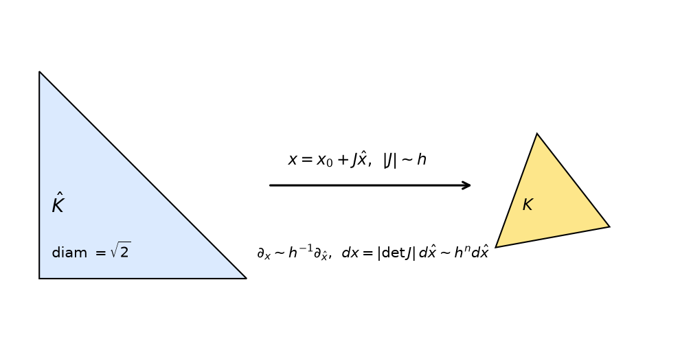
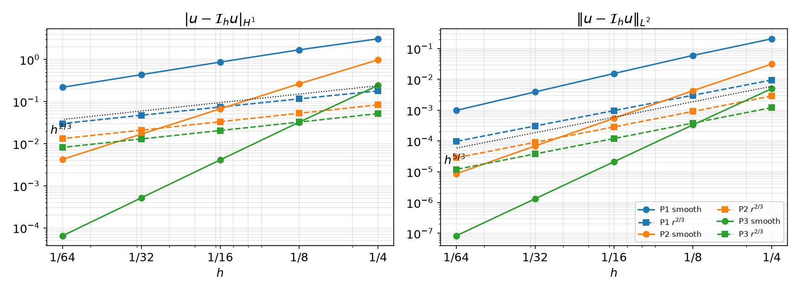

## Today

| Part | Topic | Time |
|---|---|:---:|
| **Quiz** | Week 3 material (closed-AI) | 10 min |
| **A** | Theory — interpolation operators, $H^k$ norms, Sobolev embedding, averaged Taylor polynomials, scaling, the error estimate | 70 min |
| **B** | `fem.Function` and the ways to interpolate in DOLFINx | 35 min |
| **C** | Measuring errors, convergence rates, interpolation and I/O | 40 min |
| **D** | LLM pitfalls with functions and norms · assignment | 15 min |

::: {.box}
Lab notebook: `W04_lab.ipynb` · Assignment: `W04_HW4.ipynb` (due before Week 5)
:::

## Week 3 in one slide

| | |
|---|---|
| Global space | cells share the DOFs of shared vertices and edges → $C^0$ (Lagrange) |
| Dimension | $\dim V_h=\sum_d n_d m_d$, e.g. $(kN+1)^2$ for P$k$ on $N\times N$ |
| Cell-node map | $M(c,i)$; edge DOFs ordered by global vertex numbers for $k\ge3$ |
| DOLFINx | `topology.connectivity`, `geometry.dofmaps[0]`, `V.dofmap`, owned + ghost |

::: {.fragment}
We can now **build** $V_h$. **This week: how well can $V_h$ approximate a given $u$?**

- The simplest approximation: interpolate, $u\mapsto\mathcal I_h u$
- How do we measure the error? ($H^k$ norms)
- How fast does it go to zero as $h\to0$, and what does that depend on? (Taylor + scaling)
- How do we do all this in DOLFINx — and get the numbers right?
:::

# Part A — Interpolation Theory

## §A1 The local interpolation operator

::: {.callout-note title="Definition — Local interpolant"}
For an element $(K,\mathcal P,\mathcal N)$ with nodal basis $\{\phi_i\}$:
$$\mathcal I_K v=\sum_i N_i(v)\,\phi_i\ \in\mathcal P .$$
For Lagrange elements $N_i(v)=v(x_i)$: $\mathcal I_K v$ is the polynomial that agrees with $v$ at the nodes.
:::

::: {.fragment}
| Property | Statement | Why |
|---|---|---|
| Linear | $\mathcal I_K(\alpha u+v)=\alpha\mathcal I_Ku+\mathcal I_Kv$ | $N_i$ linear |
| Nodal | $N_i(\mathcal I_Kv)=N_i(v)$ | $N_i(\phi_j)=\delta_{ij}$ |
| **Preserves $\mathcal P$** | $\mathcal I_Kp=p$ for all $p\in\mathcal P$ | unisolvence: $p-\mathcal I_Kp\in\mathcal P$ has zero DOFs |
| Projection | $\mathcal I_K\mathcal I_K=\mathcal I_K$ | apply the previous line to $p=\mathcal I_Kv$ |
:::

::: {.fragment}
**Polynomial preservation** is the engine of the whole theory: the error comes only from the part of $v$ that $\mathcal P$ cannot represent.
:::

## §A2 The global interpolation operator

::: {.callout-note title="Definition — Global interpolant"}
$\mathcal I_h u\in V_h$ with $(\mathcal I_h u)|_K=\mathcal I_K u$ for every $K\in\mathcal T_h$.
:::

Well defined and in $V_h$: neighboring cells evaluate the **same** shared DOFs (Week 3, $C^0$ decomposition), so the pieces match.

{width="85%" fig-align="center"}

::: {.fragment}
For Lagrange: $\mathcal I_h u=\sum_j u(x_j)\,\phi_j$ — the coefficient vector is just $u$ at the DOF coordinates. That is `u_h.interpolate(...)`.
:::

## §A3 Sobolev norms

Multi-index $\alpha=(\alpha_1,\dots,\alpha_n)$, $|\alpha|=\sum\alpha_i$, $D^\alpha u=\partial^{|\alpha|}u/\partial x_1^{\alpha_1}\cdots\partial x_n^{\alpha_n}$.

::: {.callout-note title="Definition — $H^k$ seminorm and norm"}
$$|u|_{H^k(\Omega)}^2=\sum_{|\alpha|=k}\int_\Omega|D^\alpha u|^2\,dx,\qquad \|u\|_{H^k(\Omega)}^2=\sum_{j=0}^k|u|_{H^j(\Omega)}^2 .$$
$H^k(\Omega)$ = functions with finite $\|\cdot\|_{H^k}$ (derivatives in the weak sense — Week 7).
:::

::: {.fragment}
| | written out | in UFL |
|---|---|---|
| $\|e\|_{L^2}=\|e\|_{H^0}$ | $\left(\int e^2\right)^{1/2}$ | `inner(e, e) * dx` |
| $|e|_{H^1}$ | $\left(\int|\nabla e|^2\right)^{1/2}$ | `inner(grad(e), grad(e)) * dx` |
| $|e|_{H^2}$ | $\left(\sum_{i,j}\int(\partial_{ij}e)^2\right)^{1/2}$ | `inner(grad(grad(e)), grad(grad(e))) * dx` |

The seminorm vanishes on polynomials of degree $<k$: $|p|_{H^{k}}=0$ for $p\in\mathcal P_{k-1}$.
:::

## §A4 When is $\mathcal I_h$ defined? — Sobolev embedding

Lagrange DOFs are **point values**. Is $u(x_i)$ meaningful for $u\in H^k$?

::: {.callout-important title="Theorem — Sobolev embedding"}
If $\Omega\subset\mathbb R^n$ is Lipschitz and $k>n/2$, then $\max_{\bar\Omega}|u|\le C\,\|u\|_{H^k(\Omega)}$ (and $u$ is continuous).
:::

::: {.fragment}
| | $n=1$ | $n=2$ | $n=3$ |
|---|:---:|:---:|:---:|
| point values bounded for | $H^1$ | $H^2$ | $H^2$ |

**In 2D, $H^1$ is not enough.** $u(x)=\log\bigl|\log|x|\bigr|$ on $|x|<1/e$ has $\int|\nabla u|^2<\infty$ but $u(0)=\infty$.
So the estimates below assume $u\in H^{k+1}$ with $k+1\ge2$, and Lagrange interpolation of a merely $H^1$ function is not defined.
(Other "interpolants" — Clément, Scott–Zhang — average instead of evaluating.)
:::

## §A5 Averaged Taylor polynomials

A Taylor polynomial at **one point** needs pointwise derivatives. Averaging over a ball $B$ gives an integral-friendly version.

::: {.callout-note title="Definition — Averaged Taylor polynomial"}
$K$ star-shaped w.r.t. a ball $B$, cut-off $\varphi\ge0$ supported in $B$ with $\int\varphi=1$:
$$Q_k u(x)=\int_B T^k_y u(x)\,\varphi(y)\,dy,\qquad T^k_yu(x)=\sum_{|\alpha|\le k}\frac{D^\alpha u(y)}{\alpha!}(x-y)^\alpha .$$
:::

::: {.fragment}
- $Q_k u\in\mathcal P_k$, and $Q_kp=p$ for $p\in\mathcal P_k$.
- $D^\alpha Q_k u=Q_{k-|\alpha|}D^\alpha u$ — averaging and differentiation commute.
:::

::: {.fragment}
::: {.callout-important title="Theorem — Bramble–Hilbert (Taylor remainder)"}
On $K$ with diameter $d$, for $0\le i\le k+1$:
$\;|u-Q_ku|_{H^i(K)}\le C\,d^{\,k+1-i}\,|u|_{H^{k+1}(K)}$, with $C$ depending on $k$, $n$ and the ratio $d/\rho_B$.
:::
Only the **$(k+1)$-th derivatives** of $u$ appear: lower-order parts are reproduced exactly.
:::

## §A6 The estimate on the reference cell

::: {.callout-important title="Lemma — Reference-cell estimate"}
On the reference triangle $\hat K$, for P$k$ Lagrange ($k\ge1$) and $0\le i\le k+1$:
$\;|\hat u-\hat{\mathcal I}\hat u|_{H^i(\hat K)}\le \hat C\,|\hat u|_{H^{k+1}(\hat K)}$.
:::

::: {.fragment}
**Proof.** Let $p=Q_k\hat u\in\mathcal P_k$. Polynomial preservation gives $\hat{\mathcal I}p=p$, so
$$\hat u-\hat{\mathcal I}\hat u=(\hat u-p)-\hat{\mathcal I}(\hat u-p).$$
:::

::: {.fragment}
1. $\|\hat u-p\|_{H^{k+1}(\hat K)}\le C|\hat u|_{H^{k+1}(\hat K)}$ (Bramble–Hilbert, all $i\le k+1$).
2. $\|\hat{\mathcal I}w\|_{H^{k+1}(\hat K)}\le\sum_j|w(\hat x_j)|\,\|\hat\phi_j\|_{H^{k+1}}\le C\max|w|\le C\|w\|_{H^{k+1}(\hat K)}$ (Sobolev, $k+1\ge2>n/2$).
3. Apply 2 to $w=\hat u-p$ and add. $\square$
:::

::: {.fragment}
Three ingredients: **polynomial preservation**, **bounded DOFs** (Sobolev), **Taylor remainder**.
:::

## §A7 Scaling to a physical cell

{width="58%" fig-align="center"}

Affine map $F_K(\hat x)=x_0+J_K\hat x$, $\hat v=v\circ F_K$. Let $h_K=\operatorname{diam}K$, $\rho_K$ = diameter of the largest inscribed ball.

::: {.fragment}
::: {.callout-important title="Lemma — Scaling of seminorms"}
$|v|_{H^m(K)}\le C\,\|J_K^{-1}\|^m\,|\det J_K|^{1/2}\,|\hat v|_{H^m(\hat K)}$ and
$|\hat v|_{H^m(\hat K)}\le C\,\|J_K\|^m\,|\det J_K|^{-1/2}\,|v|_{H^m(K)}$, with $\|J_K\|\le\dfrac{h_K}{\hat\rho}$, $\|J_K^{-1}\|\le\dfrac{\hat h}{\rho_K}$.
:::
Chain rule ($m$ derivatives → $m$ factors of $J$) and change of variables ($dx=|\det J|\,d\hat x$).
:::

::: {.fragment}
For Lagrange elements interpolation commutes with the map: $\widehat{\mathcal I_Ku}=\hat{\mathcal I}\hat u$ (nodes map to nodes).
:::

## §A7 Scaling — the proof

$$
\begin{aligned}
|u-\mathcal I_Ku|_{H^i(K)} &\le C\,\|J_K^{-1}\|^{i}\,|\det J_K|^{1/2}\;|\hat u-\hat{\mathcal I}\hat u|_{H^i(\hat K)} &&\text{(scale down)}\\
&\le C\,\|J_K^{-1}\|^{i}\,|\det J_K|^{1/2}\;\hat C\,|\hat u|_{H^{k+1}(\hat K)} &&\text{(reference estimate)}\\
&\le C\,\|J_K^{-1}\|^{i}\,\|J_K\|^{k+1}\;|u|_{H^{k+1}(K)} &&\text{(scale up)}\\
&\le C\,\Bigl(\frac{h_K}{\rho_K}\Bigr)^{i}\,h_K^{\,k+1-i}\;|u|_{H^{k+1}(K)} .
\end{aligned}
$$

::: {.fragment}
- $i=0$ ($L^2$): no shape factor at all.
- $i\ge1$: the factor $\sigma_K=h_K/\rho_K$ appears. **Shape regularity** — $\sigma_K\le\sigma$ for all cells — makes it a constant.
- Is shape regularity *necessary*? Thin triangles are common near walls. → **HW4 Q3**.
:::

## §A8 The global estimate

::: {.callout-important title="Theorem — Interpolation error"}
Shape-regular family $\{\mathcal T_h\}$, P$k$ Lagrange, $u\in H^{k+1}(\Omega)$, $k\ge1$. For $i=0,1$:
$$|u-\mathcal I_hu|_{H^i(\Omega)}\le C\,h^{\,k+1-i}\,|u|_{H^{k+1}(\Omega)},\qquad h=\max_K h_K .$$
:::
**Proof.** Square the local estimate and sum over cells: $\sum_K h_K^{2(k+1-i)}|u|^2_{H^{k+1}(K)}\le h^{2(k+1-i)}|u|^2_{H^{k+1}(\Omega)}$. $\square$
($i\ge2$ is not meaningful for $C^0$ elements globally — $\nabla\mathcal I_hu$ jumps across edges.)

::: {.fragment}
| | $\|u-\mathcal I_hu\|_{L^2}$ | $|u-\mathcal I_hu|_{H^1}$ |
|---|:---:|:---:|
| P1 | $h^2$ | $h$ |
| P2 | $h^3$ | $h^2$ |
| P3 | $h^4$ | $h^3$ |
:::

::: {.fragment}
**Why it matters:** Céa's lemma (Week 7) bounds the FE error by the **best** approximation, and $\mathcal I_hu$ is one candidate:
$\|u-u_h\|_{H^1}\le C\inf_{v_h}\|u-v_h\|_{H^1}\le C\|u-\mathcal I_hu\|_{H^1}$. Interpolation rates **are** the FE rates.
:::

## §A9 When $u$ is not smooth

If $u\in H^{s}$ only, with $1<s<k+1$, the same argument (with $k$ replaced by $s-1$) gives $|u-\mathcal I_hu|_{H^i}\le Ch^{\,s-i}|u|_{H^s}$.
**Regularity, not degree, limits the rate.**

{width="82%" fig-align="center"}

::: {.columns}
::: {.column width="50%"}
| $u=r^{2/3}$ | $L^2$ rate | $H^1$ rate |
|---|:---:|:---:|
| P1 | 1.66 | 0.66 |
| P2 | 1.67 | 0.67 |
| P3 | 1.67 | 0.67 |
:::
::: {.column width="50%"}
$r^{\alpha}\in H^{1+\alpha-\varepsilon}$ near a 2D corner, so $s=5/3$: rates $5/3$ and $2/3$ for **every** $k$.
Such corner singularities appear in the solutions of PDEs on non-convex domains (L-shapes, re-entrant corners).
:::
:::

# Part B — Functions and Interpolation in DOLFINx

## §B1 `fem.Function`: a coefficient vector on a space

$$u_h=\sum_j u_j\,\phi_j\qquad\longleftrightarrow\qquad \texttt{u.x.array}=(u_0,u_1,\dots)$$

```python
V = fem.functionspace(msh, ("Lagrange", 2))
u = fem.Function(V, name="u")       # all zeros; the name is used in output files
u.x.array                           # NumPy view: owned DOFs first, then ghosts
u.function_space, u.x.index_map, u.x.block_size
```

| 4×4 mesh, P2 | `-np 1` | `-np 2`, rank 0 | `-np 2`, rank 1 |
|---|:---:|:---:|:---:|
| `len(u.x.array)` | 81 | 57 | 57 |
| owned / ghosts | 81 / 0 | 39 / 18 | 42 / 15 |

::: {.fragment}
- If you **write** into `u.x.array` yourself, call `u.x.scatter_forward()` so ghosts get the owners' values.
- `interpolate` and solvers do this for you.
- Ghost values are copies: never sum over `u.x.array` to get a global number.
:::

## §B2 Interpolating a Python function

```python
u.interpolate(lambda x: np.sin(np.pi * x[0]) * np.cos(np.pi * x[1]))   # x has shape (3, n_points)
w.interpolate(lambda x: np.vstack((x[0], -x[1])))                       # vector space: return (gdim, n_points)
```

DOLFINx passes the **physical coordinates of all interpolation points at once**; the callable must be vectorized.

::: {.fragment}
| Mistake | What happens (0.11) |
|---|---|
| `lambda x: 1.0` | `TypeError: interpolate_f(): incompatible function arguments` → use `np.full(x.shape[1], 1.0)` |
| vector field returned as `(n_points, 2)` | `RuntimeError: Interpolation data has the wrong shape/size.` |
| `np.sin` applied to a UFL coordinate | `TypeError: loop of ufunc does not support argument 0 of type Indexed…` |
| `x[0]**0.75` | `nan` at some DOFs: boundary coordinates can be $-3\times10^{-18}$ |
:::

::: {.fragment}
NumPy for callables (`x` is an array); UFL (`ufl.sin`, `ufl.SpatialCoordinate`) for forms and `fem.Expression`.
:::

## §B3 Interpolating other things

```python
u1.interpolate(u3)                                    # Function → Function, same mesh (P3 → P1, P1 → P3, …)

expr = fem.Expression(ufl.grad(u3), VD.element.interpolation_points)   # property: no ()
g = fem.Function(VD); g.interpolate(expr)             # any UFL expression, e.g. ∇u into a DG vector space

kappa.interpolate(lambda x: np.full(x.shape[1], 10.0), cells0=right_cells)   # only on some cells
```

- P3 → P1 by `interpolate(u3)` equals direct P1 interpolation of the same $u$ (difference $4\times10^{-16}$): it evaluates $u_3$ at the P1 nodes.
- `cells0=`: piecewise data, e.g. a DG0 conductivity $\kappa=1$ / $10$ on the two halves of the square ($\int\kappa=5.5$).

::: {.fragment}
**Different meshes** need the non-matching version:
```python
cells = np.arange(n_cells_local_plus_ghost, dtype=np.int32)          # target cells
data  = fem.create_interpolation_data(V_coarse, V_fine, cells, padding=1e-14)
u_coarse.interpolate_nonmatching(u_fine, cells, interpolation_data=data)
```
Plain `u_coarse.interpolate(u_fine)` → `RuntimeError: Meshes do no match.`
A quadratic moved from a triangle mesh to a quadrilateral mesh with P2 arrives with error $2\times10^{-16}$ — polynomial preservation again.
:::

# Part C — Measuring Errors

## §C1 Norms of errors in UFL

```python
x = ufl.SpatialCoordinate(msh)
u_ex = ufl.sin(2 * ufl.pi * x[0]) * ufl.cos(2 * ufl.pi * x[1])      # exact solution as UFL
e = u_h - u_ex

def norm(form):                                                     # parallel-safe
    return np.sqrt(msh.comm.allreduce(fem.assemble_scalar(fem.form(form)), op=MPI.SUM))

L2 = norm(ufl.inner(e, e) * ufl.dx)
H1 = norm(ufl.inner(ufl.grad(e), ufl.grad(e)) * ufl.dx)             # seminorm
rate = np.log(E[i - 1] / E[i]) / np.log(h[i - 1] / h[i])
```

::: {.fragment}
| P$k$, $u=\sin2\pi x\cos2\pi y$ | $L^2$, $N=64$ | rate | $H^1$, $N=64$ | rate |
|---|:---:|:---:|:---:|:---:|
| P1 | $9.8\times10^{-4}$ | 2.00 | $2.2\times10^{-1}$ | 1.00 |
| P2 | $8.6\times10^{-6}$ | 3.00 | $4.2\times10^{-3}$ | 2.00 |
| P3 | $8.3\times10^{-8}$ | 4.00 | $6.5\times10^{-5}$ | 3.00 |

Rates from $N=32\to64$; the full table and plot are in §A9.
:::

## §C2 Three ways to get a wrong error

**1 · The exact solution lives in the same space.**
Interpolating $u_{\rm ex}$ into $V$ and comparing with $\mathcal I_hu$: the error is **exactly 0** (P1, $N=8$: $0.0$ vs $1.56\times10^{-2}$ with the UFL expression).
Use a UFL expression, or interpolate into a **higher-degree** space.

::: {.fragment}
**2 · Too little quadrature.** UFL estimates the degree for `sin` as degree + 2; forcing a low degree changes the answer:

| `quadrature_degree` | 1 | 2 | 4 | 8 | default (12) |
|---|:---:|:---:|:---:|:---:|:---:|
| $\|u-\mathcal I_hu\|_{L^2}$ | 0.0189 | 0.0146 | 0.01556 | 0.015553 | 0.015553 |
:::

::: {.fragment}
**3 · Forgetting the parallel sum** (`allreduce`), or taking `sqrt` of a per-rank value. Test with `-np 1` and `-np 2`.
:::

::: {.fragment}
**Unit test for every pipeline:** polynomial preservation. Interpolating $x^2+xy$: P1 error $4.4\times10^{-3}$; P2, P3 errors $2\times10^{-16}$.
:::

## §C3 [D] Interpolation and I/O

From the DOLFINx demo *Interpolation and IO*: a field whose **normal** component jumps at $x=0.5$, in an $H(\mathrm{curl})$ space.

```python
V  = fem.functionspace(msh, ("N1curl", 1))                     # Nédélec: tangential continuity only
u  = fem.Function(V)
u.interpolate(lambda x: np.vstack((x[0], x[1])), cells0)       # cells with x ≤ 0.5
u.interpolate(lambda x: np.vstack((x[0] + 1, x[1])), cells1)   # cells with x ≥ 0.5
V0 = fem.functionspace(msh, ("DG", 1, (2,)))                   # discontinuous Lagrange for output
u0 = fem.Function(V0); u0.interpolate(u)
```
Just left / right of $(0.5, 0.3)$: $u_0=(0.469,\,0.281)$ and $(1.531,\,0.281)$ — $u_x$ jumps, $u_y$ is continuous.

::: {.fragment}
| Writer | What it accepts | Use |
|---|---|---|
| `io.XDMFFile` | functions of the **same degree as the mesh** (P1 on an affine mesh) | P2 → `RuntimeError: Degree of output Function must be same as mesh degree.` |
| `io.VTXWriter` (ADIOS2) | Lagrange/DG of any degree, time series | open the `.bp` folder in ParaView; check `dolfinx.has_adios2` |

On Colab: write to `/tmp/fnx/` or Drive, then download and open in ParaView.
:::

## §C4 Math → DOLFINx

| Math | DOLFINx 0.11 |
|---|---|
| $u_h=\sum u_j\phi_j$ | `u = fem.Function(V)`; `u.x.array` (owned + ghosts) |
| $\mathcal I_hu$ for a formula $u$ | `u.interpolate(lambda x: ...)` (NumPy, vectorized) |
| $\mathcal I_h$ of another FE function | `interpolate(v)`; other mesh: `create_interpolation_data` + `interpolate_nonmatching` |
| $\mathcal I_h$ of an expression ($\nabla u$, $\kappa\nabla u$) | `fem.Expression(expr, V.element.interpolation_points)` |
| piecewise data | `interpolate(f, cells0=cells)` |
| $\|e\|_{L^2}$, $|e|_{H^1}$ | `sqrt(allreduce(assemble_scalar(form(inner(e,e)*dx))))`, same with `grad` |
| rate | $\log(E_{i-1}/E_i)/\log(h_{i-1}/h_i)$ |
| output | `VTXWriter` (any order), `XDMFFile` (mesh degree) |

# Part D — LLMs, Functions and Norms · Assignment

## §D1 Where LLM-generated interpolation/error code goes wrong

| Kind | What it looks like | Detection |
|---|---|---|
| **NumPy vs UFL** | NumPy functions in forms, UFL objects in callables | the `TypeError`; know which side each object lives on |
| **Shapes** | callables that return a scalar, a tuple of the wrong length, or the transposed array | the error message; print `x.shape` inside the callable |
| **Self-fulfilling checks** | comparing with a reference that lives in the same space; low quadrature | polynomial preservation; a reference you trust |
| **Stale API** | interpolation between meshes, writer classes and their arguments from older versions | the API sheet; read the signature |
| **Parallel** | per-rank norms, missing `sqrt`/`allreduce` | `-np 1` = `-np 2` |

::: {.fragment}
**Before trusting a rate:** run a polynomial that must be reproduced exactly, and check that the rate is constant over several refinements.
:::

## Assignment — HW4, due before the Week 5 lecture

::: {.columns}
::: {.column width="55%"}
### HW4 — Interpolation convergence rates (100)
- **Q1** proofs: the 1D estimate by Rolle and scaling; how norms scale (25)
- **Q2** convergence study: P1–P3, a smooth function and a function singular along an edge; graded meshes (35)
- **Q3** one-triangle experiment: which triangle shapes are harmful for $|u-\mathcal I_hu|_{H^1}$? (20)
- **Q4** LLM-assisted: transfer a P2 field between non-matching meshes, verify, write it out (20)
:::
::: {.column width="45%"}
::: {.box}
Submit the executed `.ipynb` (restart & run all) with the AI-usage log.

**Reminder:** an error in a `%%fenicsx` cell does **not** stop *Run all*. Read every output before you submit.
:::
:::
:::

## Summary

| Concept | Key idea | DOLFINx |
|---|---|---|
| Interpolant | $\mathcal I_Kv=\sum N_i(v)\phi_i$, preserves $\mathcal P$ | `interpolate` |
| $H^k$ norms | $|u|_{H^k}^2=\sum_{|\alpha|=k}\|D^\alpha u\|^2$ | UFL `inner`, `grad` |
| Sobolev | point values need $k>n/2$ | — |
| Error estimate | $|u-\mathcal I_hu|_{H^i}\le Ch^{k+1-i}|u|_{H^{k+1}}$ | rates 2/1, 3/2, 4/3 |
| Ingredients | Taylor remainder + polynomial preservation + scaling | — |
| Limits | regularity of $u$; shape of cells | graded meshes; HW4 |

::: {.fragment}
### Next week — Lax–Milgram
Riesz representation, coercivity and continuity, well-posedness of Poisson/Helmholtz; assembly and PETSc KSP; the method of manufactured solutions.
:::
