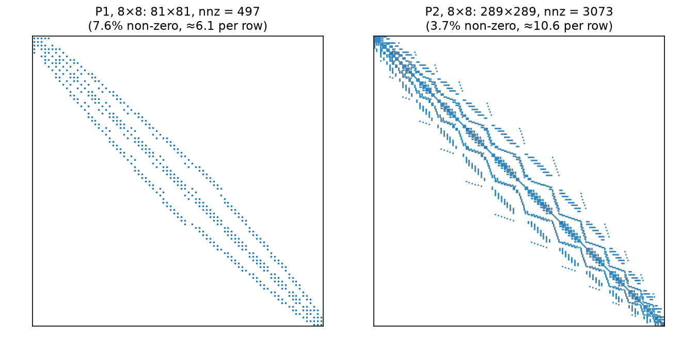
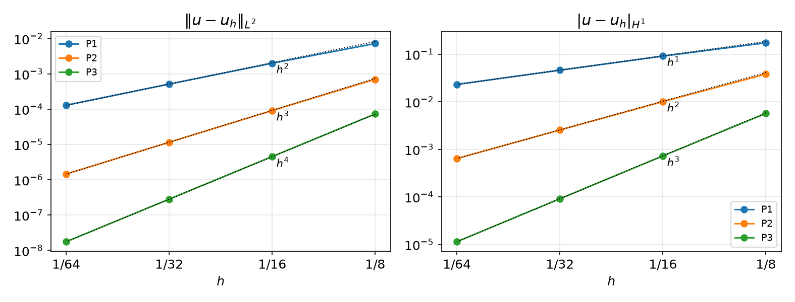

## Today

| Part | Topic | Time |
|---|---|:---:|
| **Quiz** | Week 4 material (closed-AI) | 10 min |
| **A** | Theory — Hilbert spaces, linear functionals, Riesz representation, Lax–Milgram, well-posedness of Helmholtz and Poisson | 70 min |
| **B** | From forms to matrices — assembly, PETSc `Mat`/`Vec`/`KSP`, direct and iterative solvers | 35 min |
| **C** | The method of manufactured solutions (MMS) — verifying a solver | 40 min |
| **D** | LLM pitfalls with linear solvers and MMS · assignment | 15 min |

::: {.box}
Lab notebook: `W05_lab.ipynb` · Assignment: `W05_HW5.ipynb` (due before Week 6)
:::

## Week 4 in one slide

| | |
|---|---|
| Interpolant | $\mathcal I_Kv=\sum_iN_i(v)\phi_i$; preserves $\mathcal P_k$ |
| Estimate | $|u-\mathcal I_hu|_{H^i}\le Ch^{k+1-i}|u|_{H^{k+1}}$, $i=0,1$ — rates 2/1, 3/2, 4/3 |
| Ingredients | Taylor remainder + polynomial preservation + scaling (shape regularity) |
| DOLFINx | `interpolate`, UFL error norms with `allreduce` |

::: {.fragment}
So $V_h$ **can** approximate $u$ well. **This week: does the discrete problem $u_h\in V_h$ have a solution, is it unique, and does it stay bounded as $h\to0$?**

- Answer for a whole class of problems at once: **Lax–Milgram**
- Then: how DOLFINx turns $b(u,v)=F(v)$ into $K\mathbf u=\mathbf F$ and solves it
- And how we **verify** that the code solves the right problem: MMS
:::

# Part A — Lax–Milgram

## §A1 Hilbert spaces

::: {.callout-note title="Definition — Inner product, norm, Hilbert space"}
An **inner product** $(\cdot,\cdot)$ on a vector space $V$ is bilinear, symmetric and positive definite: $(v,v)>0$ for $v\ne0$.
It induces the norm $\|v\|=(v,v)^{1/2}$. $V$ is a **Hilbert space** if it is complete in this norm (Cauchy sequences converge in $V$).
:::

::: {.fragment}
| Space | Inner product | Complete? |
|---|---|---|
| $L^2(\Omega)$ | $(u,v)=\int_\Omega uv$ | yes |
| $H^1(\Omega)$ | $(u,v)_{H^1}=\int_\Omega uv+\nabla u\cdot\nabla v$ | yes |
| $V_h$ (P$k$) with $(\cdot,\cdot)_{H^1}$ | same | yes — finite-dimensional |
| $C^1([0,1])$ with $(\cdot,\cdot)_{H^1}$ | same | **no** — $H^1$-limits may have kinks |
:::

::: {.fragment}
**Cauchy–Schwarz:** $|(u,v)|\le\|u\|\,\|v\|$. On $V_h=\operatorname{span}\{\phi_j\}$ the inner product is a matrix:
$$(u_h,v_h)_{H^1}=\mathbf v^T G\,\mathbf u,\qquad G=M+K,\quad M_{ij}=\int\phi_j\phi_i,\ K_{ij}=\int\nabla\phi_j\cdot\nabla\phi_i .$$
$G$ is the **Gram matrix** of the basis — symmetric positive definite.
:::

## §A2 Linear functionals and the dual space

::: {.callout-note title="Definition — Bounded linear functional, dual norm"}
$L:V\to\mathbb R$ linear is **bounded** if $|L(v)|\le C\|v\|$ for all $v$. The bounded ones form the **dual space** $V'$ with
$$\|L\|_{V'}=\sup_{0\ne v\in V}\frac{|L(v)|}{\|v\|}.$$
For linear functionals: bounded $\iff$ continuous.
:::

::: {.fragment}
| $L(v)$ on $V=H^1(\Omega)$ | bounded? | why |
|---|---|---|
| $\int_\Omega fv\,dx$, $f\in L^2$ | yes, $\|L\|\le\|f\|_{L^2}$ | Cauchy–Schwarz, $\|v\|_{L^2}\le\|v\|_{H^1}$ |
| $\int_{\Gamma}gv\,ds$, $g\in L^2(\Gamma)$ | yes | trace inequality (Week 6) |
| $v(x_0)$ in 1D | yes | $H^1\subset C^0$ in 1D (Sobolev, Week 4) |
| $v(x_0)$ in 2D | **no** | $\log|\log r|\in H^1$ is unbounded at 0 |
:::

::: {.fragment}
On $V_h$ every linear functional is bounded (finite dimension). The question is whether the bound **stays bounded as $h\to0$** — HW5 Q3.
:::

## §A3 Riesz representation

Every $w\in V$ defines a functional $L_w(v)=(w,v)$ with $\|L_w\|_{V'}=\|w\|$ (Cauchy–Schwarz, equality at $v=w$). The converse:

::: {.callout-important title="Theorem — Riesz representation"}
For every $L\in V'$ on a Hilbert space $V$ there is a **unique** $w\in V$ with $(w,v)=L(v)$ for all $v\in V$, and $\|w\|_V=\|L\|_{V'}$.
:::

::: {.fragment}
**On $V_h$ it is a linear solve.** With $F_i=L(\phi_i)$:
$$(w_h,\phi_i)_{H^1}=L(\phi_i)\ \ \forall i\iff G\,\mathbf w=\mathbf F,\qquad \|L\|_{V_h'}=\|w_h\|_{H^1}=\sqrt{\mathbf F^TG^{-1}\mathbf F}.$$
:::

::: {.fragment}
For $L(v)=\int fv$: $G\mathbf w=\mathbf F$ is exactly the matrix of $-\Delta w+w=f$, $\partial_nw=0$ — **the Riesz representer is the Helmholtz solution**.
$f=xy$ on the unit square, P1: $\|w_h\|_{H^1}=0.25798,\ 0.25806,\ 0.25808$ ($N=8,16,32$) $\le\|f\|_{L^2}=0.3333$.
:::

## §A4 Linear variational problems

::: {.callout-note title="Definition — Linear variational problem"}
Given a Hilbert space $V$, a bilinear form $b:V\times V\to\mathbb R$ and $F\in V'$: find $u\in V$ such that
$$b(u,v)=F(v)\qquad\forall v\in V.$$
:::

::: {.fragment}
| Problem (unit square) | $b(u,v)$ | $F(v)$ | $V$ |
|---|---|---|---|
| Helmholtz, $\partial_nu=0$ | $\int\nabla u\cdot\nabla v+uv$ | $\int fv$ | $H^1$ / P$k$ |
| Poisson, $u=0$ on $\partial\Omega$ | $\int\nabla u\cdot\nabla v$ | $\int fv$ | $H^1_0$ / P$k$ with zero boundary DOFs |
| Poisson, $\partial_nu=0$ | $\int\nabla u\cdot\nabla v$ | $\int fv$ | $\{v:\int v=0\}$ (Week 6) |
:::

::: {.fragment}
**Galerkin:** replace $V$ by $V_h\subset V$. With $u_h=\sum_ju_j\phi_j$ and $v=\phi_i$:
$$\sum_j b(\phi_j,\phi_i)\,u_j=F(\phi_i)\iff K\mathbf u=\mathbf F,\qquad K_{ij}=b(\phi_j,\phi_i).$$
Note the index order: **row $i$ = test function**, column $j$ = trial function.
:::

## §A5 Continuity and coercivity

::: {.callout-note title="Definition"}
$b$ is **continuous** (bounded) on $V$ if $\;|b(u,v)|\le M\,\|u\|_V\|v\|_V$ for all $u,v$.

$b$ is **coercive** on $V$ if $\;b(v,v)\ge\gamma\,\|v\|_V^2$ for all $v$, with $\gamma>0$.
:::

::: {.fragment}
- Continuity: $b$ does not blow up. Usually one line of Cauchy–Schwarz.
- Coercivity: $b$ "sees" every direction of $V$ — no $v\ne0$ with $b(v,v)=0$. This is where the boundary conditions enter.
:::

::: {.fragment}
**On $V_h$:** with $b(v_h,v_h)=\mathbf v^TK\mathbf v$ and $\|v_h\|^2=\mathbf v^TG\mathbf v$, the best constant is a generalized eigenvalue
$$\gamma_h=\min_{\mathbf v\ne0}\frac{\mathbf v^TK\mathbf v}{\mathbf v^TG\mathbf v}=\lambda_{\min}(K,G)\quad\text{(symmetric }K\text{)},\qquad \texttt{scipy.linalg.eigh(K, G)}.$$
:::

## §A6 The Lax–Milgram theorem

::: {.callout-important title="Theorem — Lax–Milgram"}
$V$ Hilbert, $b$ continuous ($M$) and coercive ($\gamma$), $F\in V'$. Then $b(u,v)=F(v)\ \forall v\in V$ has a **unique** solution, and
$$\|u\|_V\le\frac1\gamma\,\|F\|_{V'} .$$
:::

::: {.fragment}
**Stability and uniqueness** are one line each: take $v=u$,
$$\gamma\|u\|^2\le b(u,u)=F(u)\le\|F\|_{V'}\|u\| .$$
If $u_1,u_2$ both solve, $b(u_1-u_2,v)=0$, so the bound with $F=0$ gives $u_1=u_2$.
:::

::: {.fragment}
**Existence, symmetric $b$:** $b$ is itself an inner product on $V$, and its norm is equivalent to $\|\cdot\|_V$ ($\gamma\|v\|^2\le b(v,v)\le M\|v\|^2$),
so $(V,b)$ is a Hilbert space and $F$ is bounded on it. **Riesz** in $(V,b)$ gives $u$ with $b(u,v)=F(v)$. $\square$
:::

## §A6 Lax–Milgram — non-symmetric $b$

Riesz in $(V,(\cdot,\cdot))$ twice: $b(w,\cdot)=(Aw,\cdot)$ defines $A:V\to V$, $\|Aw\|\le M\|w\|$; $F=(f,\cdot)$. We need $Au=f$.

::: {.fragment}
Fixed point of $T(w)=w-\rho\,(Aw-f)$. For $\delta=w_1-w_2$:
$$\|T w_1-T w_2\|^2=\|\delta\|^2-2\rho\,b(\delta,\delta)+\rho^2\|A\delta\|^2\le(1-2\rho\gamma+\rho^2M^2)\,\|\delta\|^2 .$$
With $\rho=\gamma/M^2$ the factor is $1-\gamma^2/M^2<1$: $T$ is a **contraction**; $V$ complete ⇒ unique fixed point (Banach). $\square$
:::

::: {.fragment}
**Discrete version.** $V_h\subset V$ inherits $M$ and $\gamma$, so $K\mathbf u=\mathbf F$ is uniquely solvable and $\|u_h\|_V\le\gamma^{-1}\|F\|_{V'}$
**with the same constant for every $h$**: the method is **stable**. (Coercivity ⇒ $\mathbf v^TK\mathbf v>0$ ⇒ $K$ non-singular, even if $K\ne K^T$.)
:::

::: {.fragment}
A finite-dimensional system is uniquely solvable iff $K$ is non-singular — Lax–Milgram adds the **$h$-independent bound**.
:::

## §A7 Helmholtz is well posed

$-\Delta u+u=f$ in $\Omega$, $\partial_nu=0$ on $\partial\Omega$: $\;b(u,v)=\int\nabla u\cdot\nabla v+uv=(u,v)_{H^1}$, $\;F(v)=\int fv$.

::: {.fragment}
| Check | Bound | Constant |
|---|---|---|
| $F$ bounded | $|F(v)|\le\|f\|_{L^2}\|v\|_{L^2}\le\|f\|_{L^2}\|v\|_{H^1}$ | $\|F\|_{V'}\le\|f\|_{L^2}$ |
| $b$ continuous | $|b(u,v)|=|(u,v)_{H^1}|\le\|u\|_{H^1}\|v\|_{H^1}$ | $M=1$ |
| $b$ coercive | $b(v,v)=\|v\|_{H^1}^2$ | $\gamma=1$ |
:::

::: {.fragment}
So $\|u_h\|_{H^1}\le\|f\|_{L^2}$ for every mesh and degree. The Neumann condition is **natural**: it comes out of the integration by parts,
no boundary condition is imposed on $V_h$.
:::

::: {.fragment}
Numerically, $\gamma_h=\lambda_{\min}(K+M,\,G)=1.0000$ for $N=4,8,16$ — trivially, since $K+M=G$.
:::

## §A8 Poisson: the seminorm problem

$b(u,v)=\int\nabla u\cdot\nabla v$ gives $b(v,v)=|v|_{H^1}^2$ — a **seminorm**: $|c|_{H^1}=0$ for constants $c$.

::: {.fragment}
| P1, $\gamma_h=\lambda_{\min}(K,G)$ | $N=4$ | $N=8$ | $N=16$ | limit |
|---|:---:|:---:|:---:|:---:|
| Poisson, $\partial_nu=0$ | $-2\times10^{-16}$ | $2\times10^{-15}$ | $-2\times10^{-14}$ | $0$ |
| Poisson, $u=0$ on $\partial\Omega$ (boundary DOFs removed) | 0.9581 | 0.9535 | 0.9522 | $\frac{2\pi^2}{1+2\pi^2}=0.9518$ |
| $-\Delta u-5u$, $\partial_nu=0$ | $-5$ | $-5$ | $-5$ | not coercive |
:::

::: {.fragment}
- **Neumann:** $K\mathbf 1=\mathbf 0$ — not coercive; needs $\int f=0$ and $\int u=0$. **Dirichlet:** rules out constants, $\|v\|_{L^2}\le C|v|_{H^1}$ (Week 6).
- **Wrong sign:** $b(1,1)<0$ — Lax–Milgram says nothing (the problem may still be solvable, not via this theorem).
:::

## §A9 Exercises

::: {.callout-tip title="Exercise A.1 — Reaction coefficient"}
For $b_\kappa(u,v)=\int\nabla u\cdot\nabla v+\kappa\,uv$ with $\kappa>0$ on $H^1(\Omega)$: find $M$ and $\gamma$. What happens to the stability bound as $\kappa\to0$?
:::

::: {.callout-tip title="Exercise A.2 — Not coercive"}
Show that $b(u,v)=\int\nabla u\cdot\nabla v$ is not coercive on P$k$ with natural BCs. Which vector spans the kernel of $K$? Check it with `K @ ones`.
:::

::: {.callout-tip title="Exercise A.3 — Advection"}
On $\hat V=\{v\in H^1(0,1):v(0)=v(1)=0\}$ let $a(u,v)=\int_0^1u'v'+u'v+uv$. Show $a(v,v)=\|v\|_{H^1}^2$. *(Hint: $\int_0^1v'v=\tfrac12[v^2]_0^1$.)*
:::

# Part B — From Forms to Matrices

## §B1 Assembly — the cell loop

$K_{ij}=b(\phi_j,\phi_i)=\sum_{c}\int_{K_c}\bigl(\nabla\phi_j\cdot\nabla\phi_i+\phi_j\phi_i\bigr)$: only cells where **both** $\phi_i,\phi_j$ live contribute.

```text
for each cell c:
    Ke = element matrix on c          # quadrature on K̂, pullback ∇φ = J^{-T} ∇̂φ̂, weights |det J|  (Weeks 1–3)
    dofs = cell_dofs(c)               # the cell-node map M(c, ·)  (Week 3)
    K[dofs, dofs] += Ke               # scatter-add into the sparse matrix
```

::: {.fragment}
{width="62%" fig-align="center"}

The sparsity pattern is fixed by the DOF map before any number is computed; the bandwidth depends on the DOF numbering.
:::

## §B2 Assembly in DOLFINx

```python
u, v = ufl.TrialFunction(V), ufl.TestFunction(V)
a = fem.form(ufl.inner(ufl.grad(u), ufl.grad(v)) * ufl.dx + ufl.inner(u, v) * ufl.dx)   # FFCx → C kernel
L = fem.form(ufl.inner(f, v) * ufl.dx)

A = fem.assemble_matrix(a)                 # dolfinx.la.MatrixCSR: A.to_dense(), A.to_scipy() (small, serial checks)

from dolfinx.fem.petsc import assemble_matrix, assemble_vector
A = assemble_matrix(a); A.assemble()       # PETSc Mat (parallel)
b = assemble_vector(L)                     # PETSc Vec
b.ghostUpdate(addv=PETSc.InsertMode.ADD, mode=PETSc.ScatterMode.REVERSE)   # add ghost contributions to owners
```

::: {.fragment}
| | `fem.assemble_*` | `fem.petsc.assemble_*` |
|---|---|---|
| returns | `la.MatrixCSR`, `la.Vector`, NumPy-friendly | PETSc `Mat`, `Vec` |
| use for | inspecting small matrices, eigenvalues with SciPy | solving with KSP, any size, in parallel |
| after assembly | — | `A.assemble()`; vector: `ghostUpdate(ADD, REVERSE)` |
:::

::: {.fragment}
**Why `ghostUpdate`:** a cell on rank 1 that touches a DOF owned by rank 0 adds its contribution to rank 1's ghost copy. REVERSE + ADD sends it to the owner.
Forget it and the right-hand side is wrong **only in parallel**.
:::

## §B3 Solving: PETSc KSP

```python
from petsc4py import PETSc
ksp = PETSc.KSP().create(msh.comm)
ksp.setOperators(A)
ksp.setType("cg"); ksp.getPC().setType("gamg"); ksp.setTolerances(rtol=1e-10)
uh = fem.Function(V)
ksp.solve(b, uh.x.petsc_vec)
uh.x.scatter_forward()                       # owners → ghosts
print(ksp.getIterationNumber(), ksp.getConvergedReason())   # reason > 0: converged
```

::: {.fragment}
Or let `LinearProblem` do all of the above:
```python
problem = LinearProblem(a_ufl, L_ufl, bcs=[], petsc_options_prefix="helm_",       # prefix REQUIRED in 0.10+
                        petsc_options={"ksp_type": "cg", "pc_type": "gamg", "ksp_rtol": 1e-10})
uh = problem.solve(); problem.solver.getIterationNumber()
```
:::

## §B4 Direct vs iterative

Helmholtz, P1, unit square, one process, `rtol = 1e-10` — iterations:

| $N$ | DOFs | LU | CG, no PC | CG + Jacobi | CG + GAMG | CG + hypre (BoomerAMG) |
|---|---:|:---:|:---:|:---:|:---:|:---:|
| 32 | 1 089 | 1 | 145 | 102 | 15 | 6 |
| 64 | 4 225 | 1 | 275 | 198 | 17 | 7 |
| 128 | 16 641 | 1 | 533 | 392 | 18 | 7 |
| 256 | 66 049 | 1 | 994 | 553 | 20 | 7 |

::: {.fragment}
- CG needs $K$ **symmetric positive definite** — exactly what symmetric + coercive gives. Iterations $\sim\sqrt{\kappa(K)}$ and $\kappa(K)\sim h^{-2}$: unpreconditioned CG doubles when $h$ halves.
- Algebraic multigrid (GAMG, hypre): iterations almost independent of $h$ — the method of choice for large elliptic problems.
- LU (`preonly` + `lu`, or MUMPS): robust, the default for small 2D problems and for checking; memory grows fast in 3D.
:::

# Part C — The Method of Manufactured Solutions

## §C1 Manufacture a solution

We cannot check $u_h$ against the true solution of a real problem — we usually do not know it. So **invent** one:

::: {.callout-important title="MMS"}
1. Choose a smooth $\tilde u$ that satisfies the **boundary conditions** of the problem.
2. Compute $f=-\Delta\tilde u+\tilde u$ (symbolically — UFL does it for you).
3. Solve with this $f$; then $u=\tilde u$ exactly, and $\|u-u_h\|$ must decrease at the **theoretical rate**.
:::

::: {.fragment}
```python
x = ufl.SpatialCoordinate(msh)
u_ex = ufl.cos(4 * ufl.pi * x[0]) * x[1]**2 * (1 - x[1])**2     # ∂u/∂n = 0 on all four sides
f = -ufl.div(ufl.grad(u_ex)) + u_ex                             # no hand differentiation
```
:::

::: {.fragment}
| $\tilde u$ on the unit square | $\partial_n\tilde u=0$? | usable for Helmholtz with natural BC |
|---|:---:|:---:|
| $\cos(4\pi x)\,y^2(1-y)^2$, $\cos(\pi x)\cos(\pi y)$ | ✅ | ✅ |
| $\sin(\pi x)\cos(\pi y)$ | ❌ at $x=0,1$ | ❌ — solves a different problem |
:::

## §C2 Rates

$\tilde u=\cos(4\pi x)\,y^2(1-y)^2$, Helmholtz with natural BC, LU:

{width="80%" fig-align="center"}

::: {.columns}
::: {.column width="55%"}
| | $\|e\|_{L^2}$, $N=64$ | rate | $|e|_{H^1}$, $N=64$ | rate |
|---|:---:|:---:|:---:|:---:|
| P1 | $1.29\times10^{-4}$ | 1.99 | $2.31\times10^{-2}$ | 1.00 |
| P2 | $1.45\times10^{-6}$ | 3.00 | $6.39\times10^{-4}$ | 1.99 |
| P3 | $1.76\times10^{-8}$ | 4.00 | $1.14\times10^{-5}$ | 3.00 |
:::
::: {.column width="45%"}
The **interpolation** rates of Week 4 — not by accident. Proof of the $H^1$ rate: Céa's lemma (Week 7); $L^2$: Aubin–Nitsche (Week 7).
:::
:::

## §C3 The FE solution is the best approximation

For symmetric coercive $b$, **Galerkin orthogonality** $b(u-u_h,v_h)=0$ makes $u_h$ the $b$-orthogonal projection of $u$ onto $V_h$.
For Helmholtz $b=(\cdot,\cdot)_{H^1}$, so $u_h$ is the **closest point of $V_h$ to $u$ in $\|\cdot\|_{H^1}$** — closer than $\mathcal I_hu$:

| full $H^1$ norm | $N=8$ | $N=16$ | $N=32$ |
|---|:---:|:---:|:---:|
| P1: $\|u-u_h\|$ / $\|u-\mathcal I_hu\|$ | 0.1731 / 0.1750 | 0.09084 / 0.09111 | 0.04599 / 0.04602 |
| P2: $\|u-u_h\|$ / $\|u-\mathcal I_hu\|$ | 0.03806 / 0.03906 | 0.01004 / 0.01012 | 0.002547 / 0.002554 |

::: {.fragment}
Ratio $<1$ always, and $\to1$: the interpolant is *almost* optimal. The proof (three lines) and the version for a general
symmetric $b$ are in **HW5**.
:::

## §C4 What MMS catches

P2, $L^2$ error at $N=8,16,32$:

| Change to the correct code | $\|e\|_{L^2}$ | rates | verdict |
|---|---|:---:|---|
| none | 7.0e-4, 9.1e-5, 1.2e-5 | 2.94, 2.98 | ✅ |
| $\tilde u=\sin\pi x\cos\pi y$ (violates $\partial_nu=0$) | 0.430, 0.430, 0.430 | 0.00, 0.00 | wrong problem |
| sign error in $f$ | 0.056, 0.056, 0.056 | 0.00, 0.00 | wrong problem |
| $f=-\Delta\tilde u$ (forgot $+\tilde u$) | 7.8e-4, 2.1e-4, 1.7e-4 | 1.91, **0.29** | looks fine at $N=8$! |
| `quadrature_degree` 2 | 7.2e-4, 9.1e-5, 1.2e-5 | 2.97, 2.99 | harmless here |
| `quadrature_degree` 1 | `nan`, `nan`, 3.07 | — | singular matrix |

::: {.fragment}
- One error value proves nothing (row 4 at $N=8$ ≈ correct). **The rate over ≥ 3 meshes** is the test.
- Stagnating error = consistent bug (wrong $f$, BC, form); dropping rate = bug hidden on coarse meshes. Low quadrature: harmless or fatal — MMS tells.
:::

## §C5 Math → DOLFINx

| Math | DOLFINx 0.11 |
|---|---|
| $b(u,v)$, $F(v)$ | `a = inner(grad(u), grad(v))*dx + inner(u, v)*dx`, `L = inner(f, v)*dx` |
| $K_{ij}=b(\phi_j,\phi_i)$ | `fem.petsc.assemble_matrix(fem.form(a)); A.assemble()` |
| $F_i=F(\phi_i)$ | `assemble_vector(fem.form(L))` + `ghostUpdate(ADD, REVERSE)` |
| Gram matrix $G$, $\gamma_h=\lambda_{\min}(K,G)$ | `fem.assemble_matrix(...).to_dense()`, `scipy.linalg.eigh(K, G)` (small, serial) |
| Riesz representer, $\|F\|_{V_h'}$ | solve $G\mathbf w=\mathbf F$; $\sqrt{\mathbf F\cdot\mathbf w}$ |
| $K\mathbf u=\mathbf F$ | `PETSc.KSP` (`preonly`+`lu`, `cg`+`gamg`/`hypre`) or `LinearProblem(..., petsc_options_prefix=...)` |
| MMS source | `f = -div(grad(u_ex)) + u_ex` with `u_ex` a UFL expression |
| verification | rates over ≥ 3 meshes = theory |

# Part D — LLMs, Solvers and MMS · Assignment

## §D1 Where LLM-generated solver/MMS code goes wrong

| Kind | What it looks like | Detection |
|---|---|---|
| **Stale API** | `LinearProblem` without `petsc_options_prefix`; `fem.petsc.create_vector(L)` with a form; old `NewtonSolver` | `TypeError` at once; the API sheet |
| **Parallel** | missing `ghostUpdate` after `assemble_vector`, missing `scatter_forward` after `ksp.solve`, per-rank norms | `-np 1` vs `-np 2` give different numbers |
| **Wrong manufactured problem** | $\tilde u$ that violates the BC; $f$ differentiated by hand with an error; $f$ for a different PDE | error stagnates — look at the **rate** |
| **Wrong solver for the matrix** | CG on a non-symmetric or indefinite matrix; LU on a singular matrix | `getConvergedReason() < 0`, `nan`, residual check |
| **Self-fulfilling checks** | error against the interpolant in the same space | rates that are too good, or exactly 0 |

## §D2 Solvers fail silently

**KSP does not raise.** Measured (P1, $N=32$, exact answer $u\equiv1$ for $f=1$):

| Setting | `getConvergedReason()` | $\max u_h$ |
|---|:---:|:---:|
| CG, no PC, `ksp_max_it=5` | $-3$ (diverged: max iterations) | 0.53 |
| LU on pure-Neumann Poisson, $f=1$ (singular, $\int f\ne0$) | $4$ ("converged") | $6.5\times10^{12}$ |

Always print `problem.solver.getConvergedReason()` — and a positive reason is still not a proof: check the solution (MMS, residual, physics).

## Assignment — HW5, due before the Week 6 lecture

::: {.columns}
::: {.column width="55%"}
### HW5 — Lax–Milgram + MMS (100)
- **Q1** proofs: constants for a variable-coefficient form, advection–diffusion in 2D, best approximation in the energy norm (25)
- **Q2** MMS for a variable-coefficient problem: manual assembly + KSP, rates, energy-norm check, iterative solvers (35)
- **Q3** coercivity constants and dual norms, numerically (20)
- **Q4** LLM-generated MMS study with planted bugs: find, fix, explain (20)
:::
::: {.column width="45%"}
::: {.box}
Submit the executed `.ipynb` (restart & run all) with the AI-usage log.

**Reminder:** an error in a `%%fenicsx` cell does **not** stop *Run all*. Read every output before you submit.
:::
:::
:::

## Summary

| Concept | Key idea | DOLFINx |
|---|---|---|
| Hilbert space | inner product + completeness; on $V_h$: Gram matrix $G=M+K$ | `fem.assemble_matrix(...).to_dense()` |
| Riesz | $L\in V'\leftrightarrow w\in V$, $\|w\|=\|L\|$; on $V_h$: $G\mathbf w=\mathbf F$ | a Helmholtz solve |
| Lax–Milgram | continuous + coercive ⇒ unique, $\|u\|\le\|F\|/\gamma$, same $\gamma$ on $V_h$ | $\gamma_h=\lambda_{\min}(K,G)$ |
| Helmholtz | $M=\gamma=1$, natural Neumann BC | `inner(grad(u),grad(v))*dx + u*v*dx` |
| Poisson | seminorm: constants in the kernel unless a BC removes them | Week 6 |
| Assembly, solve | cell loop + DOF map; KSP: LU or CG + AMG | `assemble_matrix`, `KSP`, `LinearProblem` |
| MMS | choose $\tilde u$ with the BC, $f$ by UFL, check **rates** | `-div(grad(u_ex)) + u_ex` |

::: {.fragment}
### Next week — Boundary conditions
Neumann problems and the mean estimate, the trace inequality, partial Dirichlet; `fem.dirichletbc`, lifting, Robin conditions, subdomains and multi-material problems.
:::
