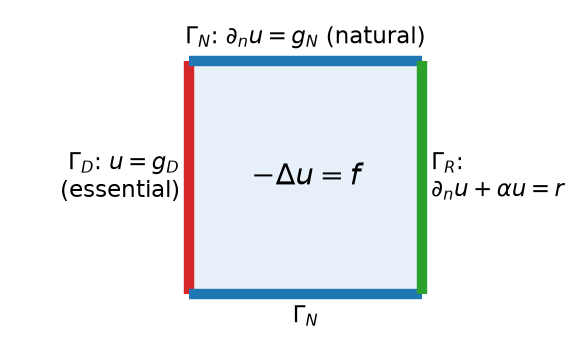
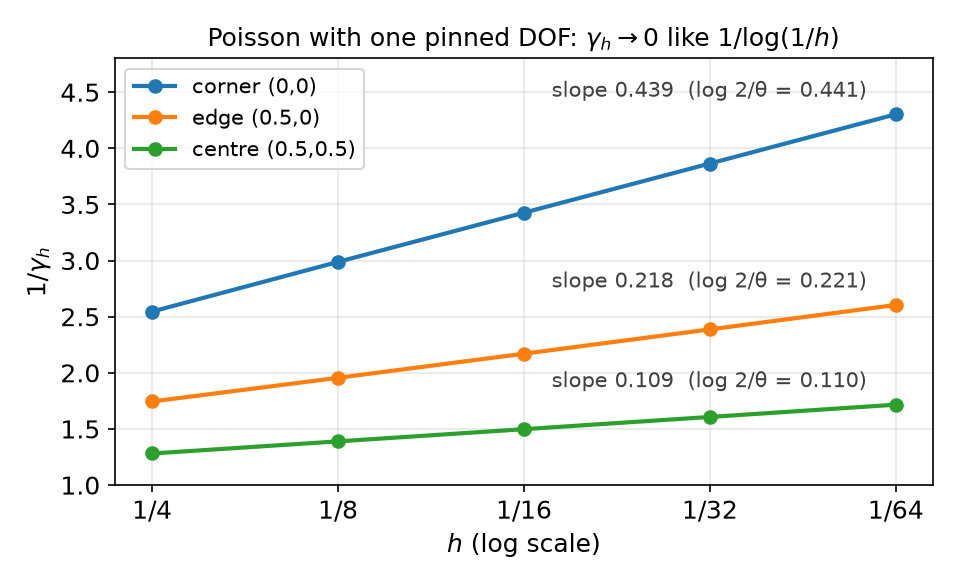
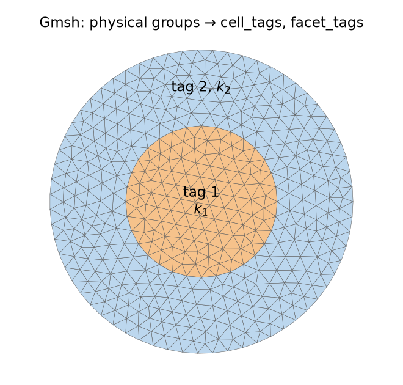

## Today

| Part | Topic | Time |
|---|---|:---:|
| **Quiz** | Week 5 material (closed-AI) | 10 min |
| **A** | Theory — weak forms with mixed boundary conditions, mean estimate, pure Neumann, trace inequality, partial Dirichlet, Robin | 65 min |
| **B** | Dirichlet conditions in DOLFINx — locating DOFs, `dirichletbc`, lifting, the assembly pipeline | 35 min |
| **C** | Neumann and Robin terms, pure Neumann in PETSc, subdomains, multi-material problems, Gmsh | 45 min |
| **D** | LLM pitfalls with boundary conditions · assignment | 15 min |

::: {.box}
Lab notebook: `W06_lab.ipynb` · Assignment: `W06_HW6.ipynb` (due before Week 7)
:::

## Week 5 in one slide

| | |
|---|---|
| Lax–Milgram | $b$ continuous ($M$) + coercive ($\gamma$) on a Hilbert space ⇒ unique $u$, $\|u\|\le\|F\|_{V'}/\gamma$ — the same on every $V_h$ |
| On $V_h$ | $\gamma_h=\lambda_{\min}(K,G)$ with the Gram matrix $G=M+K$ |
| Helmholtz | $M=\gamma=1$; Neumann condition is natural |
| Poisson | $b(v,v)=|v|^2_{H^1}$ — a **seminorm**; $\gamma_h\approx0$ with natural BCs, $0.952$ with $u=0$ on $\partial\Omega$ |
| MMS | $\tilde u$ with the BC, $f$ by UFL, rates over ≥ 3 meshes |

::: {.fragment}
**This week:** *which* boundary conditions remove the constants, and how much of the boundary is enough?

- Pure Neumann (mean estimate), partial Dirichlet (trace inequality), Robin
- Then the implementation: Dirichlet lifting, boundary markers, nullspaces, subdomains and Gmsh meshes
:::

# Part A — Boundary Conditions in the Theory

## §A1 Three kinds of boundary conditions

::: {.columns}
::: {.column width="42%"}
{width="100%"}
:::
::: {.column width="58%"}
$\partial\Omega=\Gamma_D\cup\Gamma_N\cup\Gamma_R$, $\;\mathbf n$ = outward unit normal.

| Condition | Name | Where it goes |
|---|---|---|
| $u=g_D$ on $\Gamma_D$ | essential (Dirichlet) | in the **space**: $u\in g_D+V_D$ |
| $\partial_nu=g_N$ on $\Gamma_N$ | natural (Neumann) | in $F$: $\int_{\Gamma_N}g_Nv$ |
| $\partial_nu+\alpha u=r$ on $\Gamma_R$ | Robin | in $b$: $\alpha\!\int_{\Gamma_R}\!uv$; in $F$: $\int_{\Gamma_R}rv$ |
:::
:::

::: {.fragment}
Robin is the convective (Newton cooling) condition $-k\partial_nT=h(T-T_\infty)$: $\alpha=h/k$, $r=hT_\infty/k$.
$\alpha\to0$: Neumann; $\alpha\to\infty$: Dirichlet $u=r/\alpha$.
:::

## §A2 The weak form with mixed conditions

Multiply $-\Delta u=f$ by $v$ with $v=0$ on $\Gamma_D$ and integrate by parts:
$$\int_\Omega\nabla u\cdot\nabla v-\int_{\partial\Omega}\partial_nu\,v=\int_\Omega fv .$$

::: {.fragment}
On $\Gamma_D$ the boundary term vanishes because $v=0$; on $\Gamma_N$ and $\Gamma_R$ insert the condition:

::: {.callout-note title="Weak form"}
Find $u\in H^1(\Omega)$ with $u=g_D$ on $\Gamma_D$ such that for all $v\in V_D=\{v\in H^1(\Omega):v=0\text{ on }\Gamma_D\}$
$$\underbrace{\int_\Omega\nabla u\cdot\nabla v+\alpha\int_{\Gamma_R}uv}_{b(u,v)}=\underbrace{\int_\Omega fv+\int_{\Gamma_N}g_Nv+\int_{\Gamma_R}rv}_{F(v)} .$$
:::
:::

::: {.fragment}
**Lifting:** write $u=u_0+u_g$ with any $u_g\in H^1$, $u_g=g_D$ on $\Gamma_D$. Then $u_0\in V_D$ solves $b(u_0,v)=F(v)-b(u_g,v)$ — a problem on the
**linear space** $V_D$, where Lax–Milgram applies. Two questions remain: is $F$ bounded (boundary integrals!), and is $b$ coercive on $V_D$?
:::

## §A3 The key inequality

$b(v,v)\ge|v|^2_{H^1}$, but coercivity needs the **full** norm $\|v\|^2_{H^1}=\|v\|^2_{L^2}+|v|^2_{H^1}$. It is enough to have, on the space we work in,
$$\|v\|_{L^2}\le C\,|v|_{H^1}\quad\Longrightarrow\quad \|v\|^2_{H^1}\le(1+C^2)\,|v|^2_{H^1}\le(1+C^2)\,b(v,v),\qquad \gamma=\frac{1}{1+C^2}.$$

::: {.fragment}
A **Poincaré-type inequality**. It fails on all of $H^1$ ($v=1$), so the space must exclude constants:

| Space | What excludes the constants | Tool |
|---|---|---|
| $\bar V=\{v:\int_\Omega v=0\}$ | zero mean | mean estimate (§A4) |
| $V_D=\{v:v=0\text{ on }\Gamma_D\}$, $|\Gamma_D|>0$ | zero on part of the boundary | mean estimate + trace inequality (§A6–A7) |
| $H^1$ with Robin, $\alpha>0$ | $\alpha\int_{\Gamma_R}v^2$ in $b$ | trace inequality (§A9) |
:::

::: {.fragment}
On $V_h$ the best constant is again an eigenvalue: $C_h^2=\max\frac{\mathbf v^TM\mathbf v}{\mathbf v^TK\mathbf v}$ over the space $=1/\lambda_{\min}$.
:::

## §A4 The mean estimate

::: {.callout-important title="Lemma — mean estimate"}
For $u\in H^1(\Omega)$ (in particular any $C^0$ finite element function), $\Omega$ convex, $\bar u=\frac1{|\Omega|}\int_\Omega u$:
$$\|u-\bar u\|_{L^2(\Omega)}\le C\,|u|_{H^1(\Omega)},\qquad C\text{ depends only on }\Omega .$$
:::

::: {.fragment}
**Proof sketch.** $u(x)-u(y)=\int_0^1(x-y)\cdot\nabla u(y+s(x-y))\,ds$ (FE fundamental theorem of calculus on segments). Average over $y$:
$u(x)-\bar u=\frac1{|\Omega|}\int_\Omega\!\int_0^1(x-y)\cdot\nabla u(\cdots)\,ds\,dy$. Square, Cauchy–Schwarz, split the $s$-integral at $\frac12$ and change variables
in each half — the same structure as the averaged Taylor polynomial of Week 4. $\square$
:::

::: {.fragment}
**Best constant on the unit square:** $C=1/\sqrt{\lambda_2}$, where $\lambda_2=\pi^2$ is the first non-zero Neumann eigenvalue of $-\Delta$ ($\cos\pi x$).

| P1, $C_h=1/\sqrt{\lambda_2(K,M)}$ | $N=4$ | $N=8$ | $N=16$ | $N=32$ | limit $1/\pi$ |
|---|:---:|:---:|:---:|:---:|:---:|
| | 0.3107 | 0.3163 | 0.3178 | 0.3182 | 0.3183 |
:::

## §A5 Pure Neumann

$-\Delta u=f$ in $\Omega$, $\partial_nu=g$ on all of $\partial\Omega$: $\;b(u,v)=\int\nabla u\cdot\nabla v$, $\;F(v)=\int fv+\int_{\partial\Omega}gv$.

::: {.fragment}
- **Compatibility.** Take $v=1$: $b(u,1)=0$, so a solution exists **only if** $\displaystyle\int_\Omega f+\int_{\partial\Omega}g=0$ (sources = outflow).
- **Non-uniqueness.** If $u$ solves, so does $u+c$. Fix the constant by working in $\bar V=\{v:\int v=0\}$.
:::

::: {.fragment}
::: {.callout-important title="Theorem — pure Neumann"}
On $\bar V$ (and on $\bar V_h=V_h\cap\bar V$) $b$ is coercive with $\gamma=1/(1+C^2)$, $C$ from the mean estimate. With compatible data the solution
$u\in\bar V$ satisfies $b(u,v)=F(v)$ for **all** $v\in H^1$ (split $v=(v-\bar v)+\bar v$; the constant part gives $0=0$).
:::
:::

::: {.fragment}
Unit square: $\gamma=\pi^2/(1+\pi^2)=0.908$, independent of $h$. $F$ contains $\int_{\partial\Omega}gv$ — bounded on $H^1$ only thanks to the **trace inequality**.
:::

## §A6 Trace inequality

::: {.callout-important title="Lemma — FE divergence theorem"}
For a $C^1$ vector field $\boldsymbol\xi$ and $u$ in a $C^0$ FE space: $\int_\Omega\nabla\cdot(\boldsymbol\xi u)=\int_{\partial\Omega}\boldsymbol\xi\cdot\mathbf n\,u$ — the interior facet terms cancel because $u$ is continuous and $\mathbf n^+=-\mathbf n^-$.
:::

::: {.fragment}
::: {.callout-important title="Theorem — trace inequality"}
On a polygon, $\;\|u\|_{L^2(\partial\Omega)}\le C_T\,\|u\|_{H^1(\Omega)}$.
:::
**Proof.** Take $\boldsymbol\xi$ with $\boldsymbol\xi\cdot\mathbf n=1$ on $\partial\Omega$, apply the lemma to $u^2$:
$\int_{\partial\Omega}u^2=\int_\Omega(\nabla\cdot\boldsymbol\xi)u^2+2u\,\boldsymbol\xi\cdot\nabla u\le c\bigl(\|u\|^2_{L^2}+\|u\|_{L^2}|u|_{H^1}\bigr)\le c'\|u\|^2_{H^1}$ ($2ab\le a^2+b^2$). $\square$
:::

::: {.fragment}
| P1, $C_{T,h}^2=\lambda_{\max}(B,G)$, $B_{ij}=\int_{\partial\Omega}\phi_j\phi_i$ | $N=4$ | $N=8$ | $N=16$ | $N=32$ |
|---|:---:|:---:|:---:|:---:|
| unit square | 4.156 | 4.163 | 4.165 | 4.165 |

**Bounded.** Compare Week 5 (HW5 Q3): the dual norm of a *point* value grows like $\log(1/h)$ in 2D. Lines carry $H^1$ functions; points do not.
:::

## §A7 Partial Dirichlet

::: {.callout-important title="Theorem — partial Dirichlet (Brenner & Scott)"}
If $\Gamma_D\subset\partial\Omega$ has positive length, then $\|v\|_{L^2}\le C|v|_{H^1}$ on $V_D$, so Poisson is coercive on $V_D$ and on $V_h\cap V_D$, uniformly in $h$.
:::

::: {.fragment}
**Proof.** $\|v\|_{L^2}\le\|v-\bar v\|_{L^2}+\|\bar v\|_{L^2}$. First term: mean estimate. Second: since $v=0$ on $\Gamma_D$,
$$\|\bar v\|_{L^2}=\frac{|\Omega|^{1/2}}{|\Gamma_D|}\Bigl|\int_{\Gamma_D}(\bar v-v)\Bigr|\le\frac{|\Omega|^{1/2}}{|\Gamma_D|^{1/2}}\|v-\bar v\|_{L^2(\partial\Omega)}\le\frac{|\Omega|^{1/2}C_T}{|\Gamma_D|^{1/2}}\|v-\bar v\|_{H^1}\le C|v|_{H^1}. \ \square$$
:::

::: {.fragment}
$\gamma_h$ for $\Gamma_D=\{x=0,\ 0\le y\le\ell\}$ (P1):

| $\ell$ | all of $\partial\Omega$ | 1 (one side) | 1/2 | 1/4 | 1/8 | 1/16 |
|---|:---:|:---:|:---:|:---:|:---:|:---:|
| $N=16$ | 0.9522 | 0.7118 | 0.6283 | 0.5135 | 0.4317 | 0.3767 |
| $N=32$ | 0.9519 | 0.7116 | 0.6240 | 0.5069 | 0.4227 | 0.3643 |

Smaller $\Gamma_D$ → smaller $\gamma$ (the constant has $|\Gamma_D|^{-1/2}$), but for fixed $\ell>0$ it settles as $h\to0$.
:::

## §A8 A point is not a boundary condition

Shrink $\Gamma_D$ to **one DOF** (a vertex $p$ with $v(p)=0$):

::: {.columns}
::: {.column width="55%"}
{width="100%"}
:::
::: {.column width="45%"}
$1/\gamma_h$ grows by a **constant** per halving of $h$, $\approx\log2/\theta$ ($\theta$ = interior angle at $p$: $\pi/2$, $\pi$, $2\pi$).
So $\gamma_h\sim\theta/\log(1/h)\to0$: no $h$-uniform stability.

::: {.fragment}
- 2D: $v$ can be pulled to $0$ at a point at an energy cost $\to0$. The theorem needs $|\Gamma_D|>0$.
- 1D: $H^1\subset C^0$, one point **is** enough.
- "Pin one DOF" for pure Neumann works **only** with compatible data (§C4).
:::
:::
:::

## §A9 Robin conditions

$b(u,v)=\int_\Omega\nabla u\cdot\nabla v+\alpha\int_{\partial\Omega}uv$, $\alpha>0$, on all of $H^1$:

::: {.fragment}
- **Continuous:** $|b(u,v)|\le|u|_{H^1}|v|_{H^1}+\alpha\|u\|_{L^2(\partial\Omega)}\|v\|_{L^2(\partial\Omega)}\le(1+\alpha C_T^2)\|u\|_{H^1}\|v\|_{H^1}$ — trace inequality.
- **Coercive:** $b(v,v)=|v|^2_{H^1}+\alpha\|v\|^2_{L^2(\partial\Omega)}$ controls $\|v\|^2_{L^2}$ by a Friedrichs-type inequality — HW6 Q1.
:::

::: {.fragment}
| P1, $N=32$ | $\alpha=0.01$ | $0.1$ | $1$ | $10$ | $100$ | $10^4$ |
|---|:---:|:---:|:---:|:---:|:---:|:---:|
| $\gamma_h=\lambda_{\min}(K+\alpha B,\,G)$ | 0.0399 | 0.3893 | 0.9405 | 0.9510 | 0.9518 | 0.9519 |

- $\alpha\to0$: $\gamma\approx\alpha|\partial\Omega|/|\Omega|=4\alpha$ (attained by constants) — Neumann.
- $\alpha\to\infty$: $\gamma\to2\pi^2/(1+2\pi^2)=0.9518$ — the Dirichlet value of §A7.
:::

## §A10 Summary and exercises

| Problem | Space | Coercivity from | $F$ bounded by |
|---|---|---|---|
| Helmholtz, Neumann | $H^1$ | $b=(\cdot,\cdot)_{H^1}$ | Cauchy–Schwarz + trace (for $g$) |
| Poisson, pure Neumann | $\int v=0$ | mean estimate; data must satisfy $\int f+\int g=0$ | trace |
| Poisson, partial Dirichlet | $v=0$ on $\Gamma_D$, $|\Gamma_D|>0$ | mean estimate + trace | trace |
| Poisson, Robin | $H^1$ | trace + Friedrichs-type | trace |

::: {.callout-tip title="Exercise A.1 — Compatibility"}
For $-\Delta u+cu=f$, $\partial_nu=g$ with a constant $c>0$, is a compatibility condition needed? Why not?
:::

::: {.callout-tip title="Exercise A.2 — One dimension"}
On $(0,1)$ with $v(0)=0$ show $|v(x)|\le\sqrt x\,\|v'\|_{L^2}$ and hence $\|v\|_{L^2}\le\tfrac1{\sqrt2}|v|_{H^1}$. Why does this argument fail in 2D for a single point?
:::

# Part B — Dirichlet Conditions in DOLFINx

## §B1 Essential conditions in the linear system

Split the DOFs into free ($I$) and Dirichlet ($D$) ones, $\mathbf u_D=\mathbf g$:
$$\begin{bmatrix}A_{II}&A_{ID}\\A_{DI}&A_{DD}\end{bmatrix}\begin{bmatrix}\mathbf u_I\\\mathbf u_D\end{bmatrix}=\begin{bmatrix}\mathbf b_I\\\mathbf b_D\end{bmatrix}
\quad\longrightarrow\quad A_{II}\,\mathbf u_I=\mathbf b_I-A_{ID}\,\mathbf g .$$
The rows of $D$ are **test functions that are not in $V_D$** — they are dropped; the columns of $D$ multiply known values and move to the right.

::: {.fragment}
DOLFINx keeps the full size and solves the **symmetric** system
$$\begin{bmatrix}A_{II}&0\\0&I\end{bmatrix}\begin{bmatrix}\mathbf u_I\\\mathbf u_D\end{bmatrix}=\begin{bmatrix}\mathbf b_I-A_{ID}\mathbf g\\\mathbf g\end{bmatrix}$$

| Step | Function |
|---|---|
| zero rows **and** columns of $D$, put 1 on the diagonal | `assemble_matrix(a, bcs=[bc])` |
| $\mathbf b_I\leftarrow\mathbf b_I-A_{ID}\mathbf g$ ("lifting") | `apply_lifting(b, [a], bcs=[[bc]])` |
| $\mathbf b_D\leftarrow\mathbf g$ | `set_bc(b, [bc])` |
:::

## §B2 Finding the boundary DOFs

```python
# by DOF coordinates (Lagrange elements: DOFs are point values)
dofs = fem.locate_dofs_geometrical(V, lambda x: np.isclose(x[0], 0.0))

# by mesh entities: all DOFs on the given facets (vertices, edge midpoints, ...)
fdim = msh.topology.dim - 1
msh.topology.create_connectivity(fdim, msh.topology.dim)
facets = mesh.locate_entities_boundary(msh, fdim, lambda x: np.isclose(x[0], 0.0))
dofs = fem.locate_dofs_topological(V, fdim, facets)          # or ft.find(tag) from facet tags
```

::: {.fragment}
Left side of the $8\times8$ unit square:

| marker | P1 | P2 |
|---|:---:|:---:|
| `np.isclose(x[0], 0)` | 9 | 17 |
| topological, left facets | 9 | 17 |
| `x[0] == 0.0` | **0** | **0** |
| `x[0] == 1.0` (right side) | **0** | **8** |

The DOF coordinates on $x=0$ are $\pm2.7\times10^{-18}$, not $0$ (Week 4: `x**a` gave `nan` for the same reason). Exact float comparison finds
nothing — **no error**, just a missing boundary condition.
:::

## §B3 `fem.dirichletbc` in 0.11

```python
bc = fem.dirichletbc(0.0, dofs, V)                         # constant value: pass V
bc = fem.dirichletbc(fem.Constant(msh, 1.0), dofs, V)      # Constant: pass V

g = fem.Function(V)                                        # space-dependent value
g.interpolate(lambda x: np.sin(np.pi * x[1]))              # NumPy callable, or
g.interpolate(fem.Expression(u_ex, V.element.interpolation_points))   # a UFL expression (MMS)
bc = fem.dirichletbc(g, dofs)                              # Function: V is taken from g
```

::: {.fragment}
| Call | 0.11 |
|---|---|
| `dirichletbc(g, dofs)` with `g` a `Function` | ✅ |
| `dirichletbc(g, dofs, V)` with `g` a `Function` | `TypeError: __init__(): incompatible function arguments` |
| several boundary parts | one `bc` per part, `bcs=[bc_left, bc_right]` |
:::

::: {.fragment}
For a sub-space (vector or mixed problems, Week 11) the DOFs come from `locate_dofs_topological((V.sub(0), V0), ...)` — geometrical location
needs DOF coordinates, the topological one always works.
:::

## §B4 The assembly pipeline

```python
a, L = fem.form(a_ufl), fem.form(L_ufl)
A = assemble_matrix(a, bcs=[bc]); A.assemble()                 # rows and columns of D zeroed, diagonal 1
b = assemble_vector(L)
apply_lifting(b, [a], bcs=[[bc]])                              # b_I -= A_ID g   (each rank, incl. ghosts)
b.ghostUpdate(addv=PETSc.InsertMode.ADD, mode=PETSc.ScatterMode.REVERSE)   # ghosts → owners
set_bc(b, [bc])                                                # b_D = g         (owned entries only)
ksp.solve(b, uh.x.petsc_vec); uh.x.scatter_forward()
```
`LinearProblem(a_ufl, L_ufl, bcs=[bc], petsc_options_prefix=..., ...)` performs exactly these steps.

::: {.fragment}
**The order matters.** `set_bc` writes $\mathbf g$ into owned entries. A later `ghostUpdate(ADD)` *adds* the other rank's contributions on top of it —
the Dirichlet values are corrupted, but only in DOFs that are also ghosts on another rank.
:::

## §B5 Pipeline mistakes, measured

Mixed problem of §C2 (Dirichlet + Neumann + Robin), P1, `-np 2`, $L^2$ error:

| | $N=8$ | $16$ | $32$ | $64$ | symptom |
|---|:---:|:---:|:---:|:---:|---|
| correct | 1.9e-2 | 4.9e-3 | 1.2e-3 | 3.1e-4 | rate 2 |
| no `apply_lifting` | 0.55 | 0.57 | 0.59 | 0.60 | stagnates |
| `assemble_matrix(a)` without `bcs` | 15 | 26 | 47 | 90 | grows |
| `set_bc` before `ghostUpdate` | 1.9e-2 | **1.6e-2** | 1.2e-3 | 3.1e-4 | one mesh only (here $N=16$; on Colab $N=64$), only with `-np 2` |

::: {.fragment}
- Without lifting the free rows still "see" $\mathbf u_D=0$: the solution is that of $g_D=0$ in the interior, glued to $g_D$ on $\Gamma_D$.
- The ordering bug is invisible with `-np 1`, and which mesh it hits depends on the partition — only a rate table **and** a parallel run catch it.
:::

# Part C — Neumann, Robin, Subdomains

## §C1 Boundary markers and `ds(i)`

```python
LEFT, RIGHT, BOTTOM, TOP = 1, 2, 3, 4
facets, values = [], []
for tag, marker in ((LEFT,   lambda x: np.isclose(x[0], 0)), (RIGHT, lambda x: np.isclose(x[0], 1)),
                    (BOTTOM, lambda x: np.isclose(x[1], 0)), (TOP,   lambda x: np.isclose(x[1], 1))):
    f = mesh.locate_entities_boundary(msh, fdim, marker)
    facets.append(f); values.append(np.full(len(f), tag, dtype=np.int32))
facets, values = np.hstack(facets), np.hstack(values)
order = np.argsort(facets)                                   # meshtags expects sorted indices
ft = mesh.meshtags(msh, fdim, facets[order], values[order])

ds = ufl.Measure("ds", domain=msh, subdomain_data=ft)
L = f * v * ufl.dx + g_N * v * ds(TOP) + g_N * v * ds(BOTTOM) + r * v * ds(RIGHT)
bc = fem.dirichletbc(g_D, fem.locate_dofs_topological(V, fdim, ft.find(LEFT)))
```

::: {.fragment}
**Check the tags:** $\int 1\,ds(i)$ must be the length of side $i$. Without `subdomain_data` the same code runs, and $\int1\,ds(1)=0$ — every
`ds(i)` term **silently disappears** (§D1).
:::

## §C2 MMS with all three conditions

$\tilde u=1+\sin(\pi x)e^{y}+xy^2$ — no special boundary behaviour needed: **all boundary data are computed from $\tilde u$**.

```python
n = ufl.FacetNormal(msh)
f   = -ufl.div(ufl.grad(u_ex))
g_N = ufl.dot(ufl.grad(u_ex), n)                     # Neumann data on top and bottom (normal from UFL)
r   = ufl.dot(ufl.grad(u_ex), n) + alpha * u_ex      # Robin data on the right, alpha = 10
g_D = fem.Function(V); g_D.interpolate(fem.Expression(u_ex, V.element.interpolation_points))   # left
a = inner(grad(u), grad(v)) * dx + alpha * u * v * ds(RIGHT)
```

::: {.fragment}
`-np 2`, LU:

| | $\|e\|_{L^2}$, $N=8\to64$ | rates | $|e|_{H^1}$ rates |
|---|---|:---:|:---:|
| P1 | 1.94e-2 → 3.08e-4 | 1.98, 2.00, 2.00 | 0.99, 1.00, 1.00 |
| P2 | 4.68e-4 → 9.36e-7 | 2.98, 2.99, 2.99 | 1.98, 1.99, 2.00 |
:::

::: {.fragment}
Week 5 had to pick $\tilde u$ with $\partial_n\tilde u=0$ because $g=0$ was hard-wired. With boundary terms in $F$, **any** smooth $\tilde u$ works.
:::

## §C3 Pure Neumann in PETSc

$K$ is singular, $K\mathbf 1=\mathbf 0$. Tell the solver:

```python
ns = PETSc.NullSpace().create(constant=True, comm=msh.comm)
A.setNullSpace(ns)                   # Krylov methods work orthogonal to the constant vector
ns.remove(b)                         # project b: sum_i b_i = 0
ksp.setType("cg"); ksp.getPC().setType("hypre")
ksp.solve(b, uh.x.petsc_vec); uh.x.scatter_forward()
mean = msh.comm.allreduce(fem.assemble_scalar(fem.form(uh * ufl.dx)), op=MPI.SUM)
uh.x.array[:] -= mean                # the nullspace fixes sum_i u_i, not the integral of u_h
```

::: {.fragment}
Compatible data ($\tilde u=\cos\pi x\cos\pi y+x^2y$, $f$, $g$ by UFL), `-np 2`: CG + hypre needs 7–8 iterations for every $N$; rates P1 1.95, 1.99, 2.00 and P2 2.98, 2.99, 3.00 ($L^2$).
Without the last two lines, $\int u_h$ is of order $10^{-3}$ instead of $0$: harmless for gradients, wrong for a comparison with $\tilde u$.
:::

## §C4 Pure Neumann with incompatible data

$f\to f+1$, so $\int f+\int g=1$. P1, `-np 2`; error of $u_h-\bar u_h$ against $\tilde u-\bar{\tilde u}$:

| Strategy | KSP reason | $\|e\|_{L^2}$, $N=8\to64$ | $\max|u_h|$ |
|---|:---:|---|---|
| nullspace + `remove(b)`, CG | 2 | 2.4e-2 → 9.4e-4, rates 1.79, 1.59, **1.31** | 1.8 |
| nullspace, `b` not projected, CG | **−8, −8, −8, −4** | 4.8e-2 → $5.7\times10^4$ | up to $2\times10^{11}$ |
| pin one DOF (corner), LU | 4 | 0.26 → 0.25, stagnates | 4.2 → 5.5, grows |
| plain LU | 4 | erratic | $10^{12}$–$10^{14}$ |

::: {.fragment}
- `remove(b)` subtracts the **same number from every entry** of $\mathbf b$ — that is not the load vector of a constant (boundary DOFs carry less weight), so it solves a nearby problem.
- Pinning turns the defect into a **point source** at the pinned corner: $\max|u_h|$ grows by 0.44 per halving of $h$ $=\log2/(\pi/2)$, the $\log(1/r)$ of §A8.
- With compatible data all four strategies give the same errors. **Print $\int f+\int g$ before solving.**
:::

## §C5 Subdomains and multi-material problems

$-\nabla\cdot(k\nabla u)=f$ with $k=k_1$ in $\Omega_1$, $k=k_2$ in $\Omega_2$. Weak form unchanged: $\int_\Omega k\nabla u\cdot\nabla v$.

::: {.fragment}
Interface conditions on $\Gamma=\partial\Omega_1\cap\partial\Omega_2$:

- $[u]=0$ — built into $V_h\subset H^1$ (continuous elements)
- $[k\,\partial_nu]=0$ (flux continuity) — **natural**: comes out of the integration by parts, nothing to impose

$u$ has a kink on $\Gamma$: it is smooth on each side, but not in $H^2(\Omega)$.
:::

::: {.fragment}
```python
Q = fem.functionspace(msh, ("DG", 0)); k = fem.Function(Q)          # one value per cell
k.x.array[ct.find(1)] = 10.0; k.x.array[ct.find(2)] = 1.0           # from cell tags (Gmsh)
# or: cells = mesh.locate_entities(msh, tdim, lambda x: x[0] <= 0.5 + 1e-12)
a = k * ufl.inner(ufl.grad(u), ufl.grad(v)) * ufl.dx

dx = ufl.Measure("dx", domain=msh, subdomain_data=ct)               # alternative: one term per material
a = 10.0 * ufl.inner(ufl.grad(u), ufl.grad(v)) * dx(1) + 1.0 * ufl.inner(ufl.grad(u), ufl.grad(v)) * dx(2)
```
:::

## §C6 The mesh must follow the interface

Layered square, $k=1$ for $x<s$, $k=10$ for $x>s$; $\tilde u=\cos(\pi y)\cdot\{\sin(\pi x)/k_i+c_i\}$ has continuous $u$ and $k\,\partial_xu$. `-np 2`, LU:

| interface | element | $L^2$ rates ($N=8\to64$) | $H^1$ rates |
|---|---|:---:|:---:|
| $s=1/2$ — on mesh lines | P1 | 1.98, 1.99, 2.00 | 1.00, 1.00, 1.00 |
| | P2 | 3.01, 3.00, 3.00 | 1.99, 2.00, 2.00 |
| $s=1/3$ — cuts through cells | P1 | 0.57, 1.84, 0.26 | 1.07, 0.47, 0.92 |
| | P2 | 1.02, 0.94, 1.03 | 1.68, −0.65, 1.71 |

::: {.fragment}
- On a fitted mesh, $u$ is smooth **on every cell**: the interpolation estimate of Week 4 applies cell by cell → full rates.
- On a cut mesh, cells contain the kink: rate about 1 in $L^2$, erratic, and P2 is no better than P1. Fix the mesh, not the element.
:::

## §C7 Gmsh: geometry → tagged mesh

::: {.columns}
::: {.column width="66%"}
```python
import gmsh
from dolfinx.io import gmsh as gmshio
gmsh.initialize()
if comm.rank == 0:                               # build the model on one rank
    outer = gmsh.model.occ.addDisk(0, 0, 0, 1, 1)
    inner = gmsh.model.occ.addDisk(0, 0, 0, 0.5, 0.5)
    gmsh.model.occ.fragment([(2, outer)], [(2, inner)])   # conforming interface
    gmsh.model.occ.synchronize()
    gmsh.model.addPhysicalGroup(2, [s_in], 1); gmsh.model.addPhysicalGroup(2, [s_out], 2)   # → cell tags
    gmsh.model.addPhysicalGroup(1, outer_curves, 10)                                        # → facet tag
    gmsh.option.setNumber("Mesh.CharacteristicLengthMax", 0.1)
    gmsh.model.mesh.generate(2)
md = gmshio.model_to_mesh(gmsh.model, comm, 0, gdim=2)   # every rank
gmsh.finalize()
msh, ct, ft = md.mesh, md.cell_tags, md.facet_tags
```
:::
::: {.column width="34%"}
{width="80%"}

$h=0.1$: 817 cells (212 inclusion, 605 matrix), 63 outer facets (Gmsh 4.15; counts depend on the version).

Only entities in a **physical group** become part of the mesh; the group tags become `cell_tags` / `facet_tags`.
:::
:::

## §C8 Gmsh disk: geometry limits the rate

$k_1=10$ for $r<\tfrac12$, $k_2=1$; $u=0$ on $r=1$; exact $u=\cos(\pi r/2)/k_i+c_i$. `-np 2`, $L^2$ error, Gmsh size $h=0.2\to0.025$:

| mesh | element | $L^2$ rates |
|---|---|:---:|
| interface meshed (`fragment`) | P1 | 2.04, 1.99, 2.00 |
| | P2, straight-sided triangles | 2.01, 2.02, 2.01 |
| | P2, curved triangles (`gmsh.model.mesh.setOrder(2)`) | 3.28, 2.97, 3.02 |
| interface not meshed ($k$ from cell midpoints) | P1 | 1.46, 0.74, 1.28 |

::: {.fragment}
- Straight-sided cells replace the circles by polygons: an $O(h^2)$ **geometry error** that P2 cannot beat. Curved (isoparametric) cells restore $h^3$.
- A curved interface that the mesh ignores costs as much as the misaligned layer of §C6.
:::

## §C9 Math → DOLFINx

| Math | DOLFINx 0.11 |
|---|---|
| $\Gamma_D,\Gamma_N,\Gamma_R$ | `mesh.meshtags(msh, fdim, facets_sorted, tags)`, or `md.facet_tags` from Gmsh |
| $u=g_D$ on $\Gamma_D$ | `fem.dirichletbc(g, fem.locate_dofs_topological(V, fdim, ft.find(i)))` |
| $\int_{\Gamma_N}g_Nv$, $\alpha\int_{\Gamma_R}uv$ | `g * v * ds(i)`, `alpha * u * v * ds(j)` with `ds = Measure("ds", subdomain_data=ft)` |
| $\partial_n\tilde u$ | `ufl.dot(ufl.grad(u_ex), ufl.FacetNormal(msh))` |
| lifting $\mathbf b_I-A_{ID}\mathbf g$ | `assemble_matrix(a, bcs)`, `apply_lifting`, `ghostUpdate`, `set_bc` — in this order |
| $\int v=0$ (pure Neumann) | `PETSc.NullSpace().create(constant=True)`, `A.setNullSpace`, `ns.remove(b)`, subtract the mean |
| $k$ per material | DG0 `Function` from `cell_tags`, or `dx(i)` with `subdomain_data=ct` |
| geometry | Gmsh physical groups → `dolfinx.io.gmsh.model_to_mesh` |

# Part D — LLMs and Boundary Conditions · Assignment

## §D1 Where LLM-generated BC code goes wrong

| Kind | What it looks like | Detection |
|---|---|---|
| **Stale API** | `dirichletbc(g_func, dofs, V)`; `LinearProblem` without prefix; `from dolfinx.io import gmshio`; `msh, ct, ft = model_to_mesh(...)` | `TypeError`, `ImportError`, `ValueError` at once |
| **Silent location bugs** | `x[0] == 0` — finds 0 DOFs on P1 and P2; the problem stays solvable | count DOFs, $\int1\,ds(i)$ |
| **Silent measure bugs** | `ds(i)` without `subdomain_data` (integral = 0); `dx` instead of `ds` | $\int1\,ds(i)$; rates |
| **Wrong data** | $\partial_nu$ written as $\partial_yu$ on the bottom side ($\mathbf n=(0,-1)$); Robin term only in $L$ | error stagnates |
| **Pipeline** | no `apply_lifting`; `set_bc` before `ghostUpdate`; `assemble_matrix` without `bcs` | rates; `-np 1` vs `-np 2` |
| **Pure Neumann** | LU on the singular matrix; no compatibility check; mean not removed | reason, $\max|u_h|$, $\int f+\int g$ |

## §D2 Verify each boundary separately

::: {.columns}
::: {.column width="55%"}
**Checklist for a BC-heavy solver**

1. Print the number of DOFs on each Dirichlet part and $\int 1\,ds(i)$ for each tag.
2. MMS with **every** condition active, all data computed from $\tilde u$ by UFL (normals from `FacetNormal`).
3. Rates over ≥ 3 meshes, P1 and P2.
4. Same numbers with `-np 1` and `-np 2`.
5. Pure Neumann: $\int f+\int g$, KSP reason, $\max|u_h|$, mean removed.
6. Multi-material: look at the mesh — does it follow the interfaces?
:::
::: {.column width="45%"}
::: {.box}
A boundary condition that is **missing** usually leaves a solvable problem: wrong, but no error message. A rate table is the only alarm.
:::
:::
:::

## Assignment — HW6, due before the Week 7 lecture

::: {.columns}
::: {.column width="55%"}
### HW6 — Multi-material and Robin conditions (100)
- **Q1** proofs: pure Neumann with boundary data, Robin coercivity, Dirichlet lifting in matrix form (25)
- **Q2** composite wall: two materials, Dirichlet + insulated + convective (Robin) sides, heat generation; exactness, rates, fitted vs cut interface (35)
- **Q3** coercivity constants: Robin, and one pinned DOF at a corner, an edge and an interior point (20)
- **Q4** LLM-generated mixed-BC solver with planted bugs: find, fix, explain (20)
:::
::: {.column width="45%"}
::: {.box}
Submit the executed `.ipynb` (restart & run all) with the AI-usage log.

**Reminder:** an error in a `%%fenicsx` cell does **not** stop *Run all*. Read every output before you submit.
:::
:::
:::

## Summary

| Concept | Key idea | DOLFINx |
|---|---|---|
| Essential / natural | Dirichlet in the space; Neumann, Robin in the forms | `dirichletbc`; `ds(i)` |
| Poincaré-type inequality | $\|v\|_{L^2}\le C|v|_{H^1}$ on the space ⇒ $\gamma=1/(1+C^2)$ | $\gamma_h=\lambda_{\min}$ |
| Pure Neumann | mean estimate; $\int f+\int g=0$; $u$ up to a constant | `NullSpace`, `remove(b)`, subtract mean |
| Trace inequality | $\|u\|_{L^2(\partial\Omega)}\le C\|u\|_{H^1}$; lines yes, points no | `ds` data bounded |
| Partial Dirichlet | needs $|\Gamma_D|>0$; one pinned DOF: $\gamma_h\sim1/\log(1/h)$ | `locate_dofs_topological` |
| Lifting | $A_{II}\mathbf u_I=\mathbf b_I-A_{ID}\mathbf g$ | `apply_lifting` → `ghostUpdate` → `set_bc` |
| Multi-material | flux continuity is natural; the **mesh** must follow the interface | DG0 $k$, `cell_tags`, Gmsh |

::: {.fragment}
### Next week — Convergence theory
Sobolev spaces, Céa's lemma, elliptic regularity, Aubin–Nitsche: *why* the rates are $k$ and $k+1$ — and when they are not.
:::
