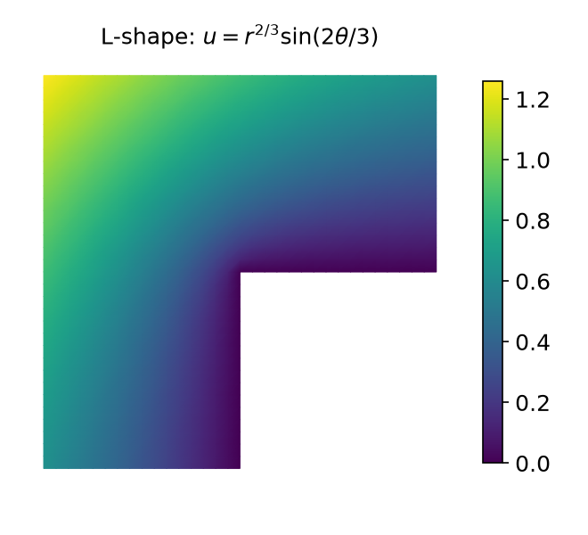
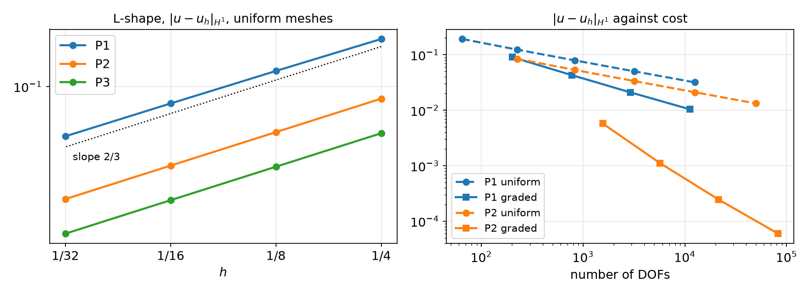

## Today

| Part | Topic | Time |
|---|---|:---:|
| **Quiz** | Week 6 material (closed-AI) | 10 min |
| **A** | Theory — weak derivatives, Sobolev spaces, Céa's lemma, elliptic regularity, Aubin–Nitsche | 70 min |
| **B** | Measuring rates correctly — which $h$, which error formula, which quadrature | 35 min |
| **C** | Regularity in action — corner singularities, graded meshes | 35 min |
| **D** | LLM pitfalls in convergence studies · assignment (a rate report) | 15 min |

::: {.box}
Lab notebook: `W07_lab.ipynb` · Assignment: `W07_HW7.ipynb` (due before Week 8) · **Week 8: midterm exam (Weeks 1–7), first 90 min**
:::

## Weeks 4–6 in one slide

| | |
|---|---|
| Interpolation (Week 4) | $|u-\mathcal I_hu|_{H^i}\le Ch^{k+1-i}|u|_{H^{k+1}}$ |
| Lax–Milgram (Week 5) | continuous ($M$) + coercive ($\gamma$) ⇒ unique, stable, same $\gamma$ on $V_h$ |
| MMS (Weeks 5–6) | P$k$: rates $k+1$ in $L^2$, $k$ in $H^1$ — observed, not yet proved |
| Boundary conditions (Week 6) | coercivity needs $\|v\|_{L^2}\le C|v|_{H^1}$; misaligned interfaces lose the rate |

::: {.fragment}
**This week:** the proof — and its fine print.

- $u_h\to u$ **where**? We need a space that contains all $V_h$ and their limits: **Sobolev spaces**.
- FE error ≤ constant × interpolation error: **Céa**. One extra power in $L^2$: **Aubin–Nitsche**.
- Both need $u\in H^{k+1}$. When $u$ is less regular, the rate drops — **for every degree**.
:::

# Part A — Convergence Theory

## §A1 The weak derivative

::: {.callout-note title="Definition — weak derivative"}
$g\in L^1_{\rm loc}(\Omega)$ is the weak derivative $D^\alpha_wf$ of $f\in L^1_{\rm loc}(\Omega)$ if
$$\int_\Omega\phi\,g\,dx=(-1)^{|\alpha|}\int_\Omega D^\alpha\phi\,f\,dx\qquad\forall\phi\in C_0^\infty(\Omega).$$
:::

Integration by parts with a test function $\phi$ that vanishes near $\partial\Omega$ — no boundary terms. The derivative moves onto $\phi$.

::: {.fragment}
| $f$ on $(-1,1)$ | weak derivative | why |
|---|---|---|
| smooth | classical $f'$ | integration by parts |
| $|x|$ | $\operatorname{sign}(x)$ | split at $0$; the boundary terms $\pm\phi(0)\cdot0$ vanish |
| $\operatorname{sign}(x)$ | **none** in $L^1_{\rm loc}$ | $-\int\phi'\operatorname{sign}=2\phi(0)$ — that is $2\delta_0$, not a function |
:::

::: {.fragment}
**FE derivative = weak derivative** for $C^0$ elements: on each cell integrate by parts; the facet terms cancel because $u$ is continuous and
$\mathbf n^+=-\mathbf n^-$ (the same argument as the FE divergence theorem of Week 6). A discontinuous $u_h$ has no weak gradient — **that is why
$H^1$ elements must be $C^0$**.
:::

## §A2 Sobolev spaces

::: {.callout-note title="Definition"}
$H^k(\Omega)=\{u\in L^2:D_w^\alpha u\in L^2\ \text{for}\ |\alpha|\le k\}$ with $\|u\|^2_{H^k}=\sum_{|\alpha|\le k}\|D^\alpha_wu\|^2_{L^2}$. A **Hilbert space** (complete); $H^{k+1}\subset H^k$.
:::

::: {.fragment}
**Completeness is the point:** a Cauchy sequence of FE solutions $u_h$ has a limit **in** $H^1$ — the space where Lax–Milgram gives $u$.
Smooth functions are dense in $H^k$: prove estimates for smooth $u$, then pass to the limit.
:::

::: {.fragment}
**Measuring regularity.** In 2D near a corner, $u=r^\alpha$ ($\alpha>0$): $|\nabla u|^2=\alpha^2r^{2\alpha-2}$ and
$\int_0^1r^{2\alpha-2}\,r\,dr<\infty\iff\alpha>0$. In general $r^\alpha\in H^s$ for $s<1+\alpha$ (fractional $s$ allowed).

| Sobolev embedding ($n$ = dimension) | |
|---|---|
| $H^k\subset C^0$ if $k>n/2$ | 1D: $H^1$ functions are continuous; 2D, 3D: need $H^2$ |
| consequence | point values are bounded on $H^1$ in 1D, **not** in 2D (Weeks 5–6) |
:::

## §A3 Strong and weak solutions

$-\Delta u+u=f$, $\partial_nu=0$ (Helmholtz): **weak** = find $u\in H^1$ with $\int\nabla u\cdot\nabla v+uv=\int fv$ for all $v\in H^1$.

::: {.fragment}
- **Strong ⇒ weak:** multiply by $v\in H^1$, integrate by parts — valid for $u\in H^2$, $v\in H^1$ (the trace $\partial_nu|_{\partial\Omega}$ exists).
- **Weak ⇒ strong** (if $u\in H^2$): take $v\in C_0^\infty$ ⇒ $-\Delta u+u=f$ in $L^2$; then arbitrary $v$ ⇒ $\int_{\partial\Omega}\partial_nu\,v=0$ ⇒ $\partial_nu=0$.
:::

::: {.fragment}
The weak form carries **both** the PDE and the natural boundary condition (Week 6). The weak solution always exists (Lax–Milgram); whether it is
in $H^2$ — or $H^{k+1}$ — is a separate question: **regularity**, §A6.
:::

## §A4 Céa's lemma

::: {.callout-important title="Theorem — Céa"}
$b$ continuous ($M$) and coercive ($\gamma$) on $V$, $u\in V$ the solution, $u_h\in V_h\subset V$ the Galerkin solution. Then
$$\|u-u_h\|_V\le\frac M\gamma\min_{v\in V_h}\|u-v\|_V\le\frac M\gamma\|u-\mathcal I_hu\|_V .$$
:::

::: {.fragment}
**Proof.** Galerkin orthogonality: $b(u-u_h,v)=0$ for $v\in V_h$. For any $v\in V_h$,
$$\gamma\|u-u_h\|^2\le b(u-u_h,u-u_h)=b(u-u_h,u-v)+\underbrace{b(u-u_h,v-u_h)}_{=0}\le M\|u-u_h\|\,\|u-v\|. \ \square$$
Symmetric $b$: $u_h$ is the **best** approximation in the energy norm, and the constant improves to $\sqrt{M/\gamma}$ (HW5 Q1).
:::

## §A4 Céa in practice

How pessimistic is $M/\gamma$? $-\nabla\cdot(k\nabla u)=f$, $k=1\,|\,\kappa$ across $x=\tfrac12$ (fitted mesh), P1, $\|u-u_h\|_{H^1}/\|u-\mathcal I_hu\|_{H^1}$:

| $\kappa$ | 1 | 10 | 100 | 1000 |
|---|:---:|:---:|:---:|:---:|
| ratio, $N=8\,/\,32$ | 0.998 / 1.000 | 1.000 / 1.000 | 1.001 / 1.000 | 1.001 / 1.000 |
| bound $\sqrt{M/\gamma}\approx\sqrt\kappa$ | 1 | 3.2 | 10 | 31.6 |

::: {.fragment}
Céa is a worst-case bound. Here the FE solution is as good as the interpolant even for $\kappa=1000$ — the **rate** comes from interpolation,
the constant from the problem. Both matter: the rate for refinement, the constant for coarse meshes.
:::

## §A5 Convergence in $H^1$

Céa + the interpolation estimate (Week 4, extended from smooth $u$ to $u\in H^{k+1}$ by density):
$$\|u-u_h\|_{H^1}\le\frac M\gamma\|u-\mathcal I_hu\|_{H^1}\le C\,h^k\,|u|_{H^{k+1}} .$$

::: {.fragment}
**If $u$ is less regular**, $u\in H^s$ with $1<s<k+1$: the interpolation estimate holds with $s$ in place of $k+1$:
$$\|u-u_h\|_{H^1}\le C\,h^{\min(k,\,s-1)}\,|u|_{H^s},\qquad \|u-\mathcal I_hu\|_{L^2}\le Ch^{\min(k+1,\,s)}|u|_{H^s}.$$
:::

## §A5 The rate needs regularity

Interpolating $u=r^\alpha$ on the unit square (singular at the corner $0$), measured rates:

| | P1 $L^2$ / $H^1$ | P2 $L^2$ / $H^1$ | P3 $L^2$ / $H^1$ | predicted $\min(k+1,1+\alpha)$ / $\min(k,\alpha)$ |
|---|:---:|:---:|:---:|---|
| $r^{0.5}$ | 1.50 / 0.50 | 1.50 / 0.50 | 1.50 / 0.50 | 1.5 / 0.5 for every $k$ |
| $r^{1.5}$ | 2.00 / 1.00 | 2.50 / 1.50 | 2.50 / 1.50 | P1: 2 / 1, P2–P3: 2.5 / 1.5 |
| $r^{2.5}$ | 2.00 / 1.00 | 3.00 / 2.00 | 3.50 / 2.50 | $k+1$ / $k$ up to 3.5 / 2.5 |

::: {.fragment}
**The rate is the smaller of what the element can do and what the function allows.** A higher degree helps only if $u$ is smooth enough.
$r^{0.5}$: P3 has 9× the DOFs of P1 and the same rate.
:::

## §A6 Elliptic regularity — and when it fails

::: {.callout-important title="Theorem — elliptic regularity (convex domain)"}
If $\Omega$ is convex (or has a smooth boundary) and $w$ solves $-\Delta w+w=g$, $\partial_nw=0$ (or $-\Delta w=g$, $w=0$) with $g\in L^2$, then
$w\in H^2$ and $|w|_{H^2}\le C\|g\|_{L^2}$.
:::

::: {.fragment}
**Re-entrant corners.** Near a corner of interior angle $\omega$, solutions of $-\Delta u=f$ (zero Dirichlet data on both sides) contain
$$u_{\rm sing}=r^{\lambda}\sin(\lambda\theta),\qquad\lambda=\frac\pi\omega,\qquad u_{\rm sing}\in H^{1+\lambda-\varepsilon}\ \text{only}.$$

| corner angle $\omega$ | $\pi/2$ (square) | $\pi$ (straight) | $3\pi/2$ (L-shape) | $7\pi/4$ | $2\pi$ (crack) |
|---|:---:|:---:|:---:|:---:|:---:|
| $\lambda=\pi/\omega$ | 2 | 1 | 2/3 | 4/7 | 1/2 |
| $u\in H^2$? | yes | yes | **no** | **no** | **no** |
:::

::: {.fragment}
Convex ⇔ all angles $<\pi$ ⇔ $\lambda>1$ ⇔ $H^2$. A single re-entrant corner caps the $H^1$ rate at $\lambda$ — §C1.
:::

## §A7 Aubin–Nitsche: one more power in $L^2$

::: {.callout-important title="Theorem — Aubin–Nitsche (convex domain)"}
$\|u-u_h\|_{L^2}\le C\,h^{k+1}|u|_{H^{k+1}}$.
:::

::: {.fragment}
**Proof (duality).** Let $w$ solve the **dual problem** $b(v,w)=(u-u_h,v)$ for all $v$, i.e. $-\Delta w+w=u-u_h$. Regularity: $|w|_{H^2}\le C\|u-u_h\|_{L^2}$.
$$\|u-u_h\|^2_{L^2}=b(u-u_h,w)=b(u-u_h,\,w-\mathcal I_hw)\le M\,\|u-u_h\|_{H^1}\,\|w-\mathcal I_hw\|_{H^1}\le C\,\|u-u_h\|_{H^1}\;h\,|w|_{H^2}.$$
Galerkin orthogonality removed $\mathcal I_hw\in V_h$. Divide by $\|u-u_h\|_{L^2}$: $\;\|u-u_h\|_{L^2}\le C\,h\,\|u-u_h\|_{H^1}\le Ch^{k+1}|u|_{H^{k+1}}$. $\square$
:::

::: {.fragment}
The extra $h$ is the interpolation error of the **dual** solution. If the dual problem is only $H^{1+\lambda}$ (re-entrant corner), the gain is $h^{\lambda}$:
$$L^2\ \text{rate}=H^1\ \text{rate}+\min(1,\lambda) .\qquad\text{L-shape: }\tfrac23+\tfrac23=\tfrac43 .$$
:::

## §A8 Summary of the theory and exercises

| | $H^1$ rate | $L^2$ rate |
|---|:---:|:---:|
| $u\in H^{k+1}$, convex domain | $k$ | $k+1$ |
| $u\in H^s$, $s<k+1$ | $s-1$ | $s-1+\min(1,\lambda)$ |
| re-entrant corner, $\lambda=\pi/\omega<1$ | $\lambda$ | $2\lambda$ |

::: {.callout-tip title="Exercise A.1 — Zero error (Ex. 5.47)"}
On $(0,1)$, P1, $N$ cells: $\int_0^1vu+v'u'=\int_0^1vx+v(1)-v(0)$ for all $v\in V_h$. Show $\|u-u_h\|_{H^1}=0$ for every $N$. Why?
:::

::: {.callout-tip title="Exercise A.2 — Regularity of a jump source (Ex. 5.48)"}
$-u''=\chi_{(0,1/2)}$ on $(0,1)$, $u(0)=u(1)=0$. In which $H^s$ is $u$? Predict the $H^1$ and $L^2$ rates of P1, P2, P3 when $x=\tfrac12$ lies inside a cell. (§B3 shows what a computer may report instead.)
:::

# Part B — Measuring Rates Correctly

## §B1 Rates: which $h$, how many points

$$\text{rate}_i=\frac{\log(E_{i-1}/E_i)}{\log(h_{i-1}/h_i)},\qquad\text{or a least-squares fit of }\log E\text{ against }\log h\text{ over the last 3–4 meshes.}$$

::: {.fragment}
| Choice | Use when | Pitfall |
|---|---|---|
| $h=1/N$ | uniform refinement of a structured mesh | meaningless for Gmsh or locally refined meshes |
| $h_{\max}$ = `msh.h(tdim, cells).max()` | quasi-uniform unstructured meshes | one bad cell dominates |
| $N_{\rm dof}^{-1/d}$ | always, and to **compare** P1/P2/uniform/graded | rate in $h$ = $d\times$ rate in $N_{\rm dof}$ |
:::

::: {.fragment}
- One pair of meshes proves nothing; look for **stable** rates over the last refinements.
- **Pre-asymptotic** regime: coarse meshes do not resolve $u$ — rates drift (Week 5: 1.95 → 1.99 → 2.00).
- A rate *above* theory is as suspicious as one below (wrong reference, superconvergence at special points, cancellation).
:::

## §B2 Computing the error

$-\Delta u=f$ on the unit square, $u=\sin\pi x\sin\pi y$, $L^2$ error; serial run:

| error computed as | P2, $N=8\to128$ | rates | P3, $N=8\to128$ | rates |
|---|---|---|---|---|
| $\int(u_h-u_{\rm UFL})^2$ | 5.5e-4 → 1.3e-7 | 3.0, 3.0, 3.0, 3.0 | 2.0e-5 → 2.9e-10 | 4.0, 4.0, 4.0, 4.0 |
| $\int u^2-2\int uu_h+\int u_h^2$ | 5.5e-4 → **2.6e-8** | 3.0, 3.0, 3.0, **5.35** | 2.0e-5 → **8.2e-8** | 4.0, 3.3, **1.5, −0.9** |
| $u_h-\mathcal I_hu$, same space | 8.7e-5 → 1.4e-9 | **3.9, 4.0, 4.0, 4.0** | 1.2e-5 → 1.8e-10 | 4.0, 4.0, 4.0, 4.0 |
| $u_h-\mathcal I u$ in P$(k+3)$, DOF-wise | 5.5e-4 → 1.3e-7 | 3.0, 3.0, 3.0, 3.0 | 2.0e-5 → 2.9e-10 | 4.0, 4.0, 4.0, 4.0 |
| UFL, `quadrature_degree` 1 | 2.3e-4 → 3.2e-8 | 3.5, 3.2, 3.1, 3.0 | 2.1e-5 → 3.1e-10 | 4.1, 4.0, 4.0, 4.0 |

::: {.fragment}
- **Expanded formula:** a difference of $O(1)$ numbers; below $\approx10^{-7}$ ($\sqrt{\varepsilon_{\rm mach}}$) the result is noise — it even changes with `-np 2`.
- **Same-space interpolant:** measures $u_h-\mathcal I_hu$ (superconvergent here), not the error.
- Under-integrated error: wrong magnitudes, rates survive here — but do not count on it.
:::

## §B3 The rate of a crime

$-u''=\chi_{(0,1/2)}$, $u(0)=u(1)=0$, $N$ odd ⇒ $x=\tfrac12$ is the **midpoint of a cell**. Load `chi * v * dx` with `chi = conditional(x < 0.5, 1, 0)`:

| | P1 $L^2$ / $H^1$ | P2 $L^2$ / $H^1$ | P3 $L^2$ / $H^1$ |
|---|:---:|:---:|:---:|
| default quadrature | **1.0** / 1.0 | 2.0 / 1.5 | 2.0 / 1.5 |
| `quadrature_degree` 20 | **1.0** / 1.0 | **1.0 / 1.0** | **1.0 / 1.0** |
| load integrated exactly (cut cell split at $\tfrac12$) | 2.0 / 1.0 | 2.5 / 1.5 | 2.5 / 1.5 |

::: {.fragment}
- Theory ($u\in H^{5/2-\varepsilon}$): $H^1$ rate $\min(k,\tfrac32)$, $L^2$ rate $\min(k+1,\tfrac52)$ — the last row.
- An odd Gauss rule has a point **exactly on the jump**; `x < 0.5` puts its weight on the wrong side. The load is wrong by $O(h)$ — a
  *variational crime* — and the computed rate is the rate of the crime. More quadrature points made it **worse**.
- Fixes: put the discontinuity on mesh nodes (Week 6), or integrate the pieces separately. Never trust a rate you cannot explain.
:::

## §B4 A credible rate study

::: {.columns}
::: {.column width="55%"}
1. Exact solution as a **UFL expression**; data ($f$, boundary values) derived from it by UFL.
2. Error integrated **directly** ($\int(u_h-u)^2$), with enough quadrature for non-polynomial $u$; collective sums with `allreduce`.
3. $\ge4$ meshes; $h$ defined consistently, or $N_{\rm dof}$.
4. Rates from consecutive pairs **and** a fit; report $L^2$ and $H^1$.
5. **Predict first:** $\min(k,s-1)$, $+\min(1,\lambda)$ in $L^2$. Explain every deviation.
6. Same numbers with `-np 1` and `-np 2`.
:::
::: {.column width="45%"}
```python
def fit_rate(h, E, last=3):
    """Slope of log E against log h, last points."""
    p = np.polyfit(np.log(h[-last:]),
                   np.log(E[-last:]), 1)
    return p[0]
```

::: {.box}
HW7 is a **rate report**: prediction, measurement, explanation — for every number.
:::
:::
:::

# Part C — Regularity in Action

## §C1 Corner singularities

$-\Delta u=0$ on $[-1,1]^2$ minus a wedge at the origin, $u=r^\lambda\sin(\lambda\theta)$ on the boundary, uniform meshes $h=\tfrac14\to\tfrac1{32}$, `-np 2`:

::: {.columns}
::: {.column width="40%"}
{width="95%"}
:::
::: {.column width="60%"}
| $\omega$ | element | $H^1$ rates | $L^2$ rates |
|---|---|:---:|:---:|
| $3\pi/2$ | P1 | 0.64, 0.65, 0.65 | 1.27, 1.29, 1.30 |
| ($\lambda=\tfrac23$) | P2 | 0.67, 0.67, 0.67 | 1.40, 1.38, 1.36 |
| | P3 | 0.67, 0.67, 0.67 | 1.40, 1.38, 1.36 |
| $7\pi/4$ | P1 | 0.56, 0.56, 0.57 | 1.13, 1.14, 1.14 |
| ($\lambda=\tfrac47$) | P2 | 0.57, 0.57, 0.57 | 1.21, 1.18, 1.16 |
| | P3 | 0.57, 0.57, 0.57 | 1.19, 1.17, 1.16 |

Predicted: $H^1$ $\lambda$ = 0.667 / 0.571; $L^2$ $2\lambda$ = 1.333 / 1.143.
:::
:::

::: {.fragment}
Every degree converges at the **same** rate. P3 costs 9× the DOFs of P1 for a constant-factor gain.
:::

## §C2 Rates and cost

{width="95%" fig-align="center"}

Left: uniform meshes, slope $\tfrac23$ for every degree. Right: the same error against the number of DOFs — uniform (dashed) vs graded (solid) meshes.

## §C3 Graded meshes

Make cells small where $u$ is rough: $\;h_K\lesssim H\,r_K^{\,1-\mu}$, $r_K$ = distance to the corner. With $\mu<\lambda/k$ the rate in $N_{\rm dof}$ is **optimal**, $k/2$ in $H^1$.

```python
for _ in range(40):
    msh.topology.create_entities(1); msh.topology.create_connectivity(2, 1)
    cells = np.arange(msh.topology.index_map(2).size_local, dtype=np.int32)
    hK, r = msh.h(2, cells), np.linalg.norm(mesh.compute_midpoints(msh, 2, cells)[:, :2], axis=1)
    mark = cells[hK > 1.5 * H * np.maximum(r, H ** (1 / mu)) ** (1 - mu)]
    if msh.comm.allreduce(len(mark), op=MPI.SUM) == 0:
        break
    msh = mesh.refine(msh, mesh.compute_incident_entities(msh.topology, mark, 2, 1))[0]   # returns (mesh, parents, ...)
```

::: {.fragment}
L-shape, slope of $|u-u_h|_{H^1}$ against $N_{\rm dof}$ (optimal $k/2$):

| | uniform | graded | DOFs for $|e|_{H^1}\approx10^{-2}$ |
|---|:---:|:---:|---|
| P1 ($\mu=0.5$) | 0.36, 0.34, 0.34, 0.33 | 0.55, 0.54, 0.52 | uniform $>10^4$ (3.2e-2 at 12 545) · graded 11 186 |
| P2 ($\mu=0.25$) | 0.35, 0.34, 0.34, 0.34 | 1.27, 1.14, 1.05 | graded: **6.0e-5** at 82 643 |
:::

## §C4 Math → DOLFINx

| Math | DOLFINx 0.11 |
|---|---|
| exact $u$, $f=-\Delta u$ | UFL expression; `ufl.atan2`, `ufl.conditional` for $\theta\in[0,\omega)$; `-ufl.div(ufl.grad(u_ex))` |
| $\|u-u_h\|_{L^2}$, $|u-u_h|_{H^1}$ | `sqrt(allreduce(assemble_scalar(form((uh-u_ex)**2*dx))))` — direct, not expanded |
| enough quadrature | `ufl.Measure("dx", metadata={"quadrature_degree": q})` for singular or non-polynomial $u$ |
| $h$, $N_{\rm dof}$ | `msh.h(tdim, cells)`, `V.dofmap.index_map.size_global` |
| domain with a re-entrant corner | `mesh.create_submesh(big, tdim, kept_cells)[0]` (or Gmsh) |
| local refinement | `mesh.refine(msh, edges)[0]`, `edges = mesh.compute_incident_entities(topology, cells, 2, 1)` |
| rate | `np.log(E[:-1]/E[1:]) / np.log(h[:-1]/h[1:])`, or `np.polyfit(log h, log E, 1)` |

# Part D — LLMs and Convergence Studies · Assignment

## §D1 Where LLM-generated rate studies go wrong

| Kind | What it looks like | Detection |
|---|---|---|
| **Theory by template** | "P2 converges with $O(h^3)$" — on an L-shaped domain | predict from regularity first |
| **Self-fulfilling error** | error against $\mathcal I_hu$ in the same space; expanded $\int u^2-2uu_h+u_h^2$ | rates too high, noise below $10^{-7}$ |
| **Wrong $h$** | $h=1/N$ on a Gmsh or refined mesh; $N$ instead of $h$ (negative rates) | plot against $N_{\rm dof}$ |
| **Data crimes** | `conditional` jumps inside cells; under-integrated singular data | rate changes with `quadrature_degree` |
| **Overclaiming** | a rate from two meshes; "converges optimally" without a number | ask for the table |
| **Stale API** | `mesh.refine(msh, edges)` used as a mesh (it returns a tuple); `create_submesh(...)` likewise | `AttributeError` |

## §D2 Writing the rate report

For every configuration in HW7:

| Step | Content |
|---|---|
| **Predict** | regularity of $u$ (which $H^s$, why), then $H^1$ and $L^2$ rates with the formula |
| **Measure** | table of errors and rates, ≥ 4 meshes, plot with reference slopes; $h$ and $N_{\rm dof}$ |
| **Compare** | predicted vs observed in one table |
| **Explain** | every difference > 0.05: pre-asymptotic? quadrature? geometry? a bug? |
| **Verify** | a smooth MMS reference case that gives the textbook rates with the same code |

::: {.fragment}
An LLM can draft the prose. The numbers, the prediction and the explanation of each deviation are yours — the AI-usage log must say which is which.
:::

## Assignment — HW7, due before the Week 8 lecture

::: {.columns}
::: {.column width="55%"}
### HW7 — Theoretical vs observed rates (100)
- **Q1** proofs: weak derivatives and $r^\alpha\in H^1$, Aubin–Nitsche with Dirichlet conditions and its failure at re-entrant corners, zero error for an exact $V_h$ solution (25)
- **Q2** rate report: corner domains $3\pi/2$, $5\pi/4$ and a smooth reference, P1–P3, uniform and graded meshes (40)
- **Q3** measurement pitfalls: a jump in the data, cancellation in the error formula (15)
- **Q4** LLM claims about convergence rates, checked against your own numbers (20)
:::
::: {.column width="45%"}
::: {.box}
Submit the executed `.ipynb` (restart & run all) with the AI-usage log.

**Week 8:** midterm exam (Weeks 1–7, closed-AI) in the first 90 minutes.
:::
:::
:::

## Summary

| Concept | Key idea | DOLFINx |
|---|---|---|
| Weak derivative | derivative moved onto a test function; $C^0$ FE derivative is weak | `ufl.grad` on $C^0$ spaces |
| Sobolev space $H^k$ | complete; $r^\alpha\in H^{s}$ for $s<1+\alpha$; $H^k\subset C^0$ iff $k>n/2$ | — |
| Céa | $\|u-u_h\|\le\frac M\gamma\|u-\mathcal I_hu\|$; worst case, often ≈ 1 | — |
| Regularity | convex ⇒ $H^2$; corner $\omega>\pi$ ⇒ $H^{1+\pi/\omega}$ only | `create_submesh`, exact $r^\lambda\sin\lambda\theta$ |
| Aubin–Nitsche | duality ⇒ $L^2$ rate = $H^1$ rate + $\min(1,\lambda)$ | — |
| Rate study | direct error integral, consistent $h$/$N_{\rm dof}$, prediction first | `assemble_scalar`, `polyfit` |
| Graded meshes | $h_K\sim Hr^{1-\mu}$, $\mu<\lambda/k$ ⇒ optimal rate in DOFs | `mesh.refine` |

::: {.fragment}
### Next week — Midterm (Weeks 1–7), then nonlinear problems
Gâteaux derivatives, Newton's method by hand and with `NonlinearProblem` / SNES.
:::
