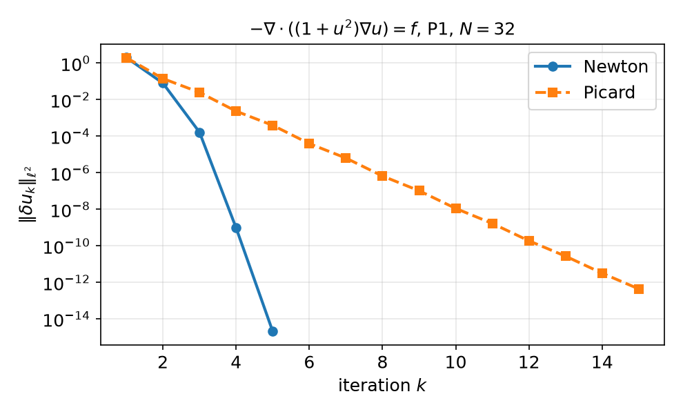

## Today

| Part | Topic | Time |
|---|---|:---:|
| **Midterm** | Weeks 1–7, closed-AI | 90 min |
| **A** | Theory — residual form, Gâteaux derivative, Newton's method, Picard iteration | 35 min |
| **B** | Newton by hand in DOLFINx — `ufl.derivative`, the update loop, what goes wrong | 30 min |
| **C** | The term project — scope, proposal, assessment | 15 min |
| **D** | LLM pitfalls with nonlinear solvers | 10 min |

::: {.box}
Lab notebook: `W08_lab.ipynb` · Assignment: **project proposal** `W08_project_proposal.ipynb` (due before Week 9) · Week 9: SNES, line search, continuation, HW8
:::

## Where we are

Weeks 1–7: **linear** problems $b(u,v)=F(v)$ — one linear solve, Lax–Milgram, Céa, rates.

::: {.fragment}
Most process models are **nonlinear**:

| Model | Nonlinearity |
|---|---|
| heat conduction with $k(T)$ | $-\nabla\cdot(k(T)\nabla T)=Q$ |
| power-law (non-Newtonian) flow | viscosity $\mu(|\nabla u|)$ |
| reaction–diffusion | source $r(u)$, e.g. $-\Delta u+u^3=f$ or Arrhenius $e^{-E/RT}$ |
| Navier–Stokes | convection $(\mathbf u\cdot\nabla)\mathbf u$ |
:::

::: {.fragment}
Plan: write the problem as $F(u;v)=0$, linearize it (Gâteaux derivative), solve a **sequence of linear problems** — each one exactly the
machinery of Weeks 5–7.
:::

# Part A — Newton's Method in Function Space

## §A1 The model problem and its residual

$$-\nabla\cdot\bigl(q(u)\nabla u\bigr)=f\ \text{ in }\Omega,\qquad u=g\ \text{ on }\partial\Omega,\qquad q(u)=1+u^2 .$$

::: {.fragment}
Weak form: find $u\in H^1$, $u=g$ on $\partial\Omega$, with
$$F(u;v):=\int_\Omega q(u)\,\nabla u\cdot\nabla v\,dx-\int_\Omega fv\,dx=0\qquad\forall v\in H^1_0 .$$
$F$ is **linear in $v$**, **nonlinear in $u$**. There is no bilinear form, so Lax–Milgram does not apply directly.
:::

::: {.fragment}
- Discretely: $\mathbf F(\mathbf u)=\mathbf 0$ with $F_i(\mathbf u)=F(u_h;\phi_i)$ — $N$ nonlinear equations in $N$ unknowns.
- In UFL the residual is written with a `fem.Function` `uh` (not a `TrialFunction`):
  `F = q(uh) * inner(grad(uh), grad(v)) * dx - f * v * dx`.
:::

## §A2 The Gâteaux derivative

::: {.callout-note title="Definition — Gâteaux (directional) derivative"}
$$J(u;w,v):=\frac{d}{d\varepsilon}F(u+\varepsilon w;v)\Big|_{\varepsilon=0}$$
— linear in the direction $w$ and in $v$: a **bilinear form**, the linearization of $F$ at $u$.
:::

::: {.fragment}
For $q(u)=1+u^2$, with $\frac{d}{d\varepsilon}q(u+\varepsilon w)|_0=q'(u)w=2uw$:
$$J(u;w,v)=\int_\Omega q(u)\,\nabla w\cdot\nabla v\,dx+\int_\Omega q'(u)\,w\,\nabla u\cdot\nabla v\,dx .$$
The second term is the one that is easy to forget.
:::

::: {.fragment}
| | by hand | UFL |
|---|---|---|
| residual | $F(u;v)$ | `F = ...` with `uh` a `Function` |
| Jacobian | $J(u;w,v)$ | `J = ufl.derivative(F, uh, w)` with `w = TrialFunction(V)` |

`ufl.derivative` differentiates the form symbolically — no hand algebra, no forgotten terms.
:::

## §A3 Newton's method

Linearize at the current iterate $u^k$: $F(u^k+\delta;v)\approx F(u^k;v)+J(u^k;\delta,v)$. Set the right side to zero:

::: {.callout-important title="Newton's method"}
Given $u^0$ with $u^0=g$ on $\partial\Omega$, repeat: find $\delta u\in V_0$ with
$$J(u^k;\delta u,v)=F(u^k;v)\quad\forall v\in V_0,\qquad u^{k+1}=u^k-\delta u,$$
until $\|\delta u\|$ (or $\|F(u^k)\|$) is below a tolerance.
:::

::: {.fragment}
- Each step is a **linear** variational problem with the bilinear form $J(u^k;\cdot,\cdot)$ — Weeks 5–6.
- The correction vanishes on $\Gamma_D$: the boundary values are put into $u^0$ once, then $\delta u\in V_0$ (homogeneous Dirichlet for $\delta u$).
- In matrices: $J(\mathbf u^k)\,\delta\mathbf u=\mathbf F(\mathbf u^k)$, $\;J_{ij}=J(u^k;\phi_j,\phi_i)=\partial F_i/\partial u_j$.
:::

## §A4 Convergence: quadratic vs linear

::: {.callout-important title="Theorem — local quadratic convergence"}
If $F(u^*)=0$, $J(u^*)$ is invertible and $J$ is Lipschitz near $u^*$, then for $u^0$ close enough to $u^*$
$$\|u^{k+1}-u^*\|\le C\,\|u^k-u^*\|^2 .$$
:::

::: {.columns}
::: {.column width="52%"}
{width="100%"}
:::
::: {.column width="48%"}
**Picard:** freeze the coefficient, $\int q(u^k)\nabla u^{k+1}\cdot\nabla v=\int fv$ — Newton without the $q'(u)$ term; linear convergence.

$u=1+\sin(\pi x)y^2$, P1, $N=32$, initial guess = solution with $q=1$:

- Newton: 5 iterations; $\|\delta u_{k+1}\|/\|\delta u_k\|^2=0.020,\ 0.026,\ 0.035$
- Picard: 15 iterations; $\|\delta u_{k+1}\|/\|\delta u_k\|\approx0.1$–$0.17$
- Both reach the **same** $u_h$ ($L^2$ error $3.78\times10^{-4}$)
:::
:::

## §A5 What the nonlinear solver does not change

The discretization error is a property of $u_h$, not of the iteration:

| P$k$, $N=8\to64$ | Newton iterations | $L^2$ errors | rates |
|---|:---:|---|:---:|
| P1 | 5, 5, 5, 5 | 5.9e-3 → 9.5e-5 | 1.98, 1.99, 2.00 |
| P2 | 5, 5, 5, 5 | 2.0e-4 → 3.9e-7 | 3.01, 3.00, 3.00 |

::: {.fragment}
- **Mesh independence:** the number of Newton iterations does not grow with $N$ — Newton converges in function space, the discretizations inherit it.
- **MMS works unchanged:** choose $\tilde u$, compute $f=-\nabla\cdot(q(\tilde u)\nabla\tilde u)$ with UFL, check the rates — once the iteration has converged.
- Stop on $\|\delta u\|$ or $\|F\|$ far below the discretization error — and **check that it stopped because it converged**.
:::

## §A6 The initial guess

Newton is only **locally** convergent. P1, $N=32$:

| $u^0$ | iterations | $\|\delta u\|$ history |
|---|:---:|---|
| solution of the linear problem with $q=1$ | 5 | 2.0, 8.0e-2, 1.6e-4, 9.6e-10, 2.1e-15 |
| $g$ on the boundary, 0 inside | 8 | 62, 17, 6.6, 1.5, 0.11, 9.3e-4, 9.3e-8, 2.5e-15 |

::: {.fragment}
Strategies (Week 9): a linear(ised) problem as the first guess; **continuation** in a parameter (load, Reynolds number, $q$); **damping / line
search** $u^{k+1}=u^k-\alpha\,\delta u$, $0<\alpha\le1$. PETSc SNES provides line searches and convergence tests.
:::

# Part B — Newton by Hand in DOLFINx

## §B1 Residual and Jacobian in UFL

```python
uh = fem.Function(V)                                       # the unknown: a Function, not a TrialFunction
v, w = ufl.TestFunction(V), ufl.TrialFunction(V)
q = lambda u: 1 + u**2
F = q(uh) * ufl.inner(ufl.grad(uh), ufl.grad(v)) * ufl.dx - f * v * ufl.dx
J = ufl.derivative(F, uh, w)                               # Gâteaux derivative in the direction w
Fc, Jc = fem.form(F), fem.form(J)                          # compiled once; they read uh's current values

bc_u = fem.dirichletbc(g, dofs)                            # boundary values for u^0
bc0 = fem.dirichletbc(0.0, dofs, V)                        # the correction is zero on the boundary
uh.x.array[:] = initial_guess.x.array                      # must satisfy u = g on the boundary
```

::: {.fragment}
The compiled forms keep a **reference** to `uh`: change `uh.x.array`, re-assemble, and you get $F(u^{k+1})$ and $J(u^{k+1})$ — no new forms inside the loop.
:::

## §B2 The Newton loop

```python
A, b = fem.petsc.create_matrix(Jc), fem.petsc.create_vector(V)
ksp = PETSc.KSP().create(comm); ksp.setOperators(A); ksp.setType("preonly"); ksp.getPC().setType("lu")
du = fem.Function(V)
for k in range(max_it):
    A.zeroEntries(); assemble_matrix(A, Jc, bcs=[bc0]); A.assemble()           # J(u^k)
    with b.localForm() as bl: bl.set(0.0)
    assemble_vector(b, Fc)                                                     # F(u^k)
    apply_lifting(b, [Jc], bcs=[[bc0]])
    b.ghostUpdate(addv=PETSc.InsertMode.ADD, mode=PETSc.ScatterMode.REVERSE)
    set_bc(b, [bc0])
    ksp.solve(b, du.x.petsc_vec); du.x.scatter_forward()                      # J du = F
    uh.x.array[:] -= du.x.array                                                # u^{k+1} = u^k - du
    if du.x.petsc_vec.norm() < tol:                                            # collective: all ranks
        break
else:
    raise RuntimeError("Newton did not converge")
```

::: {.fragment}
Re-use $A$ and $b$ (zero them each step). The sign convention $J\delta u=F$, $u\leftarrow u-\delta u$ is the one of DOLFINx's own Newton solvers.
:::

## §B3 A parallel-only sign error

Tempting variant: assemble $F$, then `b.scale(-1)` to solve $J\delta u=-F$ and **add** $\delta u$:

```python
assemble_vector(b, Fc); b.scale(-1.0)          # scales OWNED entries only — ghost entries keep +F
apply_lifting(...); b.ghostUpdate(ADD, REVERSE) # adds +F from the ghosts to -F on the owners
```

::: {.fragment}
P1, $N=16$, `-np 2`: $\|\delta u\|$ = 0.48, 1.1, 1.3, 1.6, 2.3, 4.6, 12, 18, 20, 18, 290, 39 000 — **divergence**. With `-np 1` the same code
converges (no ghosts). A PETSc `Vec` operation acts on the owned part; ghost entries are a separate local buffer.
:::

::: {.fragment}
Rule (Weeks 5–6, again): finish the vector — assemble, lift, `ghostUpdate`, `set_bc` — **before** any vector arithmetic; then test with `-np 2`.
:::

## §B4 Checks for a Newton solver

| Check | Expected | Catches |
|---|---|---|
| $\|\delta u_k\|$ history | quadratic: $\|\delta u_{k+1}\|/\|\delta u_k\|^2\approx$ const | wrong Jacobian (→ linear) |
| Taylor test $\|F(u+\varepsilon w)-F(u)-\varepsilon J(u)w\|$ | $O(\varepsilon^2)$; measured order **2.00** (exact $J$) vs **1.00** ($q'(u)$ term dropped) | hand-written Jacobians |
| iterations vs $N$ | constant | mesh-dependent stopping criteria |
| MMS rates of the converged $u_h$ | $k+1$ / $k$ | everything else (Weeks 5–7) |
| `-np 1` vs `-np 2` | identical histories | ghost/sign errors (§B3) |

::: {.fragment}
Week 9: the same with `NonlinearProblem` (PETSc SNES: `newtonls`, line search, `getConvergedReason()`), continuation, and HW8 (nonlinear MMS).
:::

# Part C — The Term Project

## §C1 Scope and milestones

**40 % of the grade:** proposal 5 · final report and code 25 · final presentation 10 (Week 16; no final exam).

::: {.fragment}
One **nonlinear or flow** problem, ideally from your own research. You must:

1. derive the weak form and argue well-posedness (or explain why the standard argument fails),
2. implement it in Colab with DOLFINx 0.11 (`%%fenicsx`, runs with `-np 2`),
3. **verify** it: MMS with predicted rates **and** a benchmark or an analytical/physical check,
4. document the LLM workflow: what was generated, which errors were found, how each part was verified.
:::

::: {.fragment}
**Six prepared topics** (`projects/index.html`): A PEM fuel-cell cathode · B packed-bed thermal runaway · C buoyant vertical bed · D Nernst–Planck
electrochemistry · E ignition–extinction by arclength continuation · F catalyst-activity map by adjoint optimization — or your own topic, e.g.
power-law channel flow, natural convection, heat conduction with $k(T)$.
:::

## §C2 The proposal (due before Week 9)

`W08_project_proposal.ipynb` — about two pages plus one running cell:

| Section | What we look for |
|---|---|
| Problem | physical setting, governing equations, parameters with units, dimensionless groups |
| Weak form | spaces, boundary conditions (essential/natural), the nonlinear residual $F(u;v)$ |
| Analysis plan | which theorem applies (Lax–Milgram for the linearization? monotone operators? inf-sup?) |
| Verification plan | manufactured solution and **predicted** rates; benchmark/reference data with a citation |
| Smoke test | one `%%fenicsx -np 2` cell that builds the mesh and solves a linear simplification |
| LLM plan and risks | what you will delegate, how you will check it; what could fail and the fallback |

::: {.fragment}
The proposal is graded for **feasibility and verifiability**, not ambition. A small problem done and verified beats a large one that is not.
:::

# Part D — LLMs and Nonlinear Solvers · Assignment

## §D1 Where LLM-generated Newton code goes wrong

| Kind | What it looks like | Detection |
|---|---|---|
| **Stale API** | `NewtonSolver(comm, NonlinearProblem(...))` (0.9 style); missing `petsc_options_prefix` | deprecation warning + `AttributeError: ... no attribute 'a'`; `TypeError` |
| **Trial vs Function** | residual written with a `TrialFunction` instead of a `Function` | `ArityMismatch: Applying nonlinear operator Power ...` at `fem.form` |
| **Hand Jacobian** | $q'(u)$ term dropped or wrong | linear instead of quadratic convergence; Taylor test |
| **Boundary values** | non-zero BC applied to the correction $\delta u$ in every step | boundary values drift; solution wrong at $\Gamma_D$ |
| **Stopping** | fixed number of iterations; no convergence check; absolute tolerance on a scaled problem | print the history; check the reason |
| **Parallel** | `b.scale(-1)` before `ghostUpdate`; stopping test on a per-rank norm | `-np 1` vs `-np 2` |

## Assignment — project proposal, due before the Week 9 lecture

::: {.columns}
::: {.column width="55%"}
### Project proposal (5 % of the grade)
- Fill in `W08_project_proposal.ipynb`: problem, weak form, analysis plan, verification plan, smoke test, LLM plan, risks, timeline
- The smoke-test cell must run with `-np 2` on Colab
- Include the AI-usage log
- One page of feedback comes back in Week 9
:::
::: {.column width="45%"}
::: {.box}
No weekly homework this week. HW8 (nonlinear MMS with SNES) is set in Week 9.

The lab `W08_lab.ipynb` (Newton by hand) is the basis for HW8 — finish it before Week 9.
:::
:::
:::

## Summary

| Concept | Key idea | DOLFINx |
|---|---|---|
| Residual form | $F(u;v)=0$, linear in $v$, nonlinear in $u$ | `uh` is a `Function` |
| Gâteaux derivative | $J(u;w,v)=\frac d{d\varepsilon}F(u+\varepsilon w;v)|_0$ | `ufl.derivative(F, uh, w)` |
| Newton | $J(u^k)\delta u=F(u^k)$, $u^{k+1}=u^k-\delta u$, $\delta u=0$ on $\Gamma_D$ | assemble, lift, `ghostUpdate`, `set_bc`, solve |
| Convergence | quadratic near the solution; mesh-independent iteration count | $\|\delta u\|$ history |
| Picard | frozen coefficient; linear convergence | drop the $q'(u)$ term |
| Verification | MMS rates of the converged $u_h$; `-np 1` vs `-np 2` | Weeks 5–7 tools |

::: {.fragment}
### Next week — Nonlinear problems II
`NonlinearProblem` and PETSc SNES, line search, continuation, convergence diagnostics; HW8 nonlinear MMS.
:::
