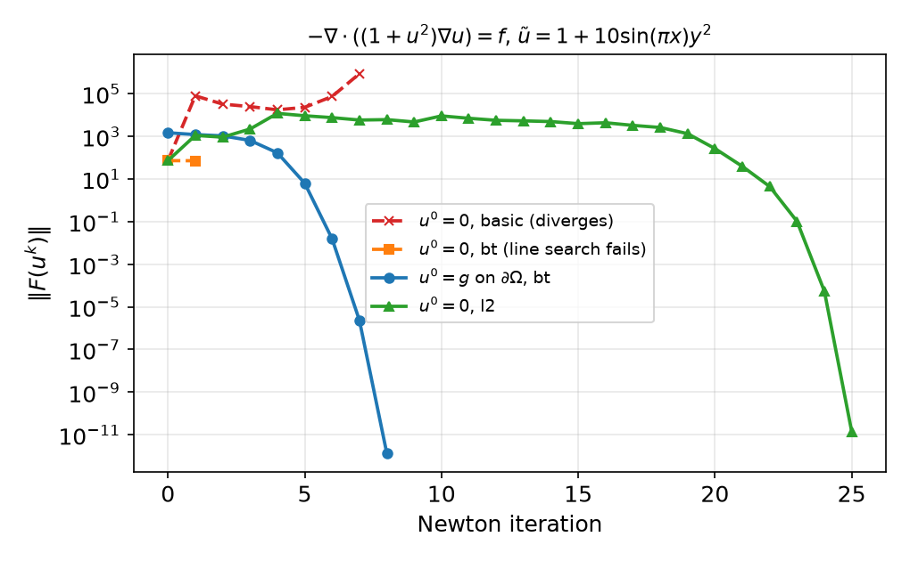
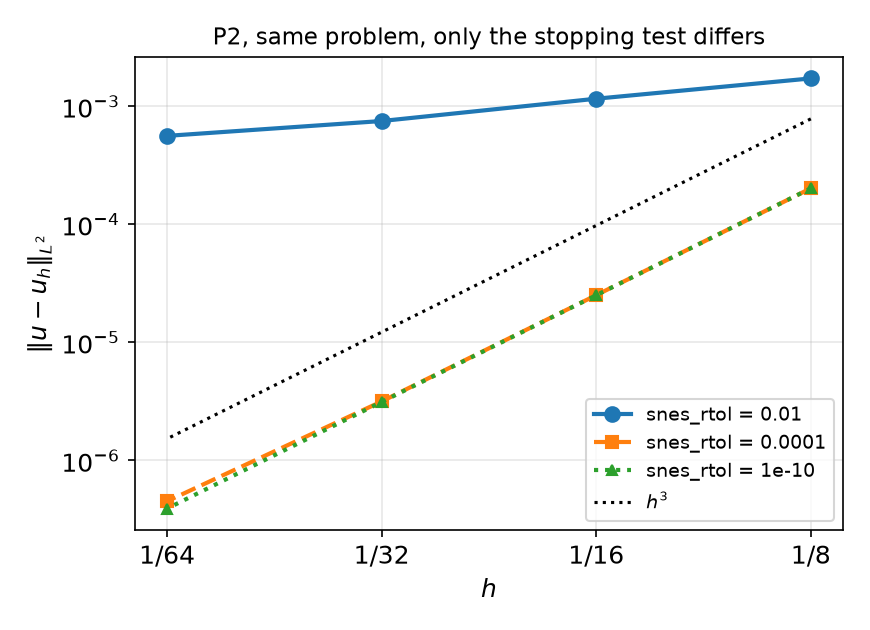
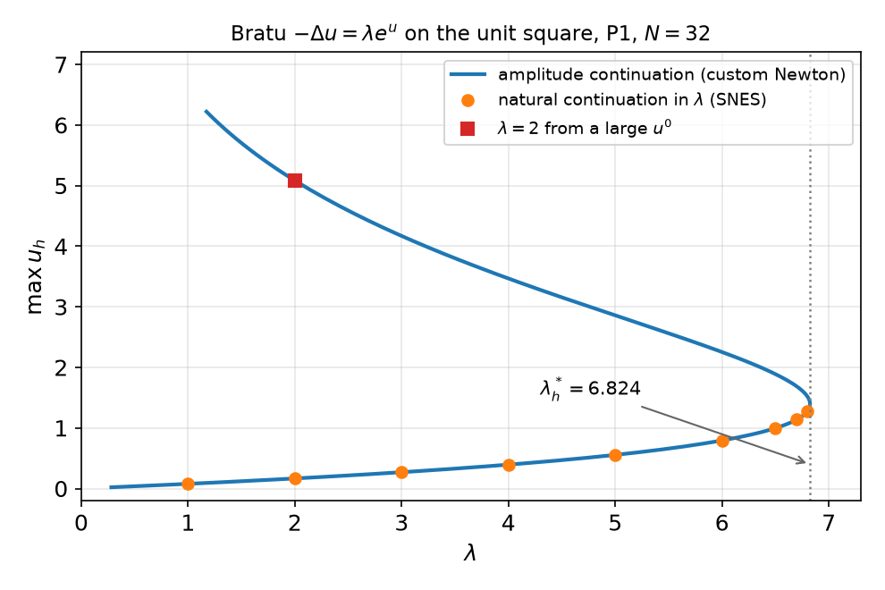

## Today

| Part | Topic | Time |
|---|---|:---:|
| Quiz | Week 8 (Gâteaux derivative, Newton step, convergence, parallel sign error) | 10 min |
| **A** | Theory — when does a nonlinear problem have a (unique) solution; Newton–Kantorovich; line search; continuation; inexact Newton | 45 min |
| **B** | PETSc SNES in DOLFINx 0.11 — `NonlinearProblem`, options, reasons, line search, stopping tests | 45 min |
| **C** | Continuation in practice — Bratu's problem, a fold, a custom Newton solver that passes it | 35 min |
| **D** | LLM pitfalls with SNES · HW8 · proposal feedback | 15 min |

::: {.box}
Lab notebook: `W09_lab.ipynb` · Homework: `W09_HW8.ipynb` (due before Week 10) · Proposal feedback: returned today
:::

## Week 8 in one slide

$$F(u;v)=0\ \ \forall v\in V_0,\qquad J(u^k;\delta u,v)=F(u^k;v),\qquad u^{k+1}=u^k-\delta u,\qquad \delta u=0\ \text{on }\Gamma_D .$$

| What we saw | Number (P1, $N=32$, $q=1+u^2$) |
|---|---|
| Newton from the $q=1$ solution | 5 iterations, $\|\delta u_{k+1}\|/\|\delta u_k\|^2\approx0.02$–$0.035$ |
| Picard (no $q'(u)$ term) | 15 iterations, linear |
| iterations vs $N$ | constant (mesh independence) |
| MMS rates of the converged $u_h$ | P1 2.00, P2 3.00 |

::: {.fragment}
Open questions from Week 8:

1. Does the nonlinear problem have a solution at all — and only one?
2. What if $u^0$ is **not** close? (zero guess: 8 iterations with $\|\delta u_1\|=62$)
3. Do we have to write the loop ourselves every time?
:::

# Part A — Theory

## §A1 Existence and uniqueness: monotone operators

Lax–Milgram needs a bilinear form. A nonlinear residual $F(u;v)=\langle\mathcal A(u),v\rangle-\ell(v)$ defines an operator $\mathcal A:V\to V'$.

::: {.callout-note title="Theorem (Zarantonello) — strongly monotone, Lipschitz operators"}
Let $V$ be a Hilbert space and $\mathcal A:V\to V'$ satisfy, for all $u,w\in V$,
$$\langle\mathcal A(u)-\mathcal A(w),u-w\rangle\ \ge\ \alpha\|u-w\|_V^2,\qquad \|\mathcal A(u)-\mathcal A(w)\|_{V'}\ \le\ L\|u-w\|_V .$$
Then $\mathcal A(u)=\ell$ has exactly one solution for every $\ell\in V'$, and $\|u-w\|_V\le\alpha^{-1}\|\mathcal A(u)-\mathcal A(w)\|_{V'}$.
:::

::: {.fragment}
- For a linear $\mathcal A$ this **is** Lax–Milgram (coercivity $\alpha$, continuity $L$).
- Proof: $u\mapsto u-\rho R^{-1}(\mathcal A(u)-\ell)$ is a contraction for $0<\rho<2\alpha/L^2$ ($R$ = Riesz map) — a Picard-type iteration.
- Typical example: a flux that depends on the **gradient**, $\mathcal A(u)=-\nabla\cdot\mathbf a(\nabla u)$ with $(\mathbf a(\xi)-\mathbf a(\eta))\cdot(\xi-\eta)\ge\alpha|\xi-\eta|^2$
  (regularized power-law fluids, nonlinear elasticity with small strains).
:::

## §A2 Two model problems that are not monotone

::: {.columns}
::: {.column width="50%"}
**Quasilinear diffusion** $-\nabla\cdot(q(u)\nabla u)=f$ (Week 8)

$q$ depends on $u$, not $\nabla u$ — not strongly monotone in general. But with $q\ge q_0>0$ use the **Kirchhoff transform**
$$K(u)=\int_0^u q(s)\,ds,\qquad \nabla K(u)=q(u)\nabla u .$$
Then $w=K(u)$ solves the **linear** problem $-\Delta w=f$, $w=K(g)$ on $\partial\Omega$; $K$ is strictly increasing, so $u=K^{-1}(w)$ exists and is unique.

(Works for $q=q(u)$ with Dirichlet data. Not for $q(x,u)$, not for Robin conditions.)
:::
::: {.column width="50%"}
**Bratu / Frank-Kamenetskii** $-\Delta u=\lambda e^u$, $u=0$

Steady thermal explosion: heat release $\propto e^{u}$ (linearized Arrhenius), conduction to a cold wall; $\lambda$ = Frank-Kamenetskii parameter.

- the reaction term **helps** $u$ grow — the opposite of monotone;
- there is a critical $\lambda^*$: **two** solutions for $0<\lambda<\lambda^*$, one at $\lambda^*$, **none** for $\lambda>\lambda^*$ (no steady state: ignition);
- at $\lambda^*$ the Jacobian $J(u^*)=-\Delta-\lambda^*e^{u^*}$ is **singular** — a **fold** (turning point).

Unit square: $\lambda^*\approx6.80812$ (literature value). We will reproduce it in Part C.
:::
:::

## §A3 How far does Newton reach? (Newton–Kantorovich)

::: {.callout-important title="Theorem (Newton–Kantorovich, classical form)"}
Suppose $\|J(u^0)^{-1}\|\le\beta$, $\|J(v)-J(w)\|\le\gamma\|v-w\|$ near $u^0$, and let $\eta=\|\delta u^0\|=\|J(u^0)^{-1}F(u^0)\|$ be the first correction. If
$$h_0:=\beta\gamma\,\eta\le\tfrac12 ,$$
then the Newton iterates stay in a ball of radius $\approx2\eta$ around $u^0$ and converge to a solution $u^*$, unique in that ball —
quadratically when $h_0<\tfrac12$.
:::

::: {.fragment}
Read it as: **(conditioning × nonlinearity) × (size of the first step) must be small.**

- Large data or a poor guess ⇒ big $\|\delta u^0\|$ ⇒ no guarantee (Week 8: $u^0=0$ gave $\|\delta u^0\|=62$).
- Near a fold $J^{-1}$ blows up ⇒ $\beta$ blows up ⇒ the basin shrinks and iteration counts grow (Bratu below: 3 → 5 iterations as $\lambda\to\lambda^*$).
- The bound is in **function-space** norms — another way to see why the iteration count does not depend on $N$.

Two remedies: make the step smaller (**damping / line search**) or make $\|\delta u^0\|$ smaller (**continuation**).
:::

## §A4 Globalization: line search on a merit function

Merit function $\phi(u)=\tfrac12\|F(u)\|^2$ (discrete residual vector). Newton direction $d=-J^{-1}F$:
$$\nabla\phi\cdot d=(J^\top F)\cdot(-J^{-1}F)=-\|F\|^2<0 \quad\Rightarrow\quad d \text{ is a descent direction.}$$

::: {.fragment}
**Backtracking (Armijo):** try $\alpha=1,\ \alpha_1,\ \alpha_2,\dots$ until $\|F(u+\alpha d)\|^2\le(1-2c\,\alpha)\|F(u)\|^2$ ($c=10^{-4}$); take $u\leftarrow u+\alpha d$.

| PETSc `snes_linesearch_type` | step length $\alpha$ |
|---|---|
| `basic` (= `none`) | always 1 — plain Newton |
| `bt` (**default** for `newtonls`) | backtracking with quadratic/cubic interpolation of $\phi$ |
| `l2` | secant search for a minimum of $\|F(u+\alpha d)\|_2^2$ |
| `cp` | critical point of $F\cdot d$ (meant for gradients of an energy) |
:::

::: {.fragment}
Caveats: (i) the descent property needs $d$ to be the Newton direction **of the same $F$ that $\phi$ measures**; (ii) $\phi$ can have local minima
where $J$ is singular — the line search then fails (`DIVERGED_LINE_SEARCH`); (iii) near the solution $\alpha=1$ is accepted and quadratic convergence returns.
:::

## §A5 Continuation

Embed the problem in a family $F(u;\lambda)=0$ with an easy member ($\lambda_0$) and the target ($\lambda_1$): load, amplitude of the data,
Reynolds number, $\beta$ in $k=e^{\beta u}$, …

::: {.callout-note title="Natural-parameter continuation"}
$\lambda_0<\lambda_1<\dots<\lambda_n$; solve $F(u;\lambda_{j})=0$ by Newton starting from $u(\lambda_{j-1})$ (or from a predictor
$u_{j-1}+(\lambda_j-\lambda_{j-1})\,\partial_\lambda u$). Halve the step if Newton fails.
:::

::: {.fragment}
- Each step has a small $\|\delta u^0\|$ — Kantorovich's $h_0$ stays small.
- **Fails at a fold:** at $\lambda^*$, $J$ is singular and for $\lambda>\lambda^*$ there is no nearby solution — no step size helps.
- **Fix — change the parameter.** Treat $\lambda$ as an unknown and prescribe something that increases monotonically along the branch, e.g. $\int_\Omega u\,dx=m$
  (amplitude continuation) or the arc length (pseudo-arclength continuation):
$$\begin{pmatrix}J & F_\lambda\\ \ell^\top & 0\end{pmatrix}\begin{pmatrix}\delta u\\ \delta\lambda\end{pmatrix}=\begin{pmatrix}F\\ c\end{pmatrix},\qquad c=\int_\Omega u\,dx-m,\quad \ell_i=\int_\Omega\phi_i\,dx .$$
  The **bordered** matrix is non-singular at the fold even though $J$ is not.
:::

## §A6 Inexact Newton

For large problems the linear system $J\delta u=F$ is solved iteratively, only to a tolerance:
$$\|J(u^k)\,\delta u-F(u^k)\|\le\eta_k\,\|F(u^k)\|\qquad(\text{forcing term }\eta_k).$$

::: {.fragment}
| forcing term | Newton convergence |
|---|---|
| $\eta_k=\eta<1$ fixed | linear |
| $\eta_k\to0$ | superlinear |
| $\eta_k=O(\|F(u^k)\|)$ | quadratic |
| **Eisenstat–Walker**: $\eta_k$ from how well the last linear model predicted $\|F\|$ | loose far away, tight near the solution |
:::

::: {.fragment}
Solving $J\delta u=F$ to $10^{-10}$ in the first iterations is wasted work: the linear model is wrong there anyway. PETSc: `snes_ksp_ew`.
Numbers in §B5.
:::

# Part B — PETSc SNES in DOLFINx 0.11

## §B1 `NonlinearProblem`

```python
from dolfinx.fem.petsc import NonlinearProblem

uh = fem.Function(V)                                    # unknown and initial guess
F = q(uh) * ufl.inner(ufl.grad(uh), ufl.grad(v)) * ufl.dx - f * v * ufl.dx
problem = NonlinearProblem(F, uh, bcs=[bc], petsc_options_prefix="nls_",      # prefix is mandatory
                           petsc_options={"snes_type": "newtonls", "snes_linesearch_type": "bt",
                                          "snes_rtol": 1e-10, "snes_atol": 1e-12, "snes_max_it": 50,
                                          "ksp_type": "preonly", "pc_type": "lu"})
problem.solve()                                         # updates uh, returns uh
reason = problem.solver.getConvergedReason()            # problem.solver is a petsc4py SNES
assert reason > 0, f"SNES failed, reason {reason}"
```

::: {.fragment}
- $J$ is `ufl.derivative(F, uh)` unless you pass `J=` (e.g. a Picard matrix, or a hand-written Jacobian).
- Inside, SNES calls back into DOLFINx: `assemble_residual` (assemble, lift, `ghostUpdate`, `set_bc`) and `assemble_jacobian` — the Week 8 loop.
- **`solve()` does not raise when SNES fails.** Check the reason, or pass `"snes_error_if_not_converged": True` (→ `PETSc.Error`, code 91).
- Week 8's `NewtonSolver` still imports but is deprecated; it does not work with the new `NonlinearProblem` (`AttributeError: ... 'a'`).
:::

## §B2 Defaults, reasons, monitors

With no `petsc_options` (measured, P1, $N=32$): `newtonls` · line search `bt` · `rtol` $10^{-8}$, `atol` $10^{-50}$, `stol` $10^{-8}$, `max_it` 50 ·
KSP **`gmres` + `bjacobi`** (an iterative linear solver: 4 Newton steps needed about 100 GMRES iterations).

::: {.columns}
::: {.column width="50%"}
| reason | meaning |
|:---:|---|
| 2 | `CONVERGED_FNORM_ABS` $\|F\|<$ atol |
| 3 | `CONVERGED_FNORM_RELATIVE` $\|F\|<$ rtol$\cdot\|F(u^0)\|$ |
| 4 | `CONVERGED_SNORM_RELATIVE` $\|\delta u\|<$ stol$\cdot\|u\|$ |
| −3 | `DIVERGED_LINEAR_SOLVE` |
| −4 | `DIVERGED_FUNCTION_NANORINF` |
| −5 | `DIVERGED_MAX_IT` |
| −6 | `DIVERGED_LINE_SEARCH` |
| −9 | `DIVERGED_DTOL` ($\|F\|$ grew too much) |
:::
::: {.column width="50%"}
```python
hist = []
problem.solver.setMonitor(lambda snes, it, rnorm: hist.append(rnorm))
problem.solve()
s = problem.solver
s.getConvergedReason(), s.getIterationNumber(), s.getLinearSolveIterations()
```
or `"snes_monitor": None, "snes_converged_reason": None` in `petsc_options` (prints from rank 0).

`snes_max_it = 2` on the Week 8 problem: reason −5, `solve()` returns normally, $L^2$ error $2.6\times10^{-3}$ instead of $3.8\times10^{-4}$ — **nothing tells you unless you look.**
:::
:::

## §B3 Boundary conditions inside SNES

DOLFINx's residual callback lifts with the **current iterate** and sets the boundary rows to
$$F_i=u_i-g_i\quad (i\in\Gamma_D),\qquad\text{Jacobian row}=e_i^\top .$$
So $u^0$ need **not** satisfy the Dirichlet data: the first full Newton step puts $u=g$ on $\Gamma_D$.

::: {.fragment}
Week 8 problem, P1, $N=32$, tight tolerances:

| $u^0$ | reason | iterations | $\|F(u^k)\|$ |
|---|:---:|:---:|---|
| $0$ everywhere | 3 | 4 | 19, 0.37, 1.5e-2, 3.8e-5, 2.9e-10 |
| $0$ inside, $g$ on $\partial\Omega$ | 2 | 8 | 24, 21, 19, 12, 4.5, 0.26, 1.1e-3, 2.5e-8, 2.3e-14 |
:::

::: {.fragment}
Why is the "wrong" guess better here? At $u=0$: $q(0)=1$, $q'(0)u=0$, so $J(0)$ is the Laplacian and the first step **is** the $q=1$ linear solve —
exactly Week 8's good initial guess. Same $L^2$ error ($3.778\times10^{-4}$) in both cases. But see the next slide.
:::

## §B4 Line search and initial guess — a harder problem

Same equation, $\tilde u=1+10\sin(\pi x)y^2$ (ten times the Week 8 amplitude). P1, $N=32$:

::: {.columns}
::: {.column width="52%"}
| $u^0$ | `basic` | `bt` | `l2` |
|---|:---:|:---:|:---:|
| $0$ everywhere | −9 | −6 | 25 |
| $0$ inside, $g$ on $\partial\Omega$ | −9 | **8** | 11 |
| $q=1$ solution | 18 | 48 | 30 |
| continuation $A=2,\dots,10$ (`basic`) | 5 × 6 | | |

Newton iterations; negative = SNES reason (failure). No option wins everywhere; continuation costs more steps, but each is mild.
All converged runs: the same $L^2$ error $8.02\times10^{-3}$.
:::
::: {.column width="48%"}
{width="100%"}
:::
:::

::: {.fragment}
- $u^0=0$: the residual vector holds $u_B-g_B$ **and** a lifting term $-J_{IB}(u_B-g_B)$ — not exactly the function whose Newton direction was computed,
  so descent is not guaranteed (§A4 (i)). **Start from $u^0=g$ on $\Gamma_D$:** `fem.set_bc(uh.x.array, [bc])`.
:::

## §B5 The linear solver inside Newton

Week 8 problem, P1, $u^0=g$ on $\partial\Omega$:

| $N$ | default `gmres`+`bjacobi` | `gmres`+`gamg`, `ksp_rtol` $10^{-10}$ | `gmres`+`gamg` + Eisenstat–Walker |
|---|:---:|:---:|:---:|
| 32 | 8 Newton / 201 linear | 8 / 112 | 11 / 26 |
| 64 | 8 / 425 | 8 / 116 | 11 / 20 |
| 128 | 8 / 909 | 8 / 125 | 10 / 28 |

::: {.fragment}
- The Newton count is mesh independent in every column; the **linear** count is not with `bjacobi` (×2 per refinement — Week 5's $\kappa\sim h^{-2}$).
- Algebraic multigrid makes the linear count mesh independent; Eisenstat–Walker cuts it by 4–6× at the price of a few more Newton steps.
- For this course (2D, $\lesssim10^5$ DOFs): `preonly` + `lu` (MUMPS in parallel) is the safe choice. Say so explicitly — the default is **not** LU.
:::

## §B6 Stopping tests and the discretization error

`snes_rtol` is relative to $\|F(u^0)\|$ — it depends on the guess and on the scaling of the equation. Same problem, P2, $u^0=g$ on $\partial\Omega$:

::: {.columns}
::: {.column width="50%"}
| `snes_rtol` | its | $L^2$ rates, $N=8\to64$ |
|---|:---:|---|
| $10^{-2}$ | 4 | 0.57, 0.63, 0.42 |
| $10^{-4}$ | 5 | 3.01, 2.99, **2.81** |
| $10^{-6}$ | 5–6 | 3.01, 3.00, **2.79** |
| $10^{-10}$ | 6 | 3.01, 3.00, 3.00 |

P1 with $10^{-2}$: rates $-0.02,\ 4.03,\ 1.96$ — reason 3 ("converged") every time.
:::
::: {.column width="50%"}
{width="100%"}
:::
:::

::: {.fragment}
Rule: algebraic error ≪ discretization error **on the finest mesh** — tight `rtol`, an `atol` in the units of $F$, and check $\|F\|$ at exit, not just the reason.
:::

# Part C — Continuation in Practice

## §C1 A continuation loop with SNES

```python
lam = fem.Constant(msh, 0.0)                      # a Constant: its value is read at every assembly
F = ufl.inner(ufl.grad(uh), ufl.grad(v)) * ufl.dx - lam * ufl.exp(uh) * v * ufl.dx
problem = NonlinearProblem(F, uh, bcs=[bc0], petsc_options_prefix="bratu_", petsc_options=opts)

for L in lam_values:
    lam.value = L                                 # uh still holds the previous solution = initial guess
    problem.solve()
    if problem.solver.getConvergedReason() <= 0:
        ...                                       # restore the last good uh, halve the step — or stop
```

::: {.fragment}
- Build the problem **once**; change `Constant.value` and re-solve. The previous solution is the initial guess (zero-order predictor).
- A Python `float` instead of a `Constant` is compiled into the form: the loop then solves the **same** problem every time (§D1).
- After a failure `uh` holds the last (bad) iterate: keep a copy of the last converged state.
:::

## §C2 Bratu: natural continuation runs into the fold

$-\Delta u=\lambda e^u$ on the unit square, $u=0$, P1, $N=32$, SNES `newtonls`/`bt`, continuation in $\lambda$:

| $\lambda$ | 1 | 2 | 3 | 4 | 5 | 6 | 6.5 | 6.7 | 6.8 | 6.85 |
|---|---|---|---|---|---|---|---|---|---|---|
| iterations | 3 | 3 | 3 | 3 | 3 | 4 | 4 | 4 | 5 | **−6** |
| $\max u_h$ | 0.078 | 0.167 | 0.270 | 0.395 | 0.556 | 0.794 | 0.997 | 1.139 | 1.277 | — |

::: {.fragment}
- The iteration count grows as $J$ approaches singularity (§A3).
- From $u^0=0$: $\lambda=6.8$ converges (7 its, same $u_h$); $\lambda=7$: `basic` → −9, `bt` → −6. No line search, no step size helps — **there is no solution**.
- $\lambda=2$ from $u^0=A\cdot16xy(1-x)(1-y)$: $A=2$ → the lower solution ($\max u=0.167$); $A=5$ → **another** solution, $\max u=5.08$;
  $A=10$ → −6. Which solution Newton finds depends on $u^0$.
:::

## §C3 Passing the fold: a custom Newton solver

Unknowns $(u,\lambda)$, constraint $\int_\Omega u\,dx=m$, step in $m$. Block elimination of the bordered system (§A5) with **one** factorization of $J$:
$$J a=F,\quad Jz=F_\lambda,\qquad \delta\lambda=\frac{\ell\cdot a-c}{\ell\cdot z},\qquad \delta u=a-\delta\lambda\,z .$$

```python
Fc, Jc = fem.form(F), fem.form(ufl.derivative(F, uh, w))
Flc = fem.form(-ufl.exp(uh) * v * ufl.dx)                         # dF/dlam
ell = assemble_vector(fem.form(v * ufl.dx)); ...                  # d(int u)/du, ghostUpdate, set_bc
for it in range(max_it):
    # assemble J (bc0), F and F_lam (lift, ghostUpdate, set_bc) — as in Week 8
    c = comm.allreduce(fem.assemble_scalar(fem.form(uh * ufl.dx)), op=MPI.SUM) - m
    ksp.solve(b, a.x.petsc_vec); ksp.solve(bl, z.x.petsc_vec)     # same LU factors, two right-hand sides
    dlam = (ell.dot(a.x.petsc_vec) - c) / ell.dot(z.x.petsc_vec)  # collective dot products
    a.x.petsc_vec.axpy(-dlam, z.x.petsc_vec)                      # du = a - dlam z
    uh.x.petsc_vec.axpy(-1.0, a.x.petsc_vec); uh.x.scatter_forward()
    lam.value = float(lam.value) - dlam
```

::: {.fragment}
$J$ is singular only **at** the fold; the formula is well defined on both sides of it and the bordered system is regular. ≤ 4 Newton iterations per step
along the whole branch (step $\Delta m=0.01$).
:::

## §C4 The bifurcation diagram — and a benchmark

::: {.columns}
::: {.column width="55%"}
{width="100%"}
:::
::: {.column width="45%"}
Fold $\lambda^*_h$ (vertex of a parabola through the three largest $\lambda$ along the branch):

| | $N$ | $\lambda^*_h$ | error |
|---|:---:|---|---|
| P1 | 16 | 6.87293 | 6.5e-2 |
| P1 | 32 | 6.82430 | 1.6e-2 |
| P1 | 64 | 6.81217 | 4.0e-3 |
| P2 | 16 | 6.80821 | 8.9e-5 |
| P2 | 32 | 6.80813 | 7.1e-6 |

Literature: $\lambda^*=6.80812$. P1 error ratio 4.0 → $O(h^2)$ — like an **eigenvalue** ($J$ singular at the fold), rate $2k$, not $k+1$.
P2 ratio 12.5: the fit in $m$ ($\Delta m=0.01$) limits it.
:::
:::

::: {.fragment}
A **benchmark with a known number** — what your project needs besides MMS. HW8 does the same in 1D, where $\lambda^*$ can be computed exactly.
:::

# Part D — LLMs and SNES · HW8

## §D1 Where LLM-generated SNES code goes wrong

| Kind | What it looks like | Symptom (0.11, measured) |
|---|---|---|
| **No reason check** | `problem.solve()` and carry on | reason −5 with `snes_max_it=2`: 7× larger error, no message |
| **0.10 / 0.9 API** | `n, converged = problem.solve()` | `NotImplementedError: Cannot take length of non-vector expression.` |
| | `NewtonSolver(comm, problem)` | deprecation warning, then `AttributeError` |
| **Parameter as `float`** | `lam = 1.0` in the form, then `for lam in (1, 3, 6, 9): problem.solve()` | same $\max u=0.0778$ for every $\lambda$ — reason 2 each time |
| **Default linear solver** | no `ksp_type`/`pc_type` | GMRES + block Jacobi: linear iterations ×2 per refinement |
| **Loose tolerance** | `snes_rtol: 1e-2` "for speed" | MMS rates 0.4–0.6 instead of 3 |
| **Guess vs BCs** | $u^0=0$ with large Dirichlet data and `bt` | −6 after one iteration |
| **Hand Jacobian** | `J=` with a missing term | linear convergence (Week 8 Taylor test) |

::: {.fragment}
Verification habit: print the reason **and** the $\|F\|$ history; run once with `-np 2`; run the convergence study with a tolerance you have tested.
:::

## HW8 — nonlinear MMS with SNES, due before the Week 10 lecture

::: {.columns}
::: {.column width="55%"}
`W09_HW8.ipynb` (100 pts)

- **Q1 (20)** Theory: the Kirchhoff transform for a temperature-dependent conductivity; the one-dimensional Bratu problem and its exact critical parameter
- **Q2 (40)** `NonlinearProblem` for $-\nabla\cdot(e^{u}\nabla u)=f$: MMS with P1/P2, SNES diagnostics, a Kirchhoff cross-check, and the stopping tolerance
- **Q3 (20)** One-dimensional Bratu: natural continuation, the custom Newton solver from the lab, $\lambda^*_h$ against the exact value
- **Q4 (20)** LLM debugging: a continuation script with four bugs
:::
::: {.column width="45%"}
::: {.box}
Rules as always: *Restart session and run all*, `-np 2` where stated, the AI-usage log, numbers only from your own cells.

**Proposal feedback** is handed back today. Revise your verification plan before the progress check.
:::
:::
:::

## Summary

| Concept | Key idea | DOLFINx / PETSc |
|---|---|---|
| Well-posedness | Zarantonello; Kirchhoff for $q(u)$; folds for Bratu | — |
| Newton–Kantorovich | $\beta\gamma\|\delta u^0\|\le\frac12$: conditioning × nonlinearity × first step | iteration count vs data, near folds |
| Line search | Newton direction = descent direction for $\frac12\|F\|^2$ | `snes_linesearch_type` |
| Continuation | small steps in a parameter; folds need a different parameter | `fem.Constant` + loop; bordered Newton |
| SNES | `NonlinearProblem(F, uh, bcs=, petsc_options_prefix=, petsc_options=)` | `getConvergedReason()` > 0, `setMonitor` |
| Verification | algebraic error ≪ discretization error; benchmark numbers | tight `rtol`, $\|F\|$ history, `-np 2` |

**Next week — time-dependent problems:** heat equation, θ-method and stability, space–time error $O(h^{k+1}+\Delta t^p)$; HW9.
