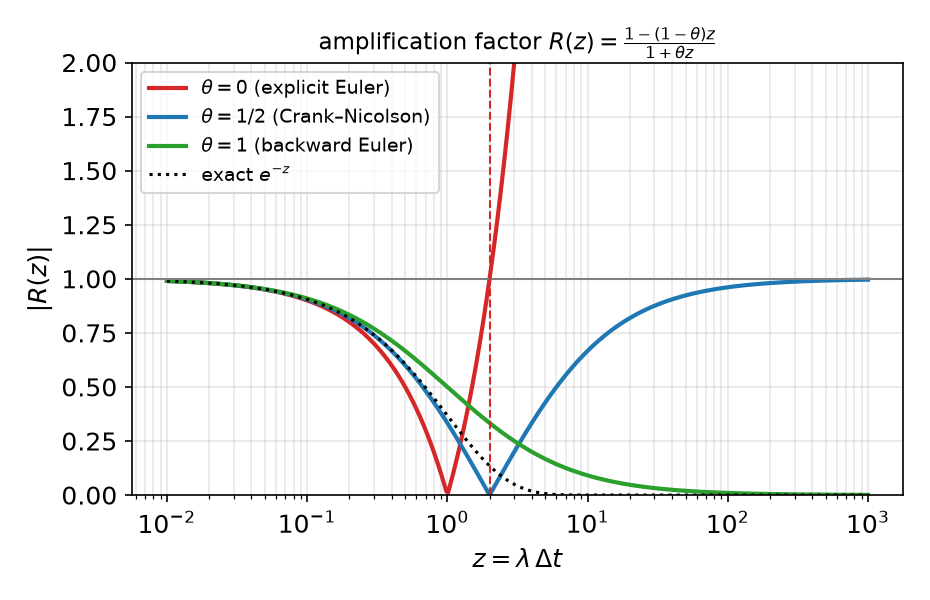
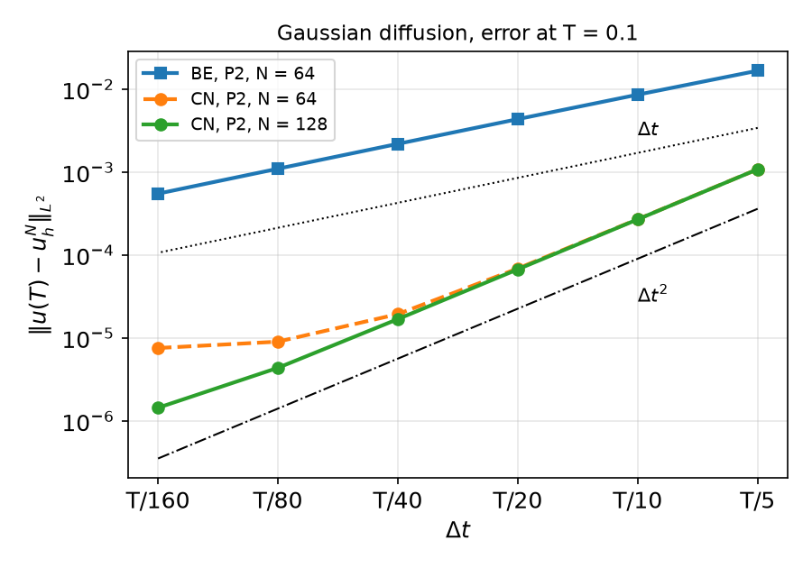
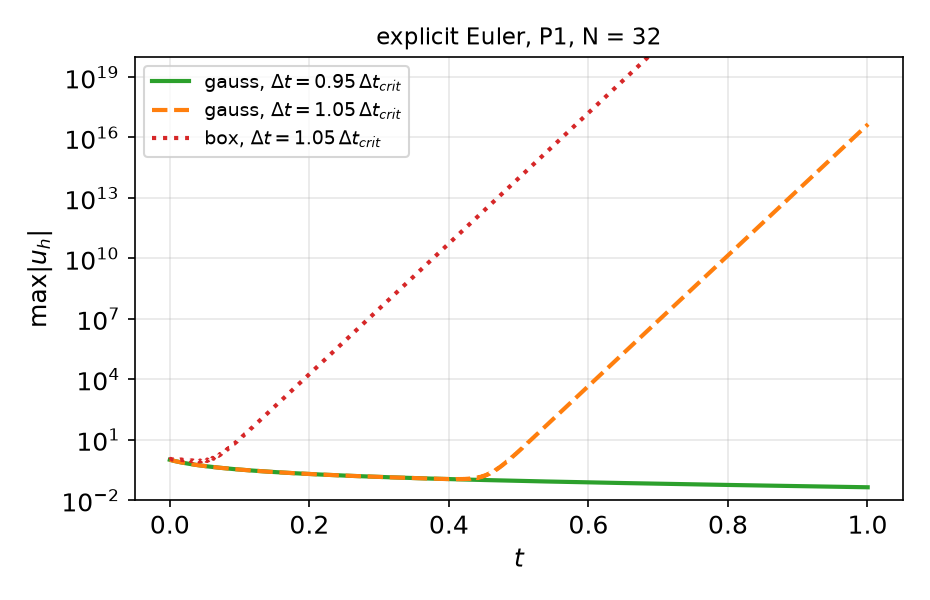
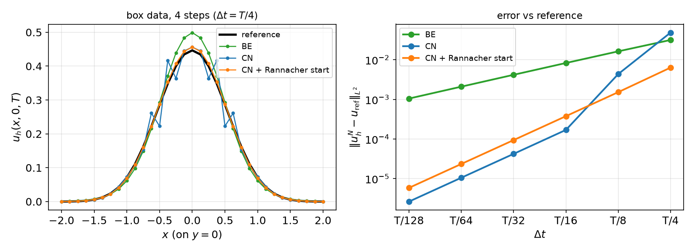
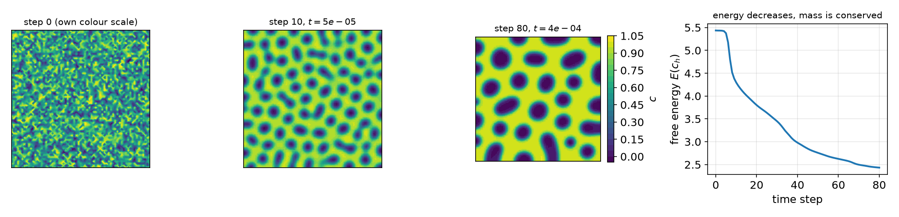

## Today

| Part | Topic | Time |
|---|---|:---:|
| Quiz | Week 9 (Kirchhoff, SNES reasons, folds, parameters, tolerances) | 10 min |
| **A** | Theory — method of lines, energy stability, semi-discrete error, the θ-method, amplification factors, space–time error | 50 min |
| **B** | The heat equation in DOLFINx — one matrix, many right-hand sides; Gaussian benchmark; temporal rates | 40 min |
| **C** | Stability in practice — explicit Euler, non-smooth data, Crank–Nicolson oscillations, Rannacher start | 30 min |
| **D** | Cahn–Hilliard (θ-method + Newton) · LLM pitfalls in time loops · HW9 | 30 min |

::: {.box}
Lab notebook: `W10_lab.ipynb` · Homework: `W10_HW9.ipynb` (due before Week 11)
:::

## Where we are

Weeks 1–7: elliptic, linear. Weeks 8–9: elliptic, nonlinear. Now: **parabolic** — the process models that evolve in time.

| Process | Model |
|---|---|
| transient conduction, quenching | $\rho c_p T_t-\nabla\cdot(k\nabla T)=Q$ |
| diffusion in a membrane / catalyst pellet | $c_t-\nabla\cdot(D\nabla c)=r(c)$ |
| phase separation (spinodal decomposition) | Cahn–Hilliard: $c_t=\nabla\cdot(M\nabla\mu)$, $\mu=f'(c)-\lambda\Delta c$ |
| start-up flow | $\rho\mathbf u_t-\mu\Delta\mathbf u+\nabla p=\mathbf f$ (Week 14) |

::: {.fragment}
Strategy: **discretise space first** (FEM, Weeks 1–7) → a system of ODEs → **discretise time** (θ-method) → at each step an elliptic problem
(linear: Weeks 5–6; nonlinear: Weeks 8–9).
:::

# Part A — Theory

## §A1 Weak form and the method of lines

$$u_t-\kappa\Delta u=f\ \text{ in }\Omega\times(0,T],\qquad u=g\ \text{ on }\partial\Omega,\qquad u(\cdot,0)=u_0 .$$

::: {.fragment}
Weak form: for a.e. $t$, find $u(t)\in H^1$, $u=g(t)$ on $\partial\Omega$, with
$$(u_t,v)+\kappa(\nabla u,\nabla v)=(f(t),v)\qquad\forall v\in H^1_0 .$$
:::

::: {.fragment}
**Semi-discretisation** (Galerkin in space, $u_h(x,t)=\sum_jU_j(t)\phi_j(x)$):
$$M\,\dot U(t)+K\,U(t)=F(t),\qquad M_{ij}=(\phi_j,\phi_i),\ \ K_{ij}=\kappa(\nabla\phi_j,\nabla\phi_i).$$
A stiff ODE system: the generalised eigenvalues $K\varphi=\lambda M\varphi$ range from $\lambda_{\min}=O(1)$ to $\lambda_{\max}=O(h^{-2})$.
:::

## §A2 Energy stability

::: {.callout-important title="Energy estimate (homogeneous Dirichlet data)"}
Take $v=u$: $\ \tfrac12\tfrac{d}{dt}\|u\|^2+\kappa\|\nabla u\|^2=(f,u)$. With Poincaré, $\|v\|\le C_P\|\nabla v\|$:
$$\|u(t)\|\le e^{-\kappa t/C_P^2}\|u_0\|+\int_0^t e^{-\kappa(t-s)/C_P^2}\|f(s)\|\,ds .$$
:::

::: {.fragment}
- The same argument with $v=u_h\in V_h$ gives the same bound for the **semi-discrete** solution, for every $h$: Galerkin in space is stable.
- Without data ($f=0$) the energy only decreases; high-frequency components decay fastest ($e^{-\lambda t}$, $\lambda\sim h^{-2}$).
- A time-stepping scheme should inherit this. Whether it does is the question of §A4–A5.
:::

## §A3 Semi-discrete error: the Ritz-projection trick

Ritz projection $R_h:H^1_0\to V_h$: $(\nabla R_hu,\nabla v)=(\nabla u,\nabla v)$ for $v\in V_h$ — the elliptic Galerkin solution, so $\|u-R_hu\|\le Ch^{k+1}|u|_{k+1}$ (Weeks 5–7).

::: {.fragment}
Split $u-u_h=\underbrace{(u-R_hu)}_{\rho}+\underbrace{(R_hu-u_h)}_{\vartheta\in V_h}$. Subtracting the equations:
$$(\vartheta_t,v)+\kappa(\nabla\vartheta,\nabla v)=-(\rho_t,v)\qquad\forall v\in V_h,$$
and the energy estimate for $\vartheta$ gives $\|\vartheta(t)\|\le\|\vartheta(0)\|+\int_0^t\|\rho_t\|\,ds$.
:::

::: {.fragment}
::: {.callout-important title="Theorem (Wheeler 1973)"}
$$\|u(t)-u_h(t)\|\le\|u_h(0)-u_0\|+Ch^{k+1}\Bigl(\|u_0\|_{k+1}+\int_0^t\|u_t\|_{k+1}\,ds\Bigr).$$
:::
Optimal $O(h^{k+1})$ in $L^2$ — **provided** $u_h(0)$ is $O(h^{k+1})$-close to $u_0$ (interpolant or $L^2$/Ritz projection) and $u_t$ is smooth.
:::

## §A4 The θ-method

$$M\frac{U^{n+1}-U^n}{\Delta t}+K\bigl(\theta U^{n+1}+(1-\theta)U^n\bigr)=\theta F^{n+1}+(1-\theta)F^n$$

::: {.columns}
::: {.column width="48%"}
| θ | name | order $p$ |
|:---:|---|:---:|
| 0 | explicit (forward) Euler | 1 |
| ½ | Crank–Nicolson | 2 |
| 1 | implicit (backward) Euler | 1 |

Each step solves $(M+\theta\Delta tK)\,U^{n+1}=\text{rhs}$: an elliptic problem with a **constant** matrix (if $\Delta t$, θ fixed) — factorise once.
:::
::: {.column width="52%"}
Modal analysis: in an eigenvector $K\varphi=\lambda M\varphi$ (with $F=0$) one step multiplies by
$$R(z)=\frac{1-(1-\theta)z}{1+\theta z},\qquad z=\lambda\Delta t .$$
{width="95%"}
:::
:::

## §A5 Stability: A-stability, L-stability, the explicit limit

Stable iff $|R(\lambda\Delta t)|\le1$ for **all** $\lambda\in[\lambda_{\min},\lambda_{\max}]$:

::: {.callout-important title="Stability of the θ-method"}
- $\theta\ge\frac12$: $|R(z)|\le1$ for all $z\ge0$ — **unconditionally stable** (A-stable).
- $\theta<\frac12$: stable iff $\Delta t\le\dfrac{2}{(1-2\theta)\lambda_{\max}}$, and $\lambda_{\max}\approx C/h^2$ ⇒ $\Delta t=O(h^2)$.
:::

::: {.fragment}
| | $R(\infty)$ | stiff (high-frequency) components |
|---|:---:|---|
| backward Euler | 0 | damped at once (**L-stable**) |
| Crank–Nicolson | −1 | not damped: flip sign every step (§C2) |
| explicit Euler | $-\infty$ | amplified unless $\Delta t\lambda_{\max}\le2$ |
:::

::: {.fragment}
Measured, P1 on $(-2,2)^2$, right triangles: $\lambda_{\max}h^2=23.8,\ 25.3,\ 25.7$ ($N=8,16,32$); with a lumped (diagonal) mass $8.2$.
At $h=0.125$: $\Delta t_{\rm crit}=2/\lambda_{\max}=1.2\times10^{-3}$, while $\lambda_{\min}=1.24$ sets the physical time scale ≈ 0.8.
:::

## §A6 Fully discrete error and the balance of $h$ and $\Delta t$

::: {.callout-important title="Error of the θ-method (smooth solution)"}
$$\|u(t_n)-u_h^n\|\le C\bigl(h^{k+1}+\Delta t^{\,p}\bigr),\qquad p=2\ (\theta=\tfrac12),\quad p=1\ (\text{otherwise}).$$
:::

::: {.fragment}
- **Temporal rate:** fix a fine mesh, halve $\Delta t$ → ratio $2^p$ — until $h^{k+1}$ (the spatial floor) dominates.
- **Spatial rate:** fix a tiny $\Delta t$, refine $h$ → ratio $2^{k+1}$.
- **Joint refinement:** $\Delta t\sim h^{(k+1)/p}$ keeps both parts balanced; e.g. P1 + CN: $\Delta t\sim h$; P1 + backward Euler: $\Delta t\sim h^2$.
- $p=2$ needs **all** data at consistent times: $\theta f^{n+1}+(1-\theta)f^n$ (or $f$ at $t_{n+\theta}$), boundary data at $t_{n+1}$, and smooth (compatible) data.
  Otherwise: **order reduction** (HW9).
:::

# Part B — The Heat Equation in DOLFINx

## §B1 One matrix, many right-hand sides

```python
t, dt, theta = fem.Constant(msh, 0.0), fem.Constant(msh, dt_value), fem.Constant(msh, 1.0)
u_n = fem.Function(V); u_n.interpolate(u0)                    # previous step (initial condition)
g = fem.Function(V); g_expr = fem.Expression(u_exact(t), V.element.interpolation_points)
bc = fem.dirichletbc(g, boundary_dofs)
u, v = ufl.TrialFunction(V), ufl.TestFunction(V)
a = fem.form(u * v * ufl.dx + dt * theta * kappa * ufl.inner(ufl.grad(u), ufl.grad(v)) * ufl.dx)
L = fem.form(u_n * v * ufl.dx - dt * (1 - theta) * kappa * ufl.inner(ufl.grad(u_n), ufl.grad(v)) * ufl.dx
             + dt * (theta * f_new + (1 - theta) * f_old) * v * ufl.dx)
A = assemble_matrix(a, bcs=[bc]); A.assemble()                # once
ksp = PETSc.KSP().create(comm); ksp.setOperators(A); ksp.setType("preonly"); ksp.getPC().setType("lu")   # factorised once

for n in range(1, nsteps + 1):                                # integer counter: t_n = n * dt
    t.value = n * dt_value
    g.interpolate(g_expr)                                     # boundary data at t_{n+1}
    with b.localForm() as bl: bl.set(0.0)
    assemble_vector(b, L); apply_lifting(b, [a], [[bc]])
    b.ghostUpdate(addv=PETSc.InsertMode.ADD, mode=PETSc.ScatterMode.REVERSE); set_bc(b, [bc])
    ksp.solve(b, uh.x.petsc_vec); uh.x.scatter_forward()
    u_n.x.array[:] = uh.x.array                               # copy values — do not rebind the name
```

## §B2 Math → code

| Mathematics | DOLFINx 0.11 |
|---|---|
| $t_n$, $\Delta t$, θ | `fem.Constant` — read at every assembly; change `.value`, never rebuild forms |
| $u^n$ in the right-hand side | a `fem.Function` `u_n` inside `L`; update with `u_n.x.array[:] = uh.x.array` |
| $M+\theta\Delta tK$ | `a`, assembled and factorised **once** (re-assemble only if $\Delta t$, θ or coefficients change) |
| $g(t_{n+1})$ | `g.interpolate(fem.Expression(u_exact(t), ...))` after `t.value = ...` |
| $\theta f^{n+1}+(1-\theta)f^n$ | two `Constant`s `t_old`, `t_new` in UFL; $\partial_t u$ for MMS by `ufl.diff(u_ex, ufl.variable(t))` |
| $\|u(T)-u_h^N\|$ | `assemble_scalar` + `allreduce` with the exact solution at the **same** $t$ |

::: {.fragment}
Loop over an integer $n$ and set $t_n=n\Delta t$: `while t < T: t += dt` accumulates rounding — with $\Delta t=0.1$ it takes **11** steps to pass $T=1$.
:::

## §B3 A benchmark with an exact solution: Gaussian diffusion

In $\mathbb R^2$ with $\kappa=1$:
$$u(x,y,t)=\frac{1}{1+4at}\exp\Bigl(-\frac{a(x^2+y^2)}{1+4at}\Bigr)\quad\text{solves}\quad u_t=\Delta u,\quad u(\cdot,0)=e^{-a(x^2+y^2)}.$$

::: {.fragment}
- On $\Omega=(-2,2)^2$ impose **its own** values on $\partial\Omega$ (time-dependent Dirichlet data): then it is the exact solution on $\Omega$ too — no truncation error
  from the finite domain.
- $a=5$, $T=0.1$: the peak drops from 1 to $1/3$ and the width grows by $\sqrt3$.
- P2 on $N\times N$ squares split into triangles; error $\|u(T)-u_h^N\|_{L^2}$.
:::

## §B4 Temporal convergence

::: {.columns}
::: {.column width="52%"}
{width="100%"}
:::
::: {.column width="48%"}
Rates, $\Delta t=T/5\to T/160$:

| | rates |
|---|---|
| BE, $N=64$ | 0.96, 0.98, 0.99, 1.00, 1.00 |
| CN, $N=64$ | 2.00, 1.97, 1.83, **1.10, 0.25** |
| CN, $N=128$ | 2.01, 2.00, 1.99, 1.95, 1.60 |

- BE: first order, $5.5\times10^{-4}$ at $T/160$.
- CN: second order **until the spatial floor** ($\approx7.5\times10^{-6}$ for P2, $N=64$). Refining the mesh lowers the floor and restores the rate.
- CN with 10 steps ($2.7\times10^{-4}$) beats BE with 160.
:::
:::

::: {.fragment}
Reading a temporal study: a rate that **falls** as $\Delta t\to0$ means "another error dominates now" — check by refining $h$, not by trusting the last digit.
:::

# Part C — Stability in Practice

## §C1 Explicit Euler: the limit is real — and can hide

$\Delta t_{\rm crit}=2/\lambda_{\max}$ from the dense eigenvalues (P1, $N=32$, $h=0.125$): $1.216\times10^{-3}$.

::: {.columns}
::: {.column width="52%"}
{width="100%"}
:::
::: {.column width="48%"}
$\max|u_h|$ at $t=0.1,\ 0.2,\ 0.5,\ 1$:

| data, $\Delta t$ | |
|---|---|
| Gaussian, $0.95\,\Delta t_{\rm crit}$ | 0.33, 0.20, 0.090, 0.043 |
| Gaussian, $1.05\,\Delta t_{\rm crit}$ | 0.33, 0.20, **≈ 3, ≈ 5e16** |
| box, $1.05\,\Delta t_{\rm crit}$ | 11, 1.9e4, 9.9e13, 1.7e30 |
:::
:::

::: {.fragment}
Smooth data contain almost no highest mode — the instability grows from **round-off** and looks fine for a while (here until $t\approx0.4$);
the exploded values even differ between machines (local 2.8 / 4.6e16, Colab 2.9 / 4.7e16): they are amplified rounding errors.
A short test run does not prove stability. Implicit methods remove the limit; explicit ones need $\Delta t=O(h^2)$ — for diffusion almost always the wrong trade.
:::

## §C2 Non-smooth data: Crank–Nicolson oscillates

Indicator of $(-\frac12,\frac12)^2$ as $u_0$, $u=0$ on $\partial\Omega$, P1, $N=32$, $T=0.1$; reference: Rannacher-started CN with 4096 steps.

{width="88%"}

::: {.fragment}
| | errors, $\Delta t=T/4\to T/128$ | rates |
|---|---|---|
| BE | 3.1e-2 … 1.05e-3 | 0.95 … 1.00 |
| CN | **4.8e-2**, 4.3e-3, 1.7e-4 … 2.6e-6 | 3.47, 4.68, 2.01, 2.00, 2.00 |
| CN + Rannacher (4 BE half steps first) | 6.3e-3 … 5.9e-6 | 2.06, 2.01, 2.00, 2.00, 2.00 |
:::

## §C3 Why — and what to do

- The jump excites high-frequency modes; CN multiplies them by $R(\lambda\Delta t)\approx-1$ each step: they **flip sign and do not decay** (left figure: wiggles at the edges of the box).
  With $\Delta t=T/4$ CN is worse than BE.
- Once $\Delta t$ is small enough that those modes have $\lambda\Delta t\lesssim1$, CN is second order again — but only asymptotically.
- **Rannacher start:** a few L-stable steps (backward Euler, half step size) damp the stiff components, then CN: second order from the start.

::: {.fragment}
**Positivity.** The exact solution is $\ge0$. Measured $\min u_h$ over all steps: BE $-7\times10^{-4}$ at $\Delta t=T/16$, $-1.6\times10^{-2}$ at $T/128$; CN down to $-2.7\times10^{-2}$.
With a consistent mass matrix even backward Euler violates the maximum principle when $\Delta t$ is **small** compared with $h^2$ (a known lower bound);
mass lumping on acute meshes restores it. Concentrations and temperatures that go negative are a discretisation artefact, not physics.
:::

# Part D — Cahn–Hilliard · LLMs · HW9

## §D1 Cahn–Hilliard: time stepping + Newton

Phase separation of a binary mixture, concentration $c$, chemical potential $\mu$:
$$c_t=\nabla\cdot(M\nabla\mu),\qquad \mu=f'(c)-\lambda\Delta c,\qquad f(c)=100\,c^2(1-c)^2 .$$

::: {.columns}
::: {.column width="45%"}
Mixed P1 × P1 for $(c,\mu)$, θ = ½ on the $\mu$ term, `NonlinearProblem` (Week 9) at every step:
```python
c, mu = ufl.split(u); c0, mu0 = ufl.split(u0)
cv = ufl.variable(c); f = 100 * cv**2 * (1 - cv)**2
mu_mid = (1 - theta) * mu0 + theta * mu
F = (c - c0) * q * dx + dt * inner(grad(mu_mid), grad(q)) * dx \
  + (mu - ufl.diff(f, cv)) * v * dx - lmbda * inner(grad(c), grad(v)) * dx
for n in range(nsteps):
    u0.x.array[:] = u.x.array
    problem.solve(); assert problem.solver.getConvergedReason() > 0
```
:::
::: {.column width="55%"}
$64\times64$, $\lambda=10^{-2}$, $\Delta t=5\times10^{-6}$, 80 steps, $c_0=0.63\pm0.01$:

- free energy $5.435\to4.296$ (10 steps) $\to2.433$ (80 steps), **monotone**;
- mass $\int c=0.63003623$ at every step (to 8 digits);
- 2–5 Newton iterations per step.

Checks with a known answer even without an exact solution: energy decay, mass conservation, `-np 1` vs `-np 2`.
:::
:::

## §D1 Cahn–Hilliard: spinodal decomposition and coarsening

{width="100%"}

- Fast separation into $c\approx0$ and $c\approx1$ (steps 0–10), then slow **coarsening**: small droplets disappear, the interface length and the energy drop.
- $c$ slightly outside $[0,1]$ ($-0.036\dots1.016$): no maximum principle for a fourth-order equation — not a bug.
- Each step: a nonlinear system (SNES) for $(c^{n+1},\mu^{n+1})$. Same checks as Week 9: reason $>0$ at every step, Newton iteration counts.

## §D2 Where LLM-generated time loops go wrong

| Kind | What it looks like | Symptom |
|---|---|---|
| **Rebinding** | `u_n = uh` at the end of the step | the form still holds the **old** `u_n` object: every step restarts from $u_0$ |
| **Time as `float`** | `t = 0.0` inside $f$ or $g$, then `t += dt` | data frozen at $t=0$ (Week 9's `lam` bug, again) |
| **Stale boundary data** | `g.interpolate(...)` once, before the loop | boundary values stay at $t=0$ |
| **Float loop** | `while t < T: t += dt` | one extra step (11 instead of 10 for $\Delta t=0.1$) |
| **Data at the wrong time** | $f(t_n)$ or $f(t_{n+1})$ in Crank–Nicolson | first order instead of second (HW9) |
| **Cost** | `LinearProblem(...)` or `fem.form(...)` inside the loop | re-assembly and re-factorisation of a constant matrix every step |
| **Error at the wrong time** | exact solution at $t_n$ compared with $u_h^{n+1}$ | an $O(\Delta t)$ error floor |

::: {.fragment}
Verification habit: print the step count and the final $t$; check that $u_h$ changes from step to step; temporal **and** spatial rates; `-np 2`.
:::

## HW9 — temporal convergence rates, due before the Week 11 lecture

::: {.columns}
::: {.column width="55%"}
`W10_HW9.ipynb` (100 pts)

- **Q1 (20)** Theory: amplification factor and the stability limit of the θ-method; $\lambda_{\max}$ for P1 in 1D; energy stability of backward Euler
- **Q2 (40)** A θ-method solver with an MMS, time-dependent boundary data: temporal rates for BE/CN, joint space–time refinement, order reduction
- **Q3 (20)** Explicit Euler: $\lambda_{\max}$, $\Delta t_{\rm crit}$ and its $h^2$ scaling, measured
- **Q4 (20)** LLM debugging: a heat solver with four bugs
:::
::: {.column width="45%"}
::: {.box}
Rules as always: *Restart session and run all*, `-np 2` where stated, the AI-usage log, numbers only from your own cells.

For every rate: **prediction first**, then measurement, then explanation.
:::
:::
:::

## Summary

| Concept | Key idea | DOLFINx |
|---|---|---|
| Method of lines | $M\dot U+KU=F$, stiff: $\lambda_{\max}\sim h^{-2}$ | mass and stiffness forms |
| Semi-discrete error | Ritz projection: $O(h^{k+1})$ if $u_h(0)$ is good | interpolate $u_0$ |
| θ-method | $R(z)=\frac{1-(1-\theta)z}{1+\theta z}$; θ ≥ ½ A-stable; BE L-stable | `Constant` dt, θ; factorise once |
| Explicit limit | $\Delta t\le2/\lambda_{\max}=O(h^2)$, may hide for smooth data | — |
| Space–time error | $O(h^{k+1}+\Delta t^p)$; data at consistent times | `t_old`, `t_new` Constants |
| Non-smooth data | CN oscillates; Rannacher start | a few BE half steps |
| Nonlinear in time | θ-method + Newton per step; energy, mass checks | `NonlinearProblem` in the loop |

**Next week — Stokes:** mixed problems, the inf-sup condition, Brezzi's theorem, Taylor–Hood, MINI; HW10.
