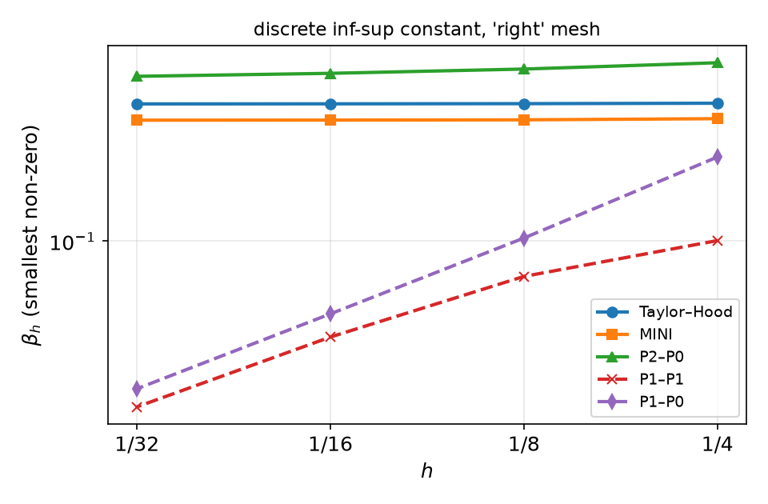
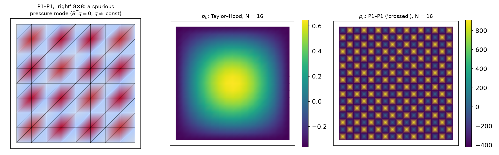
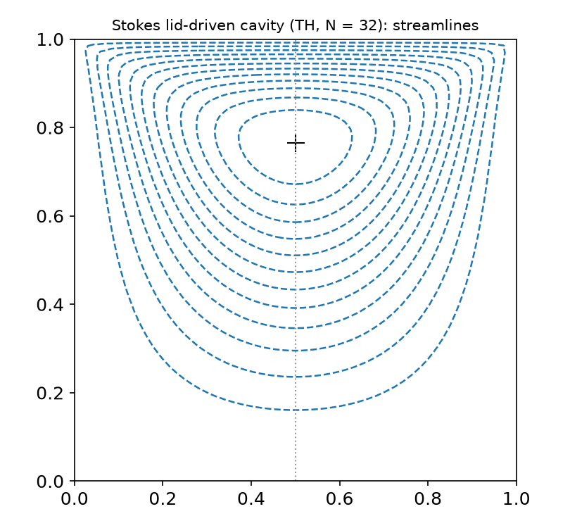

## Today

| Part | Topic | Time |
|---|---|:---:|
| Quiz | Week 10 (θ-method, amplification factor, explicit limit, temporal floor, `u_n = uh`) | 10 min |
| **A** | Theory — Stokes as a saddle-point problem, inf-sup, Brezzi's theorem, discrete inf-sup, Fortin, error estimates, pressure robustness | 55 min |
| **B** | Mixed spaces in DOLFINx 0.11 — vector and mixed elements, boundary conditions on sub-spaces, the pressure constant, MMS | 40 min |
| **C** | Element pairs in practice — measured $\beta_h$, spurious pressure modes, rates for Taylor–Hood, MINI, P2–P0, P1–P1 | 30 min |
| **D** | LLM pitfalls with mixed problems · HW10 | 15 min |

::: {.box}
Lab notebook: `W11_lab.ipynb` · Homework: `W11_HW10.ipynb` (due before Week 12)
:::

## Where we are

| Weeks | Problem | Existence | Discretization |
|---|---|---|---|
| 1–7 | elliptic, scalar | Lax–Milgram (coercive) | any conforming $V_h$ works (Céa) |
| 8–9 | nonlinear | Newton = a sequence of linear problems | same |
| 10 | parabolic | energy estimates | θ-method + elliptic solves |
| **11** | **Stokes: velocity + pressure** | **not coercive** — Brezzi | **not every pair $(V_h,Q_h)$ works** |

::: {.fragment}
Slow viscous flow: polymer melts, microfluidics, creeping flow in porous media, the inner loop of every Navier–Stokes solver (Weeks 14–15).
The pressure is not a material property here — it is the **Lagrange multiplier** of incompressibility.
:::

# Part A — Theory

## §A1 The Stokes problem and its weak form

$$-\mu\Delta\mathbf u+\nabla p=\mathbf f,\qquad\nabla\cdot\mathbf u=0\quad\text{in }\Omega,\qquad\mathbf u=\mathbf g\ \text{on }\partial\Omega,\qquad\int_\Omega p\,dx=0 .$$

::: {.fragment}
($\nabla\cdot\mathbf u=0$ ⇒ $2\nabla\cdot\varepsilon(\mathbf u)=\Delta\mathbf u$; the symmetric-gradient form $2\mu\,\varepsilon(\mathbf u):\varepsilon(\mathbf v)$ matters for traction conditions.)

$V=H^1_0(\Omega)^d$ (after lifting $\mathbf g$), $Q=L^2_0(\Omega)=\{q\in L^2:\int q=0\}$. Find $(\mathbf u,p)\in V\times Q$:
$$a(\mathbf u,\mathbf v)+b(\mathbf v,p)=(\mathbf f,\mathbf v)\quad\forall\mathbf v\in V,\qquad b(\mathbf u,q)=0\quad\forall q\in Q,$$
$$a(\mathbf u,\mathbf v)=\mu\int_\Omega\nabla\mathbf u:\nabla\mathbf v\,dx,\qquad b(\mathbf v,q)=-\int_\Omega q\,\nabla\cdot\mathbf v\,dx .$$
:::

::: {.fragment}
- **Pressure only up to a constant** with Dirichlet data everywhere: $b(\mathbf v,1)=-\int_{\partial\Omega}\mathbf v\cdot\mathbf n=0$. Hence $L^2_0$.
- **Compatibility:** $\int_{\partial\Omega}\mathbf g\cdot\mathbf n\,ds=0$ — what flows in must flow out.
:::

## §A2 Why Lax–Milgram fails

The combined form $c((\mathbf u,p),(\mathbf v,q))=a(\mathbf u,\mathbf v)+b(\mathbf v,p)+b(\mathbf u,q)$ on $X=V\times Q$:

$$c((\mathbf 0,p),(\mathbf 0,p))=0\quad\text{for every }p .$$

::: {.fragment}
Not coercive — and not an accident: the discrete matrix is a **saddle point**
$$\begin{pmatrix}A&B^\top\\B&0\end{pmatrix}\begin{pmatrix}U\\P\end{pmatrix}=\begin{pmatrix}F\\0\end{pmatrix},\qquad A\ \text{SPD},$$
symmetric but **indefinite** ($n_u$ positive, $n_p$ negative eigenvalues). Invertible iff $A$ is invertible on $\ker B$ **and** $B^\top$ is injective ($B$ has full row rank).
:::

::: {.fragment}
The pressure appears only through $B^\top P$: if $B^\top q=0$ for some $q\ne0$, that $q$ can be added to $P$ without changing anything — a **spurious pressure mode**.
In infinite dimensions "injective" has to be quantitative: the inf-sup condition.
:::

## §A3 The inf-sup condition and Brezzi's theorem

::: {.callout-note title="Definition — inf-sup (LBB) condition"}
$$\inf_{0\ne q\in Q}\ \sup_{0\ne\mathbf v\in V}\ \frac{b(\mathbf v,q)}{\|\mathbf v\|_V\,\|q\|_Q}\ \ge\ \beta>0 .$$
Equivalently: $\|B^*q\|_{V'}\ge\beta\|q\|_Q$ — every pressure is "seen" by some velocity, uniformly.
:::

::: {.callout-important title="Theorem (Brezzi 1974)"}
Let $a$ be continuous ($M$) and coercive on $Z=\ker B=\{\mathbf v:b(\mathbf v,q)=0\ \forall q\}$ ($\alpha$), and $b$ continuous and inf-sup ($\beta$). Then for all
$F\in V'$, $G\in Q'$ there is exactly one $(\mathbf u,p)$ with $a(\mathbf u,\mathbf v)+b(\mathbf v,p)=F(\mathbf v)$, $b(\mathbf u,q)=G(q)$, and
$$\|\mathbf u\|_V\le\tfrac1\alpha\|F\|+\tfrac{2M}{\alpha\beta}\|G\|,\qquad\|p\|_Q\le\tfrac{2M}{\alpha\beta}\|F\|+\tfrac{2M^2}{\alpha\beta^2}\|G\| .$$
:::

::: {.fragment}
Stokes: $a$ is coercive on all of $V$ (Poincaré; Korn for $\varepsilon:\varepsilon$), and $\nabla\cdot:H^1_0(\Omega)^d\to L^2_0(\Omega)$ is **onto** (Nečas / Bogovskiĭ) ⇒
inf-sup holds ⇒ well-posed. Proof idea: inf-sup ⇒ lift $G$ to $\mathbf u_G$; Lax–Milgram on $Z$; recover $p$ from $F-a(\mathbf u,\cdot)\in Z^0=\operatorname{Im}B^*$.
:::

## §A4 The discrete inf-sup condition

Galerkin with $V_h\subset V$, $Q_h\subset Q$. Coercivity on $Z_h$ is free ($a$ is coercive on all of $V$). The one thing to check:

$$\beta_h:=\inf_{q\in Q_h}\sup_{\mathbf v\in V_h}\frac{b(\mathbf v,q)}{\|\mathbf v\|_V\|q\|_Q}\ \ge\ \beta_0>0\qquad\text{independent of }h .$$

::: {.fragment}
**Computable:** with $A$ the $H^1$ (vector Laplacian) matrix on $V_h$ and $M_p$ the pressure mass matrix,
$$\beta_h^2=\lambda_{\min}\bigl(BA^{-1}B^\top,\ M_p\bigr)\quad(\text{on }Q_h\cap L^2_0).$$
Zero eigenvalues beyond the constant = spurious modes; a smallest non-zero eigenvalue that decays with $h$ = a pair that is **not uniformly** stable.
We compute it in Part C for five pairs.
:::

::: {.fragment}
Counting gives a quick warning: $\dim Q_h$ must not exceed what $\nabla\cdot V_h$ can "see". P1–P0 on $N\times N$ (right): $2(N-1)^2$ interior velocity DOFs, $2N^2-1$
pressure constraints — more constraints than unknowns ⇒ **locking** ($\mathbf u_h=0$ is forced in large parts) and many spurious modes.
:::

## §A5 Fortin's criterion

::: {.callout-important title="Lemma (Fortin)"}
Suppose continuous inf-sup ($\beta$) and an operator $\Pi_h:V\to V_h$ with
$$b(\mathbf v-\Pi_h\mathbf v,q_h)=0\ \ \forall q_h\in Q_h,\qquad\|\Pi_h\mathbf v\|_V\le C_\Pi\|\mathbf v\|_V .$$
Then the discrete inf-sup holds with $\beta_h\ge\beta/C_\Pi$.
:::

::: {.fragment}
$$\sup_{\mathbf v_h}\frac{b(\mathbf v_h,q_h)}{\|\mathbf v_h\|}\ \ge\ \sup_{\mathbf v}\frac{b(\Pi_h\mathbf v,q_h)}{\|\Pi_h\mathbf v\|}=\sup_{\mathbf v}\frac{b(\mathbf v,q_h)}{\|\Pi_h\mathbf v\|}\ \ge\ \frac1{C_\Pi}\sup_{\mathbf v}\frac{b(\mathbf v,q_h)}{\|\mathbf v\|}\ \ge\ \frac{\beta}{C_\Pi}\|q_h\|.$$
:::

::: {.fragment}
**MINI** $=(P1\oplus B_3)^2/P1$: take a stable interpolant (Clément) $\Pi_1$, then correct with a bubble $\mathbf b_K$ on each cell so that
$\int_K(\mathbf v-\Pi_h\mathbf v)\cdot\nabla q_h=0$ ($\nabla q_h$ is constant on $K$, and the bubble vanishes on $\partial K$ — integrate by parts). One bubble per cell and
component is exactly enough: the **minimal** enrichment. **Taylor–Hood** $P2^2/P1$: the edge midpoints play the bubbles' role (Verfürth, Stenberg).
:::

## §A6 Error estimates and pressure robustness

::: {.callout-important title="Theorem (quasi-optimality for mixed methods)"}
With uniform $\beta_h\ge\beta_0$:
$$\|\mathbf u-\mathbf u_h\|_1+\|p-p_h\|_0\le C(\beta_0)\Bigl(\inf_{\mathbf v_h}\|\mathbf u-\mathbf v_h\|_1+\inf_{q_h}\|p-q_h\|_0\Bigr).$$
:::

::: {.fragment}
| pair | $\|\mathbf u-\mathbf u_h\|_1$ | $\|p-p_h\|_0$ | $\|\mathbf u-\mathbf u_h\|_0$ (Aubin–Nitsche) |
|---|:---:|:---:|:---:|
| Taylor–Hood $P2^2/P1$ | $h^2$ | $h^2$ | $h^3$ |
| MINI $(P1\oplus B_3)^2/P1$ | $h$ | $h$ (often $h^{3/2}$ observed) | $h^2$ |
| P2–P0 | $h$ (limited by $P0$) | $h$ | $h^2$ |
:::

::: {.fragment}
**Pressure robustness.** Scaled honestly the velocity bound reads $\|\nabla(\mathbf u-\mathbf u_h)\|\le C\inf\|\nabla(\mathbf u-\mathbf v_h)\|+\frac{C}{\mu}\inf\|p-q_h\|$:
for $\mathbf f=\nabla\phi$ the exact $\mathbf u=0$, but Taylor–Hood's $\mathbf u_h\ne0$ because $\nabla\cdot\mathbf u_h=0$ holds only **weakly** (against $Q_h$).
Measured in Part C: $\|\mathbf u_h\|\propto1/\mu$.
:::

# Part B — Mixed Spaces in DOLFINx 0.11

## §B1 Vector and mixed elements

```python
import basix.ufl
P2v = basix.ufl.element("Lagrange", msh.basix_cell(), 2, shape=(2,))      # vector P2: interleaved (u_x, u_y) per node
P1  = basix.ufl.element("Lagrange", msh.basix_cell(), 1)
W   = fem.functionspace(msh, basix.ufl.mixed_element([P2v, P1]))           # Taylor-Hood

# MINI: enrich P1 with the cubic bubble, then make it a vector element
E   = basix.ufl.enriched_element([P1, basix.ufl.element("Bubble", msh.basix_cell(), 3)])
Wm  = fem.functionspace(msh, basix.ufl.mixed_element([basix.ufl.blocked_element(E, shape=(2,)), P1]))

(u, p), (v, q) = ufl.TrialFunctions(W), ufl.TestFunctions(W)
a = (mu * ufl.inner(ufl.grad(u), ufl.grad(v)) - p * ufl.div(v) - q * ufl.div(u)) * ufl.dx
L = ufl.inner(f, v) * ufl.dx
```

::: {.fragment}
- Symmetric: the two off-diagonal blocks are $B$ and $B^\top$ (same sign on $-p\,\nabla\cdot\mathbf v$ and $-q\,\nabla\cdot\mathbf u$).
- `W.sub(0)` is a **view** into the mixed space; `W.sub(0).collapse()` returns `(V0, map)` — a standalone space and the DOF map back into `W`.
- MINI on $4\times4$: velocity $2\times(25+32)=114$ DOFs (vertices + one bubble per cell).
:::

## §B2 Boundary conditions and the pressure constant

```python
V0, _ = W.sub(0).collapse(); Q0, _ = W.sub(1).collapse()
u_bc = fem.Function(V0); u_bc.interpolate(fem.Expression(u_exact, V0.element.interpolation_points))
dofs_u = fem.locate_dofs_topological((W.sub(0), V0), fdim, boundary_facets)       # the (sub-space, collapsed) pair
bc_u = fem.dirichletbc(u_bc, dofs_u, W.sub(0))

dofs_p = fem.locate_dofs_geometrical((W.sub(1), Q0), lambda x: np.isclose(x[0], 0) & np.isclose(x[1], 0))
bc_p = fem.dirichletbc(fem.Function(Q0), dofs_p, W.sub(1))                         # pin p = 0 at one point
```

::: {.fragment}
- `locate_dofs_*((W.sub(0), V0), ...)` returns **two** index arrays (in `W` and in `V0`); `dirichletbc(Function on V0, dofs, W.sub(0))`.
- **Pinning one pressure DOF** fixes the constant; compare with the exact pressure **after subtracting the means** of both.
  (Alternative: a PETSc nullspace with an iterative solver — Week 12.)
- Solve with `preonly` + `lu` + `pc_factor_mat_solver_type = mumps` — the matrix is indefinite: no Cholesky, no plain CG.
- After the solve: `uh = wh.sub(0).collapse()`, `ph = wh.sub(1).collapse()` — functions you can integrate, plot and save.
:::

## §B3 Verification: Poiseuille and MMS

**Plane Poiseuille** $\mathbf u=(y(1-y),0)$, $p=-2\mu x$: quadratic velocity, linear pressure — **in** the Taylor–Hood space.

| $N=8$ | $\|\mathbf u-\mathbf u_h\|_0$ | $\|\nabla(\mathbf u-\mathbf u_h)\|_0$ | $\|p-p_h\|_0$ |
|---|---|---|---|
| Taylor–Hood | 2.2e-16 | 4.7e-15 | 1.3e-14 |
| MINI | 2.8e-3 | 6.7e-2 | 1.4e-2 |
| P2–P0 | 2.0e-3 | 5.5e-2 | 6.0e-2 |

Exactness test first: if Taylor–Hood is not exact here, the code is wrong.

::: {.fragment}
**MMS** $\tilde{\mathbf u}=(\sin\pi x\cos\pi y,\,-\cos\pi x\sin\pi y)$ (divergence-free — **check it**), $\tilde p=\sin\pi x\sin\pi y$, $\mathbf f=-\mu\Delta\tilde{\mathbf u}+\nabla\tilde p$ by UFL.
Taylor–Hood, $N=8\to64$: $\|\mathbf u\|_0$ rates 2.99, 3.00, 3.00; $\|\nabla\mathbf u\|_0$ 1.99, 2.00, 2.00; $\|p\|_0$ 2.04, 2.01, 2.00 — as predicted.
:::

## §B4 A pitfall from the textbook slides

The source slides report Taylor–Hood velocity rates **3.98** ($L^2$) and **2.96** ($H^1$) and call it superconvergence.

::: {.fragment}
| exact solution used in the error | $\|\mathbf u-\cdot\|_0$ rates | $\|\nabla(\mathbf u-\cdot)\|_0$ rates |
|---|---|---|
| UFL expression $\tilde{\mathbf u}(x)$ | 2.99, 3.00, 3.00 | 1.99, 2.00, 2.00 |
| P2 **interpolant** $I_h\tilde{\mathbf u}$ | 3.97, 3.99, 4.00 | 2.91, 2.96, 2.98 |
:::

::: {.fragment}
The second row measures $\|\mathbf u_h-I_h\tilde{\mathbf u}\|$ — the distance between two $O(h^3)$-accurate functions in the same space, which can be one order smaller
(Week 5, again). It says nothing about the error. **Compare with the exact expression**, or interpolate into a space of higher degree.
:::

# Part C — Element Pairs in Practice

## §C1 Measured inf-sup constants

::: {.columns}
::: {.column width="38%"}
{width="100%"}
:::
::: {.column width="62%"}
$\beta_h$ (smallest non-zero) and [zero modes incl. the constant], `right` diagonal mesh:

| pair | $N=4$ | $8$ | $16$ | $32$ | verdict |
|---|---|---|---|---|---|
| Taylor–Hood | 0.368 [1] | 0.366 [1] | 0.366 [1] | 0.365 [1] | stable |
| MINI | 0.318 [1] | 0.314 [1] | 0.314 [1] | 0.313 [1] | stable |
| P2–P0 | 0.539 [1] | 0.508 [1] | 0.488 [1] | 0.474 [1] | stable |
| P1–P1 | 0.101 [8] | 0.072 [8] | 0.040 [8] | 0.021 [8] | 7 spurious modes, $\beta_h\sim h$ |
| P1–P0 | 0.221 [14] | 0.103 [30] | 0.050 [62] | 0.025 [126] | locking |
:::
:::

## §C2 What instability looks like

{width="100%"}

::: {.fragment}
- **P1–P1, `right` mesh:** $B^\top$ has a kernel beyond the constant; pinning one pressure DOF does not remove it. MUMPS reports a failed factorization:
  **KSP reason −11** (`DIVERGED_PC_FAILED`) on every mesh, the solution is `inf`. Feeding that `inf` (a pressure mean) into a UFL form even breaks the JIT compiler.
- **P1–P1, `crossed` mesh:** 3 spurious modes remain, yet LU "succeeds" (reason 4) and returns a checkerboard pressure of size $10^2$–$10^3$ (the exact $p$ lies in $[0,1]$;
  $-420\dots910$ in this run, $\pm5000$ in another — the garbage is not even reproducible). The velocity converges at the right rate — **only the pressure shows it**.
:::

## §C3 Rates of the converged solutions

MMS of §B3, $N=8\to64$, `right` / `crossed` diagonals:

| pair | $\|\mathbf u-\mathbf u_h\|_0$ | $\|\nabla(\mathbf u-\mathbf u_h)\|_0$ | $\|p-p_h\|_0$ | $\|\nabla\cdot\mathbf u_h\|_0$ |
|---|---|---|---|---|
| Taylor–Hood | 3.0 / 3.0 | 2.0 / 2.0 | 2.0 / 2.0 | 2.0 / 2.0 |
| MINI | 2.0 / 2.0 | 1.0 / 1.0 | **1.66, 1.54, 1.51** / 2.0 | 1.0 / 1.0 |
| P2–P0 | 2.0 / 2.0 | 1.2→1.0 / 1.0 | 1.0 / 1.0 | 1.0 / 1.0 |
| P1–P1 | — (reason −11) / 2.0 | — / 1.0 | — / **erratic** (e.g. −2.9, 3.1, −0.1; differs between runs) | — / 1.0 |

::: {.fragment}
- MINI pressure: better than the guaranteed $h$, $\approx h^{3/2}$ on `right`, $h^2$ on the symmetric `crossed` mesh — superconvergence depends on the mesh; theory promises $h$.
- P2–P0 is **stable** (the source table lists it as unstable): optimal for its $P0$ pressure, but wasteful — quadratic velocity gives only first order.
- $\nabla\cdot\mathbf u_h\ne0$ pointwise for all of them: $\|\nabla\cdot\mathbf u_h\|$ converges like the velocity gradient. Mass is conserved only weakly.
:::

## §C4 Pressure robustness, measured

$\mathbf f=\nabla\bigl(\sin2\pi x\cos2\pi y\bigr)$, $\mathbf u=0$ on $\partial\Omega$: exact $\mathbf u=0$, $p=\phi$. $\|\mathbf u_h\|_{L^2}$ for $N=8,16,32$:

| | $\mu=1$ | $\mu=10^{-2}$ | $\mu=10^{-4}$ |
|---|---|---|---|
| Taylor–Hood | 3.0e-4, 1.7e-5, 1.0e-6 | 3.0e-2, 1.7e-3, 1.0e-4 | **3.0, 0.17, 1.0e-2** |
| MINI | 3.8e-4, 4.0e-5, 4.8e-6 | 3.8e-2, 4.0e-3, 4.8e-4 | 3.8, 0.40, 4.8e-2 |

::: {.fragment}
- Exactly $\propto1/\mu$: the velocity error is driven by the **pressure** approximation error. Low viscosity, strong body forces (buoyancy, Week 13 of Course II)
  or large pressure gradients ⇒ visible spurious velocities.
- Cure: divergence-free pairs (Scott–Vogelius on special meshes, $H(\mathrm{div})$-conforming DG — Week 15) or grad-div stabilization.
:::

## §C5 A benchmark with a symmetry: the Stokes cavity

::: {.columns}
::: {.column width="45%"}
{width="100%"}
:::
::: {.column width="55%"}
Lid $\mathbf u=(1,0)$ on $y=1$, no-slip elsewhere, Taylor–Hood, $N=32$; stream function from $-\Delta\psi=\partial_xu_y-\partial_yu_x$, $\psi=0$ on $\partial\Omega$.

- $\min\psi=-0.0993$ at $(0.500,\,0.766)$.
- **Symmetric about $x=\frac12$:** Stokes flow is reversible (reflect $x\to1-x$, reverse $\mathbf u$). The discrete solution is symmetric only if the **mesh** is
  (lab §6); a defect that does not shrink with $h$ is a bug. Inertia (Navier–Stokes, Week 15) breaks the symmetry physically.
- The lid's velocity jumps at the top corners: $p\notin L^2$ there — pressure errors near the corners do not converge. Use the cavity for flow features, not for rates.
:::
:::

# Part D — LLMs and Mixed Problems · HW10

## §D1 Where LLM-generated Stokes code goes wrong

| Kind | What it looks like | Symptom |
|---|---|---|
| **Unstable pair** | P1–P1 "because it is simpler" | KSP reason −11 / `inf`, or a checkerboard pressure with correct-looking velocity |
| **Pressure constant ignored** | no pin, no nullspace | singular matrix: LU fails or returns a pressure shifted by an arbitrary constant |
| **Pressure error without the mean** | $\|p-p_h\|$ with $p_h$ pinned at a corner | an $O(1)$ "error" that does not converge |
| **Sub-space BC API** | `locate_dofs_*(V0, ...)` instead of `((W.sub(0), V0), ...)` | `TypeError: incompatible function arguments` in `dirichletbc` (V0 blocks, not W DOFs) |
| **Older API** | `fem.VectorFunctionSpace`, `ufl.MixedElement`, `ufl.VectorElement` | `AttributeError` (removed) |
| **Views vs copies** | `uh, ph = wh.split()` then `ph.x.array` | fine inside UFL forms, but `ph.x.array` is the **whole** mixed vector (187 entries on $4\times4$, not 25) — use `wh.sub(1).collapse()` |
| **MMS not divergence-free** | an arbitrary $\tilde{\mathbf u}$ | $\nabla\cdot\mathbf u=g\ne0$ needed but not imposed: no convergence |

::: {.fragment}
Verification habit: Poiseuille exactness for Taylor–Hood; MMS with means removed; plot the pressure; $\|\nabla\cdot\mathbf u_h\|$; the KSP reason.
:::

## HW10 — P1–P1 vs Taylor–Hood vs MINI, due before the Week 12 lecture

::: {.columns}
::: {.column width="55%"}
`W11_HW10.ipynb` (100 pts)

- **Q1 (20)** Theory: non-coercivity, inf-sup ⇔ injectivity of $B^\top$, a DOF-counting argument, the bubble in Fortin's construction
- **Q2 (40)** One solver for three pairs: Poiseuille exactness, MMS rates with a different manufactured solution, the pressure plot
- **Q3 (20)** Discrete inf-sup constants: your own computation for three pairs on a new mesh; spurious-mode counts
- **Q4 (20)** LLM debugging: a Stokes script with four bugs
:::
::: {.column width="45%"}
::: {.box}
Rules as always: *Restart session and run all*, `-np 2` where stated, the AI-usage log, numbers only from your own cells.

For every rate: **prediction first** (from the pair and §A6), then measurement, then explanation.
:::
:::
:::

## Summary

| Concept | Key idea | DOLFINx 0.11 |
|---|---|---|
| Saddle point | $c(U,U)$ not coercive; matrix indefinite | MUMPS LU, no CG |
| Inf-sup | $\inf_q\sup_v b/(\|v\|\|q\|)\ge\beta>0$; $\beta_h$ must not decay | $\beta_h^2=\lambda_{\min}(BA^{-1}B^\top,M_p)$ |
| Brezzi | coercive on $\ker B$ + inf-sup ⇒ well-posed, bounds $\sim1/\beta$ | — |
| Fortin | $b(\mathbf v-\Pi_h\mathbf v,q_h)=0$, bounded $\Pi_h$ ⇒ discrete inf-sup | bubbles (MINI), edges (TH) |
| Pairs | TH, MINI, P2–P0 stable; P1–P1, P1–P0 not | `mixed_element`, `enriched_element`, `blocked_element` |
| Pressure | defined up to a constant; compare without means | pin one DOF on `W.sub(1)` |
| Robustness | velocity error $\propto\|p\|/\mu$ for TH/MINI | — |

**Next week — solvers for saddle-point problems:** Schur complement, block preconditioners, `fieldsplit`, MINRES/GMRES, iteration counts vs $h$; HW11.
