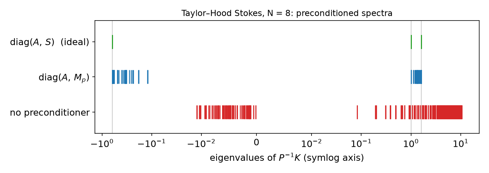
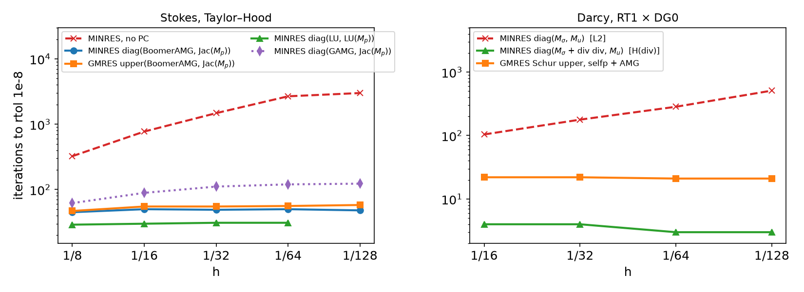
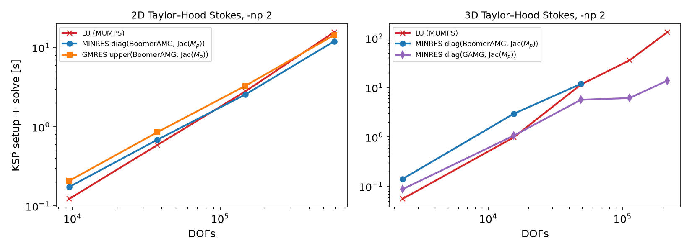

## Today

| Part | Topic | Time |
|---|---|:---:|
| Quiz | Week 11 (Stokes, inf-sup, rates, P1–P1) | 10 min |
| **A** | Theory — Schur complement, block preconditioners, $S\sim M_p$, MINRES/GMRES, Darcy | 55 min |
| **B** | DOLFINx 0.11 + PETSc — blocked and nested systems, `fieldsplit`, null space | 40 min |
| **C** | Measurements — spectra, iterations vs $h$, time vs DOFs, Darcy | 30 min |
| **D** | LLM pitfalls with iterative solvers · HW11 | 15 min |

::: {.box}
Lab notebook: `W12_lab.ipynb` · Homework: `W12_HW11.ipynb` (due before Week 13)
:::

## Where we are

| Week | Problem | Linear algebra |
|---|---|---|
| 5 | Poisson | SPD: CG + AMG, iterations $\approx$ const in $h$ |
| 9–10 | nonlinear, time-dependent | a linear solve per Newton step / time step |
| 11 | Stokes, discretized | **MUMPS LU** on the indefinite matrix |
| **12** | **the same matrix, solved iteratively** | **block preconditioners built from Week 11's $\beta_h$** |
| 14–15 | Navier–Stokes | same structure, $A$ non-symmetric, Schur complement depends on $\mathbf u$ |

::: {.fragment}
Week 11 used LU everywhere. LU is exact and robust — and its cost grows faster than the problem: in 3D, 14 times more DOFs made today's
factorization 135 times slower (0.98 s → 132 s). This week: **why** iterative solvers work for saddle points, and how to make them $h$-independent.
:::

# Part A — Theory

## §A1 The saddle-point matrix

$$
\mathscr K=\begin{pmatrix}A&B^\top\\B&0\end{pmatrix},\qquad
A_{ij}=\mu\!\int\nabla\boldsymbol\phi_j:\nabla\boldsymbol\phi_i,\quad B_{kj}=-\!\int\psi_k\,\nabla\cdot\boldsymbol\phi_j,\quad (M_p)_{kl}=\int\psi_k\psi_l .
$$

- $A$ ($n\times n$) SPD, $B$ ($m\times n$), $m<n$. Week 11 HW Q1: $\mathscr K$ has $n$ positive and $m$ negative eigenvalues (one zero for the pressure constant).
- **Indefinite** ⇒ CG is not defined (its energy "norm" is not a norm). Krylov methods for symmetric indefinite matrices: **MINRES**; for anything: **GMRES**.

::: {.fragment}
- Unpreconditioned, the eigenvalues of $\mathscr K$ (Taylor–Hood, unit square, $\mu=1$) spread as the mesh is refined:

| $N$ | 4 | 8 | 16 |
|---|---|---|---|
| $\max|\lambda|/\min|\lambda|$ | $1.65\times10^4$ | $6.86\times10^4$ | $2.77\times10^5$ |

Factor 4 per refinement, $\propto h^{-2}$, like the Poisson stiffness matrix. MINRES without preconditioner: about 320, 770, 1480, 2670 iterations for $N=8,\dots,64$.
:::

## §A2 Block factorization and the Schur complement

$$
\begin{pmatrix}A&B^\top\\B&0\end{pmatrix}
=\begin{pmatrix}I&0\\BA^{-1}&I\end{pmatrix}
\begin{pmatrix}A&0\\0&-S\end{pmatrix}
\begin{pmatrix}I&A^{-1}B^\top\\0&I\end{pmatrix},\qquad
S=BA^{-1}B^\top .
$$

::: {.fragment}
- Solving $\mathscr K\binom{\mathbf u}{p}=\binom{\mathbf f}{0}$ = two solves with $A$ and one with $S$:
  $S\,p=BA^{-1}\mathbf f$, then $A\mathbf u=\mathbf f-B^\top p$ (the **pressure Schur complement** method / Uzawa).
- $S$ is SPD on $L^2_0$ but **dense** ($A^{-1}$ inside). Never form it; approximate it.
:::

::: {.fragment}
::: {.callout-note title="Definition — Schur complement and the inf-sup constant (Week 11)"}
$\beta_h^2=\lambda_{\min}(S,M_p)$ on $L^2_0$ (with $\mu=1$). The discrete inf-sup condition says exactly: the generalized eigenvalues of $(S,M_p)$ are bounded away from 0, uniformly in $h$.
:::
:::

## §A3 Ideal block preconditioners

::: {.callout-important title="Theorem (Murphy, Golub, Wathen 2000)"}
With $\mathscr P_D=\begin{pmatrix}A&0\\0&S\end{pmatrix}$, the matrix $\mathscr P_D^{-1}\mathscr K$ has at most **three** distinct eigenvalues: $1,\ \tfrac{1\pm\sqrt5}{2}$.
MINRES with $\mathscr P_D$ converges in at most 3 iterations.
:::

::: {.fragment}
Proof sketch: $\mathscr P_D^{-1}\mathscr K\binom{\mathbf u}{p}=\lambda\binom{\mathbf u}{p}$ ⇔ $\mathbf u+A^{-1}B^\top p=\lambda\mathbf u$, $S^{-1}B\mathbf u=\lambda p$.
If $\lambda\ne1$: $\mathbf u=A^{-1}B^\top p/(\lambda-1)$ ⇒ $S p=\lambda(\lambda-1)Sp$ ⇒ $\lambda^2-\lambda-1=0$.
:::

::: {.fragment}
- Block **triangular** $\mathscr P_U=\begin{pmatrix}A&B^\top\\0&-S\end{pmatrix}$: $\mathscr K\mathscr P_U^{-1}=\begin{pmatrix}I&0\\BA^{-1}&I\end{pmatrix}$, so $(\mathscr K\mathscr P_U^{-1}-I)^2=0$ — **GMRES in 2 iterations** (non-symmetric: not MINRES).
- Full $LDU$ = exact solve, 1 iteration. All three need $S^{-1}$, which is as hard as the original problem — next slide.
:::

## §A4 Spectral equivalence: replace $S$ by the pressure mass matrix

::: {.callout-important title="Lemma (Stokes)"}
For $\mathbf v\in H^1_0$: $\|\nabla\cdot\mathbf v\|_0\le|\mathbf v|_1$. With the discrete inf-sup constant $\beta_h$:
$$\beta_h^2\,q^\top M_p q\ \le\ q^\top S q\ \le\ q^\top M_p q\qquad\forall q\perp 1 \qquad(\mu=1).$$
For viscosity $\mu$: $S=\mu^{-1}BA_1^{-1}B^\top$ ⇒ use $\mu^{-1}M_p$.
:::

::: {.fragment}
With $\mathscr P=\mathrm{diag}(A,\hat S)$ and $\sigma\in\operatorname{eig}(\hat S^{-1}S)$, the same algebra as in §A3 gives
$$\lambda=1\quad\text{or}\quad\lambda=\frac{1\pm\sqrt{1+4\sigma}}{2},\qquad \sigma\in[\beta_h^2,1].$$
Taylor–Hood, $\hat S=M_p$: $\sigma\in[0.1336,\,1.0000]$, $\beta_h=0.366$ (Week 11's value) ⇒ $\lambda\in[-0.618,-0.119]\cup[1,1.618]$ — **for every $N$** (measured: $N=4,8,16$).
:::

::: {.fragment}
Bounded spectrum on two intervals that do not depend on $h$ ⇒ MINRES iterations bounded independently of $h$. **The inf-sup constant is the convergence constant.**
:::

## §A5 Cheap blocks: AMG and Jacobi

| Exact block | Replacement | Why it is enough |
|---|---|---|
| $A^{-1}$ (vector Laplacian) | one AMG V-cycle (BoomerAMG, GAMG) | spectrally equivalent to $A^{-1}$, constants independent of $h$ |
| $S^{-1}$ | $M_p^{-1}$ | Lemma in §A4 |
| $M_p^{-1}$ | Jacobi: $\mathrm{diag}(M_p)^{-1}$ | P1 triangles: $\operatorname{eig}(D^{-1}M_p)\in[\tfrac12,2]$ exactly (measured, $N=8,16$) |

::: {.fragment}
- Each replacement multiplies the interval bounds by constants independent of $h$: iterations stay bounded, each iteration costs $O(\text{DOFs})$.
- **MINRES requires a symmetric positive definite preconditioner**: $\mathrm{diag}(A,M_p)$ ✓, $\mathrm{diag}(A,-S)$ ✗, block triangular ✗ (use GMRES).
- MINRES: short recurrence, monotone residual (in the $\mathscr P^{-1}$-norm). GMRES: any preconditioner, memory grows with iterations (restart).
:::

## §A6 Darcy: a different Schur complement

Mixed Poisson / Darcy, $\boldsymbol\sigma=-K\nabla u$, $\nabla\cdot\boldsymbol\sigma=f$, RT1 × DG0:
$$
\begin{pmatrix}M_\sigma&B^\top\\B&0\end{pmatrix},\qquad (M_\sigma)_{ij}=\int K^{-1}\boldsymbol\phi_j\cdot\boldsymbol\phi_i,\quad B_{kj}=-\int\psi_k\nabla\cdot\boldsymbol\phi_j .
$$

::: {.fragment}
- Now $A=M_\sigma$ is a **mass** matrix and $S=BM_\sigma^{-1}B^\top$ is a discrete **Laplacian** on DG0: $\operatorname{eig}(M_u^{-1}S)\in[19.8,\,2304]$ ($N=8$), $[19.8,\,9216]$ ($N=16$) — ratio $\propto h^{-2}$.
- So $\mathrm{diag}(M_\sigma,M_u)$ — the "Stokes recipe" — is **wrong** here: the problem is well-posed in $H(\mathrm{div})\times L^2$, not $L^2\times L^2$.
:::

::: {.fragment}
Two remedies:

1. **Riesz map of $H(\mathrm{div})$**: $\mathrm{diag}\big(M_\sigma+(\nabla\cdot,\nabla\cdot),\ M_u\big)$. For RT1/DG0, $(\nabla\cdot\boldsymbol\sigma,\nabla\cdot\boldsymbol\tau)=B^\top M_u^{-1}B$ exactly; preconditioned eigenvalues: $1$ and $[-1,-0.952]$.
2. **Algebraic**: $\hat S=B\,\mathrm{diag}(M_\sigma)^{-1}B^\top$ (PETSc `selfp`) — a sparse, Laplacian-like matrix on which AMG works.
:::

::: {.fragment}
**Rule (Mardal–Winther):** the preconditioner is the Riesz map of the spaces in which the continuous problem is well-posed.
:::

## §A7 Preview: Navier–Stokes and PCD (Weeks 14–15)

$$A\ \to\ F=\mu\,\text{Laplacian}+\text{convection}(\mathbf u_k)\quad\text{(non-symmetric)},\qquad S=BF^{-1}B^\top .$$

- $M_p/\mu$ is no longer spectrally equivalent to $S$ when convection dominates: iterations grow with the Reynolds number.
- **Pressure convection–diffusion (PCD)**: $S^{-1}\approx M_p^{-1}F_pA_p^{-1}$, with $F_p,A_p$ a convection–diffusion operator and a Laplacian **on the pressure space**.
- `fenicsx-pctools` (Rehor & Hale) implements PCD as a PETSc Python preconditioner inside `fieldsplit`. Its backward-facing-step demo runs on DOLFINx 0.11
  after three small API fixes: 4 Newton steps, 19–31 GMRES iterations each (Re = 100, local run).
- Week 15: lid-driven cavity with Reynolds-number continuation; iteration counts with PCD vs $M_p$.

# Part B — DOLFINx 0.11 + PETSc

## §B1 Three ways to assemble the same system

| | Monolithic | Blocked | Nested |
|---|---|---|---|
| Spaces | one `mixed_element([P2v, P1])` | two spaces `V`, `Q` | two spaces `V`, `Q` |
| Forms | one form | `[[a00, a01], [a10, None]]` | same list |
| Matrix | `MPIAIJ`, interleaved DOFs | `MPIAIJ`, **block layout** per rank | `MATNEST` of four sub-matrices |
| `kind=` | — | `None` (default) | `"nest"` |
| fieldsplit index sets | from `W.sub(i).collapse()` maps | **you compute offsets** | automatic (`getNestISs`) |
| Direct solver | MUMPS ✓ | MUMPS ✓ | MUMPS ✓ (same solution as blocked) |

::: {.fragment}
Same Taylor–Hood MMS, $N=16$, `-np 2`: monolithic (MUMPS), nested (MINRES) and blocked (MINRES) give $\|\mathbf u-\mathbf u_h\|_0=9.7063\times10^{-5}$ to all printed digits;
$\|\mathbf u_{\text{nest}}-\mathbf u_{\text{mono}}\|_0=2.6\times10^{-11}$.
:::

## §B2 The blocked system in code

```python
a   = fem.form([[mu * inner(grad(u), grad(v)) * dx, -p * div(v) * dx],
                [-q * div(u) * dx,                  None]])
a_p = fem.form([[mu * inner(grad(u), grad(v)) * dx, None],
                [None,                              p * q / mu * dx]])   # diag(A, Mp/mu)
A = assemble_matrix(a, bcs=[bc]);   A.assemble()
P = assemble_matrix(a_p, bcs=[bc]); P.assemble()
b = assemble_vector(L, kind="mpi")              # L = [f.v dx, ZeroBaseForm((q,))]
apply_lifting(b, a, bcs=bcs_by_block(extract_function_spaces(a, 1), [bc]))
b.ghostUpdate(PETSc.InsertMode.ADD, PETSc.ScatterMode.REVERSE)
set_bc(b, bcs_by_block(extract_function_spaces(L), [bc]))

Vm, Qm = V.dofmap.index_map, Q.dofmap.index_map
nu  = Vm.size_local * 2                         # owned velocity rows
off = Vm.local_range[0] * 2 + Qm.local_range[0]
is_u = PETSc.IS().createStride(nu, off, 1, comm=comm)
is_p = PETSc.IS().createStride(Qm.size_local, off + nu, 1, comm=comm)
```

::: {.fragment}
- `is_u`, `is_p`: the global rows of each field in the blocked matrix — `fieldsplit` needs them to cut out the blocks.
- Pressure constant: a `PETSc.NullSpace` with the vector $(0,\dots,0,1,\dots,1)$, attached to `A` (and removed from `b`).
:::

## §B3 `fieldsplit` options

```python
ksp.setOperators(A, P)                     # operator K, preconditioner matrix P
pc.setType("fieldsplit"); pc.setFieldSplitIS(("u", is_u), ("p", is_p))
opts = {"ksp_type": "minres", "ksp_rtol": 1e-8,
        "pc_fieldsplit_type": "additive",                # block diagonal
        "fieldsplit_u_ksp_type": "preonly",
        "fieldsplit_u_pc_type": "hypre",                 # one BoomerAMG V-cycle on A
        "fieldsplit_p_ksp_type": "preonly",
        "fieldsplit_p_pc_type": "jacobi"}                # Jacobi on Mp/mu
```

| `pc_fieldsplit_type` | meaning | with |
|---|---|---|
| `additive` | $\mathrm{diag}(\hat A,\hat S)$ | MINRES (SPD blocks) |
| `schur` + `schur_fact_type diag/lower/upper/full` | the factors of §A2 with $\hat A$, $\hat S$ | GMRES (FGMRES if inner solves are Krylov) |
| `schur_precondition a11 / selfp / user` | $\hat S$ from $P_{11}$ / $B\,\mathrm{diag}(A)^{-1}B^\top$ / your matrix | Stokes: `a11` with $P_{11}=M_p/\mu$; Darcy: `selfp` |

::: {.fragment}
Nested systems name the splits `0`, `1` (`fieldsplit_0_pc_type`, ...); blocked systems use the names you gave in `setFieldSplitIS`.
High level: `LinearProblem(a, L, bcs=..., P=a_p, kind="nest", petsc_options={...})`.
:::

## §B4 Details: the pressure constant and nested matrices

- **Singular matrix and LU:** with the null space instead of a pinned DOF, tell MUMPS: `mat_mumps_icntl_24 = 1` (null-pivot detection).
- **Pinning a pressure DOF in a blocked form** needs an explicit zero block, otherwise 0.11 refuses:
  `RuntimeError: Diagonal sub-block (1, 1) cannot be 'None' and have DirichletBC applied. Consider assembling a zero block.`

::: {.fragment}
- Pin vs null space with MINRES: 50, 49, 50 iterations with the null space, 71, 49, 50 with a pinned DOF ($N=16,32,64$; same errors).
  The null space is the natural choice for iterative solvers; the pin for LU.
- `assemble_matrix(a, kind="nest")` for a form with a `None` block and no `bcs` raises `TypeError: 'NoneType' object is not iterable` in 0.11 — pass `bcs=[]`.
:::

# Part C — Measurements

## §C1 Preconditioned spectra

{width=88%}

::: {.fragment}
$N=8$: no preconditioner $\max|\lambda|/\min|\lambda|=6.9\times10^4$; $\mathrm{diag}(A,M_p)$: 13.5 (13.4, 13.5, 13.6 for $N=4,8,16$); $\mathrm{diag}(A,S)$: exactly
$\{-0.618,\,1,\,1.618\}$, ratio 2.618. The negative interval ends at $(1-\sqrt{1+4\beta_h^2})/2=-0.119$.
:::

## §C2 Iterations vs $h$

{width=90%}

::: {.fragment}
Stokes (rtol $10^{-8}$, `-np 2`): diag(LU, LU($M_p$)) 29–31; diag(BoomerAMG, Jacobi) 45–50; upper Schur (BoomerAMG, Jacobi) 47–58 — **flat**.
GAMG with default options: 62 → 123 — not quite flat (an AMG is not automatically $h$-independent for P2 vector problems).
:::

## §C3 Viscosity scaling and the stopping test

| $\mu$ | $P_{11}=M_p/\mu$ | $P_{11}=M_p$ |
|---|---|---|
| 1 | 49 | 49 |
| $10^{-2}$ | 53 | 79 |
| $10^{-4}$ | 55 | 106 |

MINRES, diag(BoomerAMG, Jacobi), $N=32$. Same answers, more iterations: the unscaled block is spectrally equivalent with constants $\propto\mu^{-1}$.

::: {.fragment}
**The tolerance is relative to the preconditioned residual**, not the error. $N=256$, rtol $10^{-8}$: MINRES $\|\mathbf u-\mathbf u_h\|_0=2.57\times10^{-8}$, LU $2.38\times10^{-8}$ —
the algebraic error is already visible. Rule: tighten rtol until the discretization error stops changing (Week 7, again).
:::

## §C4 Time vs DOFs: 2D and 3D

{width=92%}

KSP setup + solve, minimum of two runs, `-np 2` on the build machine (Colab has 2 slow cores — measure there). Same solutions: $|x_{it}-x_{LU}|/|x_{LU}|\le2.3\times10^{-7}$ in 3D.

## §C4 Growth factors

| | DOFs | LU (MUMPS) | MINRES diag(AMG, Jacobi) |
|---|---|---|---|
| 2D, $N=32\to256$ | 9.5 k → 592 k (×62) | 0.12 → 15.7 s (×130) | 0.17 → 12.0 s (×70, BoomerAMG) |
| 3D, $N=8\to20$ | 15 k → 216 k (×14) | 0.98 → **132 s** (×135) | 1.06 → **13.8 s** (×13, GAMG) |

::: {.fragment}
- 2D: sparse LU (nested dissection, $O(n^{1.5})$ flops) is hard to beat on a laptop.
- 3D: separators are larger ($O(n^2)$ flops, $O(n^{4/3})$ memory) — LU and MINRES tie near $1.5\times10^4$ DOFs, and LU memory runs out before its time does.
- Single timings scatter by tens of percent between runs on a shared machine: compare growth factors over a wide range, not two neighboring points.
:::

## §C5 Darcy: L² vs H(div) preconditioners

| $N$ | DOFs | diag$(M_\sigma,M_u)$ [L²] | diag$(M_\sigma+\nabla\!\cdot\nabla\!\cdot,\,M_u)$ [H(div)] | Schur upper, `selfp` + AMG |
|---|---|---|---|---|
| 16 | 1 312 | 104 | 4 | 22 |
| 32 | 5 184 | 178 | 4 | 22 |
| 64 | 20 608 | 284 | 3 | 21 |
| 128 | 82 176 | 510 | 3 | 21 |

MINRES / GMRES iterations to rtol $10^{-8}$, $K=1$, $u=\sin\pi x\sin\pi y$, `-np 2`. LU errors: $\|u-u_h\|_0=4.09\times10^{-3}$, $\|\boldsymbol\sigma-\boldsymbol\sigma_h\|_0=1.57\times10^{-2}$ at $N=128$ (rate 1).

::: {.fragment}
- L²: iterations $\propto h^{-1}$ — the wrong norm. H(div) with an exact block (LU): 3–4 — the eigenvalue clusters of §A6. `selfp` + AMG: 21–22 and scalable.
- For heterogeneous $K$ the weights matter: HW11 Q3.
:::

## §C6 JIT: the first call is not a measurement

| `LinearProblem(...)` construction, Taylor–Hood $N=8$, `-np 2` | time |
|---|---|
| a new form (code generated, compiled) | 2.38 s |
| the same form again (JIT cache) | 0.05 s |

The solve itself: 0.01–0.02 s. Time the **solver** (`ksp.solve` incl. setup), after the forms exist; run the smallest case once before timing.

# Part D — LLMs and Iterative Solvers · HW11

## §D1 Where LLM-generated solver code goes wrong

| Kind | What it looks like | Symptom |
|---|---|---|
| **Viscosity ignored** | $P_{11}=M_p$ for $\mu\ne1$ | same answer, more iterations (49 → 106 for $\mu=10^{-4}$, §C3) |
| **Recipe transferred** | the Stokes block diagonal $\mathrm{diag}(A,M)$ for Darcy | iterations $\propto h^{-1}$ (104 → 510, §C5) |
| **JIT in the timing** | the first `LinearProblem` or `fem.form` inside the timer | 2.4 s of compilation in a 0.02 s solve (§C6) |
| **Pin in a blocked form** | `dirichletbc` on the pressure with a `None` $(1,1)$ block | `RuntimeError` (§B4) |
| **Constant pressure** | neither a pinned DOF nor a null space | LU: a pressure shifted by an arbitrary constant, or a failed factorization (Week 11) |
| **Older API** | `fem.petsc.create_vector_block`, `assemble_matrix_block` (not in 0.11) | `AttributeError` |

::: {.fragment}
Verification habit: first the discretization (Week 11's MMS rates), then the solver — iterations vs $h$ and $\mu$, and the answer against something you trust.
:::

## HW11 — solver iterations and time, due before the Week 13 lecture

::: {.columns}
::: {.column width="55%"}
`W12_HW11.ipynb` (100 pts)

- **Q1 (20)** Theory: preconditioned eigenvalues with $\hat S\ne S$, the triangular preconditioner, Darcy's Schur complement
- **Q2 (40)** 3D Stokes: LU vs two block preconditioners; iterations, time, slopes, agreement with LU
- **Q3 (20)** Darcy with a high-contrast permeability: which preconditioner survives?
- **Q4 (20)** LLM debugging: a solver benchmark with four bugs
:::
::: {.column width="45%"}
::: {.box}
Rules as always: *Restart session and run all*, `-np 2` where stated, the AI-usage log, numbers only from your own cells.

Timings vary between runs: report what you measured, compare **growth over a wide range**, and never compare a converged solve with a failed one.
:::
:::
:::

## Summary

| Concept | Key idea | DOLFINx 0.11 / PETSc |
|---|---|---|
| Saddle point | indefinite: MINRES or GMRES, not CG | `ksp_type minres / gmres` |
| Schur complement | $S=BA^{-1}B^\top$, dense; $\beta_h^2=\lambda_{\min}(S,M_p)$ | never formed |
| Ideal preconditioners | diag: 3 eigenvalues; triangular: GMRES in 2 | `pc_fieldsplit_type schur`, `fact_type diag/upper/full` |
| Stokes | $S\sim M_p/\mu$ with constants $\beta_h^2$, 1 | `P=[[A, None], [None, Mp/mu]]`, `additive` |
| Darcy | $S\sim$ Laplacian: use H(div) or `selfp` | `schur_precondition selfp` |
| Practice | AMG for $A$, Jacobi for $M_p$; null space for the pressure constant | `fieldsplit_u_pc_type hypre`, `NullSpace`, `icntl_24` |
| Cost | 2D: LU competitive; 3D: block preconditioners win | time vs DOFs slopes |

**Next week — advection–diffusion:** Péclet number, Galerkin oscillations, SUPG; HW12.
