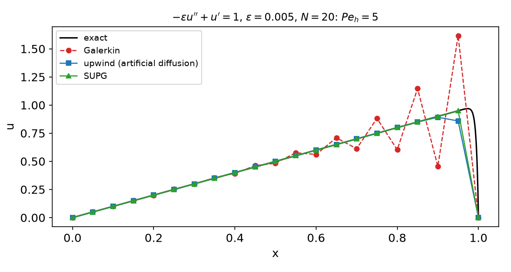
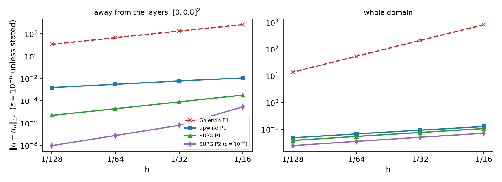
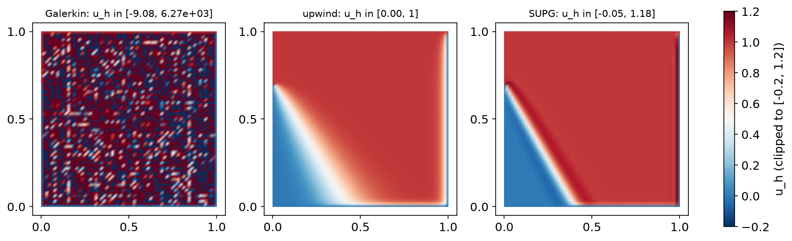

## Today

| Part | Topic | Time |
|---|---|:---:|
| Quiz | Week 12 (Schur complement, block preconditioners, Darcy) | 10 min |
| **A** | Theory — Péclet numbers, layers, why Galerkin oscillates, upwinding, SUPG | 55 min |
| **B** | DOLFINx 0.11 — SUPG forms, $\tau$, test problems with layers | 35 min |
| **C** | Measurements — 1D, 2D boundary layers, $\tau$, internal layers | 35 min |
| **D** | LLM pitfalls with stabilized methods · HW12 | 15 min |

::: {.box}
Lab notebook: `W13_lab.ipynb` · Homework: `W13_HW12.ipynb` (due before Week 14)
:::

## Where we are

| Week | Operator | What made the discretization work |
|---|---|---|
| 5–7 | $-\nabla\cdot(k\nabla u)$ | coercive and symmetric: Galerkin is the best approximation in the energy norm (Céa) |
| 11–12 | Stokes | inf-sup: the right pair of spaces |
| **13** | $-\varepsilon\Delta u+\mathbf b\cdot\nabla u$ | **coercive, but with constant $\varepsilon$ and continuity constant $\sim|\mathbf b|$** — Galerkin is stable only on paper |
| 14–15 | Navier–Stokes | the same convection term, now nonlinear |

::: {.fragment}
Heat and mass transport in a moving fluid: the reactor, the heat exchanger, the extruder, the Course II tubular reactor (species advection–diffusion–reaction with SUPG).
In process equipment $\varepsilon/(|\mathbf b|L)$ is often $10^{-3}$–$10^{-6}$.
:::

# Part A — Theory

## §A1 The advection–diffusion problem

$$-\varepsilon\Delta u+\mathbf b\cdot\nabla u=f\ \text{in }\Omega,\qquad u=g\ \text{on }\partial\Omega,\qquad \nabla\cdot\mathbf b=0 .$$

Weak form: $a(u,v)=\varepsilon(\nabla u,\nabla v)+(\mathbf b\cdot\nabla u,v)=(f,v)$ for all $v\in H^1_0$.

::: {.fragment}
- $(\mathbf b\cdot\nabla v,v)=\tfrac12\int\mathbf b\cdot\nabla(v^2)=-\tfrac12\int(\nabla\cdot\mathbf b)v^2=0$ ⇒ $a(v,v)=\varepsilon|v|_1^2$: **coercive with constant $\varepsilon$**.
- $|a(u,v)|\le(\varepsilon+C_P|\mathbf b|_\infty)|u|_1|v|_1$: continuity constant $\sim|\mathbf b|$.
- Céa: $|u-u_h|_1\le\big(1+C_P|\mathbf b|/\varepsilon\big)\inf_{v_h}|u-v_h|_1$ — the constant is the **Péclet number**.
:::

::: {.fragment}
::: {.callout-note title="Definition — Péclet numbers"}
Global $\mathrm{Pe}=|\mathbf b|L/\varepsilon$; **mesh Péclet number** $\mathrm{Pe}_h=|\mathbf b|h/(2\varepsilon)$: advection vs diffusion across one cell.
:::
:::

## §A2 Layers

1D model: $-\varepsilon u''+u'=1$, $u(0)=u(1)=0$:
$$u(x)=x-\frac{e^{(x-1)/\varepsilon}-e^{-1/\varepsilon}}{1-e^{-1/\varepsilon}} .$$

- Away from $x=1$: $u\approx x$, the solution of the **reduced** problem $u'=1$, $u(0)=0$ (one boundary condition — the inflow one).
- At the **outflow** boundary the second condition is enforced in an **exponential boundary layer** of width $O(\varepsilon/|\mathbf b|)$.
- In 2D: outflow layers (exponential), characteristic (parabolic) layers along walls parallel to $\mathbf b$, and **interior layers** where discontinuous inflow data
  are transported along streamlines.

::: {.fragment}
A mesh with $h\gg\varepsilon/|\mathbf b|$ cannot resolve the layer. The question is what the method does with what it cannot resolve: pollute the whole domain, or keep the
damage inside the layer.
:::

## §A3 Why Galerkin oscillates: the 1D stencil

P1 on a uniform mesh, $f=0$, divide by $\varepsilon/h$: central differences
$$-(1+\mathrm{Pe}_h)\,u_{i-1}+2u_i-(1-\mathrm{Pe}_h)\,u_{i+1}=0 .$$

::: {.fragment}
Ansatz $u_i=r^i$: $(1-\mathrm{Pe}_h)r^2-2r+(1+\mathrm{Pe}_h)=0$ ⇒ $r=1$ or $r=\dfrac{1+\mathrm{Pe}_h}{1-\mathrm{Pe}_h}$, so $u_i=A+B\,r^i$.
:::

::: {.fragment}
| $\mathrm{Pe}_h$ | 0.25 | 1.25 | 2.5 | 5 | 250 |
|---|---|---|---|---|---|
| $r$ | 1.667 | −9.000 | −2.333 | −1.500 | −1.008 |

$\mathrm{Pe}_h>1$ ⇒ $r<0$: the discrete solution **alternates in sign from node to node**, and the oscillation reaches all the way upstream ($|r|\to1$).
Equivalently the matrix loses the M-matrix property (positive off-diagonal entry $-(1-\mathrm{Pe}_h)$): no discrete maximum principle.
:::

## §A4 Upwinding and the optimal diffusion

**Artificial diffusion**: replace $\varepsilon$ by $\varepsilon+\tilde\varepsilon$.

- $\tilde\varepsilon=|\mathbf b|h/2$ (full upwind): effective $\mathrm{Pe}_h\le1$ always — monotone, M-matrix — but the method solves a **different** equation: $O(h)$ consistency error.
- **Optimal** (Il'in, Allen–Southwell): $\tilde\varepsilon=\dfrac{|\mathbf b|h}{2}\,\xi(\mathrm{Pe}_h)$, $\quad\xi(z)=\coth z-\dfrac1z$ — nodally **exact** in 1D for constant data.

::: {.fragment}
$\xi(z)\approx z/3$ for small $z$ (no diffusion added when the mesh resolves the layer), $\xi(z)\to1$ for $z\to\infty$ (full upwind).
:::

::: {.fragment}
In 2D, isotropic artificial diffusion also smears **across** the streamlines (crosswind), where no stabilization was needed. Brooks & Hughes (1982): add the diffusion
**only along $\mathbf b$**, and do it in a consistent way.
:::

## §A5 SUPG — streamline upwind Petrov–Galerkin

::: {.callout-important title="SUPG (Brooks–Hughes 1982)"}
Find $u_h\in V_h$ such that for all $v_h\in V_h$
$$a(u_h,v_h)+\sum_K\tau_K\big(-\varepsilon\Delta u_h+\mathbf b\cdot\nabla u_h-f,\ \mathbf b\cdot\nabla v_h\big)_K=(f,v_h),\qquad
\tau_K=\frac{h_K}{2|\mathbf b|}\,\xi(\mathrm{Pe}_K),\ \ \mathrm{Pe}_K=\frac{|\mathbf b|h_K}{2\varepsilon}.$$
:::

::: {.fragment}
- **Petrov–Galerkin**: the test function is $v_h+\tau\,\mathbf b\cdot\nabla v_h$ — upwind-weighted along the streamline.
- **Consistent**: the added term is the element **residual** times $\mathbf b\cdot\nabla v_h$; it vanishes for the exact solution, so Galerkin orthogonality
  $a_{\text{SUPG}}(u-u_h,v_h)=0$ holds.
- Stabilization acts **only along $\mathbf b$**: $\tau(\mathbf b\cdot\nabla u_h,\mathbf b\cdot\nabla v_h)$ is diffusion in the streamline direction.
- For P1, $\Delta u_h=0$ inside each cell; for P2 and higher, the term $-\varepsilon\Delta u_h$ must stay.
- 1D, P1: SUPG with this $\tau$ = the optimal artificial diffusion of §A4.
:::

## §A6 What SUPG guarantees — and what it does not

::: {.callout-important title="Theorem (stability and error, P$k$, $\tau_K\sim h_K/|\mathbf b|$ in the convection-dominated regime)"}
$a_{\text{SUPG}}(v_h,v_h)\ge\tfrac12|||v_h|||^2$ with $|||v|||^2=\varepsilon|v|_1^2+\sum_K\tau_K\|\mathbf b\cdot\nabla v\|_K^2$, and
$$|||u-u_h|||\le C\big(\varepsilon^{1/2}+h^{1/2}\big)h^k|u|_{k+1}\quad\Rightarrow\quad\|u-u_h\|_0=O(h^{k+1/2})\ \text{for smooth }u.$$
:::

::: {.fragment}
- Control of the **streamline derivative** — the quantity Galerkin cannot control when $\varepsilon\to0$.
- In practice (and in the analysis of local error estimates): $O(h^{k+1})$ **away from layers**.
- **Not monotone**: SUPG has no discrete maximum principle; it keeps over- and undershoots *at the layers* (crosswind direction). Spurious-oscillations-at-layers-diminishing
  (SOLD) and algebraic flux correction add nonlinear crosswind diffusion — beyond this course.
- Inside an unresolved layer no method is accurate; the global $L^2$ error is dominated by the layer.
:::

# Part B — SUPG in DOLFINx 0.11

## §B1 The forms

```python
h   = ufl.CellDiameter(msh)                    # longest edge of the cell (P2: use h/2)
bn  = ufl.sqrt(ufl.dot(b, b))
Peh = bn * h / (2 * eps)
tau = h / (2 * bn) * (1 / ufl.tanh(Peh) - 1 / Peh)

a = (eps * ufl.inner(ufl.grad(u), ufl.grad(v)) + ufl.dot(b, ufl.grad(u)) * v) * ufl.dx
L = f * v * ufl.dx
R = -eps * ufl.div(ufl.grad(u)) + ufl.dot(b, ufl.grad(u))          # residual operator (div grad u = 0 per cell for P1)
a += tau * R * ufl.dot(b, ufl.grad(v)) * ufl.dx
L += tau * f * ufl.dot(b, ufl.grad(v)) * ufl.dx
```

::: {.fragment}
| Math | UFL |
|---|---|
| $h_K$ | `ufl.CellDiameter(msh)` (also `Circumradius`, `MinCellEdgeLength`) |
| $\xi(z)=\coth z-1/z$ | `1 / ufl.tanh(z) - 1 / z` |
| $\sum_K(\cdot,\cdot)_K$ | `* ufl.dx` — the cellwise quantities are evaluated per cell automatically |
| $\Delta u_h$ inside $K$ | `ufl.div(ufl.grad(u))` (broken second derivatives) |

The system is **non-symmetric**: LU (MUMPS) or GMRES, never CG.
:::

## §B2 Test problems with layers

**1D**: $-\varepsilon u''+u'=1$ (exact solution in §A2). **2D**: $\mathbf b=(2,3)$, $f$ from
$$u=xy^2-y^2e^{2(x-1)/\varepsilon}-x\,e^{3(y-1)/\varepsilon}+e^{(2(x-1)+3(y-1))/\varepsilon}$$
— $u=0$ on $\partial\Omega$, layers of width $\varepsilon/2$ at $x=1$ and $\varepsilon/3$ at $y=1$, smooth part $xy^2$ ($\Delta\ne0$).

::: {.fragment}
- Write exponentials **as decaying ones**: $e^{(x-1)/\varepsilon}\le1$. The algebraically equivalent $(e^{x/\varepsilon}-1)/(e^{1/\varepsilon}-1)$ is `inf/inf = nan` for $\varepsilon=10^{-4}$.
- Measure the error **away from the layers** as well (here on $[0,0.8]^2$, a `ufl.conditional` indicator) and integrate with a high quadrature degree (8).
- $f$ from UFL: `f = -eps * div(grad(u_ex)) + dot(b, grad(u_ex))`.
:::

## §B3 Interior layers: the skew advection test

$\varepsilon=10^{-8}$, $\mathbf b=(\cos(-\pi/3),\sin(-\pi/3))$, $f=0$; $u=1$ on $\{y=1\}$ and on $\{x=0,\ y>0.7\}$, $u=0$ elsewhere on $\partial\Omega$.

- The jump at $(0,0.7)$ is carried along $\mathbf b$: an **interior layer**; exponential layers where $u$ must drop to 0 at $x=1$ and $y=0$.
- No exact solution formula — but $0\le u\le1$ (maximum principle). The range of $u_h$ measures the over- and undershoots.

```python
g = fem.Function(V)
g.interpolate(lambda x: np.where(np.isclose(x[1], 1.0) | (np.isclose(x[0], 0.0) & (x[1] > 0.7)), 1.0, 0.0))
bc = fem.dirichletbc(g, fem.locate_dofs_topological(V, 1, mesh.exterior_facet_indices(msh.topology)))
```

# Part C — Measurements

## §C1 1D: Galerkin, upwind, SUPG

{width=72%}

::: {.fragment}
$N=20$: SUPG nodal errors $3\times10^{-15}$ … $3\times10^{-16}$ for **every** $\varepsilon$ ($\mathrm{Pe}_h=0.25$ to $250$). Galerkin $\max u_h$: 1.061, 1.379, 1.617, 13.4 for $\mathrm{Pe}_h=1.25,2.5,5,250$
(exact maxima 0.902–0.999). Upwind: monotone, nodal error 0.08–0.20 for $\mathrm{Pe}_h\le5$.
:::

## §C2 2D boundary layers: errors away from the layers

{width=90%}

::: {.fragment}
$\varepsilon=10^{-6}$, P1, $N=16\to128$: Galerkin $\max u_h$ 2681 → 49; upwind away-error rate 1.0 (monotone, $\max u_h<1$); SUPG away-error rate 2.0
($4.8\times10^{-6}$ at $N=128$). P2 SUPG ($\varepsilon=10^{-4}$): rate 3.0. Whole domain: upwind and SUPG $\approx0.5$ — the unresolved layer (Galerkin's slope 2 is its oscillation amplitude decaying from $8\times10^2$ to 14).
:::

## §C3 The same table for three Péclet numbers

| $\varepsilon$ | Galerkin away error ($N=128$) / $\max u_h$ | upwind away / rate | SUPG away / rate / $\max u_h$ |
|---|---|---|---|
| $10^{-2}$ | $4.8\times10^{-6}$ / 1.03 (nearly resolved: $\mathrm{Pe}_h\approx2$) | $1.5\times10^{-3}$ / 1.0 | $6.7\times10^{-6}$ / 1.84 / 0.913 |
| $10^{-4}$ | 0.12 / 3.30 | $1.5\times10^{-3}$ / 1.0 | $4.8\times10^{-6}$ / 2.00 / 1.129 |
| $10^{-6}$ | 11.2 / 49.1 | $1.5\times10^{-3}$ / 1.0 | $4.8\times10^{-6}$ / 2.00 / 1.141 |

::: {.fragment}
- Once the mesh resolves the layer ($\mathrm{Pe}_h\lesssim1$), Galerkin is the best method — SUPG's $\xi(\mathrm{Pe}_h)\approx\mathrm{Pe}_h/3$ switches itself off.
- SUPG overshoots by 13–14 % **at** the layer for $\varepsilon\le10^{-4}$ (exact $\max u<1$): accurate away from layers, not monotone at them.
- Making Galerkin work by refinement needs $h<2\varepsilon/|\mathbf b|$: for $\varepsilon=10^{-6}$, $|\mathbf b|\approx3.6$, about $1.8\times10^6$ cells per direction.
:::

## §C4 $\tau$ matters — and so does consistency

| P1, $\varepsilon=10^{-4}$, $N=16\to128$ | away error | rates | $\max u_h$ / $\min u_h$ ($N=128$) |
|---|---|---|---|
| $\tau$ as in §A5 | $3.2\times10^{-4}\to4.8\times10^{-6}$ | 2.02, 2.01, 2.00 | 1.129 / 0 |
| $\tau/10$ | $7.2\times10^{-2}\to2.4\times10^{-4}$ | 1.56, 2.32, 4.36 | 2.571 / −0.549 |
| $10\,\tau$ | $1.2\times10^{-1}\to1.0\times10^{-3}$ | 1.11, 2.10, 3.72 | 0.641 / 0 |

::: {.fragment}
- Too small: Galerkin-like oscillations. Too large: over-diffusion ($\max u_h=0.009$ at $N=16$ — the solution is wiped out). The "rates" above 2 are the
  pre-asymptotic recovery, not accuracy.
- **P2, $\varepsilon=10^{-2}$, without $-\varepsilon\Delta u_h$ in the residual**: away-error rates 1.13, 1.46, 1.78 instead of 3.25, 3.02, 3.00 — the method is no longer consistent.
:::

## §C5 Interior layers: skew advection

{width=92%}

::: {.fragment}
Range of $u_h$ (exact solution in $[0,1]$), $N=16/32/64$: Galerkin up to $9.7\times10^4$, $2.5\times10^4$, $6.3\times10^3$ (meaningless); upwind exactly $[0,1]$ but the interior layer
is smeared over many cells; SUPG $[-0.027,1.177]$, $[-0.042,1.176]$, $[-0.048,1.176]$ — sharp layer, bounded over/undershoots **that do not go away with $h$**.
:::

# Part D — LLMs and Stabilized Methods · HW12

## §D1 Where LLM-generated advection–diffusion code goes wrong

| Kind | What it looks like | Symptom |
|---|---|---|
| **$\mathbf b=0$ somewhere** | $\tau=\frac{h}{2|\mathbf b|}(\coth\mathrm{Pe}_h-1/\mathrm{Pe}_h)$ evaluated where $\mathbf b=0$ | `nan` in the matrix: MUMPS reason −11 (test: $\mathbf b=0$ on half the unit square) |
| **Overflowing exact solution** | $(e^{x/\varepsilon}-1)/(e^{1/\varepsilon}-1)$ | `inf/inf = nan` for $\varepsilon=10^{-4}$ |
| **Wrong error measure** | only the global $L^2$ error | every method "converges at 0.5": the layer hides the difference (§C2) |
| **Refinement instead of stabilization** | "increase N until the wiggles go away" | $h<2\varepsilon/|\mathbf b|$: millions of cells per direction |
| **Over-claiming** | "SUPG removes all oscillations" | 13–18 % overshoots at layers (§C3, §C5) |
| **Older API** | `ufl.CellSize(msh)`, `uh.vector` (legacy FEniCS) | `AttributeError` in 0.11 / UFL 2026 |

::: {.fragment}
A safe $\tau$ without $1/|\mathbf b|$: $\tau=\dfrac{h^2}{12\varepsilon}\cdot\dfrac{3\,\xi(\mathrm{Pe}_h)}{\mathrm{Pe}_h}$ (the second factor $\to1$ as $\mathrm{Pe}_h\to0$) — reason 4, finite solution on the same test.
Verification habit: a 1D problem with a known nodally exact answer first; then errors away from the layers, and the range of $u_h$.
:::

## HW12 — Péclet-number sweep, due before the Week 14 lecture

::: {.columns}
::: {.column width="55%"}
`W13_HW12.ipynb` (100 pts)

- **Q1 (20)** Theory: the 1D Galerkin difference equation, optimal artificial diffusion, consistency of SUPG
- **Q2 (40)** A new problem with an outflow layer: Galerkin, upwind and SUPG for $\varepsilon=1\dots10^{-6}$; errors away from the layer, rates
- **Q3 (20)** Designing $\tau$: optimal, asymptotic, too small, too large; P2 consistency
- **Q4 (20)** LLM debugging: an SUPG script with four bugs
:::
::: {.column width="45%"}
::: {.box}
Rules as always: *Restart session and run all*, `-np 2` where stated, the AI-usage log, numbers only from your own cells.

For every table: the mesh Péclet number of each run, the range of $u_h$, and the error away from the layer.
:::
:::
:::

## Summary

| Concept | Key idea | DOLFINx 0.11 |
|---|---|---|
| Péclet number | Céa constant $\sim|\mathbf b|/\varepsilon$; $\mathrm{Pe}_h=|\mathbf b|h/2\varepsilon$ | — |
| Galerkin oscillations | 1D root $r=(1+\mathrm{Pe}_h)/(1-\mathrm{Pe}_h)<0$ for $\mathrm{Pe}_h>1$ | — |
| Upwinding | artificial diffusion $|\mathbf b|h/2$: monotone, first order | `+ bn*h/2*inner(grad u, grad v)*dx` |
| Optimal diffusion | $\xi(z)=\coth z-1/z$: nodally exact in 1D | `1/ufl.tanh(z) - 1/z` |
| SUPG | residual × $\tau\,\mathbf b\cdot\nabla v$: consistent, streamline only | `CellDiameter`, `div(grad(u))` for P2 |
| Accuracy | $O(h^{k+1})$ away from layers, $O(h^{k+1/2})$ globally (smooth $u$) | errors on a subdomain, high quadrature |
| Limits | overshoots at layers stay (13–18 %) | SOLD / flux correction (beyond) |

**Next week — Navier–Stokes:** splitting schemes (Chorin, IPCS), the CFL condition, channel flow and the DFG flow past a cylinder; HW13.
