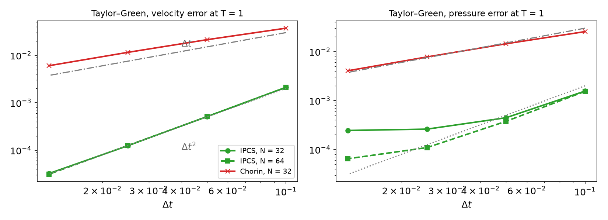
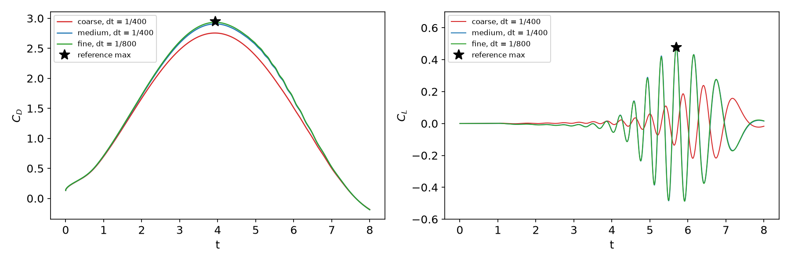
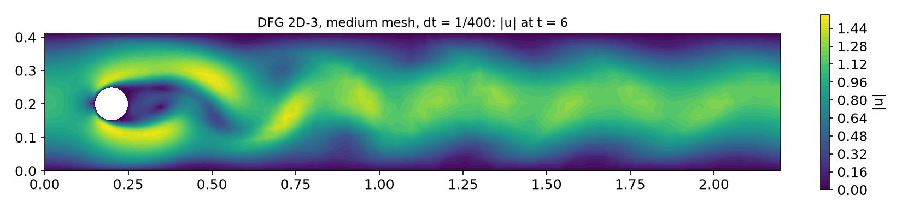

## Today

| Part | Topic | Time |
|---|---|:---:|
| Quiz | Week 13 (Péclet, Galerkin oscillations, SUPG) | 10 min |
| **A** | Theory — incompressible NS, projection (Chorin), IPCS, the nonlinear term, CFL | 50 min |
| **B** | DOLFINx 0.11 — three forms, three solvers, drag and lift, curved meshes | 35 min |
| **C** | Measurements — Taylor–Green, channel, DFG 2D-3, time step | 40 min |
| **D** | LLM pitfalls with time-dependent flow solvers · HW13 | 15 min |

::: {.box}
Lab notebook: `W14_lab.ipynb` · Homework: `W14_HW13.ipynb` (due before Week 15)
:::

## Where we are

| Week | Ingredient | Used today |
|---|---|---|
| 10 | θ-method, Crank–Nicolson, stability vs accuracy | time discretization of the momentum equation |
| 11 | Taylor–Hood P2/P1, inf-sup, pressure constant | the spatial pair |
| 12 | saddle-point solvers | avoided — by splitting |
| 13 | convection, Péclet number | the convection term, now nonlinear: cell Reynolds number |
| **14** | **incompressible Navier–Stokes, unsteady** | **projection methods** |
| 15 | steady NS by Newton, Re continuation, cavity | the other route |

::: {.fragment}
Every time step of a fully coupled scheme is a **nonlinear saddle-point problem** (Week 9 × Week 12). Projection methods split it into three **linear, symmetric or
nearly symmetric** problems — each solved with the tools of Weeks 5 and 12.
:::

# Part A — Theory

## §A1 The incompressible Navier–Stokes equations

$$\rho\big(\partial_t\mathbf u+(\mathbf u\cdot\nabla)\mathbf u\big)-\mu\Delta\mathbf u+\nabla p=\mathbf f,\qquad\nabla\cdot\mathbf u=0,\qquad\mathrm{Re}=\frac{\rho UL}{\mu}.$$

- The pressure is again a Lagrange multiplier (Week 11); no evolution equation, no initial condition, no "pressure boundary condition" in the PDE.
- Nonlinear convection $(\mathbf u\cdot\nabla)\mathbf u$: Week 13's convection with a velocity that is itself the unknown.
- Weak form (Taylor–Hood): $\big(\rho\partial_t\mathbf u+\rho(\mathbf u\cdot\nabla)\mathbf u,\mathbf v\big)+\mu(\nabla\mathbf u,\nabla\mathbf v)-(p,\nabla\cdot\mathbf v)+(q,\nabla\cdot\mathbf u)=(\mathbf f,\mathbf v)$.

::: {.fragment}
- **Do-nothing outflow**: with the $\nabla\mathbf u$ form, the natural condition is $\mu\partial_n\mathbf u-p\mathbf n=0$ — prescribing $p=0$ at the outlet and nothing for $\mathbf u$.
- A prescribed pressure $p=p_0$ on part of the boundary enters the momentum equation as the boundary term $\int p_0\,\mathbf v\cdot\mathbf n\,ds$ (integration by parts of $\nabla p$).
:::

## §A2 Chorin's projection (1968)

::: {.callout-note title="Helmholtz–Hodge decomposition"}
Every $\mathbf w\in L^2(\Omega)^d$ splits uniquely and $L^2$-orthogonally into $\mathbf w=\mathbf u+\nabla\phi$ with $\nabla\cdot\mathbf u=0$, $\mathbf u\cdot\mathbf n=0$ on $\partial\Omega$.
:::

::: {.fragment}
1. **Momentum without pressure**: $\rho\frac{\mathbf u^*-\mathbf u^n}{\Delta t}+\rho(\mathbf w\cdot\nabla)\mathbf u^{n+\frac12}-\mu\Delta\mathbf u^{n+\frac12}=\mathbf f$, $\mathbf u^*=\mathbf g$ on $\partial\Omega$.
2. **Pressure Poisson**: $\Delta p^{n+1}=\frac{\rho}{\Delta t}\nabla\cdot\mathbf u^*$, $\ \partial_np^{n+1}=0$.
3. **Projection**: $\mathbf u^{n+1}=\mathbf u^*-\frac{\Delta t}{\rho}\nabla p^{n+1}$ — the divergence-free part of $\mathbf u^*$.
:::

::: {.fragment}
- $\partial_np=0$ is **not** a property of the true pressure: a numerical boundary layer, and a splitting error $O(\Delta t)$ for velocity and pressure.
- At a steady state $\mathbf u^*-\mathbf u^n=\frac{\Delta t}{\rho}\nabla p$: the momentum equation holds only up to $O(\Delta t)$ — even a steady flow is not reproduced.
:::

## §A3 Incremental pressure correction (IPCS)

Goda (1979), van Kan (1986): put the **old** pressure into step 1 and correct by the increment $\phi=p^{n+1}-p^n$.

1. $\rho\frac{\mathbf u^*-\mathbf u^n}{\Delta t}+\rho(\mathbf w\cdot\nabla)\mathbf u^{n+\frac12}-\mu\Delta\mathbf u^{n+\frac12}+\nabla p^n=\mathbf f$, $\quad\mathbf u^*=\mathbf g$ on $\partial\Omega$
2. $\Delta\phi=\frac\rho{\Delta t}\nabla\cdot\mathbf u^*$ (with the pressure boundary data for $\phi$ where $p$ is prescribed)
3. $\mathbf u^{n+1}=\mathbf u^*-\frac{\Delta t}{\rho}\nabla\phi$, $\quad p^{n+1}=p^n+\phi$

::: {.fragment}
- Steady state: $\phi=0$ ⇒ $\nabla\cdot\mathbf u^*=0$, $\mathbf u^{n+1}=\mathbf u^*$ and step 1 **is** the discrete steady NS equation — consistent.
- Splitting error now $O(\Delta t^2)$ for the velocity in $L^2$ (with Crank–Nicolson in step 1); the pressure still carries a boundary layer from the artificial Neumann
  condition on $\phi$ (rotational form: Timmermans, Guermond–Shen — beyond this course).
- Cost per step: one convection–diffusion solve (non-symmetric), one Poisson solve (SPD), one mass-matrix solve (SPD, well conditioned).
:::

## §A4 The nonlinear term: semi-implicit

$$\rho(\mathbf w\cdot\nabla)\mathbf u^{n+\frac12},\qquad \mathbf w=\tfrac32\mathbf u^n-\tfrac12\mathbf u^{n-1}\ \text{(Adams–Bashforth)},\qquad \mathbf u^{n+\frac12}=\tfrac12(\mathbf u^*+\mathbf u^n)\ \text{(Crank–Nicolson)}.$$

- The **convecting** velocity is extrapolated (second order), the **convected** velocity is implicit: step 1 is linear — no Newton iteration.
- The matrix of step 1 contains $(\mathbf w\cdot\nabla)$: it changes every step and must be re-assembled; steps 2 and 3 have constant matrices.
- In UFL: $(\mathbf w\cdot\nabla)\mathbf u$ = `dot(w, nabla_grad(u))` (`nabla_grad(u)[i, j]` $=\partial_iu_j$) = `dot(grad(u), w)`.

::: {.fragment}
| Treatment of convection | per step | stability |
|---|---|---|
| fully implicit $(\mathbf u^{n+1}\cdot\nabla)\mathbf u^{n+1}$ | nonlinear (Newton) | unconditional |
| **semi-implicit** (above) | **linear** | no CFL limit from convection |
| fully explicit $(\mathbf w\cdot\nabla)\mathbf w$ | mass matrix only | CFL-limited; with central (Galerkin) convection AB2 is not stable on the imaginary axis |
:::

## §A5 CFL and the cell Reynolds number

$$\mathrm{CFL}=\frac{|\mathbf u|\,\Delta t}{h},\qquad \mathrm{Re}_h=\frac{|\mathbf u|\,h}{\nu}\quad(\text{Week 13: }\mathrm{Pe}_h=\mathrm{Re}_h/2).$$

- **CFL** compares the distance traveled in one step with the cell size. Explicit schemes need CFL $\lesssim1$ for **stability**; with the semi-implicit scheme
  CFL $\lesssim1$ is an **accuracy** guideline (a vortex should not jump over a cell per step).
- **$\mathrm{Re}_h$** decides whether the Galerkin discretization of convection oscillates (Week 13). At $\mathrm{Re}=100$ on the meshes below $\mathrm{Re}_h\approx10$–30 at the cylinder; P2 and the
  smooth flow keep the solution free of visible wiggles, but higher Re needs SUPG/PSPG or grad-div stabilization.

::: {.fragment}
DFG 2D-3: $\nu=10^{-3}$, $|\mathbf u|\lesssim2$, $h_{\min}=r/3\dots r/10$ ($0.017\dots0.005$): CFL = 1 at $\Delta t\approx h/2=8\times10^{-3}\dots2.5\times10^{-3}$.
:::

# Part B — Navier–Stokes in DOLFINx 0.11

## §B1 Three forms

```python
U  = 0.5 * (u + u_n)                                       # Crank-Nicolson
w  = 1.5 * u_n - 0.5 * u_n1                                # Adams-Bashforth
F1 = (rho / k * dot(u - u_n, v) + rho * inner(dot(w, nabla_grad(U)), v)
      + mu * inner(grad(U), grad(v)) - p_ * div(v)) * dx
a1, L1 = fem.form(ufl.lhs(F1)), fem.form(ufl.rhs(F1))      # re-assembled every step (w changes)
a2 = fem.form(dot(grad(p), grad(q)) * dx)                  # phi = p^{n+1} - p^n
L2 = fem.form(-rho / k * div(u_s) * q * dx)
a3 = fem.form(rho * dot(u, v) * dx)
L3 = fem.form((rho * dot(u_s, v) - k * dot(grad(phi), v)) * dx)
```

| Step | matrix | solver used here |
|---|---|---|
| 1 tentative velocity | $\frac{\rho}{\Delta t}M+\rho N(\mathbf w)+\frac\mu2K$, non-symmetric, every step | BiCGStab + Jacobi |
| 2 pressure increment | Laplacian (P1), constant | MINRES/CG + BoomerAMG |
| 3 velocity correction | mass matrix (P2), constant | CG + SOR |

## §B2 The time loop

```python
for i in range(nsteps):
    t += dt; u_in.interpolate(inflow)                      # time-dependent Dirichlet data
    A1.zeroEntries(); assemble_matrix(A1, a1, bcs=bcu); A1.assemble()
    rhs(b1, L1, a1, bcu); s1.solve(b1, u_s.x.petsc_vec); u_s.x.scatter_forward()
    rhs(b2, L2, a2, bcp); s2.solve(b2, phi.x.petsc_vec); phi.x.scatter_forward()
    p_.x.petsc_vec.axpy(1.0, phi.x.petsc_vec); p_.x.scatter_forward()
    rhs(b3, L3); s3.solve(b3, u_.x.petsc_vec); u_.x.scatter_forward()
    u_n1.x.array[:] = u_n.x.array; u_n.x.array[:] = u_.x.array
```

`rhs(b, L, a, bcs)`: zero, assemble, `apply_lifting`, `ghostUpdate(ADD, REVERSE)`, `set_bc` — Week 5's sequence, now every step.

::: {.fragment}
- Velocity BCs: inflow profile, no-slip walls and cylinder. Pressure BC: $p=0$ (hence $\phi=0$) on the outlet — do-nothing.
- Taylor–Green / channel with velocity on the whole boundary: fix one pressure value (the constant, Week 11).
:::

## §B3 Drag and lift

$$c_D=\frac{2}{\rho\bar U^2D}\int_S\Big(\rho\nu\frac{\partial u_{t}}{\partial n}n_y-pn_x\Big)ds,\qquad c_L=-\frac{2}{\rho\bar U^2D}\int_S\Big(\rho\nu\frac{\partial u_{t}}{\partial n}n_x+pn_y\Big)ds,$$
$\bar U=1$, $D=0.1$, $\mathbf n$ the unit normal **pointing out of the cylinder** (into the fluid), $u_t=\mathbf u\cdot(n_y,-n_x)$ the tangential velocity.

```python
n   = -ufl.FacetNormal(msh)                                # FacetNormal points out of the fluid domain
dS  = ufl.Measure("ds", domain=msh, subdomain_data=ft, subdomain_id=5)
u_t = ufl.inner(ufl.as_vector((n[1], -n[0])), u_)
drag = fem.form(2 / 0.1 * (mu / rho * ufl.inner(ufl.grad(u_t), n) * n[1] - p_ * n[0]) * dS)
```

::: {.fragment}
- $\Delta p=p(0.15,0.2)-p(0.25,0.2)$: point evaluation in parallel — `bb_tree`, `compute_colliding_cells`; only the rank owning the point has a cell; combine with `allreduce`.
:::

## §B4 Curved meshes and cell sizes

The DFG mesh is built with Gmsh and `setOrder(2)`: **quadratic geometry**, so that the cylinder is round.

::: {.fragment}
On this mesh, in 0.11:

| expression | result |
|---|---|
| `ufl.CellDiameter`, `ufl.MinCellEdgeLength`, `ufl.CellVolume` | `RuntimeError: ... Not handled` (JIT) |
| `ufl.Circumradius` | "only makes sense for affine simplex cells" |
| `msh.h(2, cells)` (Python, vertex distances) | works: $h_K\in$ [0.0150, 0.1450] (coarse mesh) |

Week 13's SUPG $\tau$ with `CellDiameter` therefore does not compile on a curved mesh; compute $h_K$ with `msh.h` into a DG0 function instead.
:::

# Part C — Measurements

## §C1 Taylor–Green vortex: temporal order

{width=88%}

::: {.fragment}
$\nu=0.01$, $T=1$, P2/P1, $\Delta t=0.1\to0.0125$. Velocity: IPCS rates 2.05, 2.03, 1.95 ($N=32$) and 2.05, 2.02, 2.01 ($N=64$); Chorin 0.81, 0.88, 0.94.
Pressure: Chorin $\approx1$; IPCS 1.81, 0.77, **0.09** at $N=32$ — the spatial error ($2.5\times10^{-4}$) is reached; at $N=64$ the floor drops to $6.5\times10^{-5}$ (rates 2.03, 1.78, 0.76).
A temporal rate is only visible while the temporal error dominates.
:::

## §C2 Channel flow: the steady state

$\nu=1$, $N=16$, $p=8$ / $0$ at in- / outlet, $\mathbf u=0$ on the walls; exact steady $\mathbf u=(4y(1-y),0)$, $p=8(1-x)$ (in the Taylor–Hood space). Errors at $t=1$:

| $\Delta t$ | IPCS $\|\mathbf u-\mathbf u_h\|$ | IPCS $\|p-p_h\|$ | Chorin $\|\mathbf u-\mathbf u_h\|$ | Chorin $\|p-p_h\|$ |
|---|---|---|---|---|
| 0.01 | $3.7\times10^{-5}$ | $9.6\times10^{-7}$ | $8.0\times10^{-2}$ | $9.5\times10^{-8}$ |
| 0.005 | $3.8\times10^{-5}$ | $6.3\times10^{-8}$ | $4.0\times10^{-2}$ | $1.8\times10^{-9}$ |
| 0.0025 | $3.8\times10^{-5}$ | $2.5\times10^{-9}$ | $2.0\times10^{-2}$ | $6.5\times10^{-10}$ |

::: {.fragment}
- IPCS: the velocity error is the **remaining transient** ($e^{-\pi^2\nu t}$-like decay, the same for every $\Delta t$); the steady state is exact.
- Chorin: the pressure is right, the velocity converges to a **wrong steady state**, error $\propto\Delta t$ (§A2) — its first step never sees the pressure gradient that drives the flow.
:::

## §C3 DFG 2D-3: drag and lift

{width=92%}

::: {.fragment}
| mesh, $\Delta t$ | cells / DOFs | time (`-np 2`) | $c_{D,\max}$ | $c_{L,\max}$ (time) | $\Delta p(8)$ |
|---|---|---|---|---|---|
| coarse, 1/400 | 902 / 4 324 | 31 s | 2.7550 (−6.6 %) | 0.2385 (6.410) | −0.1106 |
| medium, 1/400 | 4 323 / 20 056 | 114 s | 2.9069 (−1.5 %) | 0.4825 (5.698) | −0.1118 |
| fine, 1/800 | 12 056 / 55 257 | 607 s | 2.9334 (−0.6 %) | 0.4787 (5.694) | −0.1112 |
| reference | | | 2.9509 | 0.4780 (5.693) | −0.1116 |

Drag needs the boundary layer on the cylinder ($h$ at the wall); lift needs the onset of vortex shedding — the coarse mesh is too diffusive and sheds late and weakly.
:::

## §C4 The flow, and the time step

{width=92%}

::: {.fragment}
| medium mesh, $\Delta t$ | 1/100 | 1/200 | 1/400 | 1/800 |
|---|---|---|---|---|
| max CFL ($h_K$ from `msh.h`) | 2.52 | 1.26 | 0.63 | 0.32 |
| $c_{D,\max}$ | 2.9084 | 2.9071 | 2.9069 | 2.9068 |
| $c_{L,\max}$ | 0.6093 (+27.5 %) | 0.5108 (+6.9 %) | 0.4825 (+1.0 %) | 0.4752 (−0.6 %) |
| BiCGStab its/step (step 1) | 31.3 | 16.9 | 13.1 | 10.8 |

- Semi-implicit IPCS is **stable at CFL 2.5** — but the lift is 27 % off: drag is limited by the mesh, lift by the time step.
- Fully explicit AB2 convection on the same mesh **blows up** at every one of these $\Delta t$ (at $t=1.13$, 1.23, 1.53, 2.29) — even at CFL 0.32.
:::

# Part D — LLMs and Unsteady Flow Solvers · HW13

## §D1 Where LLM-generated Navier–Stokes code goes wrong

| Kind | What it looks like | Symptom (measured) |
|---|---|---|
| **Convection term transposed** | `dot(nabla_grad(u), w)` for $(\mathbf w\cdot\nabla)\mathbf u$ | DFG coarse: blow-up at $t=2.17$ |
| **Fully explicit convection** | $(\mathbf u^n\cdot\nabla)\mathbf u^n$ moved to the right-hand side | blow-up for every $\Delta t$ tried (§C4) |
| **Chorin presented as IPCS** | no pressure in step 1, $p^{n+1}=\phi$ | first order; steady states wrong (§C2); DFG coarse lift −57 % |
| **Cell size on curved meshes** | `ufl.CellDiameter(msh)` for SUPG / CFL on a Gmsh mesh of order 2 | JIT error "Not handled" (§B4) |
| **Accuracy from stability** | "stable, so the time step is fine" | $c_L$ +27.5 % at CFL 2.5 (§C4) |

::: {.fragment}
Verification habit: a steady exact solution (channel) and a time-dependent one (Taylor–Green) **before** the benchmark; then $c_D$, $c_L$, $\Delta p$ against the reference on two meshes
and two time steps.
:::

## HW13 — reproduce the DFG benchmark, due before the Week 15 lecture

::: {.columns}
::: {.column width="55%"}
`W14_HW13.ipynb` (100 pts)

- **Q1 (20)** Theory: Chorin as a projection, IPCS and steady states, CFL and $\mathrm{Re}_h$
- **Q2 (40)** DFG 2D-3 on a coarse and a medium mesh: $c_D$, $c_L$, $\Delta p$, errors, cost
- **Q3 (20)** Time step: stability vs accuracy
- **Q4 (20)** LLM debugging: a DFG script with four bugs
:::
::: {.column width="45%"}
::: {.box}
Rules as always: *Restart session and run all*, `-np 2`, the AI-usage log, numbers only from your own cells.

The simulations take minutes: start early, save results to `/tmp/fnx/`, plot from the saved files.
:::
:::
:::

## Summary

| Concept | Key idea | DOLFINx 0.11 |
|---|---|---|
| Projection | Helmholtz: $\mathbf u^*=\mathbf u+\nabla\phi$; artificial $\partial_np=0$ | three `fem.form`s, three KSPs |
| Chorin | no pressure in step 1: $O(\Delta t)$, steady states wrong | — |
| IPCS | old pressure in step 1, correct by $\phi$: $O(\Delta t^2)$ velocity, steady states exact | `p_ += phi` |
| Convection | semi-implicit: AB2 convecting, CN convected, linear step | `dot(w, nabla_grad(U))`, re-assemble $A_1$ |
| CFL, $\mathrm{Re}_h$ | explicit: stability; semi-implicit: accuracy | $h_K$ from `msh.h` on curved meshes |
| DFG 2D-3 | $c_{D,\max}$, $c_{L,\max}$, $\Delta p$: mesh at the cylinder matters most | `-FacetNormal`, `bb_tree` |

**Next week — steady Navier–Stokes:** Newton's method, Reynolds-number continuation, the lid-driven cavity vs Ghia et al., PCD preconditioning, H(div)-DG; HW14.
