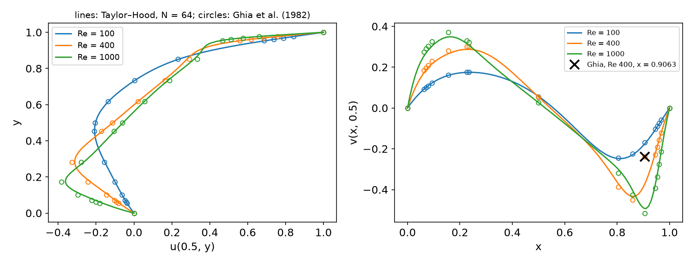
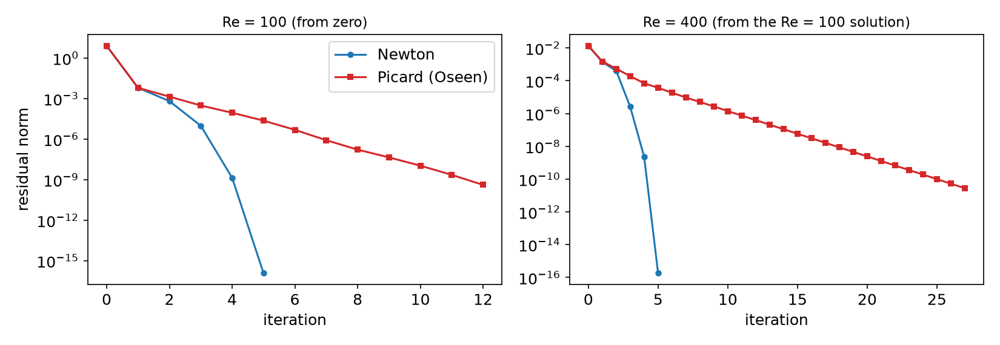

## Today

| Part | Topic | Time |
|---|---|:---:|
| Quiz | Week 14 (Chorin, IPCS, CFL, the convection term) | 10 min |
| **A** | Theory — steady NS, Newton vs Picard, continuation, PCD, H(div)-conforming DG | 50 min |
| **B** | DOLFINx 0.11 — residual and Newton, continuation, PCD with `fenicsx-pctools`, the H(div) forms | 35 min |
| **C** | Measurements — the cavity vs Ghia et al., Newton vs Picard, GMRES iterations, $\nabla\cdot\mathbf u_h$ | 40 min |
| **D** | LLM pitfalls with steady flow solvers · HW14 | 15 min |

::: {.box}
Lab notebook: `W15_lab.ipynb` · Homework: `W15_HW14.ipynb` (due before the Week 16 session)
:::

## Where we are

| Week | Ingredient | Used today |
|---|---|---|
| 9 | Newton's method, `NonlinearProblem`, SNES | the outer iteration |
| 11 | Taylor–Hood P2/P1, inf-sup, the pressure constant | the spatial pair |
| 12 | block preconditioners, Schur complement, $M_p$ | the inner (linear) solver — now with convection |
| 13 | convection, Péclet number | $\mathrm{Re}$ plays the role of the Péclet number |
| 14 | unsteady NS, projection methods | the other route to a steady state (time stepping) |
| **15** | **steady NS** | **Newton, continuation, cavity, PCD, H(div)** |

::: {.fragment}
Week 14 reached steady states by marching in time — hundreds of linear solves. A steady solution is a root of $\mathbf F(\mathbf u,p)=0$: Newton gets there in **five or six**
— if it starts close enough.
:::

# Part A — Theory

## §A1 Steady Navier–Stokes and the lid-driven cavity

$$-\nu\Delta\mathbf u+(\mathbf u\cdot\nabla)\mathbf u+\nabla p=\mathbf f,\qquad\nabla\cdot\mathbf u=0\quad\text{in }\Omega,\qquad\nu=\frac1{\mathrm{Re}}.$$

Find $(\mathbf u,p)\in V\times Q$ with $\ F\big((\mathbf u,p);(\mathbf v,q)\big)=\nu(\nabla\mathbf u,\nabla\mathbf v)+c(\mathbf u;\mathbf u,\mathbf v)-(p,\nabla\cdot\mathbf v)-(q,\nabla\cdot\mathbf u)-(\mathbf f,\mathbf v)=0$,
$\ c(\mathbf w;\mathbf u,\mathbf v)=((\mathbf w\cdot\nabla)\mathbf u,\mathbf v)$.

::: {.columns}
::: {.column width="55%"}
::: {.fragment}
**The lid-driven cavity**: unit square, $\mathbf u=(1,0)$ on the lid $y=1$, $\mathbf u=0$ on the other walls, $\mathbf f=0$.

- Enclosed flow: $p$ only up to a constant (Week 11) — pin one value, or a null space.
- The corners $(0,1)$, $(1,1)$: discontinuous velocity — $p\notin H^1$, the solution is singular there.
- Benchmark: **Ghia, Ghia & Shin (1982)**, $u(0.5,y)$ and $v(x,0.5)$ at 17 points each, Re = 100 … 10 000 (multigrid, 129 × 129 finite differences).
:::
:::
::: {.column width="45%"}
::: {.fragment}
::: {.box}
**Existence** for every Re (Leray–Schauder). **Uniqueness** only for small data: $\nu^2>\mathscr N\|\mathbf f\|_{-1}$ ($\mathscr N$: the continuity constant of $c$).
For the cavity the data is the lid: uniqueness and the convergence of Picard are guaranteed only at low Re.
:::
:::
:::
:::

## §A2 Newton vs Picard

Directional derivative of $F$ at $(\mathbf u^k,p^k)$ in the direction $(\delta\mathbf u,\delta p)$:

$$J_k\big((\delta\mathbf u,\delta p);(\mathbf v,q)\big)=\nu(\nabla\delta\mathbf u,\nabla\mathbf v)+\underbrace{c(\mathbf u^k;\delta\mathbf u,\mathbf v)}_{\text{Oseen}}+\underbrace{c(\delta\mathbf u;\mathbf u^k,\mathbf v)}_{\text{Newton only}}-(\delta p,\nabla\cdot\mathbf v)-(q,\nabla\cdot\delta\mathbf u).$$

::: {.columns}
::: {.column width="50%"}
::: {.fragment}
**Newton**: $J_k\,\delta=-F_k$, $\ \mathbf u^{k+1}=\mathbf u^k+\delta\mathbf u$.

- quadratic convergence **near** the solution
- the basin of attraction shrinks as Re grows (roughly $\sim\nu$)
- $J_k$: non-symmetric, every iteration
:::
:::
::: {.column width="50%"}
::: {.fragment}
**Picard (Oseen)**: drop $c(\delta\mathbf u;\mathbf u^k,\mathbf v)$ — the convecting velocity is frozen.

- a linear Oseen problem each step; **linear** convergence, factor $\approx\mathscr N\|\mathbf f\|/\nu^2$
- global convergence for small data
- same size and sparsity as Newton — with a direct solver about the same cost per iteration
:::
:::
:::

::: {.fragment}
Practical recipe: a few Picard steps to get close, then Newton (§C2) — or continuation (§A3).
:::

## §A3 Reynolds-number continuation

The solution depends smoothly on Re (away from bifurcations): $\mathbf u(\mathrm{Re}+\Delta\mathrm{Re})=\mathbf u(\mathrm{Re})+O(\Delta\mathrm{Re})$.

::: {.fragment}
1. Solve at a low Re from zero (Stokes-like: Newton converges).
2. Raise Re by a step; start Newton from the previous solution.
3. If Newton fails: halve the step and retry from the last converged solution.
:::

::: {.fragment}
- Natural-parameter continuation: the simplest predictor (the previous solution). Better: a tangent predictor $\mathbf u+\Delta\mathrm{Re}\,\partial_{\mathrm{Re}}\mathbf u$ (one extra
  solve with $J$), or **pseudo-arclength** continuation, which follows the branch around turning points (Keller 1977).
- Cost: each step needs a few Newton iterations, not a long transient — and every intermediate solution is itself a result.
- The same idea for any hard nonlinear problem: load stepping in elasticity, continuation in an activation energy, in a power-law index.
:::

## §A4 The linear solver: from $M_p$ to PCD

Newton/Oseen matrix and its block factorization (Week 12):
$\begin{pmatrix}F&B^\top\\B&0\end{pmatrix}$, $\ F=\nu A+N(\mathbf w)$ (+ the Newton term), $\ S=-BF^{-1}B^\top$.

::: {.columns}
::: {.column width="48%"}
::: {.fragment}
**Stokes ($N=0$)**: $S\approx-M_p/\nu$ — spectrally equivalent, iterations independent of $h$ (Week 12).

With convection this approximation ignores $N$: iterations grow with Re (§C3).
:::
:::
::: {.column width="52%"}
::: {.fragment}
**Pressure convection–diffusion (PCD)** (Kay, Loghin & Wathen 2002; Elman, Silvester & Wathen): assume the commutator is small,
$FM_u^{-1}B^\top\approx B^\top M_p^{-1}F_p$ with $F_p=\nu A_p+N_p(\mathbf w)$ the **same** operator on the pressure space. Then
$$S\approx -A_pF_p^{-1}M_p,\qquad S^{-1}\approx -M_p^{-1}F_pA_p^{-1}.$$
:::
:::
:::

::: {.fragment}
- One application: a pressure Laplace solve ($A_p$, AMG), a multiplication by $F_p$, a mass-matrix solve — all on the **pressure** space.
- Boundary conditions for $A_p$, $F_p$ are the delicate part (inflow, outflow, Robin terms; Blechta 2019). For the enclosed cavity: none — $A_p$ has the constant null space.
:::

## §A5 H(div)-conforming discontinuous Galerkin

Taylor–Hood satisfies $(\nabla\cdot\mathbf u_h,q_h)=0$ for all $q_h\in Q_h$ — but $\nabla\cdot\mathbf u_h\in$ discontinuous P1 $\not\subset Q_h$: mass is conserved only **weakly**.

::: {.columns}
::: {.column width="52%"}
::: {.fragment}
**If $\nabla\cdot V_h\subseteq Q_h$**, take $q_h=\nabla\cdot\mathbf u_h$: $\|\nabla\cdot\mathbf u_h\|^2=0$ — **pointwise divergence-free**.

- $V_h=\mathrm{RT}_{k+1}$ (normal component continuous: $H(\mathrm{div})$-conforming), $Q_h=\mathrm{DG}_k$
- tangential continuity is lost ⇒ the viscous term needs DG: **symmetric interior penalty** (Week 13's jumps and averages, $\alpha=6k^2$)
- convection: **upwind** fluxes on facets
:::
:::
::: {.column width="48%"}
::: {.fragment}
::: {.box}
**Pressure robustness**: with $\nabla\cdot\mathbf u_h=0$ exactly, the velocity error does not depend on the pressure ($\nu^{-1}\inf\|p-q_h\|$ disappears from the estimate).
Matters for small $\nu$ and large irrotational forces (buoyancy, Coriolis) — and for coupled transport: a species advected by $\mathbf u_h$ sees no artificial sources.
:::
:::
:::
:::

::: {.fragment}
Cockburn, Kanschat & Schötzau (2007); Schroeder & Lube (2018). DOLFINx 0.11 demo: `demo_navier-stokes.py` (Kovasznay flow).
:::

# Part B — Steady Navier–Stokes in DOLFINx 0.11

## §B1 The residual, Newton and Picard

```python
W  = fem.functionspace(msh, basix.ufl.mixed_element([P2_vec, P1]))
w  = fem.Function(W); u, p = ufl.split(w); v, q = ufl.TestFunctions(W)
Re = fem.Constant(msh, 100.0)                                  # changed later without recompiling
F  = (1 / Re * inner(grad(u), grad(v)) + inner(dot(grad(u), u), v)
      - p * div(v) - q * div(u)) * dx
problem = NonlinearProblem(F, w, bcs=bcs, petsc_options_prefix="cav_",
              petsc_options={"snes_type": "newtonls", "snes_linesearch_type": "none", "snes_rtol": 1e-10,
                             "ksp_type": "preonly", "pc_type": "lu", "pc_factor_mat_solver_type": "mumps"})
```

::: {.fragment}
- `J=None`: `NonlinearProblem` differentiates `F` with `ufl.derivative` — the full Newton Jacobian, no hand derivation.
- **Picard**: pass your own `J` with the convecting velocity frozen: `inner(dot(grad(du), u), v)` (`du` trial, `u` the current iterate).
- BCs: the lid by interpolating `isclose(x[1], 1)` on all boundary DOFs (the corners get 0 or 1 — a discretization choice); the pressure pinned at $(0,0)$.
:::

## §B2 Continuation and point values

```python
hist = []; problem.solver.setMonitor(lambda snes, it, rnorm: hist.append(rnorm))
for re in (100, 400, 1000):
    Re.value = re                       # the previous solution in w is the initial guess
    problem.solve()
    print(re, problem.solver.getConvergedReason(), problem.solver.getIterationNumber())
```

Point values in parallel — the rank that owns the cell evaluates, the others contribute $-\infty$:

```python
tree  = geometry.bb_tree(msh, 2)
cells = geometry.compute_colliding_cells(msh, geometry.compute_collisions_points(tree, P), P)
out   = np.full(len(P), -np.inf)
for i in range(len(P)):
    if len(c := cells.links(i)): out[i] = uh.eval(P[i], c[:1])[comp]
res = np.empty_like(out); comm.Allreduce(out, res, op=MPI.MAX)      # buffers: Allreduce, not allreduce
```

## §B3 PCD with `fenicsx-pctools`

Install (Colab, into the `%%fenicsx` environment): `pip install --no-deps git+https://gitlab.com/rafinex-external-rifle/fenicsx-pctools.git` (lab §3 has the cell).

```python
V, Q = fem.functionspace(msh, ("Lagrange", 2, (2,))), fem.functionspace(msh, ("Lagrange", 1))
F = (inner(dot(grad(u), u), v) + nu * inner(grad(u), grad(v)) - p * div(v) - q * div(u)) * dx   # u, p: separate Functions
J = ufl.derivative(F, (u, p), ufl.TrialFunctions(ufl.MixedFunctionSpace(V, Q)))
Js = create_splittable_matrix_block(J_mat, ufl.extract_blocks(J), nu=nu, v=u)  # PCD needs nu and the convecting velocity
```

| option (prefix `wrapped_`) | value |
|---|---|
| `pc_type`, `pc_fieldsplit_type`, `…schur_fact_type` | `fieldsplit`, `schur`, `upper` |
| `fieldsplit_0_pc_type` | `lu` (velocity block; AMG for large problems) |
| `fieldsplit_1_pc_python_type` | `fenicsx_pctools.pc.PCDPC_vX` |
| `fieldsplit_1_pcd_Ap_pc_type`, `…_pcd_Mp_pc_type` | `hypre`, `lu` |

Enclosed flow: no `bcs_pcd` (then $A_p$ carries the constant null space) and a pressure null space on the Jacobian.

## §B4 The H(div)-DG forms (from `demo_navier-stokes.py`)

```python
V = fem.functionspace(msh, ("Raviart-Thomas", k + 1)); Q = fem.functionspace(msh, ("Discontinuous Lagrange", k))
jump = lambda phi: outer(phi("+"), n("+")) + outer(phi("-"), n("-"))
a = (1 / Re) * (inner(grad(u), grad(v)) * dx - inner(avg(grad(u)), jump(v)) * dS
                - inner(jump(u), avg(grad(v))) * dS + alpha / avg(h) * inner(jump(u), jump(v)) * dS
                + Nitsche terms on ds) - p * div(v) * dx - div(u) * q * dx
lmbda = conditional(gt(dot(u_n, n), 0), 1, 0); u_uw = lmbda("+") * u("+") + lmbda("-") * u("-")
a += (inner(u / dt, v) * dx - inner(u, div(outer(v, u_n))) * dx
      + inner(dot(u_n, n)("+") * u_uw, v("+")) * dS + inner(dot(u_n, n)("-") * u_uw, v("-")) * dS + …)
```

::: {.fragment}
- Velocity BC: the RT DOFs are normal fluxes — `dirichletbc` sets $\mathbf u\cdot\mathbf n$; the tangential part enters weakly (Nitsche).
- The demo reaches the steady Kovasznay flow by implicit time steps with a lagged convecting velocity $\mathbf u^n$ (Picard in pseudo-time); blocked `LinearProblem(…, kind="mpi")`.
:::

# Part C — Measurements

## §C1 The cavity vs Ghia et al.

{width=96%}

Taylor–Hood, `crossed` mesh, $N=64$, continuation 100 → 400 → 1000. The × marks Ghia's $v(0.9063,0.5)$ at Re = 400 (see the next two slides).

## §C1 (cont.) Iterations and deviations

| `crossed` mesh, Taylor–Hood | Re = 100 | Re = 400 | Re = 1000 |
|---|---|---|---|
| Newton its, continuation ($N=32/64/128$) | 5 / 4 / 4 | 5 / 5 / 5 | 6 / 6 / 7 |
| Newton from zero ($N=32/64/128$) | 5 / 4 / 4 | 7 / 7 / 7 | **diverged** (reason −9; after 12–19 its, the count varies between runs) |
| $\max\lvert u-u_{\text{Ghia}}\rvert$, $N=32/64/128$ | 0.0089 / 0.0050 / 0.0050 | 0.031 / 0.015 / 0.0068 | 0.048 / 0.023 / 0.010 |
| $\max\lvert v-v_{\text{Ghia}}\rvert$, $N=32/64/128$ | 0.0051 / 0.0050 / 0.0069 | 0.114 / 0.132 / 0.142 | 0.053 / 0.023 / 0.011 |

Run time (`-np 2`, MUMPS, continuation): $N=32$ under 0.5 s per Re; $N=128$ (≈ 296 000 DOFs) 6–9 s.


## §C1 (cont.) Reading the comparison

- Re = 400, 1000: the deviation **halves** with every refinement — our discretization error dominates.
- Re = 100: it stops at 0.005 — now **Ghia's** error dominates (a 129 × 129 grid, second order, 5 digits). A benchmark is a measurement too.
- Re = 400, $v$: one point gets worse with refinement — $v(0.9063,0.5)$: ours $-0.352$, $-0.370$, $-0.380$; Ghia $-0.23827$. Without it the
  deviation is 0.036 / 0.016 / 0.0076. Ghia's value does not fit its neighbors (the × in the figure): a probable misprint in the table, noted in several transcriptions.

::: {.fragment}
::: {.box}
Before blaming your code for a disagreement with a published table: refine — does the gap shrink? Is it one point or all? Do several independent sources agree with you?
:::
:::

## §C2 Newton vs Picard

{width=88%}

::: {.fragment}
$N=32$. Re = 100 from zero: Newton 5 iterations, Picard 12. Re = 400 from the Re = 100 solution: Newton 5, Picard 27 (the residual shrinks by a factor ≈ 0.5 per step).
Re = 1000 from zero: Newton diverges, but **3 Picard steps** (residual $1.1\times10^{-3}$) **then Newton**: 4 iterations, quadratic.
:::

## §C3 GMRES inside Newton: $M_p/\nu$ vs PCD

GMRES (right preconditioned, $\text{rtol}=10^{-6}$), block upper-triangular Schur preconditioner, velocity block by LU; continuation Re = 100 → 400 → 1000, `crossed` mesh.

| Schur approximation | $N$ | Re = 100 | Re = 400 | Re = 1000 |
|---|---|---|---|---|
| $M_p/\nu$ (Week 12) | 32 | 39.5 | 215 | GMRES fails (1000 its) |
| | 64 | 40.2 | 227 | GMRES fails |
| **PCD** (`PCDPC_vX`) | 32 | 27.5 | 70.2 | 176 (Colab: 135) |
| | 64 | 28.2 | 73.0 | 176 |

GMRES iterations **per Newton step**; Newton: 4, 5, 6 iterations in every converged case. At Re = 1000 the PCD count changed between machines (176 in three local runs, 135 on Colab) — near its limit GMRES is sensitive to round-off; read it as "130–180".

::: {.fragment}
- Both are **mesh-independent** (32 → 64: same counts) — the Week 12 property survives.
- $M_p/\nu$ degrades fast with Re; PCD degrades too, but slowly — and converges at Re = 1000.
- PCD is not Re-independent here: the enclosed-flow boundary conditions on $A_p$, $F_p$ are the simplest possible; Blechta's variants and the outflow Robin term are the subject of current work.
:::

## §C4 Kovasznay flow: H(div)-DG vs Taylor–Hood

Exact steady NS solution, Re = 25, unit square, $\mathbf u$ prescribed on $\partial\Omega$.

| $n$ | H(div)-DG $\lVert\mathbf u-\mathbf u_h\rVert$ | H(div)-DG $\lVert\nabla\cdot\mathbf u_h\rVert$ | Taylor–Hood $\lVert\mathbf u-\mathbf u_h\rVert$ | Taylor–Hood $\lVert\nabla\cdot\mathbf u_h\rVert$ |
|---|---|---|---|---|
| 8 | $1.60\times10^{-2}$ | $3\times10^{-14}$ | $1.21\times10^{-3}$ | $2.4\times10^{-2}$ |
| 16 | $3.74\times10^{-3}$ | $2\times10^{-13}$ | $1.51\times10^{-4}$ | $5.8\times10^{-3}$ |
| 32 | $8.40\times10^{-4}$ | $3\times10^{-13}$ | $1.89\times10^{-5}$ | $1.4\times10^{-3}$ |

H(div)-DG: RT2 × DG1 (16 512 DOFs at $n=32$), 25 implicit steps to $t=10$. Taylor–Hood: P2 × P1, Newton (4 iterations).

::: {.fragment}
- Velocity error rates: H(div)-DG ≈ 2.1 (RT2 contains full P1), Taylor–Hood ≈ 3 (P2) — Taylor–Hood is more accurate **per mesh** here.
- $\nabla\cdot\mathbf u_h$: **round-off** for H(div)-DG ($10^{-13}$–$10^{-12}$; the digits differ between machines), $O(h^2)$ for Taylor–Hood. Choose by what matters downstream: transport by $\mathbf u_h$, pressure robustness — or the velocity error.
:::

# Part D — LLMs and Steady Flow Solvers · HW14

## §D1 Where LLM-generated steady NS code goes wrong

| Kind | What it looks like | Symptom (measured) |
|---|---|---|
| **A Picard Jacobian sold as Newton** | a hand-written `J` with the convecting velocity frozen, labeled "Newton" | linear convergence: 12 / 27 instead of 5 / 5 iterations (§C2) |
| **The Stokes preconditioner at high Re** | `fieldsplit` with $M_p/\nu$ for the Schur complement | 215 GMRES per Newton step at Re = 400, failure at Re = 1000 (§C3) |
| **"Taylor–Hood is divergence-free"** | $\nabla\cdot\mathbf u_h=0$ assumed for transport or post-processing | $\lVert\nabla\cdot\mathbf u_h\rVert=1.4\times10^{-3}$ at $n=32$ (§C4) |
| **Agreement with a table taken on trust** | one bad benchmark point "explained" by mesh or method | Ghia Re = 400, $x=0.9063$: the gap grows under refinement (§C1) |

::: {.fragment}
Verification habit: an exact solution first (Kovasznay), then the benchmark on **three meshes**; read the SNES residuals (quadratic or linear?) and the converged reason of every solve.
:::

## HW14 — the cavity at Re = 100, 400, 1000, due before Week 16

::: {.columns}
::: {.column width="55%"}
`W15_HW14.ipynb` (100 pts)

- **Q1 (20)** Theory: the Newton derivative, uniqueness and continuation, PCD, H(div)
- **Q2 (40)** The cavity vs Ghia on three meshes (`right` diagonal)
- **Q3 (20)** GMRES iterations: $M_p/\nu$ vs PCD along a continuation path
- **Q4 (20)** LLM debugging: a cavity script with four bugs
:::
::: {.column width="45%"}
::: {.box}
Rules as always: *Restart session and run all*, `-np 2`, the AI-usage log, numbers only from your own cells.

Q3 needs `fenicsx-pctools` — the install cell is in the notebook.
:::
:::
:::

## Summary

| Concept | Key idea | DOLFINx 0.11 |
|---|---|---|
| Newton | full Jacobian, quadratic near the root, small basin at high Re | `NonlinearProblem(F, w, …)`, `J=None` |
| Picard (Oseen) | convecting velocity frozen, linear, robust start | your own `J` |
| Continuation | previous Re's solution as the initial guess | `Re = fem.Constant`, `Re.value = …` |
| Cavity | Ghia et al.: refine, and question the table too | `bb_tree`, `Allreduce(MAX)` |
| PCD | $S^{-1}\approx-M_p^{-1}F_pA_p^{-1}$: convection on the pressure space | `fenicsx-pctools`, `PCDPC_vX` |
| H(div)-DG | $\nabla\cdot V_h\subseteq Q_h$ ⇒ exactly divergence-free | RT$_{k+1}$ × DG$_k$, SIP, upwinding |

**Next week — final project presentations (Course I); the report is due the same day.**
