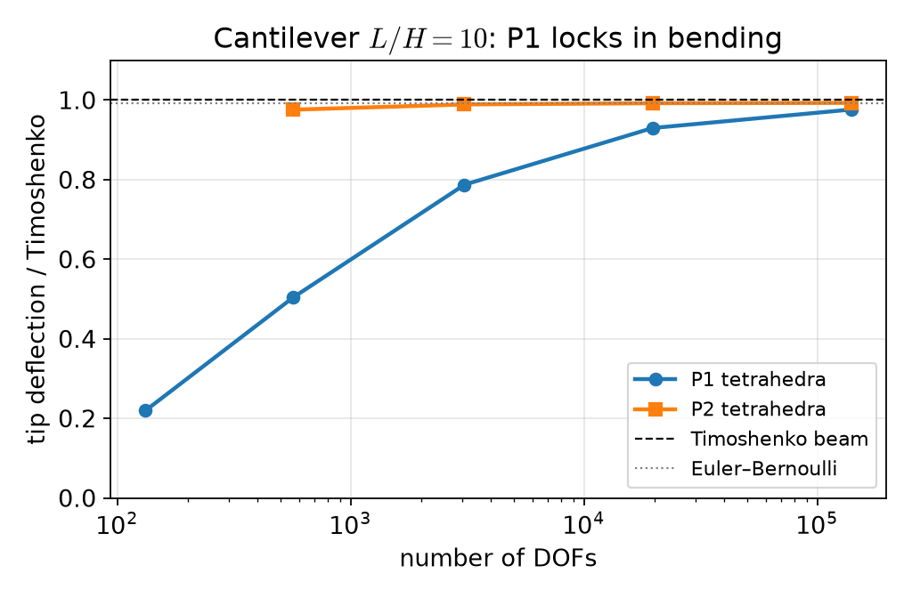
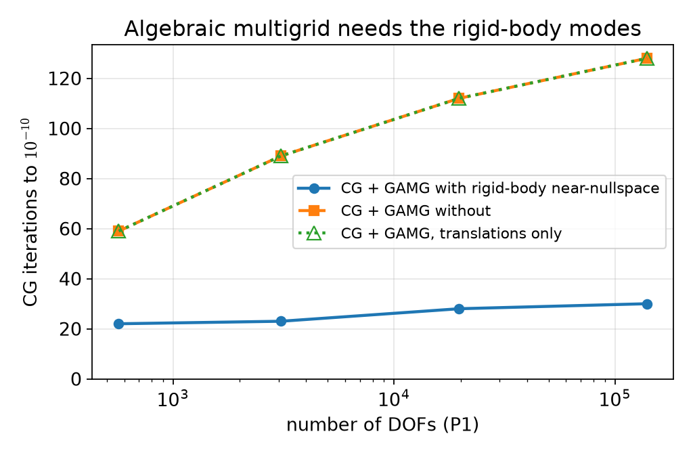
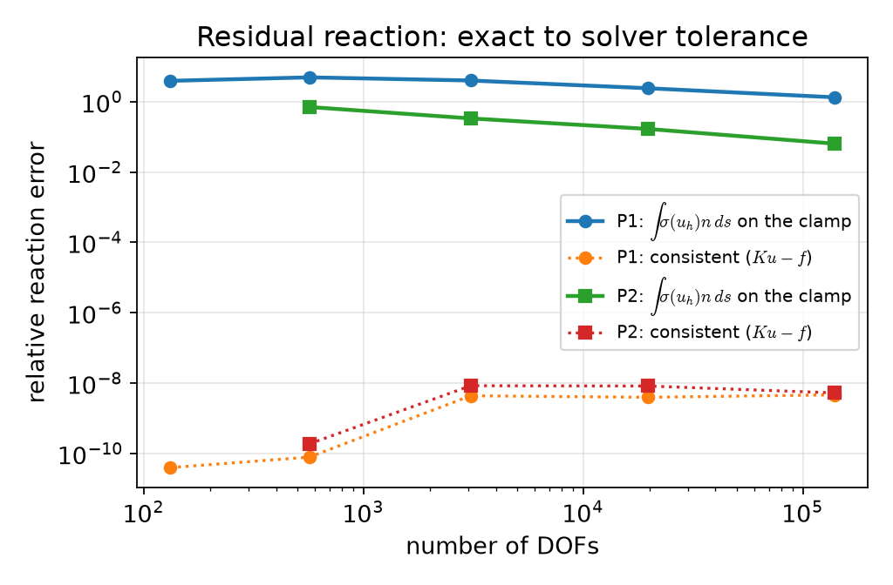
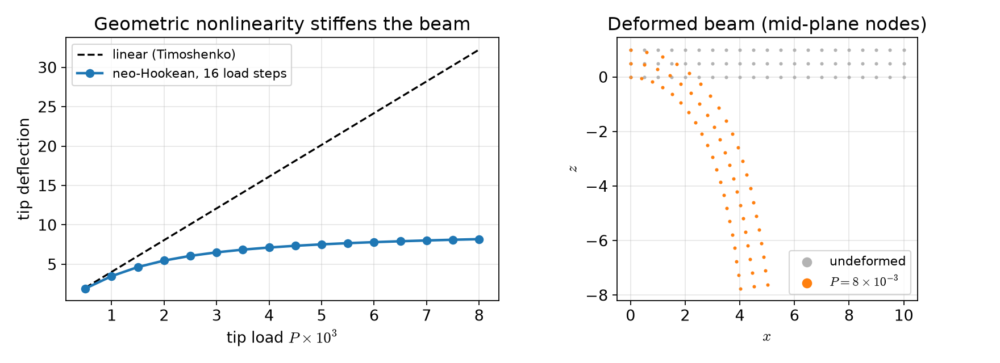

## Today

| Part | Topic | Time |
|---|---|:---:|
| **0** | Course II — what changes after Course I · schedule · project · LLMs for multi-file codes | 20 min |
| **A** | Theory — small-strain elasticity, weak form, Korn's inequality, beam theory as a benchmark | 50 min |
| **B** | Implementation — vector spaces, locking, CG + algebraic multigrid, consistent reaction forces | 45 min |
| **C** | Hyperelasticity — finite strain, neo-Hookean energy, Newton, load stepping | 45 min |
| **D** | LLM workflow for larger codes · assignment | 20 min |

::: {.box}
Lab notebook: `W01_lab.ipynb` · Assignment: `W01_HW1.ipynb` (due before Week 2)
:::

# Part 0 · Course II {background-color="#1f3864"}

## From Course I to Course II

| Course I (done) | Course II (now) |
|---|---|
| scalar problems, Stokes, Navier–Stokes | **vector-valued** solid mechanics, then coupled heat and mass transfer |
| one PDE per notebook | **coupled** fields (thermoelasticity, damage, convection–reaction) |
| linear algebra: LU, CG, block preconditioners | **multigrid** for elasticity, **SLEPc** eigenproblems, staggered and monolithic Newton |
| verification: MMS, benchmarks | the same — plus **conservation and equilibrium** checks (reactions, energy) |

The rules from Course I stay: weak form first, predicted rates, a benchmark with a citation, `-np 1` = `-np 2`, an AI-usage log.

## Schedule at a glance

| Weeks | Block | Typical benchmark |
|---|---|---|
| 1–3 | elasticity, plane stress, axisymmetry, thermoelasticity | beam theory, Lamé cylinder |
| 4–5 | plasticity, viscoelasticity, phase-field fracture | limit load, relaxation |
| 6–7 | dynamics, buckling, beams | energy conservation, Euler load |
| 8 | **midterm** (first half) · plates · **project proposal** | thin-plate limit |
| 9–10 | shells, homogenization, cohesive interfaces | Mori–Tanaka, debonding |
| 11–14 | natural convection, reactive flow, porous media + conjugate heat transfer, phase separation and scaling | de Vahl Davis, Graetz |
| 15–16 | project workshop + **progress talk** · final presentations | — |

Grading as in Course I, except the project: proposal 5 · progress presentation 5 (Week 15) · report and code 20 · final presentation 10.

## Codes get longer

A Course II project is a few hundred lines: material model, kinematics, solver loop, post-processing.
One notebook cell does not scale. The pattern used in all reference notebooks of this course:

```python
%%writefile /tmp/fnx/model.py          # ordinary Colab cell: writes a module
"""parameters, spaces, residual, solver — imported by every computation cell"""
...
```

```python
%%fenicsx -np 2
import sys; sys.path.insert(0, "/tmp/fnx")
from model import *                    # each %%fenicsx cell is a new MPI program
```

Part D: how to make an LLM produce such a module **and** the tests that check it.

# Part A · Small-strain elasticity {background-color="#1f3864"}

## Kinematics, stress, equilibrium

Displacement $\mathbf u:\Omega\subset\mathbb R^3\to\mathbb R^3$, small strain and isotropic Hooke's law
$$
\boldsymbol\varepsilon(\mathbf u)=\tfrac12\big(\nabla\mathbf u+\nabla\mathbf u^\top\big),\qquad
\boldsymbol\sigma=2\mu\,\boldsymbol\varepsilon+\lambda\,(\operatorname{tr}\boldsymbol\varepsilon)\,\mathbf I,\qquad
\mu=\frac{E}{2(1+\nu)},\ \ \lambda=\frac{E\nu}{(1+\nu)(1-2\nu)} .
$$

::: {.callout-note}
## Boundary value problem
$-\nabla\cdot\boldsymbol\sigma(\mathbf u)=\mathbf f$ in $\Omega$, $\ \mathbf u=\mathbf 0$ on $\Gamma_D$ (clamp), $\ \boldsymbol\sigma\mathbf n=\mathbf t$ on $\Gamma_N$ (traction).
:::

Plane strain: $\varepsilon_{zz}=0$, same formulas in 2D. Plane stress ($\sigma_{zz}=0$, Week 2) replaces $\lambda$ by $\lambda^*=2\lambda\mu/(\lambda+2\mu)$.

## Weak form = principle of virtual work

Multiply by $\mathbf v$ with $\mathbf v=\mathbf 0$ on $\Gamma_D$, integrate by parts, use the symmetry of $\boldsymbol\sigma$:
$$
a(\mathbf u,\mathbf v)=\int_\Omega\boldsymbol\sigma(\mathbf u):\boldsymbol\varepsilon(\mathbf v)\,dx
=\int_\Omega\mathbf f\cdot\mathbf v\,dx+\int_{\Gamma_N}\mathbf t\cdot\mathbf v\,ds=\ell(\mathbf v)\qquad\forall\mathbf v\in V .
$$

- $a$ is symmetric; $\tfrac12a(\mathbf v,\mathbf v)-\ell(\mathbf v)$ is the **potential energy**: the solution minimises it (Course I Week 5, Ritz).
- $\boldsymbol\sigma:\boldsymbol\varepsilon(\mathbf v)=\boldsymbol\sigma:\nabla\mathbf v$ because $\boldsymbol\sigma$ is symmetric — the code may use either.

## Coercivity needs Korn's inequality

$a(\mathbf v,\mathbf v)=\int 2\mu|\boldsymbol\varepsilon(\mathbf v)|^2+\lambda(\nabla\cdot\mathbf v)^2\ \ge 2\mu\|\boldsymbol\varepsilon(\mathbf v)\|^2$ controls only the **symmetric** gradient.

::: {.callout-important}
## Korn's inequality
If $|\Gamma_D|>0$: $\ \|\nabla\mathbf v\|_{L^2}\le C_K\|\boldsymbol\varepsilon(\mathbf v)\|_{L^2}$ for all $\mathbf v\in H^1_D(\Omega)^3$. With Poincaré, $a$ is coercive on $V$ → Lax–Milgram.
:::

The kernel of $\boldsymbol\varepsilon$ is the **rigid-body motions** $\mathbf r(\mathbf x)=\mathbf a+\boldsymbol\omega\times\mathbf x$ (6 in 3D, 3 in 2D).
Without a clamp they are not excluded: the pure-traction problem needs $\ell(\mathbf r)=0$ (balance of forces **and moments**) — the vector version of the Neumann compatibility condition from Course I Week 6.

## Two limits where the constant blows up

| Limit | What happens | Symptom |
|---|---|---|
| $\nu\to\tfrac12$ ($\lambda\to\infty$) | the term $\lambda(\nabla\cdot\mathbf u)^2$ enforces incompressibility | **volumetric locking** of P1 (mixed $\mathbf u$–$p$, Week 3 onwards) |
| slender structures in bending | P1 tetrahedra cannot bend without spurious shear strain | **shear locking**: far too stiff |

Locking means the error constant is huge, not that the method fails to converge — it converges, but only on very fine meshes.

## A benchmark: the cantilever

Beam $L\times B\times H=10\times1\times1$, clamped at $x=0$, total shear load $P$ on $x=L$, $E=1$, $\nu=0.3$.

$$
\delta_{\rm EB}=\frac{PL^3}{3EI},\qquad
\delta_{\rm T}=\delta_{\rm EB}+\frac{PL}{\kappa\,\mu A},\qquad I=\frac{BH^3}{12},\quad \kappa=\frac{10(1+\nu)}{12+11\nu}\ \text{(Cowper)}
$$

$\delta_{\rm T}/\delta_{\rm EB}=1.00765$ here. The 3D solid is not a beam: the clamp also suppresses the Poisson contraction, so a converged 3D
solution sits slightly **below** $\delta_{\rm T}$. Beam theory is a reference with a known modelling error — report the deviation, do not hide it.

# Part B · Implementation and solvers {background-color="#1f3864"}

## Math → code

| Mathematics | DOLFINx 0.11 |
|---|---|
| $V_h\subset H^1(\Omega)^3$, P2 | `fem.functionspace(msh, ("Lagrange", 2, (3,)))` |
| $\boldsymbol\varepsilon(\mathbf u)$ | `ufl.sym(ufl.grad(u))` |
| $\boldsymbol\sigma(\mathbf u)$ | `2*mu*eps(u) + lmbda*ufl.tr(eps(u))*ufl.Identity(3)` |
| $a(\mathbf u,\mathbf v)$ | `ufl.inner(sigma(u), eps(v))*ufl.dx` |
| $\int_{\Gamma_N}\mathbf t\cdot\mathbf v$ | `ufl.dot(t, v)*ds(2)`, `t = fem.Constant(msh, np.array([0, 0, -P/A]))` |
| $\mathbf u=\mathbf 0$ on $\Gamma_D$ | `fem.dirichletbc(np.zeros(3), dofs, V)` |
| one component, e.g. $u_x=0$ | `fem.dirichletbc(0.0, fem.locate_dofs_topological(V.sub(0), fdim, facets), V.sub(0))` |

Tip deflection: average of $u_z$ over the loaded face, `assemble_scalar(form(u[2]*ds(2)))/A` and `allreduce`.

## Result: P1 locks, P2 does not

{width=62% fig-align="center"}

P1: 0.219 → 0.504 → 0.787 → 0.930 → 0.976 of $\delta_{\rm T}$ (132 to 139 587 DOFs). P2: 0.976 at 567 DOFs, then 0.989, 0.992, 0.993.
**Same number of DOFs (3 075): P1 0.787, P2 0.989.**

## Solving large elasticity systems

3D, P2, a few $10^5$ DOFs: LU (MUMPS) becomes slow and memory hungry. $K$ is symmetric positive definite → **CG**.
Preconditioner: algebraic multigrid (`pc_type gamg`, PETSc's smoothed aggregation).

Multigrid works when the coarse levels can represent the **low-energy modes** of the operator. For elasticity those are the rigid-body motions —
they have zero energy without the clamp. A scalar AMG does not know them; we tell it:

```python
A.setNearNullSpace(rigid_body_modes(V))   # 6 vectors: 3 translations, 3 rotations (API sheet §16b)
```

## Near-nullspace: measured

{width=60% fig-align="center"}

P1, `-np 2`, relative tolerance $10^{-10}$: **22, 23, 28, 30** iterations with the rigid-body modes; **59, 89, 112, 128** without (567 → 139 587 DOFs).

Only the three translations: **59, 89, 112, 128** — exactly as without. The block size 3 of the matrix already implies them; the information GAMG is missing is the **rotations**.

## Reaction forces: two ways

The clamp exerts a force on the beam. Equilibrium: it must equal the applied load $P$.

::: {.columns}
::: {.column width="50%"}
**Flux:** $\displaystyle R=\int_{\Gamma_D}\boldsymbol\sigma(\mathbf u_h)\mathbf n\,ds$ — differentiates $\mathbf u_h$ and samples it where the stress is singular (re-entrant edges of the clamp).
:::
::: {.column width="50%"}
**Consistent:** $\mathbf r=K\mathbf u_h-\mathbf f$ with $K$ assembled **without** boundary conditions; $\mathbf r$ is non-zero only on the clamped DOFs; $R=\sum_{\rm clamp}r_z$.
:::
:::

Why the consistent value is exact: the discrete equations of all free DOFs hold, so the sum of all rows of $K\mathbf u_h-\mathbf f$ over the clamped DOFs equals the discrete load balance — it is the discrete equilibrium itself.

## Reaction forces: measured

{width=58% fig-align="center"}

Flux integral with P2: relative error 0.70 → 0.33 → 0.17 → 0.064; with P1 130–490 % (it even grows before it falls). Consistent: $10^{-8}$–$10^{-10}$, the CG tolerance.

# Part C · Hyperelasticity {background-color="#1f3864"}

## Finite strain

Deformation $\boldsymbol\varphi(\mathbf X)=\mathbf X+\mathbf u(\mathbf X)$,
$$
\mathbf F=\mathbf I+\nabla\mathbf u,\qquad \mathbf C=\mathbf F^\top\mathbf F,\qquad J=\det\mathbf F>0 .
$$

Compressible **neo-Hookean** stored energy (reduces to Hooke's law with $\mu,\lambda$ for small strain):
$$
\psi(\mathbf F)=\frac\mu2\big(\operatorname{tr}\mathbf C-3\big)-\mu\ln J+\frac\lambda2(\ln J)^2,\qquad
\Pi(\mathbf u)=\int_\Omega\psi(\mathbf F)\,dx-\int_{\Gamma_N}\mathbf t\cdot\mathbf u\,ds .
$$

Equilibrium = stationarity: $\ R(\mathbf u;\mathbf v)=D\Pi(\mathbf u)[\mathbf v]=0$ for all $\mathbf v$ — nonlinear in $\mathbf u$ (Course I Weeks 8–9).

## Energy → residual → Jacobian in UFL

```python
u = fem.Function(V); v = ufl.TestFunction(V)
F = ufl.Identity(3) + ufl.grad(u); C = F.T * F; J = ufl.det(F)
psi = mu / 2 * (ufl.tr(C) - 3) - mu * ufl.ln(J) + lmbda / 2 * ufl.ln(J) ** 2
t = fem.Constant(msh, np.zeros(3))
R = ufl.derivative(psi * ufl.dx - ufl.dot(t, u) * ds(2), u, v)     # Gateaux derivative
problem = NonlinearProblem(R, u, bcs=[bc], petsc_options_prefix="hyper_",
                           petsc_options={"snes_type": "newtonls", "snes_rtol": 1e-10, ...})
```

The Jacobian $D^2\Pi$ is generated by `ufl.derivative` inside `NonlinearProblem`. **Dead load:** $\mathbf t$ does not follow the deformation.

## Why load steps?

Newton from $\mathbf u=\mathbf 0$: the first update solves $D^2\Pi(\mathbf 0)\,\delta\mathbf u=-R(\mathbf 0)$ — that is **the linear elasticity problem**.

- $P=4\times10^{-3}$ in one step: the linear tip deflection would be 16 (the beam is 10 long). The update inverts elements, $J\le0$, $\ln J$ = NaN:
  SNES stops after **1** iteration with reason **−4** (`DIVERGED_FUNCTION_NANORINF`).
- 16 load steps up to $P=8\times10^{-3}$: **6, 9, 8, 7, 6, 6, 5, 5, 5, 5, 4, 4, 4, 4, 4, 4** Newton iterations per step.

Each step starts from the previous solution — continuation in the load (Course I Week 9).

## The line search matters

Same beam (P2, $20\times2\times2$), 8 load steps to $P=4\times10^{-3}$, `-np 2`. Newton iterations per step:

| `snes_linesearch_type` | iterations per load step | result |
|---|---|---|
| `bt` (the default of `newtonls`) | 30 in the first step — stop | **fails** (reason −5, maximum iterations) |
| `l2` | 20, 17, 15, 13, 12, 11, 11, 11 | converges |
| `cp` | 23, 19, 14, 10, 8, 7, 6, 5 | converges |
| `none` / `basic` (full Newton steps) | 6, 9, 8, 7, 6, 6, 5, 5 | converges |

With load steps small enough, the full Newton step is the best choice here; backtracking on $\|R\|$ keeps cutting the step. Always print the
iterations **and** the converged reason — a failed solve is not an error in DOLFINx, `u` is simply not the solution.

## Load–deflection

{width=88% fig-align="center"}

At $P=8\times10^{-3}$: tip deflection 8.18 (linear theory 32.2); the tip moves back by 5.48 in $x$. **Small-load check:** at $P=10^{-6}$ the
neo-Hookean tip deflection is 0.98904 of $\delta_{\rm T}$ — identical to the linear P2 solution on the same mesh.

# Part D · LLM workflow for larger codes · assignment {background-color="#1f3864"}

## Prompting for a module, not a cell

1. **Specification first**: equations, boundary conditions, parameters with units, the quantities to report, DOLFINx 0.11, the API sheet.
2. **Interfaces**: "write `model.py` with `make_mesh(n)`, `solve_linear(n, deg)`, `reaction(uh)` … each returns numbers, no plots".
3. **Tests as part of the request**: "and a cell that checks (i) the small-load limit against linear elasticity, (ii) $R=P$, (iii) `-np 1` = `-np 2`".
4. **Review the diff, not the whole file**, when you ask for a change.

## What LLMs typically get wrong in elasticity codes

- Legacy API: `VectorFunctionSpace`, `fem.FunctionSpace(msh, ...)`, `dolfinx.nls.petsc.NewtonSolver`, `uh.vector` — see the API sheet §14.
- Plane stress vs plane strain: the same `lmbda` used for both (Week 2).
- CG + GAMG **without** the near-nullspace: it converges, just slowly — you only notice if you print the iteration count.
- Reactions from `σ(u_h)n` integrated over the clamp, reported as if exact.
- A "verification" against Euler–Bernoulli that silently compares with the wrong beam theory or the wrong $I$.

Check each one with a number, not by reading.

## Assignment HW1 (due before Week 2)

| Q | Topic | Points |
|---|---|:---:|
| 1 | Rigid-body motions, Korn, compatibility of the pure-traction problem | 20 |
| 2 | Cantilever: P1 vs P2 vs slenderness, CG + GAMG with and without the near-nullspace | 40 |
| 3 | Reactions: force **and moment** equilibrium from the residual, flux comparison | 20 |
| 4 | Debugging an LLM-generated hyperelastic load-stepping script | 20 |

**Week 2 starts with a 10-minute quiz on today's material (closed-AI).**

## Summary

| Concept | Key point | DOLFINx 0.11 |
|---|---|---|
| Weak form | virtual work, symmetric, energy minimum | `inner(sigma(u), eps(v))*dx` |
| Coercivity | Korn: needs a clamp (or $\ell(\mathbf r)=0$) | `dirichletbc(np.zeros(3), dofs, V)` |
| Locking | P1 too stiff in bending; P2 fine | `("Lagrange", 2, (3,))` |
| AMG | supply the rigid-body near-nullspace | `A.setNearNullSpace(...)`, `pc_type gamg` |
| Reactions | $K\mathbf u_h-\mathbf f$ on the clamped DOFs | assemble **without** bcs |
| Hyperelasticity | energy → `derivative` → Newton, load steps | `NonlinearProblem`, `fem.Constant` load |

**Next week:** plane stress with an orthotropic material, axisymmetry ($r$-weighted forms), Gmsh geometries, the Lamé cylinder.
