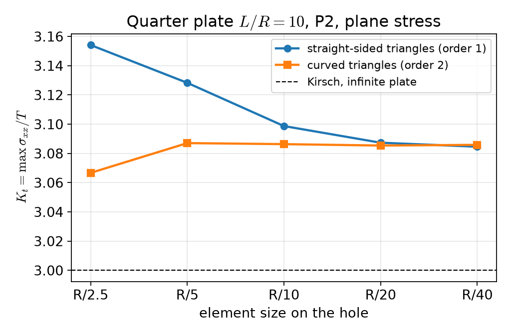
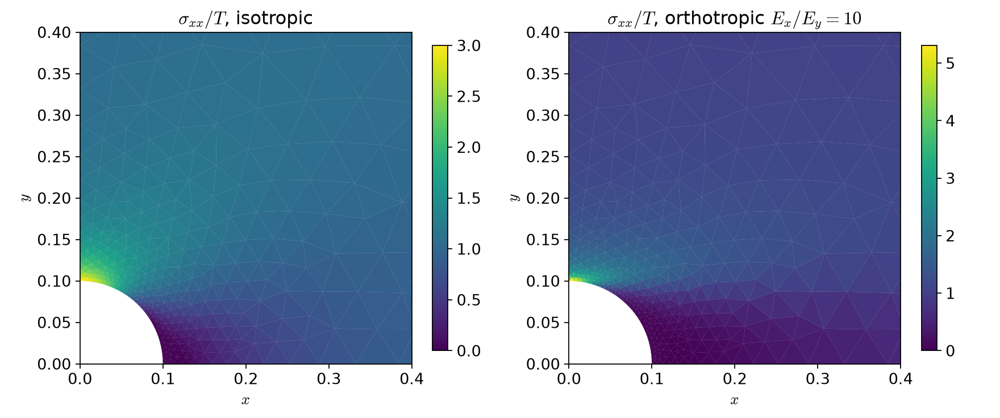
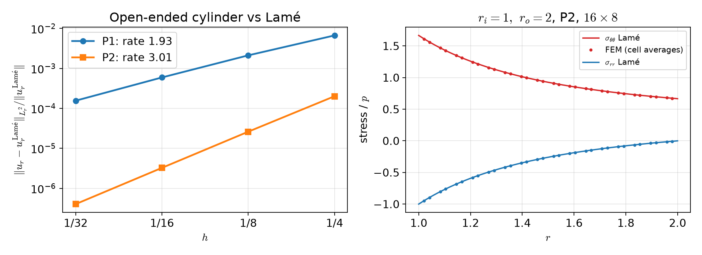

## Today

| Part | Topic | Time |
|---|---|:---:|
| | Quiz on Week 1 (closed-AI) | 10 min |
| **A** | Theory — plane strain and plane stress, orthotropic materials, stress concentration, axisymmetry, Lamé | 50 min |
| **B** | Plane problems in code — Gmsh geometry, symmetry conditions, stress recovery, $K_t$ | 45 min |
| **C** | Axisymmetry in code — the $r$-weighted form, verification against Lamé | 35 min |
| **D** | LLM pitfalls in 2D models · assignment | 20 min |

::: {.box}
Lab notebook: `W02_lab.ipynb` · Assignment: `W02_HW2.ipynb` (due before Week 3)
:::

## Week 1 in one slide

- Weak form $a(\mathbf u,\mathbf v)=\int\boldsymbol\sigma(\mathbf u):\boldsymbol\varepsilon(\mathbf v)=\ell(\mathbf v)$; Korn needs a clamp or $\ell(\mathbf r)=0$.
- P1 tetrahedra lock in bending; P2 does not.
- CG + GAMG needs the rigid-body near-nullspace; reactions from $K\mathbf u_h-\mathbf f$, not from $\int\boldsymbol\sigma\mathbf n$.
- Hyperelasticity: energy → `derivative` → Newton with load steps; print the converged reason.

**Today:** three ways to reduce a 3D body to a 2D computation — and how each reduction can be checked.

# Part A · Plane problems, orthotropy, axisymmetry {background-color="#1f3864"}

## Two plane problems

A body thin or long in $z$, loaded in the $(x,y)$ plane. Only $u_x,u_y$ are unknowns; the $zz$ components follow.

::: {.columns}
::: {.column width="50%"}
**Plane strain** (long body, $z$ fixed): $\varepsilon_{zz}=0$,
$$\sigma_{zz}=\lambda(\varepsilon_{xx}+\varepsilon_{yy})\ne0 ,$$
in-plane law with $\lambda$ and $\mu$ — the Week 1 law in 2D.
:::
::: {.column width="50%"}
**Plane stress** (thin plate): $\sigma_{zz}=\sigma_{xz}=\sigma_{yz}=0$,
$$\varepsilon_{zz}=-\frac{\lambda}{\lambda+2\mu}(\varepsilon_{xx}+\varepsilon_{yy})\ne0 .$$
:::
:::

::: {.callout-important}
## Plane stress = plane strain law with a modified Lamé constant
$\boldsymbol\sigma=2\mu\boldsymbol\varepsilon+\lambda^*(\operatorname{tr}\boldsymbol\varepsilon)\mathbf I_2,\qquad \lambda^*=\dfrac{2\lambda\mu}{\lambda+2\mu}=\dfrac{E\nu}{1-\nu^2}\quad(\lambda=\dfrac{E\nu}{(1+\nu)(1-2\nu)})$
:::

For $\nu=0.3$: $\lambda^*/\lambda=(1-2\nu)/(1-\nu)=0.571$. One line of code differs — and nothing warns you if it is the wrong line.

## Orthotropic materials

Three mirror planes of symmetry (wood, rolled sheet, unidirectional fiber composite). In plane stress, in the material axes $(1,2)$, Voigt notation with
**engineering** shear strain $\gamma_{12}=2\varepsilon_{12}$:
$$
\begin{pmatrix}\varepsilon_{11}\\\varepsilon_{22}\\\gamma_{12}\end{pmatrix}=
\underbrace{\begin{pmatrix}1/E_1&-\nu_{21}/E_2&0\\-\nu_{12}/E_1&1/E_2&0\\0&0&1/G_{12}\end{pmatrix}}_{\mathbf S\ \text{(compliance)}}
\begin{pmatrix}\sigma_{11}\\\sigma_{22}\\\sigma_{12}\end{pmatrix},\qquad \mathbf C=\mathbf S^{-1}.
$$

- Four independent constants $E_1,E_2,\nu_{12},G_{12}$; $\nu_{21}$ follows from the symmetry of $\mathbf S$ (HW2 Q1).
- Write the data as $\mathbf S$ (that is what is measured) and **invert numerically** — fewer places for a typo than a hand-inverted $\mathbf C$.

## Material axes at an angle

Fibers at angle $\theta$ to $x$: rotation $\mathbf Q=\begin{pmatrix}\cos\theta&-\sin\theta\\\sin\theta&\cos\theta\end{pmatrix}$ (columns = material axes).

::: {.callout-note}
## Rotate in, apply $\mathbf C$, rotate out
$\boldsymbol\varepsilon'=\mathbf Q^\top\boldsymbol\varepsilon\,\mathbf Q,\qquad \boldsymbol\sigma'=\mathbf C\,\boldsymbol\varepsilon'\ \text{(Voigt)},\qquad \boldsymbol\sigma=\mathbf Q\,\boldsymbol\sigma'\,\mathbf Q^\top$
:::

No $3\times3$ transformation matrices with factors 2 to get wrong: the tensor rotation is two matrix products in UFL.
For $\theta\ne0°,90°$ the stress in $(x,y)$ couples extension and shear.

## Stress concentration at a hole

Infinite plate, circular hole of radius $R$, remote tension $T$ along $x$. Kirsch (isotropic) on the hole, polar angle $\phi$:
$$
\sigma_{\phi\phi}(R,\phi)=T\,(1-2\cos2\phi):\qquad \sigma_{\max}=3T\ \text{at}\ \phi=90°,\qquad -T\ \text{at}\ \phi=0 .
$$

::: {.callout-important}
## Lekhnitskii (orthotropic, load along material axis 1)
$K_t=1+\sqrt{2\big(\sqrt{E_1/E_2}-\nu_{12}\big)+E_1/G_{12}}\qquad$ (isotropic: $1+\sqrt{2(1-\nu)+2(1+\nu)}=3$)
:::

Fiber composite $E_1=200$, $E_2=20$ GPa, $\nu_{12}=0.3$, $G_{12}=10$ GPa: load along the fibers $K_t=6.07$, across the fibers $2.60$.
Both are **infinite-plate** values: a finite plate gives something else.

## Axisymmetry

Body of revolution, loads and supports independent of $\theta$, no twist: $\mathbf u=u_r(r,z)\,\mathbf e_r+u_z(r,z)\,\mathbf e_z$. Computational domain: the half-plane section $(r,z)$, $r\ge0$.

$$
\boldsymbol\varepsilon=\begin{pmatrix}\partial_ru_r&0&\tfrac12(\partial_zu_r+\partial_ru_z)\\0&u_r/r&0\\\tfrac12(\partial_zu_r+\partial_ru_z)&0&\partial_zu_z\end{pmatrix}\quad(rr,\ \theta\theta,\ zz)
$$

- The **hoop strain** $\varepsilon_{\theta\theta}=u_r/r$: a radial displacement stretches the circumference. No hoop displacement, but a hoop stress.
- The hoop direction is not free: the law is the **3D** law, $\boldsymbol\sigma=2\mu\boldsymbol\varepsilon+\lambda(\operatorname{tr}\boldsymbol\varepsilon)\mathbf I_3$.

## The $r$-weighted weak form

Volume element $dV=r\,dr\,d\theta\,dz$, surface element $dS=r\,d\theta\,ds$:
$$
2\pi\!\int_{\Omega_{rz}}\!\boldsymbol\sigma(\mathbf u):\boldsymbol\varepsilon(\mathbf v)\,r\,dr\,dz
=2\pi\!\int_{\Omega_{rz}}\!\mathbf f\cdot\mathbf v\,r\,dr\,dz+2\pi\!\int_{\Gamma_N}\!\mathbf t\cdot\mathbf v\,r\,ds .
$$

- The $2\pi$ cancels in the equations; it does not cancel in **totals**: a force on a ring surface is $2\pi\int t\,r\,ds$.
- The weight $r$ vanishes on the axis; what this means for $u_r$ there is HW2 Q3.

## Thick cylinder: Lamé

Pressure $p_i$ inside ($r_i$), $p_o$ outside ($r_o$). Away from the ends:
$$
\sigma_{rr}=A-\frac{B}{r^2},\quad \sigma_{\theta\theta}=A+\frac{B}{r^2},\qquad A=\frac{p_ir_i^2-p_or_o^2}{r_o^2-r_i^2},\quad B=\frac{(p_i-p_o)r_i^2r_o^2}{r_o^2-r_i^2}
$$
$$
u_r=r\,\varepsilon_{\theta\theta}=\frac rE\big[\sigma_{\theta\theta}-\nu(\sigma_{rr}+\sigma_{zz})\big]
$$

| End condition | $\sigma_{zz}$ | $u_r(r_i)$ for $r_i=1,r_o=2,p_i=1,E=1,\nu=0.3$ |
|---|---|:---:|
| open ends (free top) | $0$ | 1.9667 |
| closed ends (caps carry $p\pi r_i^2$) | $A$ | 1.8667 |
| plane strain ($\varepsilon_{zz}=0$) | $2\nu A$ | 1.9067 |

Stresses $\sigma_{rr},\sigma_{\theta\theta}$ are the same; $u_r$ differs by up to 5 %. With $\sigma_{zz}$ and $\varepsilon_{zz}$ **constant**, each is an exact 3D solution
(the open-end one is *not* an approximation, and not "plane stress" except in name: $\sigma_{zz}=0$).

# Part B · Plane problems in code {background-color="#1f3864"}

## Math → code (`hole.py`)

| Mathematics | DOLFINx 0.11 |
|---|---|
| $\lambda^*=2\lambda\mu/(\lambda+2\mu)$ | `lam = 2*lmbda*mu/(lmbda + 2*mu)` |
| $\boldsymbol\sigma=2\mu\boldsymbol\varepsilon+\lambda^*\operatorname{tr}\boldsymbol\varepsilon\,\mathbf I_2$ | `2*mu*eps(u) + lam*ufl.tr(eps(u))*ufl.Identity(2)` |
| $\mathbf C=\mathbf S^{-1}$ | `C = ufl.as_matrix(np.linalg.inv(S).tolist())` |
| $\boldsymbol\varepsilon'=\mathbf Q^\top\boldsymbol\varepsilon\mathbf Q$, Voigt | `e = Q.T*eps(u)*Q; ufl.as_vector([e[0,0], e[1,1], 2*e[0,1]])` |
| $\boldsymbol\sigma=\mathbf Q\boldsymbol\sigma'\mathbf Q^\top$ | `Q*ufl.as_matrix([[s[0], s[2]], [s[2], s[1]]])*Q.T` |
| $u_x=0$ on $x=0$ | `fem.dirichletbc(0.0, fem.locate_dofs_topological(V.sub(0), 1, ft.find(1)), V.sub(0))` |
| $\int_{\Gamma_3}\mathbf t\cdot\mathbf v$ | `ufl.dot(t, v)*ds(3)` with `ds = ufl.Measure("ds", msh, subdomain_data=ft)` |

`fem.Constant` for material data works in 0.11 (an earlier version of these notes avoided it "because of JIT errors" — not reproducible).

## Geometry with Gmsh

```python
gmsh.initialize()
if comm.rank == 0:                                   # build the model on one rank only
    s = occ.addRectangle(0, 0, 0, L, L); d = occ.addDisk(0, 0, 0, R, R)
    occ.cut([(2, s)], [(2, d)]); occ.synchronize()    # plate minus disk; object and tool are removed
    ... addPhysicalGroup(1, curves, tag) for left/bottom/right/top/hole (sorted by center of mass)
    ... size field: h_hole on the hole -> h_far at distance L/2
    gmsh.model.mesh.generate(2); gmsh.model.mesh.setOrder(2)    # curved triangles
md = gmshio.model_to_mesh(gmsh.model, comm, 0, gdim=2)            # MeshData: .mesh, .facet_tags
gmsh.finalize()
```

- Physical groups become `md.facet_tags` — no `locate_entities` for the curved hole.
- **First test of any CAD geometry: the area.** $\int_\Omega1\,dx$ vs $L^2-\pi R^2/4$: 0.9921460185 vs 0.9921460184.

## Symmetry and stress recovery

Quarter model of the plate: on $x=0$ the mirror image requires $u_x=0$ and zero shear traction — a **roller**, imposed on one component:
`V.sub(0)` on $x=0$, `V.sub(1)` on $y=0$. The shear-free part is natural (nothing to do).

$K_t=\max\sigma_{xx}/T$ needs the stress of the discrete solution:

```python
W = fem.functionspace(msh, ("DG", deg - 1, (2, 2)))        # sigma(u_h) of P2 is P1 per cell (straight cells)
s = fem.Function(W); s.interpolate(fem.Expression(sigma(uh), W.element.interpolation_points))
Kt = comm.allreduce(s.x.array.reshape(-1, 4)[:, 0].max(), op=MPI.MAX) / T
```

Discontinuous, cell-wise: no smoothing that would cut the peak. The maximum over ranks needs `allreduce(..., MAX)`.

## Kirsch: does the hole geometry matter?

{width=58% fig-align="center"}

Straight-sided triangles: 3.154 → 3.128 → 3.099 → 3.087 → 3.085 — the polygon's corners raise the stress. Curved (order 2): 3.087 already at $R/5$, then 3.086, 3.085, 3.086.

## Converged — but not to 3

| Quarter plate, P2, curved, $h=R/20$ | $K_t$ | $\max\lvert\mathbf u\rvert$ |
|---|:---:|:---:|
| plane stress, $L/R=10$ | 3.0854 | 1.0518 |
| plane strain, $L/R=10$ | 3.0847 | 0.9571 |
| plane stress, $L/R=20$ | 3.0208 | |
| plane stress, $L/R=40$ | 3.0047 | |

- Same stress in plane stress and plane strain (tractions only: the 2D stress field does not depend on $E,\nu$); different displacement.
- 3.085 is the converged value of a **finite** plate; Kirsch's 3 is reached only as $L/R\to\infty$.
  Two sources of difference from a reference: discretization (mesh study) and model (size study). Report both.

## Orthotropic plate

{width=82% fig-align="center"}

$L/R=10$: fibers along the load $K_t=6.486$ (Lekhnitskii 6.072), across $2.654$ (2.604). Stiff fibers pull the load past the hole: higher, narrower peak.

# Part C · Axisymmetry in code {background-color="#1f3864"}

## Math → code (`axi.py`)

| Mathematics | DOLFINx 0.11 |
|---|---|
| $r$ | `r = ufl.SpatialCoordinate(msh)[0]` (the mesh is in $(r,z)$) |
| $\boldsymbol\varepsilon$ ($3\times3$, with $u_r/r$) | `ufl.as_matrix([[u[0].dx(0), 0, g], [0, u[0]/r, 0], [g, 0, u[1].dx(1)]])` |
| $\boldsymbol\sigma$ (3D law) | `2*mu*e + lmbda*ufl.tr(e)*ufl.Identity(3)` |
| $\int\boldsymbol\sigma:\boldsymbol\varepsilon(\mathbf v)\,r$ | `ufl.inner(sigma_axi(u, r), eps_axi(v, r))*r*ufl.dx` |
| $\int_{\Gamma_N}\mathbf t\cdot\mathbf v\,r$ | `ufl.dot(t, v)*r*ds(tag)` |
| $u_z=0$ on $z=0$ | `fem.dirichletbc(0.0, fem.locate_dofs_topological(V.sub(1), 1, ft.find(3)), V.sub(1))` |

Writing $\boldsymbol\varepsilon$ as the full $3\times3$ tensor keeps the Week 1 $\boldsymbol\sigma(\boldsymbol\varepsilon)$ unchanged — no $4\times4$ Voigt matrix to derive.

## The thick cylinder, open ends

```python
msh, ft = rz_mesh(ri, ro, h, n, n // 2)                          # rectangle in (r, z)
uh, info = solve_axi(msh, ft, deg, tractions=[(INNER, (p, 0.0))],   # internal pressure p on r = r_i
                     fixed=[(BOTTOM, 1)])                          # u_z = 0 on z = 0, top free
err = ||u_r - u_r^Lame||_{L2_r} / ||u_r^Lame||_{L2_r}               # both with the weight r
```

Only one support: the $(r,z)$ model has fewer rigid-body motions than the 3D body (which ones? HW2 Q1).

## Verification against Lamé

{width=88% fig-align="center"}

P1: $6.7\times10^{-3}\to1.6\times10^{-4}$, rate → 1.93; P2: $2.0\times10^{-4}\to4.0\times10^{-7}$, rate → 3.01. Mean $u_r(r_i)$, P2 $16\times8$: 1.966666 (Lamé, open ends: 1.966667).

## When the reference is for another problem

The rate is the test, not the size of the error:

- right model, right reference: the error falls at rate $k+1$ (P2: 3.01);
- right model, **reference of another end condition**: the error **stalls** at a constant on every mesh (lab §5);
- a few % "error" on a fine mesh is never "discretization error" in a smooth problem like this one.

The same holds for the plate: Kirsch's 3 vs 3.085 is a model difference, which a size study (not a mesh study) shows.

# Part D · LLM pitfalls in 2D models · assignment {background-color="#1f3864"}

## What goes wrong in plane and axisymmetric codes

| Pitfall | Measured symptom (this week) |
|---|---|
| Gmsh boolean that keeps the tool (`intersect(..., removeTool=False)` then `cut`): the leftover square is meshed too | 195 of 2 526 cells **inside** the hole, area 1.0022 instead of 0.9921; "$K_t$" 2.77 |
| von Mises in plane stress from the 2D deviator $\boldsymbol\sigma-\tfrac13\operatorname{tr}\boldsymbol\sigma\,\mathbf I_2$ (forgets $s_{zz}$) | equibiaxial plate: 1.84 instead of 2.02 |
| Comparing a biaxial load case with the **uniaxial** Kirsch value 3 | the biaxial reference is 2 (FEM 2.02) |
| Straight-sided triangles on a curved boundary, coarse mesh | $K_t$ 3.154 at $R/2.5$ (converged 3.085) |
| An infinite-plate formula taken as the answer for a finite model | 3.085 / 6.486 at $L/R=10$ vs 3 / 6.072 |

The first three rows are from an earlier version of this very example. The fix for all of them: area, a load-case-matched reference, a mesh study, a size study.

## Prompting for a 2D model

1. State the **reduction**: plane stress, plane strain, or axisymmetric — and the condition in $z$ (free, fixed, closed ends).
2. State the material data as measured: $E_1,E_2,\nu_{12},G_{12}$ and the fiber angle, and ask for $\mathbf C=\mathbf S^{-1}$ computed numerically.
3. Ask for the **checks** with the code: mesh area, a reduction test ($E_1=E_2$ gives the isotropic result), an exact solution with its convergence rate, a force balance.
4. Run the checks before reading the physics.

## Assignment HW2 (due before Week 3)

| Q | Topic | Points |
|---|---|:---:|
| 1 | Plane stress and $\lambda^*$, orthotropic compliance, rigid motions and the axis in $(r,z)$ | 20 |
| 2 | Orthotropic plate with a hole: plate size, fiber angle, quarter vs full model | 40 |
| 3 | Rotating shaft: the axis $r=0$, stresses on the axis, the axial force | 20 |
| 4 | Debugging an LLM-generated closed-end pressure-vessel script | 20 |

**Week 3 starts with a 10-minute quiz on today's material (closed-AI).**

## Summary

| Concept | Key point | DOLFINx 0.11 |
|---|---|---|
| Plane stress | $\lambda\to\lambda^*=2\lambda\mu/(\lambda+2\mu)$ | one line in `sigma` |
| Orthotropy | $\mathbf C=\mathbf S^{-1}$; rotate $\boldsymbol\varepsilon$ in, $\boldsymbol\sigma$ out | `ufl.as_matrix`, `Q.T*eps*Q` |
| Gmsh | build on rank 0, physical groups → tags; check the area | `gmshio.model_to_mesh(...)` → `MeshData` |
| Stress concentration | DG stress, max over ranks; mesh study **and** size study | `fem.Expression`, `allreduce(MAX)` |
| Axisymmetry | $3\times3$ strain with $u_r/r$, $r$-weighted form | `... * r * ufl.dx` |
| Verification | rate against an exact solution of **the same** problem | Lamé (3 end conditions) |

**Next week:** generalized plane strain, thermoelasticity (one-way and fully coupled), static condensation.
