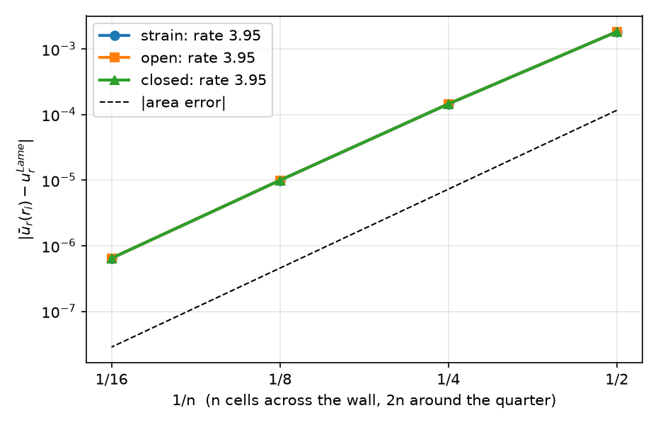
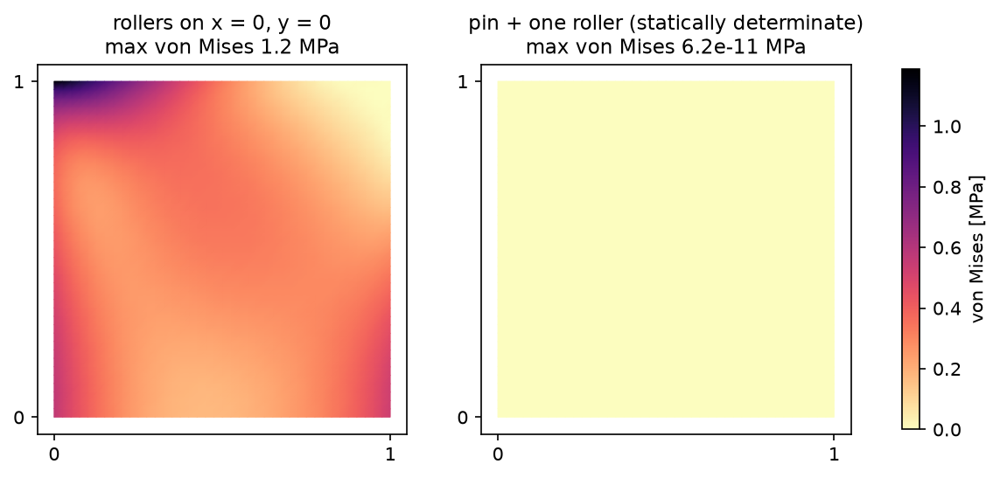
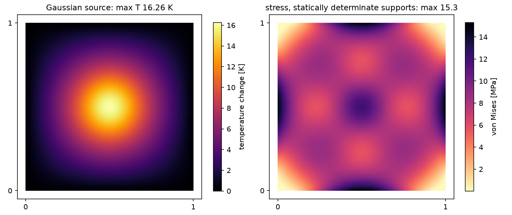
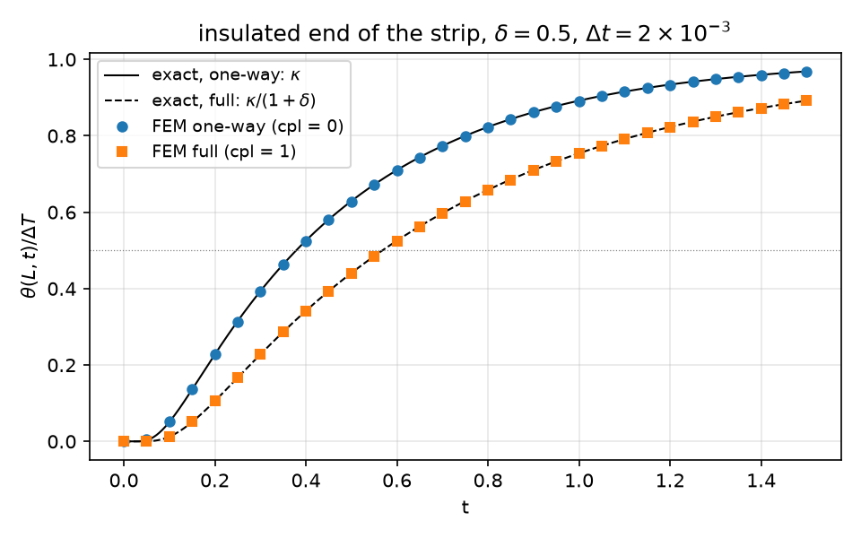

## Today

| Part | Topic | Time |
|---|---|:---:|
| | Quiz on Week 2 (closed-AI) | 10 min |
| **A** | Theory — one 3D law and three 2D reductions, generalized plane strain, thermal stress, coupled thermoelasticity | 55 min |
| **B** | Generalized plane strain in code — the extra unknown $e_0$, static condensation, the thick tube | 40 min |
| **C** | Thermoelasticity in code — one-way coupling, supports, a mixed $(\theta,\mathbf u)$ space, time stepping | 45 min |
| **D** | LLM pitfalls · assignment | 20 min |

::: {.box}
Lab notebook: `W03_lab.ipynb` · Assignment: `W03_HW3.ipynb` (due before Week 4)
:::

## Week 2 in one slide

- Plane stress = plane-strain law with $\lambda\to\lambda^*=2\lambda\mu/(\lambda+2\mu)$; orthotropy $\mathbf C=\mathbf S^{-1}$, rotate $\boldsymbol\varepsilon$ in and $\boldsymbol\sigma$ out.
- Gmsh: build on rank 0, physical groups → tags, check the area. Mesh study **and** size study.
- Axisymmetry: $3\times3$ strain with $u_r/r$, $r$-weighted form; Lamé for three end conditions (1.9667 / 1.8667 / 1.9067).

**Today:** the long prism whose ends are free (or capped) — one extra **number** $e_0$ in the unknowns; then temperature: as a load (one-way) and as an unknown (fully coupled).

# Part A · One law, three reductions, temperature {background-color="#1f3864"}

## A 2D reduction is a choice of $\varepsilon_{zz}$

Long prism along $z$, cross-section $\Omega$ in $(x,y)$, loads independent of $z$. Keep the **3D law**
$\boldsymbol\sigma=2\mu\boldsymbol\varepsilon+\lambda(\operatorname{tr}\boldsymbol\varepsilon)\mathbf I_3$ with $\boldsymbol\varepsilon$ built from $u_x(x,y),u_y(x,y)$ and one more entry:

| Reduction | $\varepsilon_{zz}$ | $\sigma_{zz}$ | when |
|---|---|---|---|
| plane strain | $0$ | $\lambda\operatorname{tr}\boldsymbol\varepsilon$ (free) | ends held fixed |
| plane stress | $-\dfrac{\lambda}{\lambda+2\mu}(\varepsilon_{xx}+\varepsilon_{yy})$ | $0$ | thin plate |
| **generalized plane strain** (GPS) | $e_0$ — **one unknown number** | free, but $\displaystyle\int_\Omega\sigma_{zz}\,dA=N$ | long prism, ends free or capped |

- GPS: every cross-section stretches by the same amount; the extra equation is the axial force balance at the ends.
- In code all three are **one function** that returns $\varepsilon_{zz}$; the rest of the model is shared.

## Generalized plane strain: the weak form

Unknowns $(\mathbf u,e_0)\in V\times\mathbb R$. Test functions $(\mathbf v,\hat e)$. Virtual work of the 3D stress on the 3D strain:
$$
\int_\Omega\boldsymbol\sigma(\mathbf u,e_0):\boldsymbol\varepsilon(\mathbf v,\hat e)\,dA=\int_{\Gamma_N}\mathbf t\cdot\mathbf v\,ds+N\,\hat e\qquad\forall(\mathbf v,\hat e)
$$

::: {.columns}
::: {.column width="55%"}
Split by the test functions:

- $\hat e=0$: the 2D problem, with $e_0$ entering through $\lambda e_0$ in $\sigma_{xx},\sigma_{yy}$;
- $\mathbf v=0$: $\displaystyle\int_\Omega\sigma_{zz}\,dA=N$ — **one** scalar equation.
:::
::: {.column width="45%"}
Discretised, a **bordered** matrix:
$$
\begin{pmatrix}K&\mathbf g\\\mathbf g^\top&c\end{pmatrix}\begin{pmatrix}\mathbf u\\e_0\end{pmatrix}=\begin{pmatrix}\mathbf f\\N\end{pmatrix}
$$
$g_i=\int\lambda\,\nabla\!\cdot\boldsymbol\phi_i$, $\;c=\int(\lambda+2\mu)\,dA$.
:::
:::

$e_0$ is a "Real" degree of freedom: one value for the whole domain, coupled to **every** row through $\mathbf g$ (a dense row and column).

## Static condensation

Eliminate the single unknown $e_0$ (block Gauss elimination):
$$
\underbrace{(c-\mathbf g^\top K^{-1}\mathbf g)}_{N_1}\,e_0=N-\underbrace{\mathbf g^\top K^{-1}\mathbf f}_{N_0},\qquad \mathbf u=\underbrace{K^{-1}\mathbf f}_{\mathbf u_0}-e_0\,\underbrace{K^{-1}\mathbf g}_{-\mathbf u_1}
$$

::: {.callout-important}
## Two solves with one matrix
Case 1: loads on, $e_0=0$ → $\mathbf u_0$, axial force $N_0$. Case 2: loads off, $e_0=1$ → $\mathbf u_1$, axial force $N_1$.
Then $N_0+e_0N_1=N$ and $\mathbf u=\mathbf u_0+e_0\mathbf u_1$ — exact for a linear problem, **one LU factorisation**.
:::

- $N_1$ is the **Schur complement**: the axial stiffness of the section once the in-plane response has been solved for. Case 2 is not "nothing happens": $e_0=1$ loads the section through $\lambda e_0$.
- The same idea at element level condenses interior (bubble) DOFs before assembly; here it condenses one global DOF.

## The thick tube in GPS

Lamé with $\sigma_{zz},\varepsilon_{zz}$ constant (Week 2). In the cross-section: $\varepsilon_{zz}=e_0=\big(\sigma_{zz}-\nu(\sigma_{rr}+\sigma_{\theta\theta})\big)/E$, with $\sigma_{rr}+\sigma_{\theta\theta}=2A$:

| End condition | $N$ | $e_0$ ($r_i=1,r_o=2,p=1,E=1,\nu=0.3$) | $u_r(r_i)$ |
|---|---|:---:|:---:|
| plane strain | (reaction) | $0$ | 1.906667 |
| open ends | $0$ | $-2\nu A/E=-0.2$ | 1.966667 |
| closed ends | $p\pi r_i^2$ | $(1-2\nu)A/E=0.13333$ | 1.866667 |

The same three numbers as the axisymmetric model of Week 2, now from a 2D cross-section with one extra unknown — an independent check of both.

## Thermal strain

Temperature change $\Delta T=T-T_0$ from the stress-free reference $T_0$; isotropic expansion $\alpha\,\Delta T\,\mathbf I$:
$$
\boldsymbol\sigma=\mathbb C:(\boldsymbol\varepsilon-\alpha\,\Delta T\,\mathbf I)=2\mu\boldsymbol\varepsilon+\lambda(\operatorname{tr}\boldsymbol\varepsilon)\mathbf I-\beta\,\Delta T\,\mathbf I,\qquad \beta=(3\lambda+2\mu)\alpha=\frac{E\alpha}{1-2\nu}
$$

| Reduction | in-plane law | $\sigma_{zz}$ |
|---|---|---|
| plane strain / GPS | $2\mu\boldsymbol\varepsilon+\lambda(\operatorname{tr}\boldsymbol\varepsilon+\varepsilon_{zz})\mathbf I_2-\beta\Delta T\,\mathbf I_2$ | $\lambda\operatorname{tr}\boldsymbol\varepsilon+(\lambda+2\mu)\varepsilon_{zz}-\beta\Delta T$ |
| plane stress | $2\mu\boldsymbol\varepsilon+\lambda^*(\operatorname{tr}\boldsymbol\varepsilon)\mathbf I_2-\dfrac{E\alpha}{1-\nu}\Delta T\,\mathbf I_2$ | $0$ |

With the "choice of $\varepsilon_{zz}$" code, each row comes out of the same 3D law — nothing to re-derive per case (HW3 Q1 asks for the derivation once).

## Which temperature fields cause stress?

$\Delta T$ is only a load if the thermal strain $\alpha\Delta T\,\mathbf I$ is **not compatible** (not the symmetric gradient of some displacement) or if the supports prevent it.

::: {.callout-important}
## Stress-free temperature fields
- 3D, free body: $\Delta T$ **linear** in $x,y,z$ → no stress.
- Plane stress, free simply connected plate: $\Delta T$ **harmonic** ($\nabla^2\Delta T=0$, e.g. steady conduction without a source) → no in-plane stress.
- Plane strain: the in-plane stress vanishes for harmonic $\Delta T$ too, but $\sigma_{zz}=-E\alpha\Delta T$ remains (the ends are held).
:::

"Free" means: the supports remove the rigid motions and nothing more (**statically determinate**). Part C measures what extra supports do.

## Temperature as an unknown: full coupling

The energy balance contains the rate of the elastic volume change. Linearised about $T_0$, with $\theta=T-T_0$:
$$
\rho c\,\dot\theta+T_0\,\beta\,\operatorname{tr}\dot{\boldsymbol\varepsilon}-\nabla\!\cdot(k\nabla\theta)=Q,\qquad \nabla\!\cdot\boldsymbol\sigma(\mathbf u,\theta)+\mathbf f=\mathbf 0
$$

- **One-way (weak) coupling:** drop $T_0\beta\operatorname{tr}\dot{\boldsymbol\varepsilon}$ → solve $\theta$ first, then $\mathbf u$ with $\theta$ as a load.
- **Full coupling:** the expansion of the solid consumes heat (and compression releases it) → $\theta$ and $\mathbf u$ in **one** system.
- At steady state $\dot{\boldsymbol\varepsilon}=0$: both models give the same answer. The coupling only acts **during** a transient.

## How strong is the coupling?

::: {.callout-note}
## Coupling number
$\displaystyle\delta=\frac{T_0\,\beta^2}{\rho c\,(\lambda+2\mu)}$ — the heat taken by the elastic expansion relative to the heat stored, in uniaxial strain.
:::

1D strip in uniaxial strain, $\sigma_{xx}=0$ (free end): $\varepsilon_{xx}=\beta\theta/(\lambda+2\mu)$, so the heat equation becomes
$$
\rho c\,(1+\delta)\,\dot\theta=k\,\theta''\qquad\Rightarrow\qquad \text{diffusivity } \frac{\kappa}{1+\delta},\ \ \kappa=\frac{k}{\rho c}
$$

| $T_0=293$ K | $\delta$ | one-way: time scale off by | measured $t_{50}$ ratio | $1+\delta$ |
|---|:---:|:---:|:---:|:---:|
| steel | 0.0114 | 1.1 % | 1.01138 | 1.01139 |
| aluminium | 0.0261 | 2.6 % | 1.02604 | 1.02607 |

Steel: $E$ 210 GPa, $\alpha$ $1.2\times10^{-5}$; aluminium: 70 GPa, $2.3\times10^{-5}$. Measured: the strip of Part C with each metal's $\delta$, $\Delta t=10^{-3}$, half-rise time full / one-way. Small for metals — but a model error you can
**measure**, not a belief. Part C uses $\delta=0.5$ ("what if") to make it visible.

# Part B · Generalized plane strain in code {background-color="#1f3864"}

## Math → code (`gps.py`)

| Mathematics | DOLFINx 0.11 |
|---|---|
| $\boldsymbol\varepsilon$ ($3\times3$) with $\varepsilon_{zz}$ | `ufl.as_matrix([[u[0].dx(0), g, 0], [g, u[1].dx(1), 0], [0, 0, ezz]])` |
| $\boldsymbol\sigma=2\mu\boldsymbol\varepsilon+\lambda\operatorname{tr}\boldsymbol\varepsilon\,\mathbf I-\beta\Delta T\,\mathbf I$ | `2*mu*e + lmbda*ufl.tr(e)*ufl.Identity(3) - beta*dT*ufl.Identity(3)` |
| $\varepsilon_{zz}$: $0$ / $e_0$ / from $\sigma_{zz}=0$ | `ezz_of(m, mode, u, dT, e0)` |
| in-plane virtual work | `ufl.inner(S2(sigma3(...)), ufl.sym(ufl.grad(v)))*dx` with `S2` = the $2\times2$ block |
| $e_0$ of a solve | `e0c = fem.Constant(msh, 0.0)`; set `e0c.value` before assembling $\mathbf b$ |
| $N=\int\sigma_{zz}\,dA$ | `fem.assemble_scalar(fem.form(sigma3(...)[2, 2]*dx))` + `allreduce` |

Material data can be numbers or DG0 functions (`Material.regions`), so the same code runs layered sections.

## One factorisation, two right-hand sides

```python
A = assemble_matrix(a, bcs=bcs); A.assemble()
ksp = PETSc.KSP().create(comm); ksp.setOperators(A); ksp.setType("preonly")
ksp.getPC().setType("lu"); ksp.getPC().setFactorSolverType("mumps")     # factorised at the first solve

def solve(lf_, e0_):                                   # load factor, e0
    lf.value, e0c.value = lf_, e0_
    b = assemble_vector(L); apply_lifting(b, [a], [bcs])
    b.ghostUpdate(addv=PETSc.InsertMode.ADD, mode=PETSc.ScatterMode.REVERSE); set_bc(b, bcs)
    w = fem.Function(V); ksp.solve(b, w.x.petsc_vec); w.x.scatter_forward(); return w

u0, u1 = solve(1.0, 0.0), solve(0.0, 1.0)              # same KSP: the LU factors are reused
e0 = (N - Nz(u0, 0.0, 1.0)) / Nz(u1, 1.0, 0.0)
uh.x.array[:] = u0.x.array + e0 * u1.x.array
```

`LinearProblem` would assemble and factorise again for each case; for one extra unknown that doubles the cost, for many (Week 9: periodic cells) it matters.

## A curved mesh without Gmsh

Week 2: the same Gmsh script gave 2968 cells on macOS and 3004 on Colab. For exact reproducibility, map a structured grid:

```python
R, TH = np.meshgrid(np.linspace(ri, ro, 2*nr + 1), np.linspace(0, np.pi/2, 2*nt + 1), indexing="ij")
x = np.c_[(R*np.cos(TH)).ravel(), (R*np.sin(TH)).ravel()]          # 6-node triangles: vertices + edge midpoints
cells = [... [v0, v1, v2, mid(v1,v2), mid(v0,v2), mid(v0,v1)] ...]  # basix order of the P2 triangle
msh = mesh.create_mesh(comm, cells, ufl.Mesh(basix.ufl.element("Lagrange", "triangle", 2, shape=(2,))), x)
```

- Curved (isoparametric) cells: area error $-1.2\times10^{-4},-7.3\times10^{-6},-4.6\times10^{-7},-2.9\times10^{-8}$ — rate 4.
- Rank 0 passes the arrays, the others pass empty ones; `create_mesh` distributes.

## Tube: three end conditions, one code

{width=56% fig-align="center"}

$n=16$: $u_r(r_i)$ = 1.9066660 / 1.9666660 / 1.8666660 and $e_0$ = 0 / −0.2000000 / 0.1333333. The three error curves lie on top of each other:
$e_0\,\mathbf u_1$ is a uniform contraction that P2 represents exactly — the error is that of the plane-strain part.

## The bordered system, assembled

The same tube, $n=4$, serial: put $K$, $\mathbf g=-\mathbf b_1$ and $c=(\lambda+2\mu)|\Omega_h|$ into one dense $307\times307$ matrix and solve.

| Check | Value |
|---|:---:|
| $\max\lvert M-M^\top\rvert$ | $8.9\times10^{-16}$ |
| $e_0$ bordered − condensed | $2.8\times10^{-16}$ |
| $\max\lvert\mathbf u_{\rm bordered}-\mathbf u_{\rm condensed}\rvert$ | $8.0\times10^{-14}$ |
| $c$ | 3.1718 |
| $N_1=c-\mathbf g^\top K^{-1}\mathbf g$ | 2.3561872 $=E\,|\Omega_h|$ |

The Schur complement turns $(\lambda+2\mu)$ — the stiffness with the section held laterally — into $E$: the section contracts freely in its plane.

# Part C · Thermoelasticity in code {background-color="#1f3864"}

## One-way coupling

```python
Th = heat(msh, ft, k=1.0, Q=0.0, dirichlet=((LEFT, 0.0), (RIGHT, 1.0)))   # P1 Function, steady
uh, info = solve_2d(msh, ft, mat, 2, "stress", dT=Th, points=[(pin, 0), (pin, 1), (roller, 1)])
```

- The temperature `Function` (P1) enters the P2 mechanical form directly; UFL evaluates it at the quadrature points.
- $\Delta T$ only appears on the right-hand side: $\displaystyle\int\beta\,\Delta T\,\nabla\!\cdot\mathbf v$ (in plane stress with $E\alpha/(1-\nu)$).
- Supports: `points=[(marker, comp)]` fixes single vertices — a pin and a roller remove the three rigid motions of a plane body and nothing more.

## The heated plate: what the supports do

{width=80% fig-align="center"}

$[0,1]^2$, $T=x$ (harmonic), plane stress, $E=210$ GPa, $\alpha=10^{-5}$. Rollers on $x=0$ and $y=0$: $\max u_x=5.7164\times10^{-6}$ m, stress 1.19 MPa.
Pin + roller: $\max u_x=5.0000\times10^{-6}=\alpha/2$, stress $6\times10^{-11}$, $\lVert\mathbf u_h-\mathbf u_{\rm free}\rVert=1.5\times10^{-17}$ with
$\mathbf u_{\rm free}=\alpha\big(\tfrac12(x^2-y^2),\,xy\big)$.

## Reading the plate result

| Supports | reduction | $\max u_x$ [m] | max von Mises [MPa] | $\max\lvert\sigma_{zz}\rvert$ |
|---|---|:---:|:---:|:---:|
| rollers | plane stress | $5.7164\times10^{-6}$ | 1.19 | 0 |
| pin + roller | plane stress | $5.0000\times10^{-6}$ | $6\times10^{-11}$ | 0 |
| pin + roller | plane strain | $6.5000\times10^{-6}$ | 2.10 | 2.10 $=E\alpha\cdot1$ |

- The rollers impose $u_x=0$ on $x=0$, where the free expansion has $u_x=-\alpha y^2/2$ (the edge bends) — **that** is the 14 %, not "the Poisson effect".
- Plane strain: $(1+\nu)\alpha/2=6.5\times10^{-6}$, in-plane stress zero, $\sigma_{zz}=-E\alpha\Delta T$ — exactly the Part A statements.
- An exact stress-free solution is the cheapest test of a thermal code: zero to round-off, and P2 reproduces the quadratic $\mathbf u_{\rm free}$ exactly.

## A temperature field that does cause stress

{width=86% fig-align="center"}

Gaussian source $Q=1000\,e^{-r^2/(2\cdot0.1^2)}$, all walls at $\Delta T=0$: $T_{\max}=16.26$ K. Not harmonic → stress even with free supports:
15.3 MPa (pin + roller), 16.4 MPa (rollers). $\max\lvert\mathbf u\rvert$: $5.01\times10^{-5}$ / $5.66\times10^{-5}$ m.

## Full coupling: one mixed space

```python
el = basix.ufl.mixed_element([basix.ufl.element("Lagrange", "triangle", 1),               # theta
                              basix.ufl.element("Lagrange", "triangle", 2, shape=(2,))])   # u
W = fem.functionspace(msh, el)
(th, u), (s, v) = ufl.TrialFunctions(W), ufl.TestFunctions(W)
w_n = fem.Function(W); th_n, u_n = ufl.split(w_n)                                         # previous step
a = (rho_c/dt*th*s + c*T0*beta/dt*ufl.tr(eps(u))*s + k*ufl.inner(ufl.grad(th), ufl.grad(s)))*ufl.dx \
    + ufl.inner(sig(u, th), eps(v))*ufl.dx
L = (rho_c/dt*th_n*s + c*T0*beta/dt*ufl.tr(eps(u_n))*s)*ufl.dx                             # c = 1 full, 0 one-way
bc_T = fem.dirichletbc(fem.Constant(msh, dT), fem.locate_dofs_topological(W.sub(0), 1, left), W.sub(0))
bc_ux = fem.dirichletbc(0.0, fem.locate_dofs_topological(W.sub(1).sub(0), 1, left), W.sub(1).sub(0))
```

- Implicit Euler; the matrix does not change in time → assemble and factorise **once**, assemble only $\mathbf b$ per step.
- The matrix is **not symmetric** ($\theta$ in the mechanics, $\operatorname{tr}\boldsymbol\varepsilon$ in the heat equation with different factors): LU, not CG.
- Output from the mixed function through forms: `w_n.sub(0)*ds(1)` for the mean $\theta$ on a boundary.

## The strip: one-way vs full vs exact

{width=58% fig-align="center"}

$\theta=\Delta T$ at $x=0$, insulated end $x=L=1$; $u_x=0$ at $x=0$, $u_y=0$ on top and bottom (uniaxial strain), $x=L$ free. Exact: a Fourier series with $\kappa$ or $\kappa/(1+\delta)$.

## Measuring the coupling

Half-rise time $t_{50}$ of $\theta(L,t)$, $\delta=0.5$, P1/P2, $64\times2$ cells:

| $\Delta t$ | one-way $t_{50}$ | full $t_{50}$ | ratio full/one-way |
|:---:|:---:|:---:|:---:|
| $4\times10^{-3}$ | 0.38059 | 0.56997 | 1.49759 |
| $2\times10^{-3}$ | 0.37967 | 0.56905 | 1.49879 |
| $1\times10^{-3}$ | 0.37921 | 0.56858 | 1.49939 |
| exact | 0.37875 | 0.56812 | $1+\delta=1.5$ |

- Both $t_{50}$ converge at **first order** in $\Delta t$ (implicit Euler); the ratio error halves too: 2.4, 1.2, 0.6 $\times10^{-3}$.
- The ratio is the quantity to test: most of the time-step error cancels in it.

# Part D · LLM pitfalls · assignment {background-color="#1f3864"}

## What goes wrong in GPS and thermal codes

| Pitfall | Measured symptom (this week) |
|---|---|
| The $e_0=1$ case solved **without its load** ($\mathbf u_1=0$) | $N_1=(\lambda+2\mu)A$ instead of $EA$: $e_0=3.543\times10^{-4}$ instead of $4.769\times10^{-4}$ (−26 %) |
| "$N=0$, so $e_0=0$: GPS reduces to plane strain" | $N_0=-0.15$ under an in-plane load: $e_0=7.1\times10^{-7}\ne0$ |
| Quarter model given the end force of the **whole** section | closed tube: $e_0=1.1333$ instead of 0.1333, $u_r(r_i)=1.5667$ instead of 1.8667 |
| Thermal test on a body with **redundant supports**, difference blamed on "the Poisson effect" | $\max u_x$ 14 % high, 1.19 MPa where the exact answer is 0 |
| Full coupling "verified" by a **steady** problem | one-way and full both $5.7164\times10^{-6}$ m — the coupling term is zero at steady state: the test checks nothing |

All five are from an earlier version of these very examples. The fix: an exact solution with a nonzero answer for the thing being tested.

## Prompting for a coupled or GPS model

1. State the reduction **and** the end condition: plane strain, plane stress, or GPS with $N$ (and $N$ for the modelled part, if symmetry is used).
2. State the supports and say whether they are meant to be statically determinate; give the boundary and initial conditions of every field.
3. For a transient, state the time scheme and ask the model to factorise once.
4. Ask for the **checks** with the code: a stress-free temperature field, the Lamé tube in GPS, a 1D transient with an exact series, a ratio that should equal $1+\delta$.
5. Run the checks before reading the physics.

## Assignment HW3 (due before Week 4)

| Q | Topic | Points |
|---|---|:---:|
| 1 | Thermal stress in the 2D reductions, stress-free temperature fields, the coupled 1D diffusion (theory) | 20 |
| 2 | GPS with bending: $\varepsilon_{zz}=e_0+\kappa_xx+\kappa_yy$, a linear temperature field, a bimetal cross-section | 35 |
| 3 | Fully coupled transient: the coupling number, real metals, what a steady test cannot see | 25 |
| 4 | Debugging an LLM-generated coupled thermoelastic script | 20 |

**Week 4 starts with a 10-minute quiz on today's material (closed-AI).**

## Summary

| Concept | Key point | DOLFINx 0.11 |
|---|---|---|
| 2D reductions | one 3D law; choose $\varepsilon_{zz}$: $0$, $e_0$, or from $\sigma_{zz}=0$ | `ezz_of(...)` in a $3\times3$ strain |
| GPS | one global unknown $e_0$, equation $\int\sigma_{zz}=N$ | bordered matrix $\begin{pmatrix}K&\mathbf g\\\mathbf g^\top&c\end{pmatrix}$ |
| Static condensation | Schur complement; two solves, one LU | one `KSP`, two right-hand sides |
| Thermal stress | $-\beta\Delta T\,\mathbf I$, $\beta=(3\lambda+2\mu)\alpha$; test with a stress-free field | `dT=Th` (a `Function`) |
| Full coupling | $T_0\beta\operatorname{tr}\dot{\boldsymbol\varepsilon}$ in the heat equation; $\delta$ | `basix.ufl.mixed_element`, `W.sub(i)` |
| Verification | exact solutions with a nonzero answer; ratios that cancel discretisation error | Lamé in GPS, $\alpha/2$, $1+\delta$ |

**Next week:** J2 plasticity — quadrature spaces, radial return, the consistent tangent.
