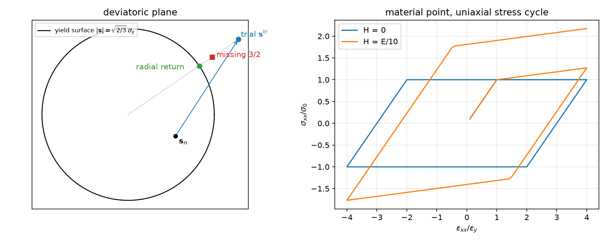
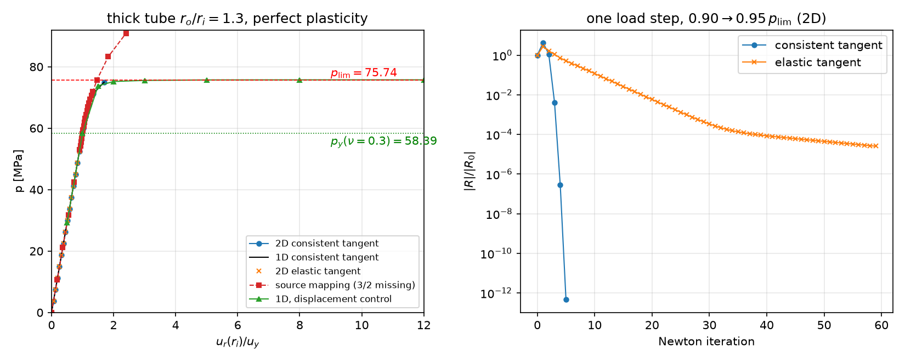
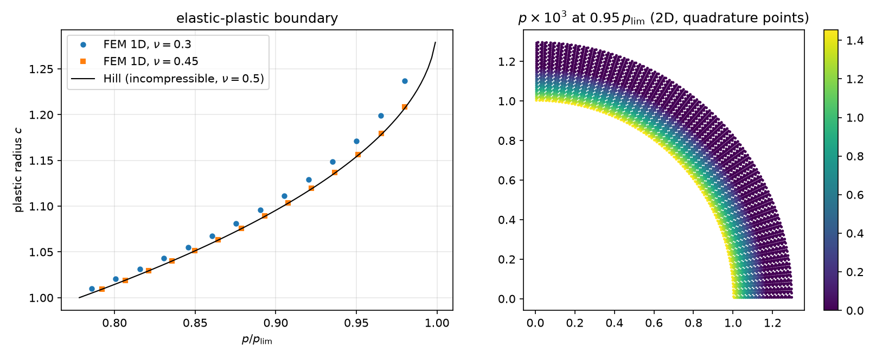

## Today

| Part | Topic | Time |
|---|---|:---:|
| | Quiz on Week 3 (closed-AI) | 10 min |
| **A** | Theory — J2 plasticity, backward Euler, radial return, the consistent tangent, the thick tube (first yield, limit load) | 55 min |
| **B** | Plasticity in code — quadrature spaces, the update in NumPy, an explicit Newton loop, displacement control | 45 min |
| **C** | Verification — material-point tests, elastic and first-yield checks, Newton rates, limit load, a 1D reference | 40 min |
| **D** | LLM pitfalls · assignment | 20 min |

::: {.box}
Lab notebook: `W04_lab.ipynb` · Assignment: `W04_HW4.ipynb` (due before Week 5)
:::

## Week 3 in one slide

- One 3D law, three 2D reductions by the choice of $\varepsilon_{zz}$; GPS adds one number $e_0$, eliminated by static condensation (two solves, one LU).
- Thermal stress $-\beta\Delta T\,\mathbf I$; harmonic $\Delta T$ is stress-free with statically determinate supports; full coupling slows heat by $1+\delta$.
- Verification by exact answers that are **not zero** for the thing being tested.

**Today:** the first **path-dependent** material. The stress is no longer a function of the strain — it is the result of an update that
remembers the past. New in code: data at quadrature points and a Newton loop we write ourselves.

# Part A · J2 plasticity {background-color="#1f3864"}

## Small-strain plasticity: the equations

$$
\boldsymbol\varepsilon=\boldsymbol\varepsilon^e+\boldsymbol\varepsilon^p,\qquad \boldsymbol\sigma=\mathbb C:(\boldsymbol\varepsilon-\boldsymbol\varepsilon^p),\qquad
f(\boldsymbol\sigma,p)=\sigma_{\rm eq}-(\sigma_0+Hp)\le0,\qquad \sigma_{\rm eq}=\sqrt{\tfrac32\,\mathbf s:\mathbf s}
$$

| Ingredient | J2 (von Mises) with linear isotropic hardening |
|---|---|
| deviator | $\mathbf s=\boldsymbol\sigma-\tfrac13(\operatorname{tr}\boldsymbol\sigma)\mathbf I$ — all **three** normal components, also in a 2D model |
| flow rule (normality) | $\dot{\boldsymbol\varepsilon}^p=\dot p\,\dfrac{\partial f}{\partial\boldsymbol\sigma}=\dot p\,\dfrac32\,\dfrac{\mathbf s}{\sigma_{\rm eq}}$ — deviatoric: plastic flow keeps the volume |
| equivalent plastic strain | $\dot p=\sqrt{\tfrac23\,\dot{\boldsymbol\varepsilon}^p:\dot{\boldsymbol\varepsilon}^p}$ (in uniaxial tension $p=\varepsilon^p_{xx}$) |
| loading/unloading | $\dot p\ge0,\quad f\le0,\quad \dot p\,f=0$ (Kuhn–Tucker) |

Two material constants beyond elasticity: $\sigma_0$ and $H$ ($H=0$: perfect plasticity). Uniaxial tangent after yield: $E_t=EH/(E+H)$.

## Backward Euler: the return mapping

Step $n\to n+1$, strain increment $\Delta\boldsymbol\varepsilon$ given (by the Newton iterate). With $\mu$ the shear modulus:

1. **Elastic predictor:** $\boldsymbol\sigma^{\rm tr}=\boldsymbol\sigma_n+\mathbb C:\Delta\boldsymbol\varepsilon$, $\;f^{\rm tr}=\sigma_{\rm eq}^{\rm tr}-(\sigma_0+Hp_n)$. If $f^{\rm tr}\le0$: done, $\boldsymbol\sigma=\boldsymbol\sigma^{\rm tr}$.
2. **Plastic corrector:** $\boldsymbol\sigma=\boldsymbol\sigma^{\rm tr}-2\mu\,\Delta p\,\tfrac32\,\mathbf s/\sigma_{\rm eq}$. The deviator shrinks along its own direction:
   $\mathbf s=\big(1-3\mu\Delta p/\sigma^{\rm tr}_{\rm eq}\big)\mathbf s^{\rm tr}$, so $\sigma_{\rm eq}=\sigma^{\rm tr}_{\rm eq}-3\mu\Delta p$, and $f=0$ gives

$$
\Delta p=\frac{f^{\rm tr}}{3\mu+H},\qquad \boldsymbol\sigma=\boldsymbol\sigma^{\rm tr}-2\mu\sqrt{\tfrac32}\,\Delta p\,\hat{\mathbf n},\qquad \hat{\mathbf n}=\frac{\mathbf s^{\rm tr}}{\lvert\mathbf s^{\rm tr}\rvert},\quad \lvert\mathbf s\rvert=\sqrt{\tfrac23}\,\sigma_{\rm eq}
$$

- **Closed form** for J2 + linear hardening — no local iteration. Exact on the discrete level: after the return $f=0$ to round-off.
- The return is **radial** in the deviatoric plane. The pressure $\tfrac13\operatorname{tr}\boldsymbol\sigma$ is untouched.

## The return in one picture

{width=82% fig-align="center"}

Left: the trial deviator outside the circle goes back to it along the radius. Right: one material point, uniaxial stress, strain-controlled
cycle ±4 $\varepsilon_y$: with $H=0$ the stress stays at $\pm\sigma_0$; $H=E/10$ peaks at $318.18$ MPa, the exact $\sigma_0+E_t(4\varepsilon_y-\varepsilon_y)$.

## The consistent tangent

Newton needs $\partial\boldsymbol\sigma_{n+1}/\partial\Delta\boldsymbol\varepsilon$ of the **discrete** update, not of the rate equations:

$$
\mathbb C^{\rm alg}=\mathbb C-2\mu\,\beta\,\mathbb I_{\rm dev}-2\mu\,\bar\theta\,\hat{\mathbf n}\otimes\hat{\mathbf n},\qquad
\beta=\frac{3\mu\,\Delta p}{\sigma^{\rm tr}_{\rm eq}},\qquad \bar\theta=\frac{3\mu}{3\mu+H}-\beta
$$

- Elastic points: $\Delta p=0$ → $\mathbb C^{\rm alg}=\mathbb C$. Symmetric (associative flow).
- $\beta\,\mathbb I_{\rm dev}$: the deviator is scaled down; $\bar\theta\,\hat{\mathbf n}\otimes\hat{\mathbf n}$: no stiffness along the flow direction (for $H=0$).
- With $\mathbb C^{\rm alg}$ Newton converges **quadratically**; with the elastic $\mathbb C$ ("modified Newton") **linearly**, and the rate degrades as the
  plastic zone grows.
- Check in code: compare $\mathbb C^{\rm alg}$ with a finite difference of `update` — relative difference $3\times10^{-11}$ (the elastic $\mathbb C$: 0.25).

## Mandel notation for plane strain

Store symmetric tensors as 4-vectors so that $\boldsymbol\sigma:\boldsymbol\varepsilon$ is a dot product:

$$
\boldsymbol\sigma\mapsto(\sigma_{xx},\sigma_{yy},\sigma_{zz},\sqrt2\,\sigma_{xy}),\qquad \boldsymbol\varepsilon\mapsto(\varepsilon_{xx},\varepsilon_{yy},\varepsilon_{zz},\sqrt2\,\varepsilon_{xy}),\qquad
\mathbb C=\lambda\,\mathbf m\mathbf m^\top+2\mu\,\mathbf I_4,\quad \mathbf m=(1,1,1,0)
$$

- Plane strain: $\varepsilon_{zz}=0$, but $\sigma_{zz}\ne0$ and it enters $\mathbf s$ and $\sigma_{\rm eq}$. The 4th component is **not optional**.
- $\mathbb I_{\rm dev}=\mathbf I_4-\tfrac13\mathbf m\mathbf m^\top$, $\;\lvert\mathbf s\rvert^2=\mathbf s\cdot\mathbf s$ (the $\sqrt2$ makes the shear count twice).
- The same 4-vector works for the **1D radial** model of a tube: $(\varepsilon_{rr},\varepsilon_{\theta\theta},\varepsilon_{zz},0)=(u',u/r,0,0)$.

## The thick tube: elastic state and first yield

Plane strain, inner radius $a$, outer $b$, inner pressure $p$. Lamé: $\sigma_{rr}=A-B/r^2$, $\sigma_{\theta\theta}=A+B/r^2$, $\sigma_{zz}=2\nu A$,
with $A=pa^2/(b^2-a^2)$, $B=Ab^2$. At $r=a$:

$$
\sigma_{\rm eq}^2=\frac{3B^2}{a^4}+(1-2\nu)^2A^2\quad\Rightarrow\quad
p_y=\frac{\sigma_0\,(b^2-a^2)}{\sqrt{3b^4+(1-2\nu)^2a^4}}
$$

- $\nu=\tfrac12$: $p_y=\frac{\sigma_0}{\sqrt3}\big(1-\frac{a^2}{b^2}\big)$ — the textbook formula; it assumes $\sigma_{zz}$ = the mean of $\sigma_{rr},\sigma_{\theta\theta}$.
- Our tube ($a=1$, $b=1.3$, $E=70$ GPa, $\nu=0.3$, $\sigma_0=250$ MPa): $p_y=58.39$ MPa; the $\nu=\tfrac12$ formula gives 58.93 (+0.93 %).

## The limit load

At collapse the stresses stop changing, so the strain **rate** is purely plastic. Plane strain: $\dot\varepsilon_{zz}=\dot\varepsilon^p_{zz}=0$ ⇒ $s_{zz}=0$
⇒ $\sigma_{zz}=\tfrac12(\sigma_{rr}+\sigma_{\theta\theta})$ ⇒ $\sigma_{\rm eq}=\tfrac{\sqrt3}{2}(\sigma_{\theta\theta}-\sigma_{rr})=\sigma_0$. Equilibrium
$\partial_r\sigma_{rr}=(\sigma_{\theta\theta}-\sigma_{rr})/r$ from $\sigma_{rr}(a)=-p$ to $\sigma_{rr}(b)=0$:

$$
p_{\rm lim}=\frac{2\sigma_0}{\sqrt3}\ln\frac ba=75.74\ \text{MPa}\qquad\text{— no }E,\ \text{no }\nu
$$

- Above $p_{\rm lim}$ there is **no equilibrium**; at $p_{\rm lim}$ the displacement is unbounded (perfect plasticity).
- Elastic–plastic boundary $c$ (Hill, incompressible elastic zone, $\nu=\tfrac12$): $\;p=\frac{\sigma_0}{\sqrt3}\big[2\ln\frac ca+1-\frac{c^2}{b^2}\big]$.

# Part B · Plasticity in code {background-color="#1f3864"}

## Where the variables live: quadrature spaces

$\boldsymbol\sigma$, $p$ and $\mathbb C^{\rm alg}$ are not finite element fields — they are **values at the quadrature points**, updated pointwise.

```python
cell = msh.basix_cell()
Q4  = fem.functionspace(msh, basix.ufl.quadrature_element(cell, value_shape=(4,),   degree=2))   # sigma, d eps
Q44 = fem.functionspace(msh, basix.ufl.quadrature_element(cell, value_shape=(4, 4), degree=2))   # C_alg
Q1  = fem.functionspace(msh, basix.ufl.quadrature_element(cell, value_shape=(),     degree=2))   # p
sig, sig_n, Ct = fem.Function(Q4), fem.Function(Q4), fem.Function(Q44)
p, p_n = fem.Function(Q1), fem.Function(Q1)
```

- Degree 2 on triangles = 3 points per cell; `sig.x.array.reshape(-1, 4)` is a plain $(n_q,4)$ NumPy array.
- A form with a quadrature function is integrated **at those points** — FFCx takes the rule from the element (measured: the `quadrature_degree` metadata is ignored).
- Two copies: the converged state $(\boldsymbol\sigma_n,p_n)$ and the current iterate $(\boldsymbol\sigma,p)$.

## Strain at the points, update in NumPy

```python
def eps4(u):                                  # Mandel, plane strain
    e = ufl.sym(ufl.grad(u))
    return ufl.as_vector([e[0, 0], e[1, 1], 0, np.sqrt(2) * e[0, 1]])

deps_expr = fem.Expression(eps4(Du), Q4.element.interpolation_points)   # compiled once
deps = fem.Function(Q4)

def constitutive():
    deps.interpolate(deps_expr)                                         # evaluate at all quadrature points
    s, pp, C, pl = mat.update(deps.x.array.reshape(-1, 4), sig_n.x.array.reshape(-1, 4), p_n.x.array)
    sig.x.array[:] = s.ravel(); p.x.array[:] = pp; Ct.x.array[:] = C.ravel()
```

- `Du` is the displacement **increment** since the last converged step; `update` is vectorised over all points (`j2.py`, NumPy only).
- The material law knows nothing about DOLFINx: you can test it in an ordinary notebook cell.

## Residual and Jacobian

$$
R(\mathbf v)=\int_\Omega\boldsymbol\sigma\cdot\boldsymbol\varepsilon(\mathbf v)\,dA-\int_{\Gamma_i}(-p\,\mathbf n)\cdot\mathbf v\,ds,\qquad
J(\delta\mathbf u,\mathbf v)=\int_\Omega\big(\mathbb C^{\rm alg}\boldsymbol\varepsilon(\delta\mathbf u)\big)\cdot\boldsymbol\varepsilon(\mathbf v)\,dA
$$

```python
F = fem.form(ufl.dot(sig, eps4(v)) * dx + pload * ufl.dot(n, v) * ds(INNER))
J = fem.form(ufl.dot(ufl.dot(Ct, eps4(du)), eps4(v)) * dx)
```

- `sig` and `Ct` are **coefficients**, not UFL expressions of `u`: UFL cannot differentiate through the return mapping, so we supply the tangent.
- 1D radial model: the same forms with $(u',u/r,0,0)$ and the weight $r$ (`* x[0] * dx`).

## The Newton loop

```python
def step(load):
    Du.x.array[:] = 0.0;  pload.value = load
    for it in range(maxit + 1):
        constitutive()                                  # sigma, p, C_alg from Du
        res = residual()                                # assemble F, lifting, set_bc
        if it == 0: ref = max(ref, res)
        if res <= rtol * ref: break                     # converged
        if it == maxit: return False                    # NOT converged: do not commit
        A.zeroEntries(); assemble_matrix(A, J, bcs=bcs); A.assemble()
        ksp.solve(b, du.x.petsc_vec); du.x.scatter_forward()
        Du.x.array[:] -= du.x.array
    u.x.array[:] += Du.x.array                          # commit: the new converged state
    sig_n.x.array[:] = sig.x.array;  p_n.x.array[:] = p.x.array
    return True
```

- The state is committed **once per step**, after convergence. Iterates never touch $(\boldsymbol\sigma_n,p_n)$.
- `ref` = the largest first residual seen so far: a small last increment near $p_{\rm lim}$ must not tighten the tolerance below round-off.
- The function returns whether it converged. A non-converged step is **not an exception** — the caller must look.
- `plas.py` adds one safeguard (not shown): a failed step is solved once more from $\Delta u=0$ with halved corrections where $|R|$ grows.
  Near $p_{\rm lim}$ the 2D tangent is almost singular, and threaded MUMPS round-off sent about 1 in 8 runs of the step to $50\,u_y$ astray (16×48); the retry recovers all of them.
  It is not the default: halving whenever $|R|$ grows breaks quadratic convergence, since $|R|$ grows in the first iteration when the plastic zone changes.

## Displacement control and the reaction

Prescribe the inner radial displacement instead of $p$. The increment enters through the **first correction**, by lifting with the converged tangent:

```python
assemble_vector(b, F)
apply_lifting(b, [J], bcs=[bcs], x0=[Du.x.petsc_vec], alpha=-1.0)   # rows: Du - g on the boundary
b.ghostUpdate(addv=PETSc.InsertMode.ADD, mode=PETSc.ScatterMode.REVERSE)
set_bc(b, bcs, Du.x.petsc_vec, -1.0)
```

- Setting the boundary DOFs of `Du` to the new value **before** the first solve puts the whole jump into one layer of cells:
  measured, the 2D tube's first step ($0.5\,u_y$) did not converge in 50 iterations.
- The pressure from the **consistent reaction**: $p=\dfrac{1}{a\,\pi/2}\displaystyle\int_\Omega\boldsymbol\sigma\cdot\boldsymbol\varepsilon(\mathbf w_R)\,dA$ with any
  $\mathbf w_R$ that equals $\mathbf e_r$ on $r=a$ and is admissible (here $\mathbf e_r\,(b-r)/(b-a)$) — Week 1's reaction, one form.

## The model modules

| `j2.py` (NumPy) | `plas.py` (DOLFINx) |
|---|---|
| `J2(E, nu, sig0, H)`: $\mathbb C$, `update(deps, sig_n, p_n, tangent)` | `annulus_mesh` (curved, as Week 3), `radial_mesh` (1D) |
| `dev`, `von_mises`, `IDEV`, `ONE` | `Tube(msh, ft, mat, ri, ro, control=, tangent=)` |
| `uniaxial(mat, exx)`: one point in uniaxial stress | `step(load)` → `(converged, iterations, residuals)` |
| | `ur_inner`, `pressure_from_reaction`, `plastic_radius`, `max_von_mises` |
| | `lame_ur`, `p_first_yield`, `p_limit` |

The same `Tube` runs the 2D quarter section and the 1D radial model. The 1D model with 400–800 cells is the **reference** for the 2D one —
a different discretisation of the same problem, not a different program.

# Part C · Verification {background-color="#1f3864"}

## Material-point checks (no DOLFINx)

$10^4$ random strain increments from $\boldsymbol\sigma_n=0$, $\lvert\Delta\varepsilon_{ij}\rvert\sim4\times10^{-3}$ (8244 points yield):

| Check | $H=0$ | $H=E/10$ |
|---|:---:|:---:|
| $\max\lvert f\rvert/\sigma_0$ at plastic points after the return | $1.1\times10^{-15}$ | $1.4\times10^{-15}$ |
| $\max f/\sigma_0$ at elastic points | $<0$ | $<0$ |
| $\mathbb C^{\rm alg}$ vs central difference ($h=10^{-8}$) | | $3.2\times10^{-11}$ |
| elastic $\mathbb C$ vs central difference | | 0.25 |
| uniaxial cycle: peak at $4\varepsilon_y$ vs $\sigma_0+E_t\cdot3\varepsilon_y$ | 250 = 250 | 318.18 = 318.18 |

The local Newton of the uniaxial driver converges in **one** iteration: for linear hardening the update is piecewise linear and $\mathbb C^{\rm alg}$ is exact.

## Elastic and first-yield checks on the tube

- **Elastic** ($p=0.5\,p_y$, 2D, $8\times24$ curved cells, P2): $u_r(a)=1.6422404\times10^{-3}$ vs Lamé $1.6422406\times10^{-3}$ (relative $8\times10^{-8}$), one Newton iteration.
- **First yield** (1D, 400 cells):

| load | plastic quadrature points |
|---|:---:|
| $0.999\,p_y(\nu=0.3)$ | 0 |
| $1.001\,p_y(\nu=0.3)$ | 1 |
| $0.999\times58.93$ (the $\nu=\tfrac12$ formula) | 11 (zone up to $c=1.0039$) |

The textbook formula is not "approximately right" here — the model shows it is the formula of a **different** material.

## Load–displacement and Newton

{width=88% fig-align="center"}

Left: 2D and 1D curves coincide; displacement control (green) follows the plateau at $p_{\rm lim}$. Right: one load step $0.90\to0.95\,p_{\rm lim}$ —
consistent tangent $1,\,4.3,\,1.1,\,4.2\times10^{-3},\,2.8\times10^{-7},\,5\times10^{-13}$ (quadratic; one thread — threaded MUMPS moves the middle values by tens of %); elastic tangent a factor 0.74 per iteration (238 iterations to $10^{-8}$).

## Iterations per load step

20 equal steps of $p$ from 0 to $0.99\,p_{\rm lim}$, `rtol` = $10^{-8}$ (steps 1–15 elastic: one iteration each):

| | step 16 | 17 | 18 | 19 | 20 ($0.99\,p_{\rm lim}$) |
|---|:---:|:---:|:---:|:---:|:---:|
| 2D, consistent | 3 | 4 | 5 | 5 | 7 |
| 2D, elastic tangent | 49 | 86 | 124 | not converged (200) | |
| 1D, consistent | 4 | 4 | 5 | 5 | 8 |
| 1D, elastic tangent | 16 | 23 | 33 | 55 | not converged (200) |

- The elastic tangent is not "a bit slower": its rate tends to 1 as the plastic zone spreads; near $p_{\rm lim}$ it stalls.
- The consistent tangent costs nothing extra — `update` returns it with the stress.

## Mesh convergence and the 1D reference

$u_r(a)$ at $p=71.95$ MPa ($0.95\,p_{\rm lim}$), load steps as in the original source, `rtol` $10^{-8}$:

| model | $u_r(a)$ [mm] |
|---|:---:|
| 2D $4\times12$ / $8\times24$ / $16\times48$ | 4.51853 / 4.52049 / 4.51909 |
| 1D 50 / 200 / 800 | 4.51935 / 4.51930 / 4.51930 |

- 2D agrees with the 1D reference to 0.03 % on every mesh. The convergence is not monotone: the plastic front crosses quadrature points.
- Plastic radius at this load: 1D (800) 1.1711, 2D $16\times48$ 1.1656 (the radius of the outermost plastic quadrature point: resolution $\sim h$).

## The limit load: pressure vs displacement control

| Pressure control (1D) | $u_r(a)/u_y$ | converged |
|---|:---:|:---:|
| 75.0 / 75.5 / 75.7 / 75.73 MPa | 1.72 / 2.80 / 4.92 / 6.59 | yes (6–7 iterations) |
| $1.001\,p_{\rm lim}=75.81$ MPa | — | **no**: 50 iterations, residual $10^2$–$10^3$, not decreasing |

| Displacement control, $u_r(a)=50\,u_y$ | $p$ from the reaction [MPa] |
|---|:---:|
| 1D 400 | 75.7380394 |
| 2D $4\times12$ / $8\times24$ / $16\times48$ | 75.73878 / 75.73811 / 75.738045 |
| exact $p_{\rm lim}$ | 75.738039 |

`rtol=1e-12` here. 2D comes out **above** $p_{\rm lim}$ (a displacement model is too stiff): $+7.5\times10^{-4}$, $+6.9\times10^{-5}$, $+5.2\times10^{-6}$ — a discretisation error.
At the default `rtol=1e-8` the same steps give 1D 75.73799 ($-4.7\times10^{-5}$; other step sequences $-2$ to $-12\times10^{-5}$, not monotone in the step count): the lifting puts the prescribed jump into the first residual,
so `ref` grows to $6\times10^5$–$2\times10^7$ and final residuals of $2$–$9\times10^{-3}$ pass. The pressure read from the reaction carries that error.

## The plastic zone

{width=82% fig-align="center"}

At $0.98\,p_{\rm lim}$: $c=1.2372$ ($\nu=0.3$), $1.2087$ ($\nu=0.45$), Hill 1.2070. Hill's formula is exact only for an incompressible elastic zone:
the model converges to it as $\nu\to\tfrac12$. Right: $p$ is largest at the bore and zero outside $c$.

## The original source, re-run on 0.11

The source of this week ran the same tube with its own return mapping: `n = s/sigma_eq`, `sigma = sigma_tr - 2*mu*dgamma*n`.

- $\mathbf s/\sigma_{\rm eq}$ has length $\sqrt{2/3}$, not 1 — the factor $\tfrac32$ of the flow rule is missing. After the return $f=f^{\rm tr}/3$ (**measured**: ratio 0.3333);
  the stress stays outside the yield surface.
- Its tube: $u_r(a)=4.3786$ mm at $0.95\,p_{\rm lim}$ (0.11 reproduces the source's printout to every digit) — **3.1 % stiff** against 4.5193.
- The same mapping in our code converges at $1.2\,p_{\rm lim}$ with $\sigma_{\rm eq}=1.27\,\sigma_0$: a "perfectly plastic" model that hardens.
- Also in the source: the elastic tangent (11–15 iterations at a loose `1e-4`), the $\nu=\tfrac12$ first-yield formula, the claim "FEM vs analytic ✅".

Nothing crashed, the curve looked smooth and the iterations converged. One line — $f\le0$ after the return — would have caught it.

# Part D · LLM pitfalls · assignment {background-color="#1f3864"}

## What goes wrong in plasticity codes

| Pitfall | Measured symptom (this week) |
|---|---|
| Return with $\mathbf s/\sigma_{\rm eq}$ instead of a unit normal (factor $\tfrac32$ lost) | $f=f^{\rm tr}/3>0$ after the return; tube 3.1 % stiff; converges above $p_{\rm lim}$ |
| Elastic stiffness used as the Newton tangent | 49 → 124 iterations per step, no convergence at $0.99\,p_{\rm lim}$ (consistent: 3–7) |
| First-yield formula of $\nu=\tfrac12$ used for $\nu=0.3$ | 11 plastic points at "0.999 $p_y$"; the true $p_y$ is 0.93 % lower |
| Pressure control beyond the limit load | no equilibrium: the step does not converge — silently, unless the code returns a flag |
| Prescribed displacement put into the boundary DOFs before the first solve | first 2D step diverges (50 iterations); lifting with the converged tangent: 1 iteration |

The fix is the same each time: a test whose exact answer you know **before** you run — $f=0$, a finite difference, Lamé, $p_y$, $p_{\rm lim}$.

## Prompting for a plasticity model

1. Paste the material update (`j2.py`) and ask for **material-point tests first**: $f\le0$ after the return, a finite-difference tangent, a uniaxial curve.
2. State the kinematics: plane strain with $\varepsilon_{zz}=0$ and $\sigma_{zz}$ kept; or the 1D radial model.
3. Ask for an explicit Newton loop that **returns** convergence and commits the state only after convergence; say which tangent.
4. State the load path, including where it must stop ($p<p_{\rm lim}$) or switch to displacement control.
5. Ask for the analytical checks with the code: Lamé, $p_y(\nu)$, $p_{\rm lim}$, a 1D reference.

## Assignment HW4 (due before Week 5)

| Q | Topic | Points |
|---|---|:---:|
| 1 | Radial return, the consistent tangent, first yield and limit load of the tube (theory) | 20 |
| 2 | Hardening: the material point against the bilinear curve, the tube beyond $p_{\rm lim}$, Newton rates | 25 |
| 3 | Autofrettage: overload, unload, residual stress, reverse yielding in a thick tube ($b/a=3$) | 35 |
| 4 | Debugging an LLM-generated plasticity script | 20 |

**Week 5 starts with a 10-minute quiz on today's material (closed-AI).**

## Summary

| Concept | Key point | DOLFINx 0.11 |
|---|---|---|
| J2 plasticity | $f=\sigma_{\rm eq}-(\sigma_0+Hp)\le0$, deviatoric flow, $\sigma_{zz}$ in the deviator | NumPy `update` on $(n_q,4)$ arrays |
| Return mapping | $\Delta p=f^{\rm tr}/(3\mu+H)$, radial; $f=0$ after the return | `j2.py`, testable without DOLFINx |
| Internal variables | values at quadrature points; converged copy + iterate | `basix.ufl.quadrature_element`, `fem.Expression` |
| Newton | consistent tangent → quadratic; commit after convergence | `assemble_matrix(A, J, bcs)`, own loop |
| Limit load | no equilibrium above $p_{\rm lim}$; displacement control + reaction | `apply_lifting(..., x0=[Du], alpha=-1)` |
| Verification | material point, Lamé, $p_y(\nu)$, $p_{\rm lim}$, 1D reference | `Tube` in 1D and 2D |

**Next week:** viscoelasticity and phase-field fracture — more internal variables, time-dependent and history fields.
