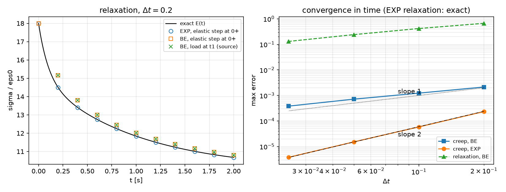
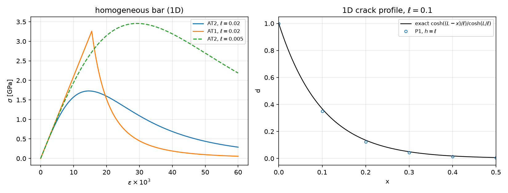
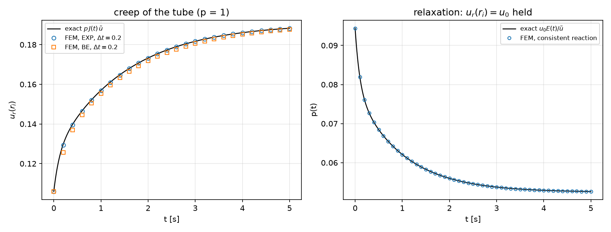
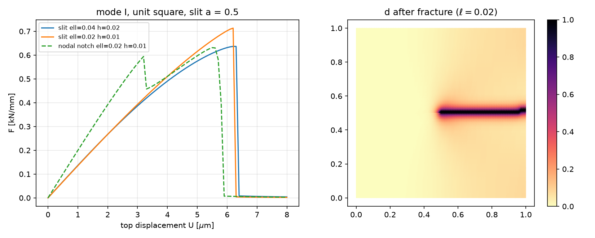

## Today

| Part | Topic | Time |
|---|---|:---:|
| | Quiz on Week 4 (closed-AI) | 10 min |
| **A** | Viscoelasticity — the generalized Maxwell model, relaxation and creep, time integration, the correspondence principle | 45 min |
| **B** | Phase-field fracture — from Griffith to AT2, the length scale $\ell$, irreversibility, the staggered scheme | 45 min |
| **C** | Code and verification — internal variables again, a creeping tube, a slit specimen, the original sources re-run | 50 min |
| **D** | LLM pitfalls · assignment | 20 min |

::: {.box}
Lab notebook: `W05_lab.ipynb` · Assignment: `W05_HW5.ipynb` (due before Week 6)
:::

## Week 4 in one slide

- J2 plasticity: radial return, $f=0$ after the return, the consistent tangent (3–7 Newton iterations instead of 49–124).
- Internal variables at quadrature points, an explicit Newton loop that **returns** a convergence flag.
- Limit load: no equilibrium above $p_{\rm lim}$; displacement control and the consistent reaction.

**Today:** two more materials with memory. Viscoelasticity remembers the **strain history** (linear, rate-dependent); phase-field fracture
remembers the **largest driving force** (nonlinear, irreversible). Both are verified against exact answers that do not come from the code.

# Part A · Linear viscoelasticity {background-color="#1f3864"}

## The generalized Maxwell model (Prony series)

A spring $E_\infty$ in parallel with $N$ Maxwell branches (spring $E_i$ + dashpot, relaxation time $\tau_i$):

$$
\sigma=E_\infty\varepsilon+\sum_i E_i(\varepsilon-\varepsilon^v_i),\qquad \dot\varepsilon^v_i=\frac{\varepsilon-\varepsilon^v_i}{\tau_i}
\quad\Rightarrow\quad
\sigma(t)=\int_0^tE(t-s)\,\dot\varepsilon(s)\,ds,\qquad E(t)=E_\infty+\sum_iE_ie^{-t/\tau_i}
$$

- $E_0=E_\infty+\sum E_i$: instantaneous (glassy) modulus; $E_\infty$: long-time (rubbery) modulus.
- Our material: $E_\infty=10$, $(E_1,\tau_1)=(5,1)$, $(E_2,\tau_2)=(3,0.1)$ MPa, s; $\nu=0.3$ — $E_0=18$.
- In 3D: $\mathbb C(t)=\mathbb C_\infty+\sum_i\mathbb C_ie^{-t/\tau_i}$, one viscous strain tensor per branch (an internal variable, like $\boldsymbol\varepsilon^p$ in Week 4).

## Relaxation and creep

- **Relaxation** (strain $\varepsilon_0$ held): $\sigma(t)=\varepsilon_0E(t)$ — exact, no computation.
- **Creep** (stress $\sigma_0$ held): $\varepsilon(t)=\sigma_0J(t)$ with the creep compliance $J$. By Laplace transform ($\hat f(s)=\int_0^\infty e^{-st}f\,dt$):

$$
\hat\sigma=s\hat E(s)\,\hat\varepsilon\quad\Rightarrow\quad \hat J(s)=\frac{1}{s^2\hat E(s)},\qquad s\hat E(s)=E_\infty+\sum_i\frac{E_is}{s+1/\tau_i}=\frac{N(s)}{D(s)}
$$

$J(t)=$ residues at $s=0$ and at the roots of $N$ (the **retardation** times, different from the $\tau_i$). Checks: $J(0)=1/E_0=0.055556$,
$J(\infty)=1/E_\infty=0.1$, $J(10)=0.0999542$ — and a $10^5$-step integration agrees to $10^{-12}$.

`visco.Prony.relax(t)`, `visco.Prony.creep(t)`: both exact, NumPy only.

## One time step of a branch

$\dot\varepsilon^v=(\varepsilon-\varepsilon^v)/\tau$ over $[t_n,t_{n+1}]$, written in one form for two schemes:

$$
\varepsilon^v_{n+1}=a\,\varepsilon^v_n+(1-b)\,\varepsilon_{n+1}+(b-a)\,\varepsilon_n,\qquad
\sigma_{n+1}=\Big(E_\infty+\sum_ib_iE_i\Big)\varepsilon_{n+1}-\sum_iE_i\big(a_i\varepsilon^v_{i,n}+(b_i-a_i)\varepsilon_n\big)
$$

| Scheme | $a$ | $b$ | Exact when |
|---|---|---|---|
| backward Euler (BE) | $\dfrac{\tau}{\tau+\Delta t}$ | $=a$ | never (first order) |
| exponential (EXP) | $e^{-\Delta t/\tau}$ | $\dfrac{(1-a)\tau}{\Delta t}$ | the strain is linear in time over the step |
| instantaneous step ($\Delta t=0$) | 1 | 1 | always: a jump is elastic, $\sigma$ jumps by $E_0\Delta\varepsilon$ |

- Effective stiffness $E_\infty+\sum b_iE_i$: constant for a constant $\Delta t$ — **one factorisation** for the whole run.
- A load applied at $t=0$ is a jump: take an elastic step at $0^+$, then the time steps.

## The schemes against the exact solutions

{width=84% fig-align="center"}

Relaxation: EXP is exact at every step ($10^{-15}$); BE is 3.7 % off at $\Delta t=0.2$ and converges slowly (0.73 % at $\Delta t=0.025$).
Creep: BE first order ($2.1\times10^{-3}\to3.8\times10^{-4}$), EXP second order ($2.3\times10^{-4}\to3.8\times10^{-6}$).

## The correspondence principle

If every branch has the **same** Poisson ratio, $\mathbb C(t)=E(t)\,\hat{\mathbb C}(\nu)$: the viscoelastic problem is the elastic problem with $E$ replaced by
the hereditary integral. For loads that are constant in time from $t=0$:

$$
\mathbf u(\mathbf x,t)=\underbrace{\mathbf u_{\rm el}(\mathbf x;\,E=1,\nu)}_{\text{one elastic solve}}\cdot\sigma_0J(t)\quad\text{(load control)},\qquad
\text{reaction}(t)=\text{reaction}_{\rm el}(E=1)\cdot u_0E(t)\quad\text{(displacement control)}
$$

- The thick tube under inner pressure (Weeks 3–4), plane strain: $u_r(r_i,t)=p\,J(t)\,\tilde u$, $\tilde u=$ Lamé with $E=1$ $=1.906667$ ($r_o/r_i=2$).
- An exact time-dependent solution of a 2D problem — the test for the FE code. Only the constant-$\nu$ case separates like this.

# Part B · Phase-field fracture {background-color="#1f3864"}

## From Griffith to a regularised crack

Griffith: a crack grows when the energy released per unit crack area reaches $G_c$. Total energy of a body with a crack set $\Gamma$:
$\mathcal E=\int_{\Omega\setminus\Gamma}\psi(\boldsymbol\varepsilon)\,dA+G_c\,|\Gamma|$. Replace the sharp crack by a damage field $d\in[0,1]$ of width $\sim\ell$ (AT2):

$$
\mathcal E_\ell(\mathbf u,d)=\int_\Omega g(d)\,\psi(\boldsymbol\varepsilon(\mathbf u))\,dA+\frac{G_c}{2}\int_\Omega\Big(\frac{d^2}{\ell}+\ell|\nabla d|^2\Big)dA,\qquad g(d)=(1-d)^2+k
$$

- The second integral is a **length** in disguise: for the optimal profile $d=e^{-|x|/\ell}$ across a straight crack it equals $G_c$ per unit crack length.
- As $\ell\to0$ the minimisers converge to Griffith's (Γ-convergence) — but $\ell$ also sets a strength (next slide), so it is a **material parameter**.
- $k\sim10^{-6}$ keeps the broken material from making the stiffness matrix singular.

## Two exact tests of AT2

::: {.columns}
::: {.column width="50%"}
**1D crack profile.** $d(0)=1$, $d'(L)=0$, no load: $d=\dfrac{\cosh((L-x)/\ell)}{\cosh(L/\ell)}$, energy $\dfrac{G_c}{2}\tanh\dfrac L\ell$.

| $h/\ell$ | $\Gamma_h/\Gamma$ (P1) |
|:---:|:---:|
| 1 | 1.04083 |
| 0.5 | 1.01036 |
| 0.25 | 1.00260 |
| 0.125 | 1.00065 |

Second order in $h/\ell$ — **if** a node sits on the crack.
:::
::: {.column width="50%"}
**Homogeneous bar.** No gradient; $\partial_d\mathcal E=0$ gives
$d=\dfrac{E\varepsilon^2}{G_c/\ell+E\varepsilon^2}$, $\sigma=(1-d)^2E\varepsilon$:

$$
\sigma_{\max}=\frac{3\sqrt3}{16}\sqrt{\frac{EG_c}{\ell}}\quad\text{at}\quad\varepsilon=\sqrt{\frac{G_c}{3E\ell}},\ d=\tfrac14
$$

$E=210$ GPa, $G_c=2.7\times10^{-3}$ kN/mm, $\ell=0.02$ mm: $\sigma_{\max}=1.7292$ GPa. Smaller $\ell$ → stronger.
AT2 damages from the first strain (no elastic range); AT1 ($w(d)=d$) is elastic up to $\sqrt{3G_cE/(8\ell)}=3.26$ GPa.
:::
:::

## The homogeneous response and the profile

{width=86% fig-align="center"}

Left: the strength of the regularised model scales as $\ell^{-1/2}$. Right: P1 with $h=\ell$ already follows the exact profile (energy +4 %).

## Irreversibility and the driving force

Cracks do not heal. Two common ways to impose $\dot d\ge0$:

- **History field** (Miehe 2010): replace $\psi^+$ in the $d$-equation by $\mathcal H(t)=\max_{s\le t}\psi^+(s)$ — a quadrature-point variable. The $d$-problem is then **linear**:
$$
\int_\Omega\Big[\Big(\frac{G_c}{\ell}+2\mathcal H\Big)d\,q+G_c\ell\,\nabla d\cdot\nabla q\Big]dA=\int_\Omega2\mathcal H\,q\,dA
$$
- **Bound constraints** $d_n\le d\le1$ (variational inequality, PETSc `vinewtonrsls`) — needed for AT1; not used today.

Which energy drives the crack: $\psi^+$ (a **split**). Amor: $\psi^+=\tfrac K2\langle\operatorname{tr}\boldsymbol\varepsilon\rangle_+^2+\mu\,\mathbf e:\mathbf e$ (all three normal components, plane strain);
compression of the volume does not damage. "Hybrid" form: the $\mathbf u$-problem keeps $g(d)\boldsymbol\sigma(\boldsymbol\varepsilon)$ (linear), only $d$ sees the split.

## Alternate minimisation (staggered scheme)

For each displacement step $U_n$:

1. solve $\mathbf u$ with $d$ fixed (linear, $g(d)$ stiffness);
2. $\mathcal H=\max(\mathcal H_n,\psi^+(\boldsymbol\varepsilon(\mathbf u)))$ at the quadrature points;
3. solve $d$ with $\mathcal H$ fixed (linear);
4. repeat 1–3 until $\max|d-d_{\rm prev}|<10^{-4}$; then $\mathcal H_n\leftarrow\mathcal H$.

- Each sub-problem is convex — robust; the price is many iterations when the crack runs: **149–179** iterations in the step where our specimen breaks.
- A step that hits the iteration cap is **not** converged; the result belongs to no load. Count, report, refine the step.

# Part C · Code and verification {background-color="#1f3864"}

## The three modules

| `visco.py` (NumPy) | `vtube.py` (DOLFINx) | `pfield.py` (DOLFINx) |
|---|---|---|
| `Prony(E_inf, [(E_i, tau_i)], nu)` | `annulus_mesh` (Weeks 3–4) | `profile_1d(Gc, ell, L, n)` |
| `.relax(t)`, `.creep(t)` exact | `ViscoTube(msh, ft, mat, ri, ro, control, scheme)` | `slit_mesh(h, a)` — no Gmsh |
| `.coeffs(dt, scheme)` → $(a_i,b_i)$ | `.step(dt, load)`, `dt = 0`: elastic | `PhaseField(msh, E, nu, Gc, ell, split)` |
| `point(mat, t, eps=… / sig=…)` | `.ur_inner()`, `.pressure_from_reaction()` | `.step(U)` → (converged, iterations) |
| | `lame_ur` | `.force()`, `.crack_energy(band)`, `.d_max()` |

The structure of Week 4 again: internal variables at quadrature points, NumPy updates, forms with quadrature coefficients.

## Viscoelasticity in code: a linear problem per step

```python
Ceff.x.array[:] = np.tile((Cinf + sum(b * Ci for (a, b), Ci in zip(ab, Cb))).ravel(), nq)   # constant for a fixed dt
hist.x.array[:] = sum((a * ev_i + (b - a) * e_old) @ Ci for ...).ravel()                    # history stress at the points
a = ufl.dot(ufl.dot(Ceff, eps4(du)), eps4(v)) * dx            # assembled and factorised once per step size
L = ufl.dot(hist, eps4(v)) * dx - p * ufl.dot(n, v) * ds(INNER)
# after the solve: e_new at the points, then  ev_i <- a ev_i + (1 - b) e_new + (b - a) e_old,  e_old <- e_new
```

- No Newton: the material is linear. The history enters only the right-hand side.
- The matrix is reassembled only when $\Delta t$ changes (the elastic step at $0^+$ has its own).
- Mandel 4-vectors and plane strain as in Week 4 — $\sigma_{zz}$ is kept.

## The creeping tube

{width=84% fig-align="center"}

| $\Delta t$ | 0.2 | 0.1 | 0.05 |
|---|:---:|:---:|:---:|
| EXP: $\max\lvert u_r-pJ\tilde u\rvert/u_r(\infty)$ | $2.3\times10^{-3}$ | $5.9\times10^{-4}$ | $1.5\times10^{-4}$ |
| BE | $2.1\times10^{-2}$ | $1.2\times10^{-2}$ | $7.2\times10^{-3}$ |

Relaxation ($u_r(r_i)$ held, pressure from the consistent reaction) matches $u_0E(t)/\tilde u$ to $3\times10^{-6}$ — the spatial error of the mesh.

## Phase field in code

```python
g = (1 - d)**2 + k
a_u = g * ufl.inner(sig(du), eps(v)) * dx                                  # u-problem, d fixed (hybrid: isotropic g)
a_d = (Gc / ell + 2 * H) * dd * q * dx + Gc * ell * ufl.inner(ufl.grad(dd), ufl.grad(q)) * dx
L_d = 2 * H * q * dx                                                       # H: quadrature Function
for it in range(1, maxit + 1):                                             # one load step
    d_old = d.x.array.copy()
    solve_u(); psi.interpolate(psi_plus_expr); H.x.array[:] = np.maximum(H_n, psi.x.array); solve_d()
    if max_abs(d.x.array - d_old) < tol: break
H_n = H.x.array.copy();  return err < tol, it
```

- Reaction: $F=\int_\Omega g\,\sigma_{yy}\,dA$ — the virtual work with $\mathbf w=(0,y)$ (Week 4's consistent reaction, one line).
- Both matrices change every iteration ($g(d)$ and $\mathcal H$): reassemble, refactorise.

## A notch in the mesh, not in the damage

`slit_mesh(h)`: a structured unit square, $h$ along the crack line, $y$ graded away from it; the nodes on $y=0.5$, $x<0.5$ are **duplicated**, so
the slit has two free faces. No Gmsh: the same 4800 cells on every computer ($h=0.01$).

| | slit in the mesh | $d=1$ on one line of nodes (no slit) |
|---|:---:|:---:|
| crack energy at the start / $G_ca$ | 0 | 1.04 (a profile, not a developed crack) |
| load–displacement | rises, one peak, breaks | a false first peak, a drop, a second peak |
| $F_{\max}$ ($\ell=0.02$) | 0.7133 | 0.6312 (−11.5 %) |
| staggered iterations | all converged ($\le178$) | **cap of 300 reached** |

A one-node line of $d=1$ is weaker than the crack band the model forms itself; it re-damages under load.

## The slit specimen

{width=86% fig-align="center"}

Mode I, $E=210$ GPa, $\nu=0.3$, $G_c=2.7\times10^{-3}$ kN/mm, 80 steps to $U=8\,\mu$m. The crack runs straight and unstably (one step);
the faint background in the ligament is AT2's diffuse damage.

## Energy and the length scale

| $\ell$ | $h$ | cells | $F_{\max}$ [kN/mm] | $\Gamma/(G_ca)$ total | in the band $\lvert y-\tfrac12\rvert<5\ell$ | max. iterations |
|:---:|:---:|:---:|:---:|:---:|:---:|:---:|
| 0.04 | 0.02 | 1200 | 0.6366 | 1.538 | 1.436 | 179 |
| 0.04 | 0.01 | 4800 | 0.6131 | 1.338 | 1.250 | 149 |
| 0.02 | 0.01 | 4800 | 0.7133 | 1.426 | 1.346 | 178 |

- The crack costs more than $G_c a$: the band of elements with $d\approx1$ (an effective toughness $\approx G_c(1+h/2\ell)$ in the literature) — it falls with $h$ at fixed $\ell$.
- $0.08$–$0.10\,G_ca$ lies outside the band: diffuse damage, larger for larger $\ell$.
- $F_{\max}$ depends on $\ell$ (strength) **and** on $h$ (4 % here): report both, and a mesh study.

## The original sources, re-run on 0.11

**Viscoelasticity** (generalized Maxwell, the same Prony data):

- Its "analytic" curve is the same backward-Euler algorithm with $\Delta t=0.001$ — a code-to-code check. (It is close to the exact $J(10)=0.0999542$; the header's "0.067 %" is not what the code prints, 0.023 %.)
- Relaxation: the load is applied in the first time step, so $\sigma(t_1)=1.5167$ — neither $E_0\varepsilon_0=1.8$ at $0^+$ nor the exact 1.4500 at $t_1$.
- "Long-time $=E_\infty/(1-\nu^2)\cdot\varepsilon_0=1.0989$": the bar is free laterally (uniaxial stress) — the limit is $E_\infty\varepsilon_0=1.0$, which its own FEM (1.000046) reached.

**Phase field** (shear test):

- Mesh $h=0.05$ away from the notch tip with $\ell=0.0075$: the crack path is 7 cells per $\ell$ too coarse.
- Notch "as an initial condition $d=1$": the $d$-problem is linear with right-hand side $2\mathcal H$ — the initial value never enters (measured: $d_{\max}$ 1 → 0 after the first solve).
- Staggered loop capped at 50 iterations and the cap reached at the peak step; "snap-back ✅" under displacement control is not observable.

# Part D · LLM pitfalls · assignment {background-color="#1f3864"}

## What goes wrong in history-dependent codes

| Pitfall | Measured symptom (this week) |
|---|---|
| "Analytic" reference computed with the same algorithm | agreement proves only that the code reproduces itself |
| Load applied at the first time step (no elastic step at $0^+$) | relaxation starts at 1.5167 instead of 1.8; $O(\Delta t)$ error that does not show up late |
| Long-time limit with the wrong reduced modulus ($E/(1-\nu^2)$ for a free bar) | a 10 % "discrepancy" that is the reference's |
| Mesh coarser than $\ell$ along the crack path | the crack band and $F_{\max}$ are mesh artefacts |
| Notch as an initial value of $d$ / as one line of nodes | erased by the first solve / false first peak, $F_{\max}$ −11.5 %, iterations at the cap |
| Staggered loop with a silent iteration cap | non-converged steps plotted as results |
| All of $\int\gamma(d)$ reported as crack energy | AT2's diffuse damage ($0.08$–$0.10\,G_ca$ here) counted as crack |

## Prompting for a viscoelastic or phase-field model

1. State the model completely: the Prony data and the time scheme; the phase-field model (AT1/AT2), $g(d)$, the split, the irreversibility method.
2. Ask for the **exact tests first**: relaxation $=\varepsilon_0E(t)$, creep $=\sigma_0J(t)$ (Laplace), correspondence for constant $\nu$; the 1D profile energy, the homogeneous $\sigma_{\max}$.
3. Ask for an elastic step at $0^+$ for loads applied at $t=0$.
4. For fracture: $h\le\ell/2$ along the expected path, the notch in the **mesh**, a staggered loop that **returns** whether it converged and how many iterations it took.
5. Report energies (elastic, crack, band) next to the force — they are the checks a force curve hides.

## Assignment HW5 (due before Week 6)

| Q | Topic | Points |
|---|---|:---:|
| 1 | Time integration of a Maxwell branch, the creep compliance of the standard linear solid, AT2 strength and length scale (theory) | 20 |
| 2 | Viscoelasticity: the order of the time schemes in 2D, relaxation under displacement control, creep and recovery | 25 |
| 3 | Phase field: mesh and length-scale study of the slit specimen, the split in compression | 35 |
| 4 | Debugging an LLM-generated phase-field script | 20 |

**Week 6 starts with a 10-minute quiz on today's material (closed-AI).**

## Summary

| Concept | Key point | DOLFINx 0.11 |
|---|---|---|
| Prony series | $E(t)=E_\infty+\sum E_ie^{-t/\tau_i}$; creep $J$ by Laplace | `visco.Prony` (NumPy) |
| Time integration | EXP exact for relaxation, order 2; BE order 1; elastic step at $0^+$ | constant matrix per $\Delta t$ |
| Correspondence | constant $\nu$: $u(t)=u_{\rm el}(E=1)\,\sigma_0J(t)$ | exact 2D test |
| AT2 | $\Gamma_\ell\to G_c$ per length; $\sigma_{\max}=\frac{3\sqrt3}{16}\sqrt{EG_c/\ell}$ | `pfield.profile_1d`, homogeneous bar |
| Irreversibility | $\mathcal H=\max\psi^+$ (history) — linear $d$-problem | quadrature `Function` |
| Staggered scheme | alternate $\mathbf u$ / $d$ until converged; report iterations | `PhaseField.step` → flag |

**Next week:** dynamics (Newmark) and buckling (SLEPc eigenvalues).
