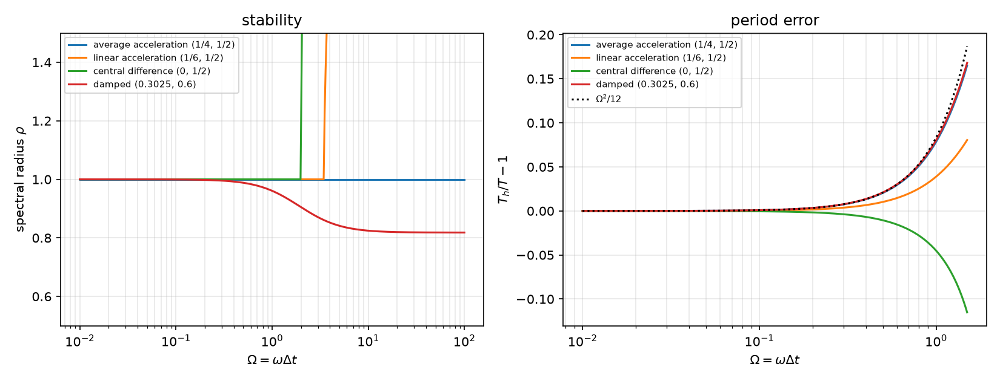
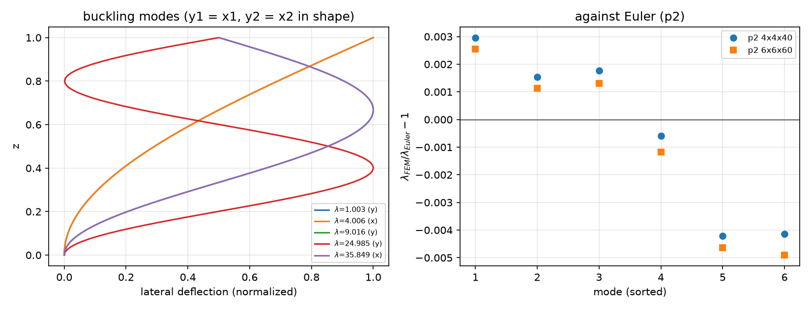
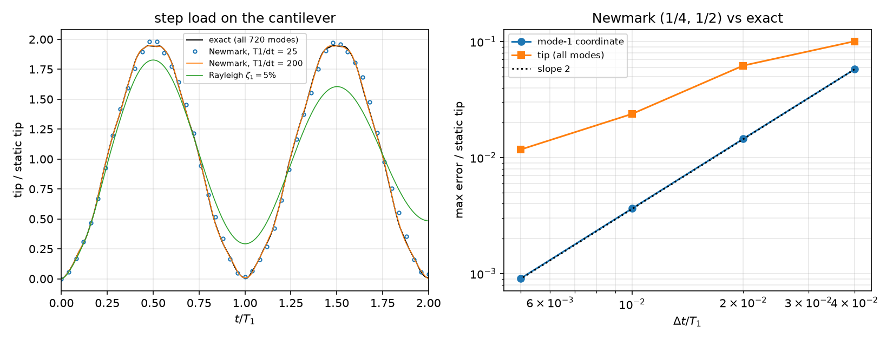

## Today

| Part | Topic | Time |
|---|---|:---:|
| | Quiz on Week 5 (closed-AI) | 10 min |
| **A** | Dynamics — $M\ddot{\mathbf u}+C\dot{\mathbf u}+K\mathbf u=\mathbf f$, modes, the Newmark family, stability and period error, Rayleigh damping | 50 min |
| **B** | Eigenproblems with SLEPc — natural frequencies, linear buckling, the geometric stiffness, shift-invert | 35 min |
| **C** | Verification — an exact semi-discrete solution, energy, damping ratio, Euler loads, the original sources re-run | 55 min |
| **D** | LLM pitfalls · assignment | 20 min |

::: {.box}
Lab notebook: `W06_lab.ipynb` · Assignment: `W06_HW6.ipynb` (due before Week 7)
:::

## Week 5 in one slide

- Viscoelasticity: Prony series, exact $J(t)$, the exponential scheme (exact for relaxation), an elastic step at $0^+$, correspondence.
- Phase field: AT2, $\sigma_{\max}=\frac{3\sqrt3}{16}\sqrt{EG_c/\ell}$, the history field, a staggered loop that reports convergence, the notch in the mesh.

**Today:** time enters through **inertia**. The semi-discrete system is a set of oscillators; the time scheme must be stable for all of them and accurate
for the ones we care about. Then the same matrices in an eigenproblem: frequencies and buckling loads with SLEPc.

# Part A · Dynamics {background-color="#1f3864"}

## The semi-discrete equations

$$
M\ddot{\mathbf u}+C\dot{\mathbf u}+K\mathbf u=\mathbf f(t),\qquad M=\int_\Omega\rho\,\mathbf N^\top\mathbf N,\quad K=\int_\Omega\mathbf B^\top\mathbb C\,\mathbf B
$$

- Modes: $K\boldsymbol\phi_i=\omega_i^2M\boldsymbol\phi_i$, $\boldsymbol\phi_i^\top M\boldsymbol\phi_j=\delta_{ij}$. With $\mathbf u=\sum q_i\boldsymbol\phi_i$ the system splits into oscillators
  $\ddot q_i+\omega_i^2q_i=\boldsymbol\phi_i^\top\mathbf f$.
- Step load $\mathbf f$ from $t=0$: $q_i=\frac{\boldsymbol\phi_i^\top\mathbf f}{\omega_i^2}(1-\cos\omega_it)$ — **every** mode peaks at twice its static value.
- For a small mesh, all modes from dense matrices give the **exact semi-discrete solution** — a reference for the time scheme alone.
- The spectrum is wide: our cantilever ($20\times4$ P2, 720 unknowns) has $\omega_1=524$ and $\omega_{\max}=2.0\times10^6$ rad/s.

## The Newmark family

$$
\mathbf u_{n+1}=\mathbf u_n+\Delta t\,\dot{\mathbf u}_n+\Delta t^2\big[(\tfrac12-\beta)\ddot{\mathbf u}_n+\beta\ddot{\mathbf u}_{n+1}\big],\qquad
\dot{\mathbf u}_{n+1}=\dot{\mathbf u}_n+\Delta t\big[(1-\gamma)\ddot{\mathbf u}_n+\gamma\ddot{\mathbf u}_{n+1}\big]
$$

Predictor–corrector form: $(M+\gamma\Delta t\,C+\beta\Delta t^2K)\,\ddot{\mathbf u}_{n+1}=\mathbf f_{n+1}-C\tilde{\dot{\mathbf u}}-K\tilde{\mathbf u}$ — one matrix, factorized once.

| $(\beta,\gamma)$ | name | stability | accuracy |
|---|---|---|---|
| $(\tfrac14,\tfrac12)$ | average acceleration (trapezoidal) | unconditional | 2nd order, no amplitude error, energy conserved |
| $(\tfrac16,\tfrac12)$ | linear acceleration | $\omega\Delta t\le\sqrt{12}=3.46$ | 2nd order |
| $(0,\tfrac12)$ | central difference | $\omega\Delta t\le2$ | 2nd order, explicit with a lumped $M$ |
| $\gamma>\tfrac12$, $\beta=\tfrac14(\gamma+\tfrac12)^2$ | numerically damped | unconditional | 1st order |

The initial acceleration follows from the equation: $M\ddot{\mathbf u}_0=\mathbf f_0-C\dot{\mathbf u}_0-K\mathbf u_0$ (for a step load, $\ddot{\mathbf u}_0=M^{-1}\mathbf f\ne0$).

## Stability and period error on one oscillator

{width=86% fig-align="center"}

The amplification matrix of one step ($\Omega=\omega\Delta t$). Central difference: $\rho=1.000$ at $\Omega=1.99$, $1.221$ at $2.01$. Average acceleration: $\rho=1$ for all $\Omega$
(no damping, also none of the spurious high modes); period error $\approx\Omega^2/12$ (measured $1.00524$ at $T/\Delta t=25$, formula $1.00526$).

## Rayleigh damping

$C=\alpha_MM+\alpha_KK$ is diagonal in the modes: mode $i$ gets

$$
\zeta_i=\frac{\alpha_M}{2\omega_i}+\frac{\alpha_K\omega_i}{2}\qquad\Rightarrow\qquad \zeta_1=\zeta\ \text{ for }\ \alpha_M=\zeta\omega_1,\ \alpha_K=\zeta/\omega_1
$$

- Not "$\alpha_M=2\zeta\omega_1$, $\alpha_K=2\zeta/\omega_1$" — that gives $\zeta_1=2\zeta$.
- The stiffness part grows with $\omega$: on our cantilever $\zeta_{2,3,4}=0.15,\ 0.39,\ 0.40$ — higher modes are damped hard (often wanted).
- Damped step response of one oscillator: peak $1+e^{-\zeta\pi/\sqrt{1-\zeta^2}}=1.8545$ for $\zeta=5\,\%$.

# Part B · Eigenproblems with SLEPc {background-color="#1f3864"}

## Natural frequencies: shift-invert

```python
K = assemble_matrix(k_form, bcs=[bc], diag=1.0); K.assemble()      # BC rows: identity
M = assemble_matrix(m_form, bcs=[bc], diag=0.0); M.assemble()      # BC rows: zero -> the BC "modes" go to infinity
eps = SLEPc.EPS().create(comm); eps.setOperators(K, M); eps.setProblemType(SLEPc.EPS.ProblemType.GHEP)
eps.setDimensions(6); eps.setTarget(0.0); eps.setWhichEigenpairs(SLEPc.EPS.Which.TARGET_MAGNITUDE)
st = eps.getST(); st.setType("sinvert"); st.getKSP().setType("preonly"); st.getKSP().getPC().setType("lu")
eps.solve();  lam = eps.getEigenpair(i, x)                          # omega = sqrt(lam)
```

- Shift-invert at $\sigma=0$: Krylov on $(K-\sigma M)^{-1}M$ — the smallest $\omega$ become the largest eigenvalues, found in a few iterations.
- `diag=0.0` on $M$: a constrained DOF has $K_{ii}=1$, $M_{ii}=0$ → $\lambda=\infty$, never near the target.
- GHEP: $K$, $M$ symmetric, $M$ semi-definite — real eigenvalues, $M$-orthogonal vectors.

## Which mode is which?

$20\times4$ P2 cantilever, $L/H=10$, plane stress, $E=210$ GPa, $\rho=7800$ kg/m³:

| # | $\omega$ [rad/s] | axial share | Euler–Bernoulli | |
|:---:|:---:|:---:|:---:|---|
| 1 | 523.59 | 0.005 | 526.65 | bending 1 (−0.58 %) |
| 2 | 3141.78 | 0.03 | 3300.46 | bending 2 (−4.8 %) |
| 3 | 8161.80 | **1.00** | — | **axial** (exact $\frac{\pi}{2L}\sqrt{E/\rho}=8150.46$) |
| 4 | 8278.64 | 0.06 | 9241.39 | bending 3 (−10.4 %) |

- Mode 3 is not the third bending mode. Classify modes by their shape (here: the share of $u_x^2$), never by their index.
- Bending modes drift below Euler–Bernoulli as the wavelength shortens: shear and rotary inertia (Timoshenko). Mesh $80\times16$: 523.17, 3138.48 — converged.

## Linear buckling

Two steps: a pre-buckling solve under a reference load $\mathbf f_{\rm ref}$ → stress $\boldsymbol\sigma_0$; then the load factor at which the stiffness becomes singular:

$$
(K+\lambda K_G)\boldsymbol\phi=0,\qquad K_G(\mathbf u,\mathbf v)=\int_\Omega\boldsymbol\sigma_0:(\nabla\mathbf u\,\nabla\mathbf v^\top)\,dV=\int_\Omega\sigma^0_{ij}\,u_{k,i}\,v_{k,j}\,dV
$$

- $P_{\rm cr}=\lambda P_{\rm ref}$. All three displacement components $k$ appear: the lateral ones ($k=x,y$) are the ones that buckle.
- $K_G$ is indefinite. Solve $(-K_G)\boldsymbol\phi=\theta K\boldsymbol\phi$ with $\theta=1/\lambda$: $K$ is positive definite (B matrix of a GHEP); the largest $\theta$ = the smallest $\lambda$.
- Assemble $-K_G$ with `diag=0.0` on the BC rows: no spurious eigenvalues, no "diag = 1e-12" trick.

## The column

Clamped–free, $b\times h\times L=0.05\times0.025\times1$ m, hexahedra, compressive traction on the top. Euler: $P_n=\frac{(2n-1)^2\pi^2EI}{4L^2}$; with $P_{\rm ref}=P_1$ (weak axis):
$\lambda$ = 1, 4, 9, 25, 36, 49 (deflection y, x, y, y, x, y).

| mesh | DOFs | $\lambda_1$ … $\lambda_6$ | time |
|---|:---:|---|:---:|
| P2 $4\times4\times40$ | 19683 | 1.0030, 4.0061, 9.0160, 24.985, 35.849, 48.797 | 2.0 s |
| P2 $6\times6\times60$ | 61347 | 1.0026, 4.0045, 9.0118, 24.970, 35.833, 48.760 | 10.9 s |
| P1 $4\times4\times30$ | 2325 | 1.7066, 4.7380, 15.377, 42.53, 42.81, 84.18 | 0.1 s |

- P1 hexahedra lock in bending (Week 1): +71 % on the first load.
- Pre-buckling check: $u_z(L)=-1.28328\times10^{-4}$ m vs $-PL/(EA)=-1.28510\times10^{-4}$ (the clamped base restrains the lateral contraction).

## Below Euler is not an error

{width=84% fig-align="center"}

Modes 1–3 lie 0.1–0.3 % above Euler (discretization, falling with refinement); modes 4–6 up to 0.5 % **below** (and further below on the finer mesh): shorter
waves feel shear deformation, $P_E/(\kappa GA)=1.4\,\%$ for the $x$-2 mode (Engesser's beam estimate $\lambda=35.49$).

# Part C · Verification {background-color="#1f3864"}

## The three modules

| `sdof.py` (NumPy) | `dyn.py` (DOLFINx, SLEPc) | `buckle.py` (DOLFINx, SLEPc) |
|---|---|---|
| `amplification(Omega, beta, gamma, zeta)` | `Cantilever(L, H, nx, ny, E, nu, rho, P, plane)` | `Column(b, h, L, nx, ny, nz, E, nu, deg, kg)` |
| `spectral_radius`, `period_ratio` | `.static()`, `.modes(n)` → $(\omega,\boldsymbol\phi,$ axial share$)$ | `.solve(nev)` → $(\lambda$, axis, mode$)$ |
| `integrate(w, dt, n, ...)`, `step_exact` | `.newmark(dt, n, beta, gamma, aM, aK, record)` | `.euler(n, axis)`, `.Pref`, `.u0` |
| | `.dense_modal()` (serial): the exact solution | |

`newmark` works on PETSc vectors: predictor and corrector are `axpy`s, the matrix $M+\gamma\Delta tC+\beta\Delta t^2K$ is factorized once.

## Newmark against the exact semi-discrete solution

{width=86% fig-align="center"}

| $T_1/\Delta t$ | 25 | 50 | 100 | 200 |
|---|:---:|:---:|:---:|:---:|
| error, mode-1 coordinate | $5.8\times10^{-2}$ | $1.4\times10^{-2}$ | $3.6\times10^{-3}$ | $9.1\times10^{-4}$ |
| error, tip (all 720 modes) | 0.10 | 0.062 | 0.024 | 0.012 |
| $\omega_{\max}\Delta t$ | 955 | 477 | 239 | 119 |

## Reading the table

- The mode-1 coordinate converges at **second order** (factor 4 per halving). The tip converges slowly: it contains modes with $\omega\Delta t\gg1$ that
  no affordable $\Delta t$ resolves. Average acceleration keeps them bounded ($\rho=1$) but with the wrong phase; their share of the tip is small.
- Dynamic amplification of the tip: exact 1.9476 — below 2 because the modes do not peak together; Newmark 1.983 / 1.992 / 1.960 / 1.948.
- Total energy $\tfrac12\dot{\mathbf u}^\top M\dot{\mathbf u}+\tfrac12\mathbf u^\top K\mathbf u-\mathbf f^\top\mathbf u$ is conserved to $10^{-10}$ (relative to $\mathbf f^\top\mathbf u_{\rm st}$) — the trapezoidal rule is energy-conserving
  for linear systems. A drift is a bug.
- Damping $\zeta_1=5\,\%$: mode-1 peak 1.85455 vs 1.85447 (one oscillator); logarithmic decrement → $\zeta=0.04998$. The tip peaks at 1.827: the higher modes are damped harder.

## The original sources, re-run on 0.11

**Dynamics** (cantilever, step load):

- Static reference $FL^3/(3EI)$ (beam, $E$), model in **plane strain**: the FEM static deflection is 0.912 of it. Its "DAF 1.815 (should be ~2)" is $0.912\times1.99$ — a reference error, not a dynamic one.
- Initial acceleration 0 for a step load; units "m" for millimetres; the tip node computed and then not used (the minimum over all $u_y$ instead).
- Damping exercise: header "$\alpha_M=2\zeta\omega_1$, $\alpha_K=2\zeta/\omega_1$" (would give $2\zeta$); the code uses $\zeta\omega_1$, $\zeta/\omega_1$ — correct. "Theory 1.85 vs 1.666" is again the static reference.

**Buckling** (the same column):

- Results reproduced to every digit (1.00296, 4.00614, 9.01598, 35.84856). The mode at 24.985 (the third weak-axis mode, Euler 25) is listed but left unexplained.
- "Using only $\sigma_{zz}$ gives ~280 % error": $\sigma_{zz}u_{k,z}v_{k,z}$ (all $k$) gives 1.0026 / 4.0008 / 8.989 — within 0.04–1.6 %. What loses buckling is keeping only $k=z$ ($\lambda=7744$).
- "−0.42 % error" for the $x$-2 mode: shear deformation, physics of the 3D model.

# Part D · LLM pitfalls · assignment {background-color="#1f3864"}

## What goes wrong in dynamics and eigenvalue codes

| Pitfall | Measured symptom (this week) |
|---|---|
| Static/beam reference with another 2D reduction than the model (plane strain vs $E$) | "DAF 1.815" instead of 1.99 |
| Initial acceleration set to 0 for a load applied at $t=0$ | the load arrives one step late; $O(\Delta t)$ phase error |
| Rayleigh coefficients $2\zeta\omega_1$, $2\zeta/\omega_1$ | twice the intended damping |
| Modes numbered by index ("mode 3 = third bending mode") | mode 3 is axial (99.97 % $u_x^2$) |
| Explicit scheme with $\Delta t$ from the lowest frequency | central difference needs $\omega_{\max}\Delta t\le2$: here $\Delta t\le1.0\,\mu$s, not $T_1/100=120\,\mu$s |
| `A.convert("dense")` to inspect a matrix | **in place**: the PETSc matrix is now dense, MUMPS fails afterward — use `A.convert("dense", B)` |
| `f(obj.static().x.petsc_vec)` | the temporary Function is freed before use: segmentation fault — keep the Function in a variable |
| $K_G$ with only the axial component, or BC rows "fixed" by tiny diagonals | no buckling ($\lambda=7744$) / spurious eigenvalues; use $\sigma^0_{ij}u_{k,i}v_{k,j}$ and $B=K$ |

## Prompting for a dynamics or buckling model

1. State the reduction and the reference together (plane stress ↔ beam theory with $E$; plane strain ↔ $E/(1-\nu^2)$).
2. Ask for the **modes first**, classified by shape; set $\Delta t$ from the modes you want to resolve, and check stability against $\omega_{\max}$ for explicit schemes.
3. Ask for a consistent initial acceleration and an energy (or log-decrement) check printed with the response.
4. For buckling: the full geometric stiffness, $K$ as the B matrix, a pre-buckling check ($u_z=-PL/EA$), modes matched to Euler **by shape**.
5. Keep a small serial case with an exact semi-discrete or analytical answer next to every production run.

## Assignment HW6 (due before Week 7)

| Q | Topic | Points |
|---|---|:---:|
| 1 | Newmark stability and period error, Rayleigh damping, the buckling eigenproblem (theory) | 20 |
| 2 | Dynamics: the explicit stability limit, a numerically damped scheme, slenderness and Euler–Bernoulli | 30 |
| 3 | Buckling: element order and mesh, slenderness and shear, which $K_G$ | 30 |
| 4 | Debugging an LLM-generated Newmark script | 20 |

**Week 7 starts with a 10-minute quiz on today's material (closed-AI).**

## Summary

| Concept | Key point | DOLFINx 0.11 / SLEPc |
|---|---|---|
| Semi-discrete dynamics | modes decouple; step load: each mode peaks at 2× static | `assemble_matrix(m, bcs, diag=0.0)` |
| Newmark | $(\tfrac14,\tfrac12)$: unconditional, energy-conserving, period error $\Omega^2/12$ | one factorization of $M+\gamma\Delta tC+\beta\Delta t^2K$ |
| Explicit | central difference: $\omega_{\max}\Delta t\le2$ | $\omega_{\max}$ from the eigen solver |
| Rayleigh | $\zeta_i=\alpha_M/2\omega_i+\alpha_K\omega_i/2$ | $C=\alpha_MM+\alpha_KK$ |
| Frequencies | shift-invert at 0; classify by shape | `EPS`, GHEP, `ST sinvert` |
| Buckling | $\sigma^0_{ij}u_{k,i}v_{k,j}$; $(-K_G)\phi=\theta K\phi$ | GHEP with $B=K$ |

**Next week:** beams — trusses, 3D Timoshenko beams, finite rotations.
