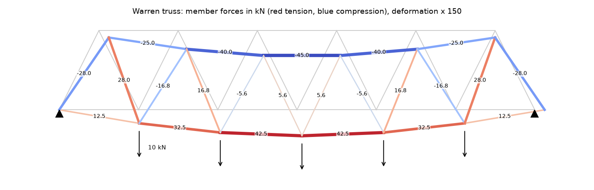
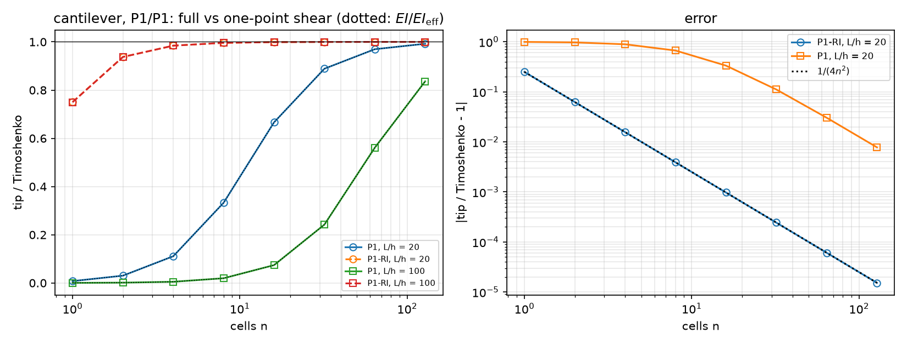
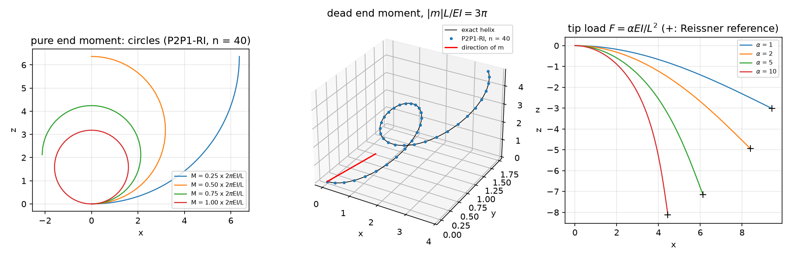

## Today

| Part | Topic | Time |
|---|---|:---:|
| | Quiz on Week 6 (closed-AI) | 10 min |
| **A** | Trusses — a 1D mesh in 2D/3D without Gmsh, the axial strain from the tangent, the method of joints | 35 min |
| **B** | 3D Timoshenko frames — generalized strains, the local frame, shear locking, torsion | 45 min |
| **C** | Finite rotations — $\Lambda=\exp\widehat{\boldsymbol\theta}$, energy → SNES, exact circle, helix and elastica, Newton | 60 min |
| **D** | The sources re-run · LLM pitfalls · assignment | 20 min |

::: {.box}
Lab notebook: `W07_lab.ipynb` · Assignment: `W07_HW7.ipynb` (due before Week 8) · **Week 8: midterm (first half)**
:::

## Week 6 in one slide

- Semi-discrete dynamics: modes decouple; Newmark $(\tfrac14,\tfrac12)$ is unconditionally stable and conserves energy; central difference needs $\omega_{\max}\Delta t\le2$.
- Rayleigh damping $\zeta_i=\alpha_M/2\omega_i+\alpha_K\omega_i/2$; SLEPc shift-invert for frequencies; buckling as $(-K_G)\phi=\theta K\phi$.

**Today:** structures whose members are long and thin. Instead of meshing them in 3D, we reduce them to their axis: a **1D mesh in 2D or 3D**. Three
models of increasing richness — the truss (axial force only), the Timoshenko beam (six section forces), the geometrically exact rod (any rotation).

# Part A · Trusses {background-color="#1f3864"}

## Three line models

| model | unknowns at a node | strains | valid for |
|---|---|---|---|
| truss | $\mathbf u$ (2 or 3) | $\varepsilon=\boldsymbol t\cdot\mathbf u'$ | pin-jointed members, axial force only |
| Timoshenko beam / frame | $\mathbf u$, $\boldsymbol\theta$ (6) | $\varepsilon$, two shears, two curvatures, twist | small rotations, rigid or welded joints |
| geometrically exact rod | $\mathbf u$, $\boldsymbol\theta$ (6) | $\boldsymbol\Gamma=\Lambda^\top(\boldsymbol t_0+\mathbf u')-\boldsymbol t_0$, $\mathbf K=T^\top\boldsymbol\theta'$ | any rotation, small strain |

$'=d/ds$ along the member. The cross-section enters only through $ES$, $\kappa GS$, $EI_1$, $EI_2$, $GJ$ — computed once (Saint-Venant $J$ for a rectangle, $\kappa$ by Cowper).

## A 1D mesh in 2D/3D — no Gmsh

```python
pts, cells = joints + inner points, [(i, j), ...]                 # rank 0 only; empty arrays elsewhere
msh = mesh.create_mesh(comm, cells, ufl.Mesh(basix.ufl.element("Lagrange", "interval", 1, shape=(gdim,))), pts)
msh.topology.create_connectivity(0, 1)                             # vertex -> cell, for locate_dofs_topological(V, 0, vertices)
J = ufl.Jacobian(msh); t = ufl.as_vector([J[i, 0] for i in range(gdim)]); t = t / ufl.sqrt(ufl.dot(t, t))
eps = lambda w: ufl.dot(ufl.dot(ufl.grad(w), t), t)                 # axial strain  t . grad(u) t
```

- `ufl.grad` on a manifold mesh is the tangential gradient; $\nabla\mathbf u\,\boldsymbol t=d\mathbf u/ds$. The sign of $\boldsymbol t$ depends on the cell orientation — use it in even powers.
- Joint loads go straight into the vector at the joint DOFs (`locate_dofs_topological(V.sub(c), 0, vertex)`): `locate_dofs_geometrical` refuses sub-spaces in 0.11.
- The source used Gmsh with `setTransfiniteCurve(lt, 2)` — one cell per member, which matters (next slide).

## The Warren truss

{width=88% fig-align="center"}

13 joints, 23 members, 3 reactions: $2j=m+r$ — **statically determinate**. Min $u_y=-2.1882$ mm, max $|u_x|=0.8333$ mm (the source's values); member forces = the method of joints to
$\sim10^{-10}$ N (round-off), whatever $ES$ is. Cut each member into two cells: the middle node has **no stiffness across the member** → zero pivot, KSP reason −11, $|u|=\infty$.

## Trusses and frames run serially

A vertex shared by **3 or more** cells is duplicated in DOLFINx 0.11 when those cells end up on different ranks:

| mesh | vertices, 1 rank | 2 ranks | 3 ranks |
|---|:---:|:---:|:---:|
| Warren truss | 13 | **21** (Colab: **17**) | — |
| star of 6 cells | 7 | **8** | 7 |
| ladder ($2\times11$ joints) | 22 | **25** | **30** |
| chain (every vertex in ≤ 2 cells) | 21 | 21 | 21 |

The structure falls apart (reason −11, $\infty$), with no error message. Run trusses and frames with `-np 1` (they are small anyway). A **chain** — a single
beam or rod — is fine in parallel (the rod of Part C runs on 2 ranks).

# Part B · 3D Timoshenko frames {background-color="#1f3864"}

## Generalized strains in the local frame

Local frame per member: $\boldsymbol t$, $\mathbf a_1=\dfrac{\mathbf{up}\times\boldsymbol t}{|\mathbf{up}\times\boldsymbol t|}$, $\mathbf a_2=\boldsymbol t\times\mathbf a_1$.

| strain | expression | resultant |
|---|---|---|
| axial | $\varepsilon=\boldsymbol t\cdot\mathbf u'$ | $N=ES\,\varepsilon$ |
| shear | $\gamma_1=\mathbf a_1\cdot\mathbf u'-\mathbf a_2\cdot\boldsymbol\theta$, $\ \gamma_2=\mathbf a_2\cdot\mathbf u'+\mathbf a_1\cdot\boldsymbol\theta$ | $Q_\alpha=\kappa GS\,\gamma_\alpha$ |
| bending | $\chi_1=\mathbf a_1\cdot\boldsymbol\theta'$, $\ \chi_2=\mathbf a_2\cdot\boldsymbol\theta'$ | $M_1=EI_1\chi_1$ ($I_1=\int x_2^2dA$), $M_2=EI_2\chi_2$ |
| twist | $\tau=\boldsymbol t\cdot\boldsymbol\theta'$ | $T=GJ\,\tau$ |

$a(\mathbf u,\boldsymbol\theta;\mathbf v,\boldsymbol\varphi)=\int\big(N\varepsilon_v+Q_1\gamma_{1v}+Q_2\gamma_{2v}+M_1\chi_{1v}+M_2\chi_{2v}+T\tau_v\big)\,ds$ on a mixed space $(\mathbf u,\boldsymbol\theta)$.
Rectangle $b\times h$ with $h$ along $\mathbf a_2$: $I_1=bh^3/12$ (deflection along $\mathbf a_2$) — the source's comment "(weak)" for it is wrong for $h>b$.

## Shear locking

{width=84% fig-align="center"}

P1 $w$, P1 $\theta$, exact integration: on a cell the shear strain $w'-\theta$ cannot vanish when $\theta$ varies, and $\int\kappa GA\gamma^2$ adds $\kappa GA\,\ell^2/12$ to $EI$ — the dotted
curves, **exact to 6 digits**. Cure: integrate the shear terms with **one point** (`metadata={"quadrature_degree": 0}`), or $\mathbf u$ in P2.

## Locking in numbers

The source's cantilever: $L=10$, $b\times h=0.3\times0.5$ m, $F=-1$ kN; Euler–Bernoulli $-0.5079$ mm, **Timoshenko $-0.5089$ mm**.

| $n$ | 1 | 2 | 5 | 10 | 100 |
|---|:---:|:---:|:---:|:---:|:---:|
| P1/P1 full integration | 0.0077 | 0.030 | 0.163 | 0.438 | 0.98734 |
| P1/P1 one-point shear = P2/P1 | 0.7505 | 0.9376 | 0.9900 | 0.9975 | 0.999975 |

- The source: "$n=100$: $-0.5025$ mm, 1.07 % vs Euler–Bernoulli ✅". It is 0.98734 of Timoshenko — **still locked**. A Timoshenko result below Euler–Bernoulli is the signature.
- The locking-free elements give exactly $w_{EB}(1-\frac1{4n^2})+w_{\rm shear}$: shear exact, bending second order. P2/P1 = P1-RI to all digits.

## Frames: torsion and the reference vector

**L-frame** (legs $a=2$, $b=1$, circle $r=0.05$, $F=-1$ kN at the end):
$w=\frac{F(a^3+b^3)}{3EI}+\frac{Fab^2}{GJ}+\frac{F(a+b)}{\kappa GA}$ = 53.5 % bending + **46.4 % torsion** + 0.1 % shear. The torque $Fb$ is constant in leg 1 → its twist is linear →
exact in P1 for every $n$ ($-2.522227\times10^{-3}$). FEM $n=16$: 0.99948 of the exact deflection.

**Portal frame** (columns along $\mathbf e_z$) with `up = e_z`: $\mathbf a_1=\mathbf e_z\times\boldsymbol t=\mathbf 0$, 0/0 → NaN → MUMPS fails (reason −11) — silently. The source's `cross(ez, t)` has this flaw.
Take `up` not parallel to any member, or one per member. With `up = e_y`: sway / slope–deflection = 0.988 ($n=8$), 1.0023 ($n=64$; FEM also stretches and shears), 0.9997 (rigid).

# Part C · Finite rotations {background-color="#1f3864"}

## Rotation vector and exponential map

Rotation $\Lambda\in SO(3)$ of the cross-section, parametrized by $\boldsymbol\theta$ (axis × angle), $\varphi=|\boldsymbol\theta|$, $S=\widehat{\boldsymbol\theta}$ ($S\mathbf a=\boldsymbol\theta\times\mathbf a$):

$$
\Lambda=I+\frac{\sin\varphi}{\varphi}S+\frac{1-\cos\varphi}{\varphi^2}S^2,\qquad
T=I+\frac{1-\cos\varphi}{\varphi^2}S+\frac{\varphi-\sin\varphi}{\varphi^3}S^2
$$

Material strains (total formulation, reference axis $\boldsymbol t_0$):

$$
\boldsymbol\Gamma=\Lambda^\top(\boldsymbol t_0+\mathbf u')-\boldsymbol t_0\ \ (\text{axial},\ \text{2 shears}),\qquad \mathbf K=T^\top\boldsymbol\theta'\ \ (\text{twist},\ \text{2 curvatures})
$$

$\Psi=\tfrac12\boldsymbol\Gamma\cdot C_N\boldsymbol\Gamma+\tfrac12\mathbf K\cdot C_M\mathbf K$, $C_N=\operatorname{diag}(ES,GS,GS)$, $C_M=\operatorname{diag}(GJ,EI,EI)$. Small $\boldsymbol\theta$: $\Lambda\approx I+S$ and the strains of Part B return.
$\varphi\to0$: regularize with $\sqrt{\boldsymbol\theta\cdot\boldsymbol\theta+10^{-12}}$.

## Energy → residual → SNES

```python
w = fem.Function(V); u, th = ufl.split(w)                          # V = (P2 vector) x (P1 vector), mesh = the x axis in 3D
Lam, T = expmap(th)
Gam = Lam.T * (t0 + u.dx(0)) - t0;  Kap = T.T * th.dx(0)
dxN = ufl.Measure("dx", domain=msh, metadata={"quadrature_degree": 2})          # 2-point rule for the force term
Pi = 0.5 * ufl.dot(Gam, CN * Gam) * dxN + 0.5 * ufl.dot(Kap, CM * Kap) * dx - ufl.dot(F, u) * ds(tip) - ufl.dot(M, th) * ds(tip)
problem = NonlinearProblem(ufl.derivative(Pi, w, ufl.TestFunction(V)), w, bcs=bcs, petsc_options_prefix=f"rod{k}_",
                           petsc_options={"snes_linesearch_type": "basic", "snes_divergence_tolerance": 1e12, ...})
for t in steps:  F.value[:] = t * F_max;  problem.solve()              # total loads; each step starts from the last
```

- `ufl.derivative` of $\Psi$ is fine: $\mathbf K$ contains $\boldsymbol\theta'$, its variation contains $\delta\boldsymbol\theta'$ — no second derivative appears. (The source's "AD would need $d^2\theta/ds^2$" is wrong, and its own code uses `derivative`.)
- The tip is a boundary vertex of the chain: `ds(tip)` integrates a point — parallel-safe.

## Three exact answers

- **Circle.** End moment $M$ about $-\mathbf e_y$, no force: $\boldsymbol\Gamma=0$, $\mathbf K=(0,M/EI,0)$ — an arc, for any $ES$, $GS$. $M=2\pi EI/L$ closes it.
- **Helix.** $EI=GJ$, dead end moment $\mathbf m$: the spatial curvature is $\mathbf m/EI$, so $\boldsymbol\theta(s)=s\,\mathbf m/EI$ **exactly** (linear in $s$!) and the center line is a helix about $\mathbf m$.
- **Elastica.** Dead tip force: shooting on $EI\varphi'=F(x_{\rm tip}-x)$ (inextensible), or with $\varepsilon=N/ES$, $\gamma=Q/GS$ (Reissner). With $ES=GS$: $\varepsilon\mathbf d_1+\gamma\mathbf d_2=\frac F{ES}(0,-1)$ — a
  **uniform** extra translation, $w_{\rm Reissner}=w_{\rm elastica}+FL/ES$ exactly.

For a rotation about a fixed axis, $T^\top\mathbf M=\mathbf M$: the simple load term $\mathbf M\cdot\boldsymbol\theta(L)$ has the same equilibrium as a true dead moment (HW7 Q1c).

## The rod, verified

{width=95% fig-align="center"}

$L=10$, $EI=GJ=100$, $ES=GS=10^4$, P2P1-RI, $n=40$. Circle: tip errors $\le1.3\times10^{-7}$ up to the full turn (2–3 Newton iterations per step). Elastica, $\alpha=FL^2/EI=10$: $w/L$ = 0.81150
(Reissner 0.81161, elastica 0.81061); linear theory would say 3.33.

## Locking at large rotation

Helix, $|\mathbf m|L/EI=3\pi$, tip error $|\mathbf u-\mathbf u_{\rm ex}|$:

| element | $n=10$ | 20 | 40 | 80 | rate |
|---|:---:|:---:|:---:|:---:|:---:|
| P1/P1, one-point force term | $6.4\times10^{-2}$ | $1.6\times10^{-2}$ | $3.9\times10^{-3}$ | $9.8\times10^{-4}$ | 2 |
| P2/P1, two-point force term | $3.2\times10^{-4}$ | $2.0\times10^{-5}$ | $1.2\times10^{-6}$ | $7.6\times10^{-8}$ | 4 |
| P2/P1, full integration (the source's) | 4.86 | 1.62 | Newton fails | Newton fails | — |

- With the reduced rule $\boldsymbol\Gamma$ can vanish at the quadrature points: $\boldsymbol\theta$ is then **exact** ($10^{-15}$), and $\mathbf u$ is the center line integrated by the midpoint / 2-point Gauss rule.
- P2/P1 is locking-free in the linear theory only: in a curved state $\boldsymbol\Gamma$ is not a polynomial, and the stiff force term locks. P1/P1 full: elastica $w/L$ 0.209 instead of 0.302.

## Newton for rods

| symptom | cause | fix |
|---|---|---|
| reason **−9** (DIVERGED_DTOL) after 1 iteration, stiff rod ($ES\,L^2/EI=10^7$) | the first update is the **linear** solution: it stretches a near-inextensible rod, residual $1\to1.3\times10^6$ | `snes_divergence_tolerance: 1e12` — Newton then converges in 6–8 |
| `snes_divergence_tolerance: -1` | PETSc 3.25 ignores it (stays $10^4$) | a large positive value |
| reason −5 after 50 iterations, rod hardly moved | PETSc's default `bt` line search cuts every step to a sliver | `snes_linesearch_type: basic` |
| an option of an earlier solver (e.g. `snes_monitor`) acts on a new one | options live in a global database under the prefix | a new prefix per problem |

The source's rod ($ES\,L^2/EI=10^4$), first step $\alpha=1$: `basic` 7 iterations, $w/L=0.3018$; `bt` reason −5 after 50, $w/L=0.038$.

# Part D · Sources · pitfalls · assignment {background-color="#1f3864"}

## The two modules

| `frame.py` | `rod.py` |
|---|---|
| `line_mesh(X, members, n)` → mesh, member of each cell | `Rod(L, n, ES, GS, GJ, EI, elem)` — `"P1-RI"`, `"P2P1-RI"` (default), `"P1"`, `"P2P1"` |
| `Truss(X, members, ES, n, eps0)`: `.fix`, `.load`, `.solve`, `.forces()` | `.solve(F=, M=)` (total tip loads) → (reason, its); `.tip()`, `.centerline()`, `.energy()` |
| `Frame(X, members, sec, n, elem, up)`: `.clamp`, `.load(F, M)`, `.at(x)`, `.resultants()` | `circle_tip`, `helix_tip`, `reissner` (shooting; $ES=GS=\infty$: elastica) |
| `rect(b, h, E, nu)`, `circ(r, E, nu)` → $ES$, $\kappa GS$, $EI_{1,2}$, $GJ$ | `expmap(th)` → $\Lambda$, $T$; `rodrigues` (NumPy) |

## The original sources, re-run on 0.11

- **Truss:** reproduced ($-2.1882$, $0.8333$ mm); "midpoint transverse DOFs unconstrained → singular" is right.
- **3D Timoshenko:** the $n=10$ / $n=100$ values ($-0.2230$ / $-0.5025$ mm) are P1/P1 locking, not "✅ 1.07 % vs EB". The local frame $\mathbf e_z\times\boldsymbol t$ breaks for vertical members.
  The summary "`u_sol.x.array[2::3]` (stride 3)" is wrong for the mixed space — the code's own second extraction uses `[2::6]`.
- **Finite rotations:** step 1 reproduced to every digit, $u_z=-1.4997$ m. Its "10 % error = shear locking" compares with $FL^3/3EI=1.6667$ m but step 1 also has the moment: the linear
  answer to **both** loads is $-1.4749$ m, and P2/P1 with and without reduced integration agree. The curvature history `curv_old` is never updated. Force and moment both act in
  the $x$–$z$ plane, so the tip path is planar ($u_y\equiv0$) — not a helix.

## What goes wrong in beam codes

| Pitfall | Measured symptom (this week) |
|---|---|
| Members cut into several truss cells | zero pivot, reason −11, $|u|=\infty$ |
| A frame or truss with `mpirun -n 2` | vertices duplicated (13 → 17–21), reason −11 |
| Local frame from $\mathbf e_z\times\boldsymbol t$ with a vertical member | NaN in the matrix, reason −11 |
| $I_1$, $I_2$ attached to the wrong local axis | the bending part off by $(h/b)^2$ (HW7: 4×) |
| Polar moment $I_p$ instead of Saint-Venant $J$ for a rectangle | torsion too stiff ($J=4.6\times10^{-5}$ vs $I_p=8.3\times10^{-5}$ m⁴) |
| Result compared with Euler–Bernoulli instead of Timoshenko | locking hidden: "1.07 % ✅" is 1.27 % locked |
| SNES reason not printed | DTOL after one iteration, or `bt` stalling, look like answers |
| `snes_divergence_tolerance: -1` | ignored in PETSc 3.25 |

## Prompting for a beam model

1. State the model (truss / Timoshenko / geometrically exact) and the element **with its integration rule**; ask for a locking check against Timoshenko, not Euler–Bernoulli.
2. Give the section by $ES$, $\kappa GS$, $EI_1$, $EI_2$, $GJ$ **and** say which local axis each belongs to; ask for the local frame with a reference vector that cannot be parallel to a member.
3. Trusses and frames: one cell per truss member, `-np 1`, joint loads at vertex DOFs, an independent statics check (method of joints, force method).
4. Finite rotations: the strain definitions written out, the SNES options (line search, divergence tolerance), the reason printed every step, and an exact test (circle, helix).
5. Keep the exact answers next to the production run: Timoshenko tip, slope–deflection, circle, helix, Reissner.

## Assignment HW7 (due before Week 8)

| Q | Topic | Points |
|---|---|:---:|
| 1 | Truss singularity, the locked Timoshenko element, rotations about a fixed axis (theory) | 20 |
| 2 | Linear: an indeterminate truss with lack of fit, a rectangular L-frame, locking vs slenderness | 30 |
| 3 | Finite rotations: element convergence on the helix, stiff rods and Newton, the source's load case | 30 |
| 4 | Debugging an LLM-generated rod script | 20 |

**Week 8: midterm (first half) — Weeks 1–7.** No separate quiz; practice questions on this week are handed out for the review.

## Summary

| Concept | Key point | DOLFINx 0.11 |
|---|---|---|
| 1D mesh in 2D/3D | joints + members, no Gmsh; tangent from the Jacobian | `mesh.create_mesh` with an `interval` element of `shape=(gdim,)` |
| Truss | one cell per member; statics checks forces | vertex DOFs: `locate_dofs_topological(V.sub(c), 0, v)`; `-np 1` |
| Timoshenko | 6 strains in $(\boldsymbol t,\mathbf a_1,\mathbf a_2)$; P1/P1 locks by $\kappa GA\ell^2/12$ | one-point shear `quadrature_degree: 0`, or $\mathbf u$ in P2 |
| Finite rotations | $\boldsymbol\Gamma=\Lambda^\top(\boldsymbol t_0+\mathbf u')-\boldsymbol t_0$, $\mathbf K=T^\top\boldsymbol\theta'$ | energy → `ufl.derivative` → `NonlinearProblem` |
| Large rotation | reduced rule for the force term; exact tests | `basic` line search, divergence tolerance $10^{12}$, a prefix per problem |

**Next week:** midterm · Reissner–Mindlin plates · project proposal.
