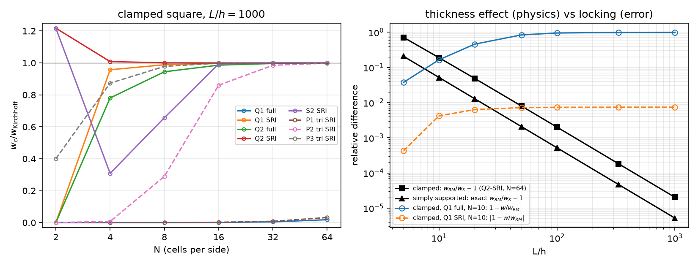

## Today

| Part | Topic | Time |
|---|---|:---:|
| | **Midterm exam** (Weeks 1–7, concepts + code reading, closed-AI) | 90 min |
| **A** | Reissner–Mindlin plates — kinematics, energy, the Kirchhoff limit | 15 min |
| **B** | Shear locking — counting constraints, reduced integration, quadrilaterals vs triangles | 20 min |
| **C** | References — Navier, the exact Reissner–Mindlin plate, thickness vs locking; the sources re-run | 15 min |
| **D** | LLM pitfalls · the project proposal | 10 min |

::: {.box}
Lab notebook: `W08_lab.ipynb` (start in class, finish at home) · **Project proposal:** `W08_project_proposal.ipynb` (due before Week 9) · no homework this week
:::

# Part A · Reissner–Mindlin plates {background-color="#1f3864"}

## From 3D to the mid-plane

Plate of thickness $h$ on $\Omega\subset\mathbb R^2$; the normal stays straight but **not** normal (first-order shear deformation):

$$
u_\alpha(x,y,z)=-z\,\theta_\alpha(x,y),\qquad u_z=w(x,y),\qquad \boldsymbol\chi=\operatorname{sym}\nabla\boldsymbol\theta,\qquad \boldsymbol\gamma=\nabla w-\boldsymbol\theta
$$

$$
\int_\Omega D\big[(1-\nu)\boldsymbol\chi(\boldsymbol\theta)+\nu\operatorname{tr}\boldsymbol\chi(\boldsymbol\theta)\mathbf I\big]:\boldsymbol\chi(\boldsymbol\psi)+F\,(\nabla w-\boldsymbol\theta)\cdot(\nabla v-\boldsymbol\psi)\,dA=\int_\Omega q\,v\,dA
$$

$D=\dfrac{Eh^3}{12(1-\nu^2)}$ (bending), $F=\kappa Gh$, $\kappa=5/6$ (shear). Mixed space $(w,\boldsymbol\theta)$ — the Week 7 Timoshenko beam, one dimension up.

## The Kirchhoff limit

$\dfrac{F}{D}\sim\dfrac{1}{h^2}$: as $h/L\to0$ the shear term becomes a **penalty** that enforces $\boldsymbol\theta=\nabla w$ — the Kirchhoff (Love–Kirchhoff) plate, a 4th-order problem
$D\Delta^2w=q$ that needs $C^1$ elements. Reissner–Mindlin keeps $C^0$ elements and adds shear deformation.

| | simply supported square | clamped square |
|---|---|---|
| Kirchhoff | Navier series, $w_c=0.00406235\,qa^4/D$ | $w_c=0.00126532\,qa^4/D$ (tabulated) |
| Reissner–Mindlin | **exact:** $w_{RM}=w_K+\mathcal M/F$ (hard support) | no closed form → converged FE |
| $w_{RM}/w_K-1$ at $L/h$ = 10, 100, 1000 | 5.2 %, 0.052 %, 0.0005 % | 18.9 %, 0.20 %, 0.002 % |

$\mathcal M=(M_{xx}+M_{yy})/(1+\nu)$ solves $-\Delta\mathcal M=q$, $\mathcal M=0$ on the edges (Marcus): a second Navier series. **Hard** support: $w=0$ and the tangential rotation $=0$;
**soft**: $w=0$ only (boundary layer).

# Part B · Shear locking {background-color="#1f3864"}

## Counting constraints

In the thin limit $\nabla w=\boldsymbol\theta$ is enforced at every quadrature point of the shear term — 2 constraints per point. If the discrete space cannot satisfy them all
with a nonzero deflection, it **locks**: the shear energy, multiplied by $F\propto h$ against $D\propto h^3$, freezes $w$.

| element (unknowns per cell: $3\times$ nodes per cell) | shear rule | constraints | ratio | clamped, $N=10$ / 50 |
|---|---|:---:|:---:|---|
| Q1 | full $2\times2$ | 8 | 0.38 | 0.00046 / 0.011 |
| Q1 | **one point** | 2 | 1.5 | 0.9926 / 0.9997 |
| Q2 (9 nodes) | full $3\times3$ | 18 | 0.67 | 0.9645 / 0.9987 |
| Q2 | $2\times2$ | 8 | 1.5 | 1.0002 / 1.00002 |
| S2 (8 nodes) | $2\times2$ | 8 | 1.1 | 0.877 / 1.00002 |

A heuristic (Hughes), not a theorem — but it predicts the table: ratio well above 1 → no locking.

## Reduced integration: quadrilaterals yes, triangles no

{width=92% fig-align="center"}

Left: clamped square, $L/h=1000$, centre deflection over Kirchhoff. P1 triangles with one shear point: ratio $1.5/2=0.75$ — **still locked** (0.008 at $N=32$). P2-SRI recovers slowly,
P3 works. Right: thickness effect (black, physics, $\propto(h/L)^2$) against locking (blue, error, $\to1$).

## DOLFINx 0.11

```python
c = msh.basix_cell()
V = fem.functionspace(msh, basix.ufl.mixed_element([basix.ufl.element("Q", c, deg), basix.ufl.element("Q", c, deg, shape=(2,))]))   # "S": serendipity
(w, th), (v, ps) = ufl.TrialFunctions(V), ufl.TestFunctions(V)
dxs = ufl.Measure("dx", domain=msh, metadata={"quadrature_degree": 2 * deg - 2})        # SRI: the shear term only
a = ufl.inner(M(th), chi(ps)) * ufl.dx + F * ufl.dot(ufl.grad(w) - th, ufl.grad(v) - ps) * dxs
```

- `quadrature_degree` 0 or 1 → one point on a quadrilateral; 2 → $2\times2$. Only the shear term is reduced; bending stays fully integrated.
- Serendipity DOFs are not all point values: `tabulate_dof_coordinates()` fails ("does not have pointwise evaluation"); evaluate the deflection at a point
  (`bb_tree` → `compute_colliding_cells` → `Function.eval`).
- `V.sub(i).collapse()` returns `(space, [map])` — the map is a **list** of arrays in 0.11.

# Part C · References and verification {background-color="#1f3864"}

## Which reference?

At $L/h=10$ the source compared both elements with **Kirchhoff**:

| clamped, $h=0.1$, Q1, $N=10$ | over $w_K$ | over $w_{RM}$ (Q2-SRI, $N=64$) |
|---|:---:|:---:|
| SRI | 1.184 ("too large") | **0.9958** |
| full integration | 0.993 ("looks right") | **0.835** — 17 % locked |

The thick plate **is** 18.9 % more flexible than Kirchhoff: that is physics. Against the thin limit the locked element looked right and the correct one wrong.
Compare with a reference of the **same model**; use a limit only where it applies.

## Convergence against the exact Reissner–Mindlin plate

Simply supported (hard), $h=0.01$, centre deflection against $w_K+\mathcal M/F$:

| $N$ | 4 | 8 | 16 | 32 | 64 | rate |
|---|:---:|:---:|:---:|:---:|:---:|:---:|
| Q1-SRI | $2.3\times10^{-2}$ | $5.1\times10^{-3}$ | $1.3\times10^{-3}$ | $3.1\times10^{-4}$ | $7.8\times10^{-5}$ | 2 |
| Q2-SRI | $1.7\times10^{-3}$ | $9.7\times10^{-5}$ | $6.0\times10^{-6}$ | $3.7\times10^{-7}$ | $2.3\times10^{-8}$ | 4 |

**Locking-free = uniform in $h$:** Q1-SRI, $N=20$: 0.999428, 0.999194, 0.999192 of $w_{RM}$ for $h$ = 0.1, 0.01, 0.001. A locking element has an error that grows as $h\to0$ at fixed $N$.

## The original sources, re-run on 0.11

- **plates_ch01:** the element table (Q1/S2/Q2, full/SRI, $N$ = 10, 50) reproduced to every digit, e.g. Q2-SRI 1.00021 / 1.00002, S2-SRI 0.87658 / 1.00002, Q1 full 0.00046 / 0.01116.
  Its `max(abs(w.x.array))` happens to be right for serendipity (the maximum sits on a vertex DOF) but is not a deflection in general.
- **intro_ch03:** SRI at $N=20$, $h=10^{-3}$: 0.9984 of Kirchhoff — reproduced; with the exact constant $1.265319\times10^{-3}$ instead of the source's $1.265\times10^{-3}$ it is 0.9982. Its thickness study
  ("Expected: SRI maintains accuracy for all $t$") compares thick plates with Kirchhoff — at $t=0.1$ the "accurate" 0.993 is the locked element (previous slides).
- The 0.10 → 0.11 port needs no API change for plates; `LinearProblem(..., petsc_options_prefix=...)` as in Week 1.

# Part D · LLM pitfalls · the proposal {background-color="#1f3864"}

## What goes wrong in plate codes

| Pitfall | Measured symptom (this week) |
|---|---|
| Equal-order P1/Q1 with the full rule | deflection 0.0005 of the true one at $L/h=1000$ |
| "Reduced integration" on triangles | P1-SRI 0.008 at $N=32$ — still locked |
| Thick plate checked against Kirchhoff | a 17 % locked element looks right, a correct one looks 18 % off |
| Only $w=0$ called "clamped" | a soft simply supported plate (≈ 4× the clamped deflection for a disk) |
| `max(abs(w.x.array))` with non-nodal DOFs | not a deflection (serendipity, hierarchical, DG) |
| `tabulate_dof_coordinates()` on serendipity | RuntimeError — use point evaluation |
| A straight-sided disk from Gmsh (`setOrder(1)`) | area and boundary error that refinement in $p$ cannot remove |

## The project proposal

Due before Week 9 (5 %): one of the **ten topics A–J** in `projects/index.html` — taken from current research fields of chemical and biomolecular engineering — or **your own
problem**, small enough to verify. At most three students per topic.

1. **Problem** — equations, BCs, parameters with units, dimensionless numbers, quantities of interest.
2. **Model and weak form** — spaces, reductions (2D, axisymmetric, plane strain, GPS), constitutive model and internal variables.
3. **Numerical plan** — elements and why (locking!), solvers, stepping, cost on Colab.
4. **Verification plan** — exact/manufactured solutions with predicted rates, benchmarks with sources, conservation, `-np 1` vs `-np 2`.
5. **Smoke test** — one `%%fenicsx -np 2` cell: DOFs and one checkable number. 6. **LLM plan, risks, timeline** (W15 progress talk, W16 report).

The worked example (reactor wall under pressure and heat, Lamé check to $5\times10^{-10}$) is in the notebook.

## Summary

| Concept | Key point | DOLFINx 0.11 |
|---|---|---|
| Reissner–Mindlin | $(w,\boldsymbol\theta)$, $C^0$, shear stiffness $F\propto h$, bending $D\propto h^3$ | `mixed_element([Q, Q vector])` |
| Locking | constraint ratio < 1 → frozen deflection | the full rule on the shear term |
| Cure | SRI on quadrilaterals (Q1: 1 point, Q2: $2\times2$); not on triangles (use P3) | `metadata={"quadrature_degree": 2*deg-2}` |
| References | thick: RM ($w_K+\mathcal M/F$ for hard SS); thin: Kirchhoff | `navier_ss(D, F)` |
| Verification | rates uniform in $h$; same model as the reference | point evaluation `Function.eval` |

**Next week:** shells and periodic homogenization (`dolfinx_mpc`) — and HW8.
