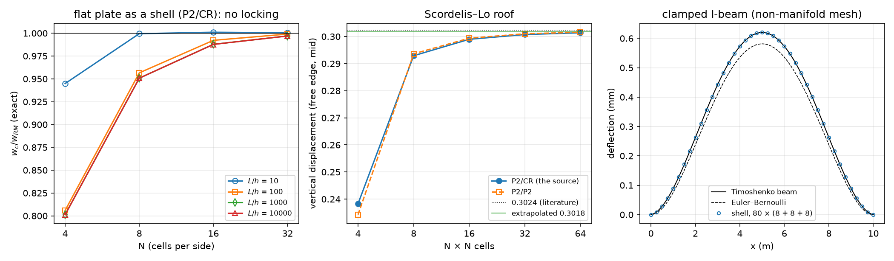
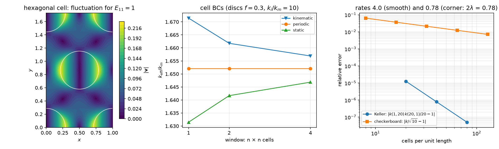

## Today

| Part | Topic | Time |
|---|---|:---:|
| | Quiz on Week 8 (closed-AI) | 10 min |
| **A** | Shells — a 2D mesh in 3D, the local frame, membrane + bending + shear, drilling | 35 min |
| **B** | Shell verification — plate, cylinder, Scordelis–Lo, an I-beam against beam theory; the source re-run | 25 min |
| **C** | Periodic homogenization — the cell problem, `dolfinx_mpc`, two silent traps, exact checks and bounds | 40 min |
| **D** | Cell boundary conditions and window size · LLM pitfalls · HW8 | 15 min |

::: {.box}
Lab notebook: `W09_lab.ipynb` (≈ 80 min) · Homework: `W09_HW8.ipynb` (due before Week 10) · **New package:** `dolfinx_mpc` 0.11 — the setup cell installs it (≈ 1 min)
:::

# Part A · Shells on surface meshes {background-color="#1f3864"}

## A 2D mesh in 3D

A shell is a surface with a thickness $t$. DOLFINx meshes it as **triangles with 3D coordinates** (topological dimension 2, geometric dimension 3) — no Gmsh needed:

```python
el = ufl.Mesh(basix.ufl.element("Lagrange", "triangle", 1, shape=(3,)))   # shape (3,): gdim = 3
msh = mesh.create_mesh(comm, cells, el, X)            # X: (n, 3) points, cells: (m, 3); rank 0 passes the arrays, the others empty arrays
```

- A cylinder, a roof, a plate tilted in space: map a structured parameter grid $(s,t)\mapsto(x,y,z)$; a closed tube merges the seam.
- **Non-manifold** surfaces work: in an I-beam the web edge *is* the flange center line — three cells meet at one edge (shared vertices).
- On such a mesh `ufl.grad(u)` is a $3\times3$ **tangential** gradient (derivatives along the surface only).
- Flat facets: a curved shell is approximated by flat triangles → a geometry error $O(h^2)$ (measured on the cylinder, Part B).

## The local frame

Per cell: $\mathbf e_3$ = unit normal from the cell Jacobian, $\mathbf e_1=\mathbf e_y\times\mathbf e_3$ (or $\mathbf e_z$ if $\mathbf e_3\parallel\mathbf e_y$), $\mathbf e_2=\mathbf e_3\times\mathbf e_1$.
$\mathbf P=[\mathbf e_1|\mathbf e_2]$ ($3\times2$) projects onto the tangent plane.

```python
t = ufl.Jacobian(msh)                                        # 3 x 2: the two edge vectors of the reference map
e3 = normalize(ufl.cross(ufl.as_vector([t[0, 0], t[1, 0], t[2, 0]]), ufl.as_vector([t[0, 1], t[1, 1], t[2, 1]])))
VT = fem.functionspace(msh, ("DG", 0, (3,)))                 # interpolate e1, e2, e3 into DG0: constant per cell
f = fem.Function(VT); f.interpolate(fem.Expression(e3, VT.element.interpolation_points))
P = ufl.as_matrix([[e1[i], e2[i]] for i in range(3)])
```

The frame jumps from cell to cell — fine: strains are measured in each cell's own frame, and the unknowns ($\mathbf u$, $\boldsymbol\theta$) are **Cartesian**, so they stay continuous.

## Membrane, bending, shear

With $\tilde\nabla(\cdot)=\nabla(\cdot)\,\mathbf P$ and the rotation of the normal $\boldsymbol\beta=\mathbf e_3\times\boldsymbol\theta$:

$$
\boldsymbol\varepsilon=\operatorname{sym}(\mathbf P^T\tilde\nabla\mathbf u),\qquad
\boldsymbol\kappa=\operatorname{sym}(\mathbf P^T\tilde\nabla\boldsymbol\beta),\qquad
\boldsymbol\gamma=\tilde\nabla(\mathbf u\cdot\mathbf e_3)-\mathbf P^T\boldsymbol\beta
$$

$$
\int_\Omega t\,\mathbb C_{ps}\boldsymbol\varepsilon:\hat{\boldsymbol\varepsilon}+\frac{t^3}{12}\mathbb C_{ps}\boldsymbol\kappa:\hat{\boldsymbol\kappa}+\mu t\,\boldsymbol\gamma\cdot\hat{\boldsymbol\gamma}
+\underbrace{\frac{Et^3}{h^2}\,d\,\hat d}_{\text{drilling}}\;dA=\int_\Omega\mathbf f\cdot\hat{\mathbf u}\,dA
$$

- Membrane ($\propto t$) + Week 8's Reissner–Mindlin plate ($t^3$, $t$) in every cell's tangent plane; $\mathbb C_{ps}$: plane stress. Shear factor 1 (the source; $5/6$ is also used).
- Space (the source): $\mathbf u\in P_2^3$, $\boldsymbol\theta\in CR_1^3$ (Crouzeix–Raviart: one value per edge midpoint, nonconforming).
- **Drilling:** $\theta_3=\boldsymbol\theta\cdot\mathbf e_3$ appears in no strain → singular matrix. Penalty on $d=\tfrac12\big((\mathbf P^T\tilde\nabla\mathbf u)_{12}-(\mathbf P^T\tilde\nabla\mathbf u)_{21}\big)+\theta_3$
  (in-plane rotation of the membrane = drilling rotation).

## Math → DOLFINx 0.11

| Math | Code |
|---|---|
| $\mathbf u\in P_2^3$, $\boldsymbol\theta\in CR_1^3$ | `mixed_element([element("Lagrange", c, 2, shape=(3,)), element("CR", c, 1, shape=(3,))])` |
| $\tilde\nabla\mathbf u$ | `ufl.dot(ufl.grad(u), P)` — `grad` is already tangential on a manifold mesh |
| $\boldsymbol\beta=\mathbf e_3\times\boldsymbol\theta$ | `ufl.cross(e3, th)` |
| cell size $h$ in the drilling stiffness | `ufl.CellDiameter(msh)` |
| clamped edge | `u = 0` and `theta = 0` on the edge facets (CR dofs sit on facets: `locate_dofs_topological` works) |
| point value | `bb_tree` → `compute_colliding_cells` → `Function.eval` (returns a flat array of 3 values in 0.11) |
| symmetry plane $x=0$ | $u_x=0$, $\theta_y=\theta_z=0$ — Cartesian components, because $\boldsymbol\theta$ is Cartesian |

::: {.callout-important}
## Check the solver
Without the drilling term MUMPS stops with KSP reason **−11** (factorization failed) — `LinearProblem.solve()` does **not** raise, the field is NaN. Read `problem.solver.getConvergedReason()`.
:::

# Part B · Shell verification {background-color="#1f3864"}

## A ladder of references

{width=100% fig-align="center"}

| Case | Reference | Result (this week, `-np 2`) |
|---|---|---|
| flat simply supported plate in 3D | exact Reissner–Mindlin $w_K+\mathcal M/F$ (Week 8, $F=\mu t$) | $N$ = 4, 8, 16, 32: 0.801, 0.951, 0.988, 0.997 at $L/h=10^3$ — **the same** at $10^4$ (no locking) |
| the same plate rotated in space | the unrotated plate | deflection and energy equal to $4\times10^{-11}$ |
| open tube, internal pressure | membrane: $u_r=pR^2/(Et)$, $u_z=-\nu pRz/(Et)$ | $u_r$: 0.98880, 0.99708, 0.99921 ($n_\theta$ = 16, 32, 64) — rate 2: flat facets |
| Scordelis–Lo roof | 0.3024 (literature) | 0.2383, 0.2929, 0.2990, 0.3007, 0.3014 ($N$ = 4…64) → extrapolated 0.3018 |
| clamped I-beam, $L/h_w=25$ | Timoshenko beam, $w=\frac{qL^4}{384EI}+\frac{qL^2}{8GA_s}$ | 1.00003, 1.0013, 1.0018 (refining) — a **model** difference, not an error |

## What the ladder tells you

- **Plate:** P2/CR rotations and P2 rotations give the same numbers (0.9878 at $N=16$, $L/h=10^3$) — on flat triangles neither locks; the error is uniform in $t$ (Week 8's test).
  The drilling factor (0.01 … 100) changes the flat plate by $10^{-11}$: there the drilling rotation is decoupled.
- **Cylinder:** facets approximate the circle → $O(h^2)$ geometry error that no element choice removes (Week 2: curved mapped cells).
- **Scordelis–Lo** (membrane + bending, free edges, rigid diaphragms $u_y=u_z=0$): converges from below; the drilling factor now matters a little
  (0.30125 / 0.30074 / 0.30068 for 0.1 / 1 / 10 at $N=32$) — curved shells couple the drilling rotation through the facet kinks.
- **I-beam:** the shell converges to 1.0018 × the beam value: shear lag, web–flange shear flow, local web bending — the beam theory is the approximation here.
  Euler–Bernoulli alone would be 6.2 % off (the shear term).

## The source re-run on 0.11

The source (curved I-beam, `I_beam.msh`, 1100 cells, $f=(0,0.2,-1)$, "both ends clamped") — the API ports unchanged; the numbers raise questions:

| | max $\vert u_y\vert$ (m) |
|---|:---:|
| the source's slides | 2.007694e-04 |
| the source's notebook output — reproduced on 0.11 to every digit | 2.535546e-04 |
| clamp only the end sections (22 facets), $\mathbf u=0$ | 2.754e-04 |
| end sections, $\mathbf u=0$ and $\boldsymbol\theta=0$ (clamped) | 2.449e-04 |

- The beam is an **arch** ($z$ from −0.22 to 1.59 m): $y$ is the lateral direction, so "max $\vert u_y\vert$ (vertical)" is the *lateral* response to the 0.2 load ($\max\vert u_z\vert=8.5\times10^{-5}$ m).
- "Clamp $x<x_{\min}+0.3$" catches 26 facets: the 22 of the end sections **plus 4 free flange edges**; and only $\mathbf u$ is fixed ("clamped" needs $\boldsymbol\theta$ too).
- Lesson: print **what** a boundary marker selected (count, midpoints), not only how many dofs.

# Part C · Periodic homogenization {background-color="#1f3864"}

## The cell problem

A periodic microstructure (fibers in a matrix, pores in an electrode, inclusions in a gel) with period $\ell\ll L$: at each macroscopic point the strain is $\mathbf E+\boldsymbol\varepsilon(\mathbf v)$,
with a **periodic** fluctuation $\mathbf v$ on the cell $Y$:

$$
\int_Y\mathbb C(\mathbf y)\big(\mathbf E+\boldsymbol\varepsilon(\mathbf v)\big):\boldsymbol\varepsilon(\mathbf w)\,dY=0\quad\forall\mathbf w\ \text{periodic},\qquad
\mathbb C^{\hom}\mathbf E=\langle\boldsymbol\sigma\rangle=\frac1{|Y|}\int_Y\mathbb C(\mathbf E+\boldsymbol\varepsilon(\mathbf v))\,dY
$$

- Three load cases $\mathbf E=(1,0,0),(0,1,0),(0,0,1)$ (Voigt, $2E_{12}$) → three columns of $\mathbb C^{\hom}$; conduction: $\mathbf G=\mathbf e_x,\mathbf e_y$ → $\mathbf K^{\hom}$.
- $\langle\boldsymbol\varepsilon(\mathbf v)\rangle=0$ for periodic $\mathbf v$ (divergence theorem, opposite normals cancel) — the mean strain **is** $\mathbf E$.
- $|Y|$ is the **cell** area — with voids, more than the meshed area.
- $\mathbb C^{\hom}$ is symmetric and positive definite; the symmetry of the microstructure decides isotropy (square array: cubic; hexagonal array: isotropic in the plane).

## `dolfinx_mpc`: periodicity as multipoint constraints

```python
import dolfinx_mpc
mpc = dolfinx_mpc.MultiPointConstraint(V)
on = lambda a, b: np.isclose(a, b, atol=1e-8)
mpc.create_periodic_constraint_geometrical(V, lambda x: on(x[0], Lx) & ~on(x[1], Ly), lambda x: np.array([x[0] - Lx, x[1], x[2]]), bcs)  # right <- left
mpc.create_periodic_constraint_geometrical(V, lambda x: on(x[1], Ly) & ~on(x[0], Lx), lambda x: np.array([x[0], x[1] - Ly, x[2]]), bcs)  # top <- bottom
mpc.create_periodic_constraint_geometrical(V, lambda x: on(x[0], Lx) & on(x[1], Ly), lambda x: np.array([x[0] - Lx, x[1] - Ly, x[2]]), bcs)  # corner
mpc.finalize()
v = dolfinx_mpc.LinearProblem(a, L, mpc, bcs=bcs, petsc_options=LU, petsc_options_prefix="cell_").solve()
```

- Slave dofs (right, top) = master dofs (left, bottom). Install: `micromamba install -n fenicsx -c conda-forge dolfinx_mpc=0.11` (2 packages, nothing else changes; the setup cell does it on Colab).
- A periodic mesh (matching nodes) from Gmsh: `gmsh.model.mesh.setPeriodic(1, right, left, affine)` — pair the pieces of the two sides **in order**.
- `bcs`: a Dirichlet pin for the rigid translation (the fluctuation is defined up to a constant).

## Two silent traps

Exact test: a laminate (layers normal to $y$, $f=0.3$, $E$ = 10 / 1, $\nu$ = 0.2 / 0.3) — $\mathbb C^{\hom}$ is known in closed form.

| constraint | max $\vert\mathbb C^{\hom}-\mathbb C^{\text{exact}}\vert/\max\vert\mathbb C\vert$ | $\vert C_{12}-C_{21}\vert$ |
|---|:---:|:---:|
| corner once, pin at an **interior** vertex | $5.9\times10^{-15}$ | $10^{-16}$ |
| pin the dof at $(0,0)$ — a **master** of the periodic constraint | $6.1\times10^{-3}$ | 0 |
| both sides whole: the corner constrained **twice** | $2.7\times10^{-3}$ | $1.7\times10^{-3}$ |

::: {.callout-important}
## Both traps are silent
No error, no warning. With the pin on a master dof `dolfinx_mpc` 0.11 returns a field whose pinned value is not zero (−0.038 in a conduction test).
Rule: constrain the corner once; pin the translation at an interior vertex. Test with the laminate first.
:::

## Exact checks and bounds

{width=100% fig-align="center"}

| Check | Result |
|---|---|
| laminate: $\mathbb C^{\hom}$ (elastic), arithmetic / harmonic mean (conduction) | $6\times10^{-15}$ / $4\times10^{-16}$ |
| **Keller** (any 2D two-phase geometry): $k(k_1,k_2)\,k(k_2,k_1)=k_1k_2$ | discs $f=0.4$, contrast 20: $1.3\times10^{-5}$, $8.0\times10^{-7}$, $5.1\times10^{-8}$ — rate 4 |
| **checkerboard:** $k=\sqrt{k_1k_2}$ (Dykhne) | contrast 10: $6.4\times10^{-2}$ … $7.2\times10^{-3}$ — rate **0.78** |
| hexagonal array, $f=0.3$: isotropy $(C_{11}-C_{12})/2C_{66}$ | 1.000000 (square array: 1.155 — cubic, not isotropic) |
| Hashin–Shtrikman (plane strain): $K=\frac{C_{11}+C_{12}}2\in[1.39813,1.94954]$, $G\in[0.59376,0.90944]$ | $K=1.39814$ (on the lower bound), $G=0.59595$ |

The checkerboard rate is set by the corner singularity $\phi\sim r^\lambda$, $\lambda=\frac4\pi\arctan(1/\sqrt{10})=0.390$: the energy converges as $h^{2\lambda}=h^{0.78}$ — refine at the corners.

## The source re-run on 0.11

Source cell: rectangle $1\times\frac{\sqrt3}2$ with **one** disc ($f=0.3$), non-periodic Gmsh mesh (350 cells), corner pinned, both sides whole.

| | $C_{11}$ | $C_{22}$ | $C_{12}$ / $C_{21}$ | $C_{16}$ |
|---|:---:|:---:|:---:|:---:|
| the source's output — reproduced on 0.11, `-np 1` | 2.0213 | 2.0761 | 0.7764 / 0.7450 | 0.0219 |
| the same script, `-np 2` | 2.0056 | 2.0645 | 0.7446 / 0.7421 | −0.0016 |
| corner once, interior pin (`-np 1` = `-np 2`) | 2.0079 | 2.0730 | 0.7480 / 0.7480 | $10^{-6}$ |

- The defect shows up as an **asymmetric** matrix and as a result that **depends on the number of ranks**.
- The rectangle with one disc is a *rectangular* array, not hexagonal: $C_{11}\ne C_{22}$ — the "isotropy check" could not pass.
- "$E^*$ = 1.730 vs Mori–Tanaka 1.608 (7.9 %)": $C_{11}-C_{12}^2/C_{11}$ is the plane-**strain** modulus, the Mori–Tanaka formula used the plane-**stress** bulk modulus $E/2(1-\nu)$ —
  the 7.9 % and $\nu^*$ 0.371 vs 0.256 compare different quantities, not FE against theory.

# Part D · Cell BCs and window size · LLM · HW8 {background-color="#1f3864"}

## Kinematic, periodic, static

| cell BC | fluctuation | gives |
|---|---|---|
| kinematic (affine) | $\mathbf v=0$ on $\partial Y$ | an upper bound (too stiff) |
| periodic | $\mathbf v$ periodic | the answer for a periodic medium — independent of how many cells you take |
| static (uniform traction / flux) | $\boldsymbol\sigma\mathbf n=\boldsymbol\Sigma\mathbf n$ | a lower bound (too soft) |

Discs $f=0.3$, $k_i/k_m=10$, windows of $n\times n$ cells: kinematic 1.6714 / 1.6618 / 1.6569, periodic **1.652044** (all $n$), static 1.6315 / 1.6417 / 1.6468 —
the gap halves with $n$. A single laminate cell with kinematic / static BCs is 13 % / 52 % off.

**Porous media** (insulating pores, $f=0.3$): $k=0.53758\,k_s$, below the Hashin–Shtrikman bound $(1-f)/(1+f)=0.53846$.

## What goes wrong in shell and homogenization codes

| Pitfall | Measured symptom (this week) |
|---|---|
| No drilling stabilization | KSP reason −11, NaN field, no exception |
| A box marker for "the ends" | free flange edges clamped too: 8 % less lateral deflection (curved I-beam) |
| "Clamped" with only $\mathbf u=0$ | a different support (here 12 % more lateral deflection) |
| `setPeriodic` with the pieces of two sides in the wrong order | Gmsh pairs the wrong edges (meshing error or a distorted mesh) |
| Bounding boxes compared with `1e-9` in Gmsh/OCC | OCC boxes are enlarged by ~$10^{-7}$: periodic sides not found, matrix removed |
| Straight-sided discs (`order=1`) | inclusion fraction 0.2999 instead of 0.3 — compare bounds at the *actual* fraction |
| Strongly graded (very thin) cells with `dolfinx_mpc` | "Newton method failed … non-affine geometry" on one rank, **the other rank waits forever** |
| An isotropy check on a cell that is not isotropic | square / rectangular arrays are not |

## HW8 (due before Week 10)

Theory (shell strains, drilling, the mean-strain theorem, Keller) · the pressurized tube and the facet error · clamping an I-beam: what a marker selects ·
the Scordelis–Lo roof with symmetry · the checkerboard singularity and graded meshes · cell BCs and window size · an LLM-generated homogenization script with defects.

The setup cell installs `dolfinx_mpc`; the whole HW runs in a few minutes on Colab.

## Summary

| Concept | Key point | DOLFINx 0.11 |
|---|---|---|
| Surface mesh | triangles with 3D points; non-manifold allowed | `create_mesh(..., element(..., shape=(3,)), X)` |
| Shell kinematics | membrane + bending + shear in the cell's tangent frame; drilling penalty | `ufl.Jacobian`, DG0 frame, `CR` rotations |
| Shell checks | plate (exact RM), rotation invariance, tube, Scordelis–Lo, beam | `Function.eval`, KSP reason |
| Cell problem | periodic fluctuation; $\mathbb C^{\hom}=\langle\boldsymbol\sigma\rangle$ over $\vert Y\vert$ | `dolfinx_mpc.MultiPointConstraint`, `LinearProblem(a, L, mpc, ...)` |
| Traps | corner once, interior pin; symmetric, rank-independent | `-np 1` vs `-np 2` |
| References | laminate (exact), Keller, Dykhne, HS bounds, window bounds | |

**Next week:** cohesive interfaces (intrinsic cohesive zones, submeshes) — and HW9.
