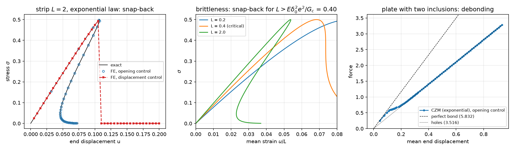
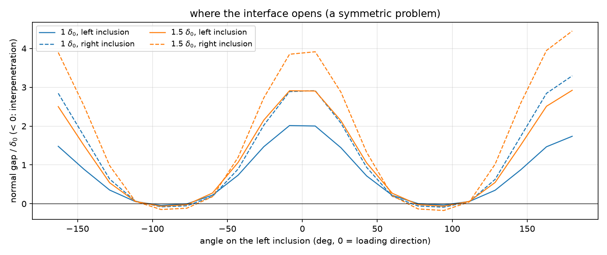
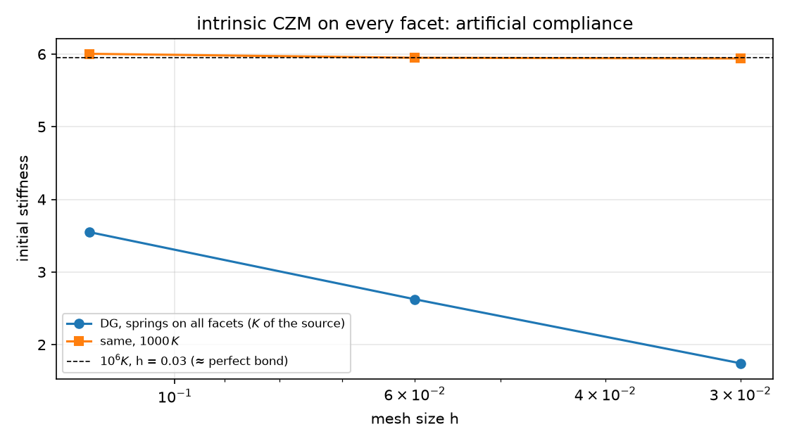

## Today

| Part | Topic | Time |
|---|---|:---:|
| | Quiz on Week 9 (closed-AI) | 10 min |
| **A** | Cohesive zones — traction–separation laws, $G_c$, $\sigma_c$, the bar with one interface, snap-back | 30 min |
| **B** | Interfaces between subdomains in DOLFINx 0.11 — submeshes, entity maps, the '+' side, ghost cells | 35 min |
| **C** | Path following — load, displacement and opening control; the plate with two inclusions | 35 min |
| **D** | Cohesive springs on every facet (the source) · LLM pitfalls · HW9 | 20 min |

::: {.box}
Lab notebook: `W10_lab.ipynb` (≈ 80 min) · Homework: `W10_HW9.ipynb` (due before Week 11) · Interfaces in chemical engineering: particle–binder debonding in battery electrodes, coating delamination, fibre–matrix interfaces in membranes and composites
:::

# Part A · Cohesive zones {background-color="#1f3864"}

## Traction–separation

A crack or an interface is a surface across which the displacement may jump, $[\![\mathbf u]\!]=\mathbf u_2-\mathbf u_1$. A **cohesive law** $\mathbf T([\![\mathbf u]\!])$ transmits a traction that first
rises, reaches the strength $\sigma_c$, and then softens to zero; the energy to open it completely is the fracture energy $G_c=\int_0^\infty T\,d\delta$.

$$
\sum_i\int_{\Omega_i}\boldsymbol\sigma(\mathbf u_i):\boldsymbol\varepsilon(\mathbf v_i)\,dx+\int_\Gamma\mathbf T([\![\mathbf u]\!])\cdot[\![\mathbf v]\!]\,dS=\int_{\partial\Omega_N}\mathbf t\cdot\mathbf v\,ds
$$

| law | $T(\delta)$ | peak | initial stiffness |
|---|---|---|---|
| exponential (the source) | $\dfrac{G_c}{\delta_0^2}\,\delta\,e^{-\delta/\delta_0}$, $\delta_0=\dfrac{G_c}{e\,\sigma_c}$ | $\sigma_c$ at $\delta=\delta_0$ | $G_c/\delta_0^2$ — fixed by $G_c$, $\sigma_c$ |
| bilinear | $K_0\delta$ up to $\sigma_c/K_0$, then linear to 0 at $\delta_c=2G_c/\sigma_c$ | $\sigma_c$ | $K_0$ — a penalty you choose |
| linear spring | $K\delta$ | — | $K$ (an imperfect, elastic interface) |

**Intrinsic** laws are present from the start (the interface adds a compliance $1/K_0$); **extrinsic** ones are inserted when the stress reaches $\sigma_c$. Here: intrinsic, vector form
$\mathbf T=\frac{T(\delta)}{\delta}[\![\mathbf u]\!]$, $\delta=|[\![\mathbf u]\!]|$ (the source's choice — it softens in compression as well, see Part C).

## The bar with one interface — exact

Bar (or strip in plane stress) of length $L$, one interface, end displacement $u$: uniform stress $\sigma=T(\delta)$ and

$$
u(\delta)=\frac{L}{E}\,T(\delta)+\delta,\qquad \frac{du}{d\delta}=\frac{L}{E}\,T'(\delta)+1 .
$$

After the peak $T'<0$: if $\frac LE\min T'<-1$ the end displacement **decreases** while the crack opens — **snap-back**. For the exponential law $\min T'=-G_ce^{-2}/\delta_0^2$:

$$
\text{snap-back}\iff L>L_c=\frac{E\,\delta_0^2\,e^2}{G_c}\qquad(\text{here } E=10,\ G_c=0.01,\ \sigma_c=0.5:\ L_c=0.40).
$$

The elastic energy stored in a long bar exceeds what the interface can dissipate: the bar releases it faster than the interface opens. **Brittleness** is a property of the *structure* ($L$), not of the law alone.

::: {.callout-important}
## What can control the test?
Load control stops at the peak. Displacement control cannot follow a snap-back. A quantity that grows monotonically — the **crack opening** — can.
:::

# Part B · Interfaces between subdomains {background-color="#1f3864"}

## One space per subdomain, coupled on $\Gamma$

The interface only, not every facet: each subdomain gets its own continuous space on a **submesh**; the interface integral couples them.

```python
subs = [mesh.create_submesh(msh, 2, ct.find(i)) for i in (1, 2)]          # (submesh, EntityMap, vertex map, geometry map)
V = [fem.functionspace(s[0], ("Lagrange", deg, (2,))) for s in subs]; em = [s[1] for s in subs]
dx = ufl.Measure("dx", domain=msh, subdomain_data=ct)                     # every integral on the PARENT mesh
dS = ufl.Measure("dS", domain=msh, subdomain_data=[(1, data)])(1)        # data = [cell_1, local facet, cell_2, local facet, ...]
jmp = u[1]("-") - u[0]("+")                                                # '+' = side 1, '-' = side 2 — by construction of data
F = [inner(sig(u[0]), eps(w[0])) * dx(1) - dot(T(jmp), w[0]("+")) * dS,
     inner(sig(u[1]), eps(w[1])) * dx(2) + dot(T(jmp), w[1]("-")) * dS]
problem = NonlinearProblem(F, u, bcs=bcs, entity_maps=em, kind="mpi", petsc_options_prefix="bm_", petsc_options=...)
```

- All forms live on the parent mesh; `entity_maps` tells the assembler where the submesh functions live. Blocked residual and Jacobian, one SNES (`kind="mpi"`).
- Check: a strip with a linear spring $K$, $u_{\rm end}=\sigma L/E+\sigma/K$ — reproduced to $10^{-15}$ (`-np 1` and `-np 2`).

## Trap 1: which cell is '+'?

With plain meshtags (`subdomain_data=mesh.meshtags(msh, 1, facets, 1)`) DOLFINx orders the two cells of an interior facet **as it likes** — then `u1("+")` is sometimes evaluated in a cell of subdomain 2.

| plate with two inclusions, $K=G_c/\delta_0^2$, P2 | `-np 1` | `-np 2` |
|---|:---:|:---:|
| explicit '+' = matrix | 5.48394 | 5.48394 |
| meshtags | 3.77287 (SNES −5) | 4.62581 (SNES −5) |

| linear spring strip (structured mesh) | `-np 1` | `-np 2` |
|---|:---:|:---:|
| meshtags | 0.022 (= exact, by luck) | 0.05295 (Colab: 0.02308), SNES −5 |

The ordering depends on the mesh **and on the partition**. A linear solve (the source) gives a wrong number without complaint; SNES at least fails to converge.
Build the integration data yourself: for each interface facet, the cell of subdomain 1 first.

## Traps 2 and 3: ghost cells and garbage collection

**Ghost cells.** Interior-facet integrals need both cells of a facet on the owning rank. Built-in meshes are created with `GhostMode.shared_facet`; **Gmsh meshes are not**:

```python
md = gmsh_io.model_to_mesh(gmsh.model, comm, 0, gdim=2,
                           partitioner=mesh.create_cell_partitioner(mesh.GhostMode.shared_facet, 2))
```

Without it, the DG model of Part D at `-np 2` returned a stiffness of $8\times10^{-14}$: the facets on the partition boundary were skipped and the plate fell into two loose pieces.

**Garbage collection.** A `NonlinearProblem` replaced in a loop is freed by Python's cyclic collector at a *different* moment on each rank; its destructor destroys PETSc objects collectively.
One rank waits in the destroy, the other in the next assembly — the program hangs (about half of the `-np 2` runs in a test). The module switches automatic collection off and collects
explicitly in every constructor (`gc.disable()`, `gc.collect()`), i.e. at the same point on all ranks.

## Math → DOLFINx 0.11

| Math | Code |
|---|---|
| $\Omega_1,\Omega_2$ with their own spaces | `mesh.create_submesh(msh, tdim, ct.find(i))` → `EntityMap`; `functionspace(submesh, ...)` |
| $\int_{\Omega_i}\dots$ | `dx(i)` on the parent mesh + `entity_maps=[em1, em2]` |
| $\int_\Gamma\dots$, side 1 = '+' | `ufl.Measure("dS", domain=msh, subdomain_data=[(1, data)])` with data built from `f2c`, `c2f` |
| $[\![\mathbf u]\!]=\mathbf u_2-\mathbf u_1$ | `u[1]("-") - u[0]("+")` |
| normal gap | `dot(jmp, n("+"))`, `n = ufl.FacetNormal(msh)` (outward of side 1) |
| blocked Newton | `NonlinearProblem([F1, F2], [u1, u2], entity_maps=em, kind="mpi")` |
| a functional of both fields | `fem.form(expr * dS, entity_maps=em)`; vectors: `fem.petsc.assemble_vector([g1, g2], kind="mpi")` |

# Part C · Path following {background-color="#1f3864"}

## Opening control: one more equation

Load $\lambda$ (traction on the right edge) becomes an unknown; the mean normal opening $g(\mathbf u)=\frac1{|\Gamma|}\int_\Gamma[\![\mathbf u]\!]\cdot\mathbf n_1$ is prescribed:

$$
\mathbf R(\mathbf u)-\lambda\mathbf f=\mathbf 0,\qquad g(\mathbf u)=\hat\delta
\quad\Rightarrow\quad
\mathbf K\mathbf a=-\mathbf R,\ \ \mathbf K\mathbf b=\mathbf f,\ \ \Delta\lambda=\frac{\hat\delta-g(\mathbf u)-\mathbf g\cdot\mathbf a}{\mathbf g\cdot\mathbf b},\ \ \Delta\mathbf u=\mathbf a+\Delta\lambda\,\mathbf b .
$$

Two solves with one factorisation per Newton step — Week 3's global unknown by static condensation again. $g$ is linear in $\mathbf u$: its vector $\mathbf g$ is assembled once.
The residual and Jacobian come from the `NonlinearProblem` (`solver.computeFunction`, `solver.computeJacobian`).

**Never stop exactly at the peak:** there the interface stiffness $T'$ is zero, one half of the strip is a free rigid body, $\mathbf K$ is singular — the next step started from it diverged. A step grid that
misses $\delta_0$ by a little works.

## The strip: exact through the snap-back

{width=100% fig-align="center"}

- Left: opening control reproduces the exact curve to $4\times10^{-16}$ at every step (≤ 3 Newton iterations); the end displacement falls from 0.1076 to 0.0460 after the peak.
- Displacement control: $u=0.105$, $\sigma=0.494$; next step $u=0.110$: SNES reports **"converged"** (13 iterations) — at $\sigma=6.5\times10^{-6}$, the fully separated state. It jumped over the
  snap-back and said nothing. (The source stopped at "conv = −6" instead — same physics, a different symptom.)
- Middle: the snap-back appears for $L>L_c=0.40$. Right: the plate with two inclusions.

## The plate with two inclusions

The source's plate (matrix $E=10$, inclusions $E=70$, $G_c=0.01$, $\sigma_c=0.5$ on the interface only), left $u_x=0$, bottom $u_y=0$, traction on the right; P2, $h=0.06$.

| check | value |
|---|---|
| perfect bond (one CG mesh) / interface spring $K\to\infty$ ($10^6$) | 5.8322 / 5.8321 |
| interface $K=G_c/\delta_0^2=185$ (the law's initial stiffness) | 5.484 (−6 %: the interface compliance) |
| plate with holes / slope after full debonding | 3.51607 / 3.51607 |
| displacement control | runs through (99 steps, ≤ 24 Newton iterations): no snap-back here |

Both ends of the curve are checked by an independent model: the start by the perfectly bonded plate, the end by the plate with holes.

## The plate: where the interface opens

{width=85% fig-align="center"}

- The interface opens first in the loading direction ($\theta=0°, 180°$); at $\pm90°$ the matrix contracts onto the inclusion — **interpenetration** ($-0.1\,\delta_0$), because the isotropic law has no contact.
- The problem is symmetric, the solution is not: the right inclusion debonds first. When an inclusion has lost all stiffness it is a free body — a singular matrix (a few steps stop at 30 iterations: 3 of 98 here, more on Colab), and
  its rigid motion is arbitrary (gaps of $70\,\delta_0$). Force and displacement stay right; the gap field does not. A debonded inclusion needs **contact**.

# Part D · Springs on every facet · LLM · HW9 {background-color="#1f3864"}

## The source's intrinsic model: compliance grows with refinement

Source chapter 1: DG everywhere, the exponential law on **every** interior facet (stronger in the bulk, $K_{\rm bulk}=295$, weaker on the interface), Nitsche for the supports.
Linearised initial stiffness (left clamped as in the source, reference 5.95; plotted on the next slide):

| $h$ | 0.12 | 0.06 | 0.03 | 0.015 |
|---|:---:|:---:|:---:|:---:|
| source code on 0.11 | 3.545 | 2.635 | 1.748 | 1.036 |
| this week's DG model | 3.550 | 2.625 | 1.744 | — |
| same, $1000\,K$ | 6.004 | 5.949 | 5.940 | — |

Each facet is a spring in series with a cell: the added compliance $\propto1/(Kh)$ — doubles with every halving of $h$ (0.114, 0.211, 0.404, 0.797). An intrinsic law on all facets needs
$K\,h/E\gg1$; with the source's $K$ it is 1.8. The source's "elastic stiffness 2.6 N/mm ✅" is a mesh-dependent artefact; chapter 2's "4.18 N/mm, stiffer because CG matches nodes" is the '+' trap
(reproduced on 0.11: 4.43 with the slightly different Gmsh mesh), with a different left support than chapter 1 (5.95 vs 5.87 for perfect bond).

## Artificial compliance

{width=80% fig-align="center"}

The stiffness falls with every refinement and never converges; with $1000\,K$ ($Kh/E\gg1$) the same model converges to perfect bond.

## The sources re-run on 0.11

- **interfaces_ch01:** runs unchanged (`PETSc.SNES` driven directly). 1426 cells instead of 1434 (Gmsh), peak 0.522 at $u=0.213$ (source 0.534 at 0.22), stops at step 45 with
  conv = −6 — the plot ends at the peak: the post-peak response is not computed, "snap-back ✅" is an interpretation of a failed solve.
- It assigns the interface properties to the **cells** next to the interface and averages them on facets: the bulk facets of those cells get mixed properties.
- **interfaces_ch02:** runs unchanged; serial only (`PETSc.Vec().createSeq`, hand-made block vector); the '+' ordering of the interface facets is not controlled; a linear spring is called
  "linearized CZM" — there is no softening at all.

## What goes wrong in interface codes

| Pitfall | Measured symptom (this week) |
|---|---|
| Interface facets from meshtags: '+' not controlled | stiffness 3.77 / 4.63 instead of 5.48; depends on the rank count |
| Gmsh mesh without `shared_facet` ghosts | interior-facet terms on partition boundaries skipped: stiffness $10^{-13}$ at `-np 2` |
| Problems re-created in a loop under MPI | random hangs in PETSc destructors (garbage collection) |
| A step that lands exactly on the peak | singular tangent, the next Newton step diverges |
| Displacement control through a snap-back | "converged" — on the other branch |
| An isotropic law with no contact | interpenetration, floating debonded inclusions |
| Cohesive springs on all facets, small $K$ | stiffness that falls with mesh refinement |

## HW9 (due before Week 11)

Theory (the laws, snap-back, artificial compliance) · the bilinear law and its exact strip · brittleness and the strip length · springs on every facet: compliance against $h$ and $K$ ·
counting the '+' sides · where and when the inclusions debond · an LLM-generated interface script with defects. The whole HW runs in a few minutes on Colab.

## Summary

| Concept | Key point | DOLFINx 0.11 |
|---|---|---|
| Cohesive law | $\sigma_c$, $G_c=\int T\,d\delta$, initial stiffness | `ufl.exp`, `ufl.conditional` on $\vert[\![\mathbf u]\!]\vert$ |
| Snap-back | $L>E\delta_0^2e^2/G_c$ (exponential law) | exact bar: $u=TL/E+\delta$ |
| Interface only | one space per submesh, coupled on $\Gamma$ | `create_submesh`, `entity_maps`, `NonlinearProblem([...], kind="mpi")` |
| Traps | '+' side, ghost cells, garbage collection | explicit facet data, `GhostMode.shared_facet`, `gc.collect()` |
| Path following | opening control: bordered Newton, two solves | `computeFunction`, `computeJacobian`, `assemble_vector(kind="mpi")` |
| Springs everywhere | compliance $\propto1/(Kh)$ | DG + Nitsche: only with $Kh/E\gg1$ |

**Next week:** natural convection (Boussinesq, de Vahl Davis) — and HW10.
