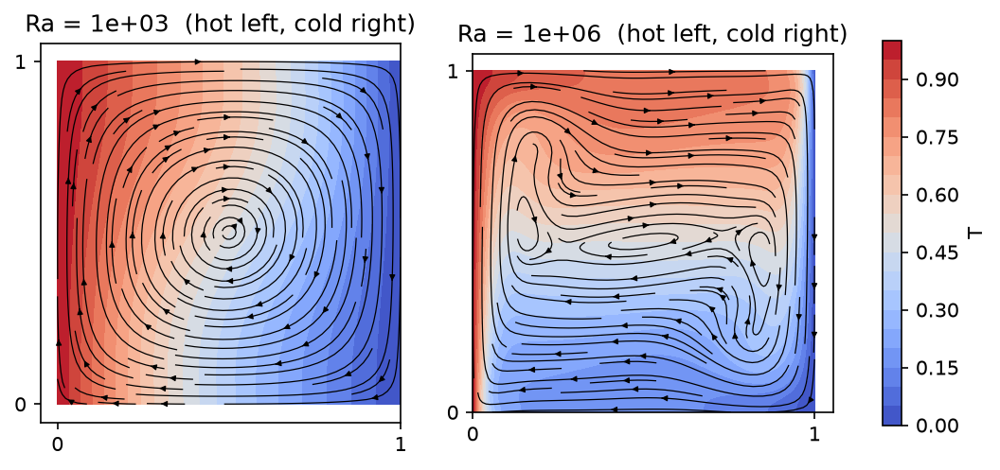
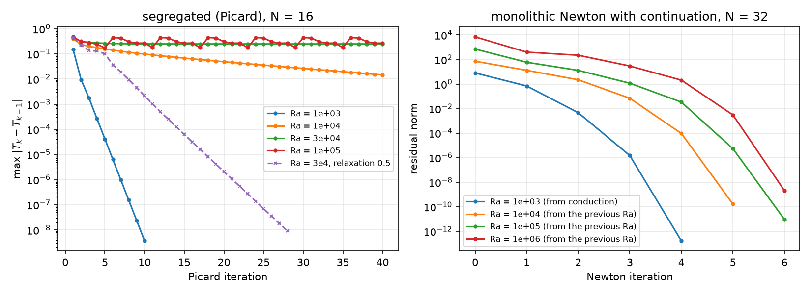
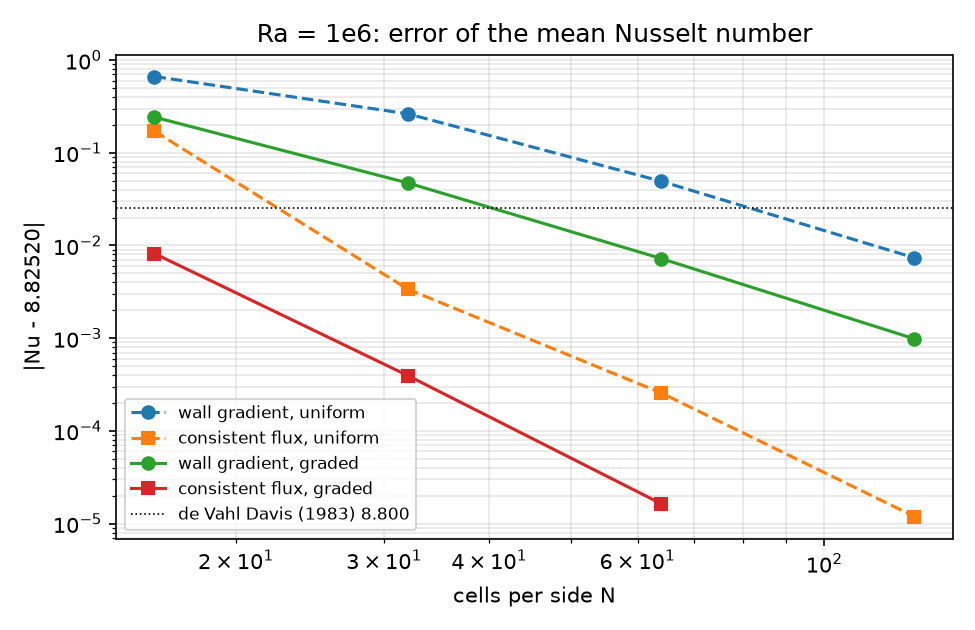
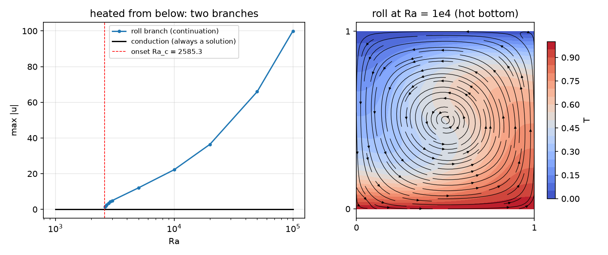

## Today

| Part | Topic | Time |
|---|---|:---:|
| | Quiz on Week 10 (closed-AI) | 10 min |
| **A** | Boussinesq flow — scalings, $Ra$, $Pr$, the benchmark, boundary layers | 25 min |
| **B** | One mixed space for $(\mathbf u,p,T)$ — Newton, continuation, Picard | 35 min |
| **C** | Verification — MMS, the Nusselt number two ways, the benchmark's accuracy | 35 min |
| **D** | Heated from below: two branches, the onset · LLM pitfalls · HW10 | 25 min |

::: {.box}
Lab: `W11_lab.ipynb` (≈ 80 min) · Homework: `W11_HW10.ipynb` (due before Week 12) · Applications: cooling of reactors and tanks, crystal-growth melts, electrochemical cells, buoyant packed beds
(AMPS I topic C: a segregated Brinkman–Boussinesq model — this week the monolithic alternative)
:::

# Part A · Boussinesq flow {background-color="#1f3864"}

## The model

Density varies only through temperature, and only where it multiplies gravity ($\beta\Delta T\ll1$):

$$
\rho_0(\mathbf u\cdot\nabla)\mathbf u=-\nabla p+\mu\Delta\mathbf u+\rho_0 g\beta(T-T_0)\,\mathbf e_y,\qquad\nabla\cdot\mathbf u=0,\qquad\mathbf u\cdot\nabla T=\kappa\Delta T .
$$

Two-way coupling: buoyancy drives the flow, the flow carries the heat. Two parameters after scaling ($L$, $\Delta T$):

$$
Ra=\frac{g\beta\Delta T L^3}{\nu\kappa}\ \ \text{(buoyancy vs. diffusion)},\qquad Pr=\frac{\nu}{\kappa}\ \ \text{(0.71 for air)}.
$$

**The de Vahl Davis cavity:** unit square, $T=1$ on the left wall, $T=0$ on the right, top and bottom adiabatic, no slip everywhere; steady, $Ra=10^3\dots10^6$, $Pr=0.71$.

## Two scalings — the same physics, different numbers

| velocity scale $U$ | momentum | energy | velocity values |
|---|---|---|---|
| $\kappa/L$ (thermal) | $(\mathbf u\cdot\nabla)\mathbf u=-\nabla p+Pr\,\Delta\mathbf u+Pr\,Ra\,T\mathbf e_y$ | $\mathbf u\cdot\nabla T=\Delta T$ | $\mathbf u_\kappa$ — **the benchmark's unit** |
| $\nu/L$ (viscous) | $(\mathbf u\cdot\nabla)\mathbf u=-\nabla p+\Delta\mathbf u+\frac{Ra}{Pr}T\mathbf e_y$ | $\mathbf u\cdot\nabla T=\frac1{Pr}\Delta T$ | $\mathbf u_\nu=\mathbf u_\kappa/Pr$ |

The Nusselt number $Nu=\frac{1}{H}\int_\text{hot}-\partial_xT\,ds$ (mean wall heat flux / conductive flux) does not depend on $U$; velocities do. This week: $\kappa/L$, as the benchmark.

## Scales of the solution

{width=58% fig-align="center"}

- $Ra=10^3$: nearly conduction ($Nu=1.118$), one slow roll. $Ra=10^6$: thin thermal boundary layers on the vertical walls, a stratified core, $Nu=8.83$.
- Boundary-layer scale $\delta_T\sim L\,Ra^{-1/4}$: 0.18 at $10^3$, **0.032** at $10^6$. A uniform $32\times32$ mesh has one cell in it — the mesh is set by $\delta_T$, not by $L$ (lab §2). Graded meshes:
  $s\mapsto s-g\sin(2\pi s)/(2\pi)$, wall spacing $(1-g)h$.

# Part B · One mixed space {background-color="#1f3864"}

## Weak form and element

Find $(\mathbf u,p,T)\in\mathbf V_h\times Q_h\times S_h$ (P2/P1 Taylor–Hood + P2) with $\mathbf u=0$, $T=T_D$ on the walls, $p(0,0)=0$:

$$
\int_\Omega\big[(\nabla\mathbf u\,\mathbf u)\cdot\mathbf v+Pr\,\nabla\mathbf u:\nabla\mathbf v-p\,\nabla\cdot\mathbf v-q\,\nabla\cdot\mathbf u-Pr\,Ra\,T\,v_y+(\mathbf u\cdot\nabla T)\,s+\nabla T\cdot\nabla s\big]\,dx=0 .
$$

- Inf-sup stable pair for $(\mathbf u,p)$ (AMPS I Week 11); $T$ in P2 like $\mathbf u$, because $\mathbf u\cdot\nabla T$ and the buoyancy couple them at the same resolution.
- Pressure: no-slip on all walls → $p$ only up to a constant; pin one point (or give the null space).
- The adiabatic walls need nothing: $\partial_nT=0$ is natural.
- Newton's Jacobian has all nine blocks; the off-diagonal ones are the coupling: $-Pr\,Ra\,\delta T\,v_y$ and $(\delta\mathbf u\cdot\nabla T)\,s$.

## Math → DOLFINx 0.11

| Math | Code |
|---|---|
| $\mathbf V_h\times Q_h\times S_h$ | `basix.ufl.mixed_element([element("Lagrange", c, 2, shape=(2,)), element("Lagrange", c, 1), element("Lagrange", c, 2)])` |
| $(\mathbf u,p,T)$, tests | `u, p, T = ufl.split(w)`; `v, q, s = ufl.TestFunctions(W)` |
| $(\nabla\mathbf u\,\mathbf u)\cdot\mathbf v$ | `ufl.inner(ufl.grad(u) * u, v)` |
| boundary data on one field | `V, _ = W.sub(0).collapse()`; `dirichletbc(f, locate_dofs_topological((W.sub(0), V), 1, facets), W.sub(0))` |
| $p(0,0)=0$ | `locate_dofs_geometrical((W.sub(1), Q), lambda x: isclose(x[0], 0) & isclose(x[1], 0))` |
| Newton | `NonlinearProblem(F, w, bcs=bcs, petsc_options_prefix=..., petsc_options={"snes_type": "newtonls", ...})` |
| $Ra$ as a parameter | `Ra = fem.Constant(msh, 1e3)`; `Ra.value = 1e4` — no re-compilation |
| residual history | `solver.setConvergenceHistory()`, `solver.getConvergenceHistory()` |

## Continuation in $Ra$

Newton converges only from inside its basin. At high $Ra$ the conduction state is far from a solution with thin layers. Direct starts against continuation (graded $N=32$; SNES reason, iterations):

| start | line search | $Ra=10^4$ | $10^5$ | $10^6$ |
|---|---|:---:|:---:|:---:|
| conduction | none | ✓ 7 | **−9** (diverged) | **−9** |
| $\mathbf w=0$ | none | ✓ 7 | ✓ 11 | **−9** |
| conduction | `bt` | ✓ 6 | ✓ 23 | **−6** or **−5**, $Nu=4.135$ |
| $\mathbf w=0$ | `bt` | ✓ 7 | ✓ 10 | ✓ 13 |
| **continuation** $10^3\to10^4\to10^5\to10^6$ | none | ✓ 5 | ✓ 6 | ✓ 6 |

Which direct start works is luck — and a failed solve with a line search leaves a plausible state ($Nu=4.135$ instead of 8.825). Continuation: every start inside the basin, the whole $Ra$ dependence for free. **Check the reason after every solve.**

## Picard against Newton

{width=100% fig-align="center"}

## Picard against Newton: why

- Picard (segregated): flow with the last $T$, then $T$ with that flow. Contraction factor 0.155 at $Ra=10^3$, 0.9 at $10^4$, stalls at $3\times10^4$, oscillates at $10^5$ ($N=16$).
- It drops the coupling blocks of the Jacobian, whose size grows with $Ra$. Relaxation ($\omega=0.5$) rescues $3\times10^4$ (28 iterations, each a nonlinear flow solve).
- Newton with continuation: 4–6 iterations per decade, quadratic at the end.

# Part C · Verification {background-color="#1f3864"}

## A manufactured solution for the coupled system

$\mathbf u=5\,\mathrm{curl}(\sin^2\pi x\sin^2\pi y)$, $p=\cos\pi x\sin\pi y$, $T=1-x+0.2\sin\pi x\cos\pi y$; sources from UFL (`div(grad(.))` of the exact fields), Dirichlet data everywhere, $Ra=10^3$.

| $N$ | $\Vert e_\mathbf u\Vert$ | $\vert e_\mathbf u\vert_1$ | $\Vert e_p\Vert$ | $\Vert e_T\Vert$ | $\vert e_T\vert_1$ |
|:---:|:---:|:---:|:---:|:---:|:---:|
| 8 | 5.3e-2 | 3.1 | 0.33 | 2.0e-4 | 6.8e-3 |
| 64 | 1.0e-4 | 5.0e-2 | 1.4e-4 | 2.2e-7 | 1.1e-4 |
| order (last) | 3.00 | 2.00 | 3.42 → 2 | 3.09 | 2.00 |

The coupling costs no order; Newton solves the discrete problem in 5 iterations. Pressure and $T$ are pre-asymptotic (faster than guaranteed) on coarse meshes — HW10 Q2.

## The Nusselt number two ways

**Wall gradient:** $Nu=\frac1H\int_\text{hot}-\partial_xT_h\,ds$ — a derivative of $T_h$, where the layer is steepest.

**Consistent flux:** test the weak energy equation with $z_h$ = 1 at the hot-wall nodes, 0 elsewhere: $Nu=\frac1H\int_\Omega(\mathbf u_h\cdot\nabla T_h\,z_h+\nabla T_h\cdot\nabla z_h)\,dx$ (equal for the exact solution — HW10 Q1).

The flux is a functional of the discrete solution evaluated through the weak form — no pointwise derivative on the boundary. `nusselt()` and `nusselt_flux()` in the module.

## The Nusselt number: convergence

{width=78% fig-align="center"}

## The Nusselt number: what the figure says

At $Ra=10^6$:

| $N$ | gradient, uniform | gradient, graded | flux, uniform | flux, graded |
|:---:|:---:|:---:|:---:|:---:|
| 16 | 9.490 | 9.068 | 8.654 | 8.817 |
| 32 | 9.088 | 8.872 | 8.8218 | **8.8248** |
| 64 | 8.875 | 8.832 | 8.8249 | 8.82518 |
| 128 | 8.833 | 8.826 | 8.82519 | 8.82520 |

- The way the quantity is computed matters more than the mesh: the flux on a $32\times32$ mesh is better than the gradient on $128\times128$.
- $Nu_\text{hot}=Nu_\text{cold}$ to all digits in **every** column, right or wrong: the cavity and this mesh are centro-symmetric ($x\to1-x$, $y\to1-y$, $T\to1-T$, $\mathbf u\to-\mathbf u$). Not a test.

## The benchmark and its accuracy

| $Ra$ | $Nu$ (1983) | $Nu$, $N=128$ | $u_{\max}$ at $y$ (1983) | $u_{\max}$ at $y$, $N=128$ | $v_{\max}$ at $x$ (1983) | $v_{\max}$ at $x$, $N=128$ |
|---|---|---|---|---|---|---|
| $10^3$ | 1.118 | 1.11779 | 3.649, 0.813 | 3.6494, 0.813 | 3.697, 0.178 | 3.697, 0.178 |
| $10^4$ | 2.243 | 2.24482 | 16.178, 0.823 | 16.183, 0.823 | 19.617, 0.119 | 19.628, 0.119 |
| $10^5$ | 4.519 | 4.52164 | 34.73, 0.855 | 34.741, 0.855 | 68.59, 0.066 | 68.64, 0.066 |
| $10^6$ | 8.800 | **8.82520** | 64.63, 0.850 | 64.834, 0.850 | 219.36, 0.0379 | 220.6, 0.038 |

The 1983 values are extrapolated from coarse finite-difference meshes; at $10^6$ they are 0.3 % ($Nu$) and 0.6 % ($v_{\max}$) low. A converged sequence beats a reference with an unknown error — and a
"within 1 % of the benchmark" test cannot tell a $10^{-5}$ result from a 0.7 % one (HW10 Q3). Velocity maxima are taken **along the lines** $x=0.5$, $y=0.5$, with their positions.

# Part D · Heated from below · LLM · HW10 {background-color="#1f3864"}

## Rayleigh–Bénard: conduction is always a solution

$T=1$ at the bottom, $T=0$ at the top, adiabatic sides. $\mathbf u=0$, $T=1-y$ solves the equations for **every** $Ra$ — stable below $Ra_c$, unstable above.

- Newton from any start with $\mathbf u=0$ (conduction or zero) returns it in **one** iteration, "converged", $Nu=1.000000$ — tested at $Ra=2000$ to $10^4$. At $\mathbf u=0$ the residual is affine in $(p,T)$: the first Newton step lands exactly on the conduction state.
- A temperature perturbation alone does the same. To reach the convecting branch: start from a roll (velocity **and** temperature) near onset, then continue.

## Two branches

{width=100% fig-align="center"}

Left: the roll branch from continuation (down to onset, up to $10^5$, $Nu=3.92$ there); the conduction branch exists at every $Ra$. Right: the roll at $Ra=10^4$ ($Nu=2.159$).

## The onset of convection

On the roll branch near onset, $\max|\mathbf u|^2$ is linear in $Ra$ (a pitchfork):

| mesh | fit | $Ra_c$ |
|---|---|---|
| $16\times16$ | $\max\vert\mathbf u\vert^2=0.0574\,(Ra-2585.97)$ | 2585.97 |
| $32\times32$ | $\max\vert\mathbf u\vert^2=0.0576\,(Ra-2585.30)$ | 2585.30 |

- A direct solve at $Ra_c$ cannot work: the Jacobian has a zero eigenvalue there and the conduction state is still a solution. Approach along the branch and extrapolate (or solve the linear eigenvalue problem).
- The roll has a mirror image (the other sense of rotation) with the same $Nu$. A large continuation step can land on it — "converged", with only the many iterations as a hint (HW10 Q6).

## What goes wrong in coupled-flow codes

| Pitfall | Measured symptom (this week) |
|---|---|
| A segregated iteration at high $Ra$ | contraction 0.155 → 0.9 → stall; oscillation at $10^5$ |
| A start with $\mathbf u=0$ when convection is unstable | Newton "converges" to conduction in one iteration, $Nu=1$ |
| A large continuation step on a symmetric problem | the mirror solution, unnoticed ($Nu$ identical) |
| $Nu_\text{hot}=Nu_\text{cold}$ as a check | holds by symmetry for any solution |
| Too few cells in $\delta_T\sim Ra^{-1/4}$ | uniform $N=16$: gradient $Nu$ 9.49 instead of 8.825 |
| Maxima from the largest nodal value in the box | not the benchmark quantity (lines $x=0.5$, $y=0.5$) |
| Equal-order P1/P1 for $(\mathbf u,p)$ | violates inf-sup (AMPS I Week 11) |

## HW10 (due before Week 12)

Theory (scalings, the consistent flux, the symmetry) · a manufactured solution and its rates · the Nusselt number on four mesh families with Richardson extrapolation · $Nu(Ra)$ and the boundary-layer law ·
Picard's contraction and relaxation · heated from below: two branches and the onset · an LLM-generated benchmark script with defects. The whole HW runs in a few minutes on Colab.

## Summary

| Concept | Key point | DOLFINx 0.11 |
|---|---|---|
| Boussinesq | $Ra$, $Pr$; the velocity unit is part of the benchmark | `fem.Constant` for $Ra$, $Pr$ |
| One mixed space | Taylor–Hood + P2 $T$, pressure pinned | `basix.ufl.mixed_element`, `W.sub(i).collapse()` |
| Newton + continuation | 4–6 iterations per decade; check every reason | `NonlinearProblem`, `getConvergedReason()` |
| Picard | contraction grows with the coupling ($Ra$) | two problems, relaxation |
| Nusselt number | consistent flux $\gg$ wall gradient | `assemble_scalar` of the weak form with $z_h$ |
| Benchmark | converged sequence vs. a reference with its own error | Richardson, positions of the maxima |
| Bifurcation | conduction always a solution; onset from $\max\vert\mathbf u\vert^2$ | perturbed start, continuation along the branch |

**Next week:** reactive flow — a tubular reactor with Navier–Stokes velocity and advection–diffusion–reaction (SUPG) — and HW11.
