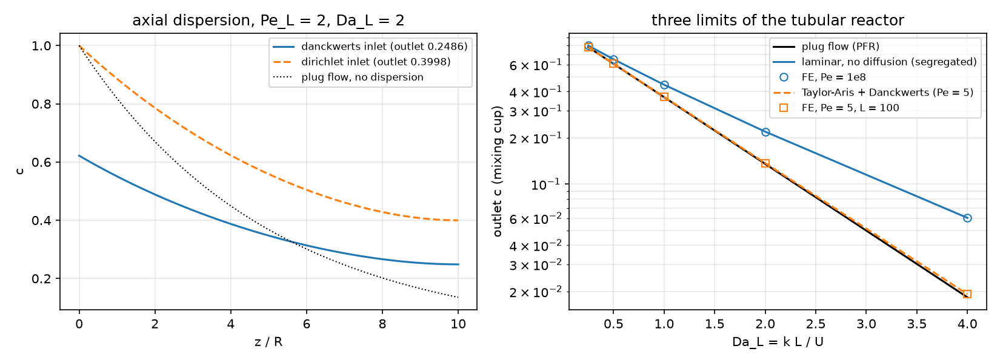
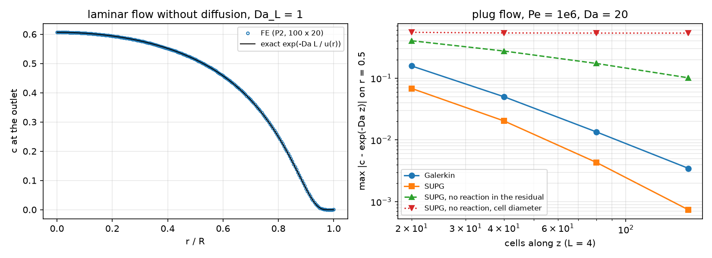
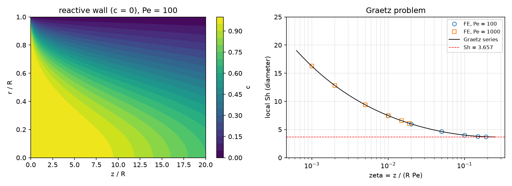
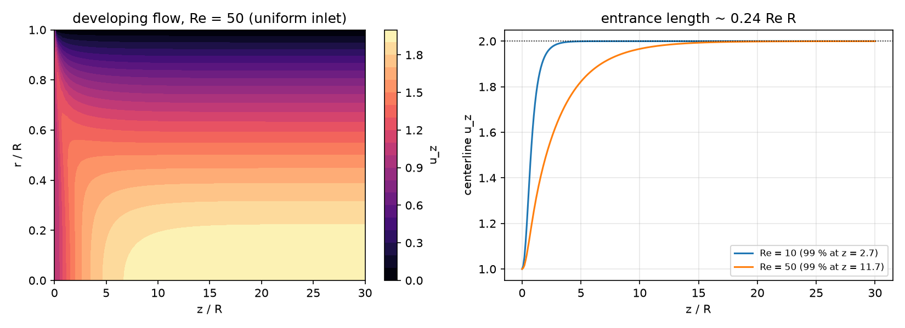

## Today

| Part | Topic | Time |
|---|---|:---:|
| | Quiz on Week 11 (closed-AI) | 10 min |
| **A** | The tubular reactor — $Pe$, $Da$, $Re$; three exact limits; the mixing cup | 25 min |
| **B** | Axisymmetric weak form, the Danckwerts inlet, SUPG with a consistent residual | 30 min |
| **C** | Verification against the limits — dispersion, segregated flow, SUPG, Graetz | 35 min |
| **D** | Navier–Stokes in the tube (one-way coupling) · LLM pitfalls · HW11 | 25 min |

::: {.box}
Lab: `W12_lab.ipynb` (≈ 80 min) · Homework: `W12_HW11.ipynb` (due before Week 13) · Applications: tubular and microchannel reactors, catalytic monoliths (reactive wall), chromatography and
dispersion in pipes (AMPS I Week 13: SUPG on a slab — this week the tube, with reaction and a real velocity field)
:::

# Part A · The tubular reactor {background-color="#1f3864"}

## The model

Axisymmetric tube of radius $R$ and length $L$; lengths in units of $R$, velocities in units of the mean $U$:

$$
\mathbf u\cdot\nabla c=\frac1{Pe}\Big(\partial_{zz}c+\partial_{rr}c+\frac1r\partial_rc\Big)-Da\,c^n,\qquad Pe=\frac{UR}{D},\quad Da=\frac{k\,R\,c_0^{n-1}}{U}.
$$

- Velocity: plug ($u_z=1$), Poiseuille ($u_z=2(1-r^2)$), or steady Navier–Stokes from a uniform inlet ($Re=UR/\nu$) — **one-way coupling**: the flow does not feel $c$.
- Inlet $z=0$: feed $c_0=1$. Outlet $z=L$: no diffusive flux. Wall $r=1$: inert ($\partial_rc=0$) or instantaneous wall reaction ($c=0$). Axis $r=0$: nothing to impose.
- Reactor-scale groups: $Pe_L=Pe\,L$, $Da_L=Da\,L$ (the plug-flow outlet is $e^{-Da_L}$ for first order).

## Three exact limits

| limit | model | outlet (first order) |
|---|---|---|
| plug flow + axial dispersion | $u=1$, $D$ axial only, Danckwerts inlet | $\dfrac{4a\,e^{Pe_L(1-a)/2}}{(1+a)^2-(1-a)^2e^{-aPe_L}}$, $a=\sqrt{1+4Da_L/Pe_L}$ |
| laminar, no diffusion (segregated) | each streamline a PFR, time $L/u(r)$ | $\displaystyle\int_0^1u\,e^{-Da_L/u}\,2r\,dr$ |
| laminar, radial diffusion, long tube | Taylor–Aris: $D_\text{eff}=D(1+Pe^2/48)$ | the dispersion formula with $Pe_\text{eff}$ |
| reactive wall, no axial diffusion | Graetz | $\sum_km_ke^{-w_k\zeta}$, $\zeta=z/(R\,Pe)$, $w_1=Sh_\infty=3.657$ |

$Da_L=1$: plug flow 0.3679, segregated laminar 0.4432 — a spread of residence times always costs conversion for a first-order reaction ($e^{-x}$ is convex).

## The mixing cup

What leaves the reactor is the **flux**: $\displaystyle c_\text{mix}=\frac{\int u_z\,c\,r\,dr}{\int u_z\,r\,dr}$ — the concentration of the collected outflow, the one that closes the species balance
$\int_\text{in}u_zc_0\,r\,dr-\int_\text{out}u_zc\,r\,dr=\int Da\,c^n\,r\,dV$.

- Laminar flow, $Da_L=1$: mixing cup **0.4432**, area mean **0.3266** — the slow fluid near the wall is almost fully converted but carries little flow.
- Conversion, yield, selectivity: always from the mixing cup.

# Part B · The finite element model {background-color="#1f3864"}

## Axisymmetric weak form

$dV=2\pi r\,dr\,dz$: every integral of the 3D weak form becomes an integral over the half-plane $(z,r)$ **with the weight $r$**:

$$
\int_\Omega\Big(\mathbf u\cdot\nabla c\,w+\frac1{Pe}\nabla c\cdot\nabla w+Da\,c^n\,w\Big)\,r\,dr\,dz+\int_\text{inlet}u_z\,(c-1)\,w\,r\,dr=0 .
$$

- The $\frac1r\partial_rc$ of the Laplacian is produced by the weight — it does not appear in the weak form.
- Axis $r=0$: the boundary term carries $r=0$ — no condition, none must be imposed.
- Outlet: $\partial_zc=0$ is natural. Inert wall: natural. Reactive wall: Dirichlet $c=0$.
- $n=2$: nonlinear — Newton, 4–11 iterations from $c=1$.

## The Danckwerts inlet

Flux balance across $z=0$: upstream only advection, $Uc_0$; inside advection **and** dispersion: $u_zc-\frac1{Pe}\partial_zc=u_zc_0$.

- In the weak form a Robin term $\int_\text{inlet}u_z(c-1)\,w\,r\,dr$ — no Dirichlet condition.
- The concentration just inside is **below** the feed (0.62 at $Pe_L=2$): back-mixing.
- $c=1$ at the inlet instead adds a diffusive inflow that is not there.

## Dispersion profiles and the three limits

{width=100% fig-align="center"}

Left: the two inlet conditions at $Pe_L=2$, $Da_L=2$. Right: FE (symbols) on the exact limits — segregated laminar flow ($Pe=10^8$) and Taylor–Aris ($Pe=5$, $L=100$), between them plug flow.

## SUPG with a consistent residual

$$
\sum_K\int_K\tau\,R(c_h)\,(\mathbf u\cdot\nabla w)\,r\,dx,\qquad R(c)=\mathbf u\cdot\nabla c-\frac1{Pe}\Big(\Delta c+\frac1r\partial_rc\Big)+Da\,c^n,
$$

$\tau=\frac{h_u}{2p|\mathbf u|}\big(\coth Pe_h-\frac1{Pe_h}\big)$, $Pe_h=\frac{|\mathbf u|h_uPe}{2p}$ ($p$ = degree).

- **Consistent:** the exact solution makes $R=0$. Every term of the strong equation belongs in $R$ — the reaction, the axisymmetric $\frac1r\partial_rc$, the second derivatives of P2.
- $h_u$ = the cell length **along $\mathbf u$**, $|\mathbf u|/|J^{-1}\mathbf u|$ — on stretched cells the diameter is the diagonal, set by the short side across the flow.

## Math → DOLFINx 0.11

| Math | Code |
|---|---|
| $(z,r)$, weight $r$ | `z, r = ufl.SpatialCoordinate(msh)`; `... * r * ufl.dx` in every form |
| Danckwerts inlet | `F += u[0] * (c - 1.0) * w * r * ds(inlet)` |
| reactive wall | `dirichletbc(zero, locate_dofs_topological(S, 1, wall))` |
| $\Delta_\text{axi}c$ for SUPG | `ufl.div(ufl.grad(c)) + c.dx(1) / r` |
| $h_u$ | `Ku = ufl.JacobianInverse(msh) * u`; `h = un / ufl.sqrt(ufl.dot(Ku, Ku))` |
| mixing cup | `assemble_scalar(form(u[0] * c * r * ds(out))) / assemble_scalar(form(u[0] * r * ds(out)))` |
| axisymmetric Stokes/NS | `+ u[1] * v[1] / r**2` in the viscous term, `div = u[0].dx(0) + u[1].dx(1) + u[1] / r`, $u_r=0$ on the axis |
| one-way coupling | the NS velocity `w.sub(0).collapse()` passed to the species form on the same mesh |

# Part C · Verification {background-color="#1f3864"}

## Dispersion and the inlet condition

Plug flow, $Da_L=2$, P2, 100 × 4 cells:

| $Pe_L$ | Danckwerts FE | exact | Dirichlet FE | exact (Dirichlet) | plug flow |
|:---:|:---:|:---:|:---:|:---:|:---:|
| 2 | 0.24855163 | 0.24855163 | 0.39975057 | 0.39975057 | 0.13534 |
| 20 | 0.15894023 | 0.15894023 | 0.17350042 | 0.17350042 | |
| 200 | 0.13800210 | 0.13800210 | 0.13936859 | 0.13936859 | |

- Agreement to 8 digits — the formulation, not the mesh, decides here.
- The wrong inlet condition: +61 % at $Pe_L=2$, +9 % at 20, +1 % at 200 — for large $Pe_L$ the excess is $\approx Da_L/Pe_L$, the extra diffusive inflow that $c=1$ forces in.

## Laminar flow: the field and the integral

{width=100% fig-align="center"}

## Laminar flow and SUPG: what the figure says

- Left ($Pe=10^8$, $Da_L=1$): outlet profile on $e^{-Da_L/u(r)}$; mixing cup 0.443209 (exact 0.443207). The field has $c_{\min}=-0.135$ at the inlet/wall corner, where $c$ jumps from 1 to 0 **across** streamlines:
  SUPG acts along streamlines and cannot remove it; the mixing cup weights it with $u\approx0$.
- Right (plug flow, $Pe=10^6$, $Da=20$): Galerkin 0.158 → 0.0035, SUPG 0.068 → 0.00074 (2–5× better).
- **SUPG without the reaction in $R$**: 0.40 → 0.10, first order — inconsistent. With $\tau$ from the cell diameter (2 cells across): **0.54 on every mesh**.
- At high conversion it hides: outlet 0.00065 instead of 0.000336 (+94 %) — still "within 0.1 % of the inlet concentration" (HW11 Q3).

## The Graetz problem

{width=100% fig-align="center"}

$Pe=1000$: FE and series agree to $2\times10^{-5}$ in $c_\text{mix}$ and to the 4th digit in $Sh$. $Pe=100$: up to $4\times10^{-4}$ near the inlet — **axial** diffusion, which the series neglects; $Pe=10$: +14 % (HW11 Q4).

## Taylor–Aris: radial diffusion in laminar flow

$Da_L=1$, Poiseuille, inert wall:

| $Pe$, $L$ | FE | Taylor–Aris + Danckwerts | segregated | plug |
|---|:---:|:---:|:---:|:---:|
| 5, 100 | 0.368991 | 0.368990 | 0.443207 | 0.367879 |
| 20, 400 | 0.368307 | 0.368307 | | |
| 100, 400 | 0.369768 | 0.369780 | | |

- Radial diffusion moves each molecule across all streamlines: the laminar reactor behaves like plug flow with a small dispersion, not like the segregated limit.
- Valid for $L/R\gg Pe$ (radial diffusion time $\ll$ residence time). The least dispersion at $Pe=\sqrt{48}$.

# Part D · Navier–Stokes · LLM · HW11 {background-color="#1f3864"}

## Developing flow in the tube

{width=100% fig-align="center"}

Uniform inlet, no slip, do-nothing outlet, Taylor–Hood with the axisymmetric terms. Outlet $=2(1-r^2)$ to $10^{-13}$ ($Re=10$), $dp/dz=-8/Re$ to 5 digits; the centerline reaches 99 % at $z=2.7$ and 11.7 ($\approx0.24\,Re$).

## One-way coupling: does the entrance matter?

$Pe=100$, $Da=0.05$, $L=30$, outlet $c_\text{mix}$:

| velocity | $Re=10$ | $Re=50$ |
|---|:---:|:---:|
| Navier–Stokes (developing) | 0.248715 | 0.247270 |
| Poiseuille everywhere | 0.249334 | 0.249334 |
| plug flow | 0.223297 | 0.223297 |

- The flatter entrance profile converts slightly more: −0.25 % / −0.8 %, growing with $L_e/L\propto Re$. Here Poiseuille is a fine assumption; in short reactors at high $Re$ it is not.
- Two-way coupling needs a feedback: heat of reaction with $\mu(T)$, buoyancy (Week 11), a change of moles.

## What goes wrong in reactor codes

| Pitfall | Measured symptom (this week) |
|---|---|
| SUPG residual without the reaction | first-order error, 0.40 → 0.10 on refinement |
| $\tau$ from the cell diameter on stretched cells | the error does not shrink at all (0.54) |
| Judging an integral and missing the field | mixing cup exact, $c_{\min}=-0.135$ at the inlet corner |
| An absolute tolerance at high conversion | a +94 % error in the unconverted fraction passes |
| The Graetz series at low $Pe$ | +14 % from axial diffusion ($Pe=10$) |

## HW11 (due before Week 13)

Theory (the axisymmetric weak form, Danckwerts, the mixing cup, consistency) · second-order kinetics with Newton · SUPG variants and the outlet · Graetz with axial diffusion · Navier–Stokes in the tube and
one-way coupling · Taylor–Aris dispersion · an LLM-generated reactor script with defects. The whole HW runs in a few minutes on Colab.

## Summary

| Concept | Key point | DOLFINx 0.11 |
|---|---|---|
| Axisymmetry | weight $r$ in every integral, nothing on the axis | `* r * ufl.dx`, `* r * ds` |
| Inlet | Danckwerts: a Robin term | `u[0] * (c - 1) * w * r * ds(in)` |
| Outlet quantity | mixing cup, not the area mean | flux-weighted `assemble_scalar` |
| SUPG | full residual, streamline length | `div(grad(c)) + c.dx(1) / r`, `JacobianInverse` |
| Verification | dispersion model, segregated flow, Taylor–Aris, Graetz | `danckwerts`, `segregated`, `taylor_aris`, `graetz` |
| Coupling | NS velocity into the species equation | same mesh, `w.sub(0).collapse()` |

**Next week:** porous media (Brinkman, Darcy–Stokes) and conjugate heat transfer on submeshes — and HW12.
