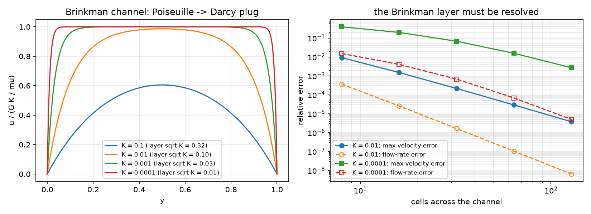
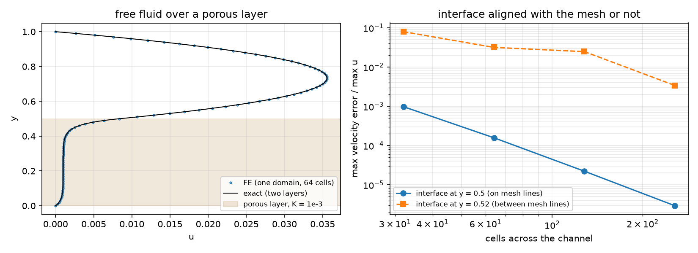
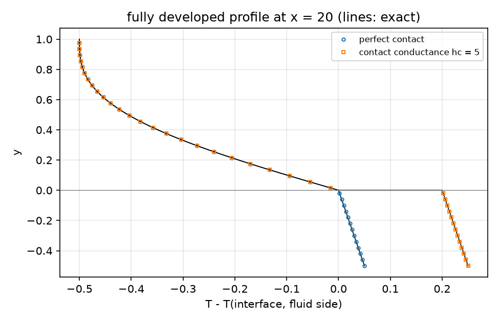
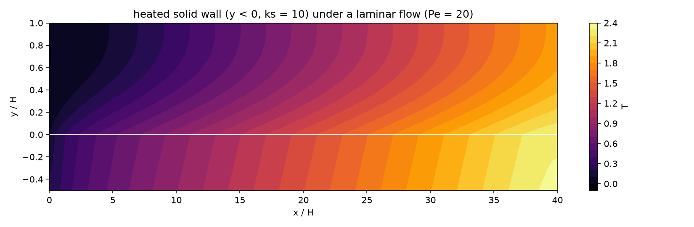
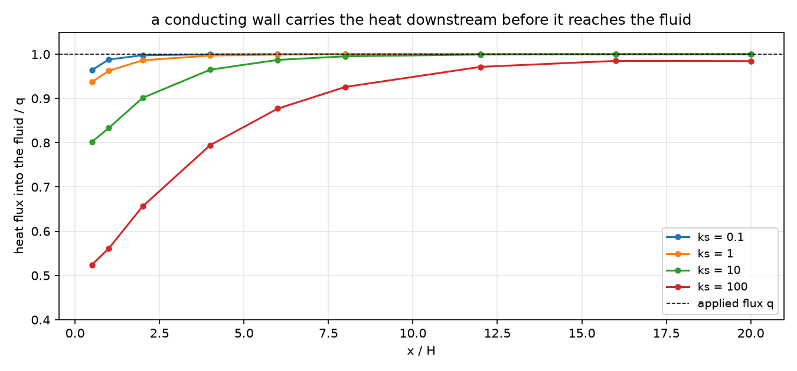

## Today

| Part | Topic | Time |
|---|---|:---:|
| | Quiz on Week 12 (closed-AI) | 10 min |
| **A** | Flow in porous media — Darcy, Brinkman, Forchheimer; the Brinkman layer; free fluid over a porous bed | 30 min |
| **B** | One domain in DOLFINx — $1/K$ per cell, resolving the layer, aligning the interface, Ergun | 25 min |
| **C** | Conjugate heat transfer — flow on a submesh, heat everywhere; developed solution, energy balance, contact resistance | 40 min |
| **D** | LLM pitfalls · HW12 | 15 min |

::: {.box}
Lab: `W13_lab.ipynb` (≈ 80 min) · Homework: `W13_HW12.ipynb` (due before Week 14) · Applications: packed and fixed beds, filters and membranes over a free stream, catalyst layers, heat exchangers and
cooled reactor walls (AMPS I Week 12: Darcy as a mixed problem; Week 10 here: integrals on an interface between submeshes)
:::

# Part A · Flow in porous media {background-color="#1f3864"}

## Three models of a porous medium

Superficial velocity $\mathbf u$, permeability $K$:

| model | equation | when |
|---|---|---|
| Darcy | $\frac{\mu}{K}\mathbf u+\nabla p=\mathbf f$ | slow flow, far from walls and free fluid |
| Brinkman | $-\mu_e\Delta\mathbf u+\frac{\mu}{K}\mathbf u+\nabla p=\mathbf f$ | near walls and interfaces (no-slip, shear) |
| Brinkman–Forchheimer | $\dots+\beta\,|\mathbf u|\,\mathbf u$ | $Re_p=\rho Ud_p/\mu\gtrsim1$ (Ergun's inertial term) |

All with $\nabla\cdot\mathbf u=0$. Brinkman adds a viscous term — and with it a **layer** of thickness $\lambda=\sqrt{\mu_eK/\mu}$ at every wall and interface. Ergun for a packed bed:
$\frac1K=\frac{150(1-\varepsilon)^2}{\varepsilon^3d_p^2}$, $\beta=\frac{1.75\rho(1-\varepsilon)}{\varepsilon^3d_p}$.

## The Brinkman channel and its layer

$0<y<1$, no slip, pressure gradient $G$, $\mu_e=\mu=1$:

$$
u=GK\Big(1-\frac{\cosh\frac{y-1/2}{\sqrt K}}{\cosh\frac1{2\sqrt K}}\Big),\qquad Q=GK\Big(1-2\sqrt K\tanh\frac1{2\sqrt K}\Big).
$$

- $K\to\infty$: Poiseuille ($Q=G/12$). $K\to0$: Darcy plug $u=GK$ with layers of width $\sqrt K$ at the walls.
- $K=10^{-4}$: the layers are 0.01 thick and carry only 2 % of the flow ($Q/Q_\text{Darcy}=0.98$).

## Free fluid over a porous bed

Porous layer $0<y<a$, free fluid $a<y<1$. **One domain:** a single Brinkman equation with $1/K=0$ in the fluid.

- Integrating by parts on each side: the weak form imposes **continuity of $u$** (the space) **and of the shear stress** $\mu_e\partial_yu$ (natural) at $y=a$ — nothing to write.
- Beavers–Joseph describe the same interface by a slip $\partial_yu=\frac{\alpha}{\sqrt K}(u_i-u_D)$. The Brinkman layer below the interface acts exactly as such a slip with $\alpha=\sqrt{\mu_e/\mu}$ — measured: $\alpha=0.998$ for $K=10^{-3}$, $10^{-4}$ (HW12 Q3).
- Exact two-layer solution: $\cosh/\sinh$ in the bed, a parabola above, four constants from no-slip and the two interface conditions (written with $e^{-y/\lambda}$, $e^{(y-a)/\lambda}$ — $\cosh(a/\lambda)$ overflows for thin layers).

# Part B · One domain in DOLFINx {background-color="#1f3864"}

## Weak form and code

$$
\int_\Omega\Big(\mu_e\nabla\mathbf u:\nabla\mathbf v+\frac{\mu}{K}\mathbf u\cdot\mathbf v+\beta|\mathbf u|\,\mathbf u\cdot\mathbf v-p\,\nabla\cdot\mathbf v-q\,\nabla\cdot\mathbf u-\mathbf f\cdot\mathbf v\Big)\,dx=0 ,
$$

Taylor–Hood, $1/K$ a **DG0** field set per cell; Newton for the Forchheimer term (2–6 iterations).

| Math | DOLFINx 0.11 |
|---|---|
| $1/K$ per cell | `Q = functionspace(msh, ("DG", 0)); invK.x.array[ct.find(2)] = 1 / K` |
| $\vert\mathbf u\vert\mathbf u$ | `ufl.sqrt(ufl.dot(u, u) + 1e-20) * ufl.dot(u, v)` |
| do-nothing ends, body force | no pressure condition needed (the ends fix $p$) |
| wall shear | interpolate `u[0].dx(1)` into DG1 (`fem.Expression`) |

## The Brinkman layer must be resolved

{width=100% fig-align="center"}

## What the figure says

| cells across | 8 | 16 | 32 | 64 | 128 |
|---|:---:|:---:|:---:|:---:|:---:|
| $K=10^{-4}$: max velocity error | 0.39 | 0.20 | 0.068 | 0.016 | 0.0027 |
| $K=10^{-4}$: flow-rate error | 0.015 | 0.0040 | 0.00067 | 0.000068 | 0.000005 |

- The flow rate is right to 1.5 % on 8 cells while the velocity in the layer is off by 39 %: an integral hides the layer (a functional, Week 11).
- The wall shear (the drag) is worse still: −11.5 % on 64 uniform cells. A mesh graded toward the walls (first cell $\le\sqrt K$) gives 0.4 % on 32 cells (HW12 Q2).

## The interface on mesh lines — or not

{width=100% fig-align="center"}

## The interface: what the figure says

- Aligned ($a=0.5$): order 2.6–2.9, $10^{-3}\to3\times10^{-6}$.
- Between mesh lines ($a=0.52$): $1/K$ per cell moves the interface to a mesh line — 0.531, 0.516, 0.523, 0.520 for 32…256 cells. Error 8 %, 3.2 %, 2.5 %, 0.34 %: first order on average, erratic in detail.
- The flow above is sensitive to the interface position ($dQ/da\approx-0.07$): a mesh that ignores the material boundary computes a different bed.

## Forchheimer: the Ergun core

Packed bed $d_p=0.05$, $\varepsilon=0.4$: $1/K=337\,500$, $\beta=328$. Core velocity of Brinkman–Forchheimer against Ergun:

| $G$ | $U$ (FE) | $U$ (Ergun) | $Re_p$ | $G/U$ (Darcy: 337 500) | Newton |
|---|:---:|:---:|:---:|:---:|:---:|
| $10^5$ | 0.296211 | 0.296211 | 0.015 | 337 597 | 2 |
| $10^8$ | 240.202 | 240.202 | 12 | 416 316 | 4 |
| $10^9$ | 1305.63 | 1305.63 | 65 | 765 911 | 6 |

The inertial term equals the viscous one at $Re_p\approx51$. The Brinkman layer ($\sqrt K=0.0017$) is not resolved here and need not be: the core and the flow rate are right.

# Part C · Conjugate heat transfer {background-color="#1f3864"}

## The model

Fluid channel $0<y<1$ over a solid wall $-t<y<0$; heat flux $q$ into the bottom of the wall; inlet fluid at $T=0$; top adiabatic. With $H$, the mean velocity and $k_f$:

$$
\text{fluid: } Pe\,\mathbf u\cdot\nabla T=\Delta T,\qquad\text{solid: } 0=\nabla\cdot(k_s\nabla T),\qquad T,\ k\,\partial_nT\ \text{continuous (perfect contact)}.
$$

- **Flow on the fluid submesh only** (Stokes, parabolic inlet) — there is no flow in the solid to solve for.
- **Temperature on the whole mesh** (one continuous P2 space, $k$ per cell) — or on two submeshes with a contact conductance $h_c$: flux $=h_c(T_s-T_f)$ (Week 10's interface integral).

## Moving a field from a submesh to its parent

```python
fsub, em, _, _ = mesh.create_submesh(msh, tdim, ct.find(1))         # em: EntityMap
sub_cells = np.arange(n_sub_cells, dtype=np.int32)
parent_cells = em.sub_topology_to_topology(sub_cells, inverse=False)
u_parent.interpolate(u_sub, cells0=sub_cells, cells1=parent_cells)  # cells0: of the SOURCE, cells1: of the TARGET
```

- Swapped (`cells0=parent_cells, cells1=sub_cells`): correct on rank 0 — where both numberings happen to coincide — and a **segmentation fault on rank 1**. A bug that only `-np 2` shows.
- Outside the fluid cells `u_parent` stays 0: the advection term vanishes in the solid by construction.

## The fully developed solution

With $T=Ax+\theta(y)$ and the bulk balance $Pe\,A=q$: fluid $\theta''=q\,u$, $u=6y(1-y)$; solid $k_s\theta''=0$; flux $q$ through the wall:

$$
\theta_f=\theta_w-qy+q\Big(y^3-\frac{y^4}{2}\Big),\qquad\theta_s=\theta_w-\frac{q\,y}{k_s}+\frac{q}{h_c},\qquad \theta_b-\theta_w=-\frac{13}{35}q,\quad Nu_H=\frac{35}{13}.
$$

$k_s$ does not enter $Nu$ (the fluid sees the flux $q$ at its wall); $h_c$ only shifts the solid by $q/h_c$. FE at $x=20$ ($L=40$, 160 × 30): $Nu_H=2.692384$ (35/13 = 2.692308), $\theta$ to $2.5\times10^{-5}$,
jump 0.199998 for $h_c=5$.

## The developed profile

{width=72% fig-align="center"}

## The energy balance

$qL=40$ must leave the domain:

| | value |
|---|:---:|
| convected out ($Pe\int u\,T$ outlet − inlet) | 39.183692 |
| conducted out through the inlet, from $\partial_nT_h$ | 0.800635 → residual **0.0157** |
| conducted out through the inlet, consistent (residual at the Dirichlet dofs) | 0.816308 → residual $5\times10^{-11}$ |

- At $Pe=20$ heat diffuses upstream and leaves through the cold inlet — 2 % of the input.
- Only the flux the discrete equations actually exchange closes the balance (the reaction of the Dirichlet condition, as Week 11's consistent Nusselt number).

## The conjugate effect: the temperature field

{width=100% fig-align="center"}

The wall ($k_s=10$) is nearly isothermal across its thickness; the fluid heats up from below, the outlet end (adiabatic) bends the isotherms.

## The conjugate effect: where the heat enters

{width=85% fig-align="center"}

A conducting wall spreads the heat axially: with $k_s=100$ only 52 % of $q$ enters the fluid at $x=0.5$, and the wall stays cooler ($T_{\max}$ 7.35 → 1.99 from $k_s=0.1$ to 100). Far downstream every wall gives $Nu_{D_h}=5.3846$.

## Contact resistance and the penalty trap

Two submeshes coupled by $\int_\Gamma h_c(T_s-T_f)(w_s-w_f)$:

| $h_c$ | SNES (rtol $10^{-10}$) | SNES (rtol $10^{-8}$) | jump | $T_b(20)$ |
|---|:---:|:---:|:---:|:---:|
| 10 | ✓ 1 | ✓ 1 | 0.099999 | 1.00206 |
| $10^4$ | ✓ 1 | ✓ 1 | $1.0\times10^{-4}$ | 0.97443 |
| $10^6$ | **−5 (30)** | ✓ 1 | $1.0\times10^{-6}$ | 0.974188 |
| $10^8$ | **−5 (30)** | **−5 (30)** | $1.0\times10^{-8}$ | 0.974185 |

The linear problem is solved in one step; afterward round-off times $h_c$ keeps the residual above the tolerance — "diverged", with the right answer. A penalty large enough to mimic perfect contact ruins the
conditioning: perfect contact = one continuous space (or Nitsche with a moderate penalty).

# Part D · LLM · HW12 {background-color="#1f3864"}

## What goes wrong in porous and conjugate models

| Pitfall | Measured symptom (this week) |
|---|---|
| The Brinkman layer not resolved | velocity −39 % ($K=10^{-4}$, 8 cells), wall shear −51 % |
| Judging by the flow rate | 1.5 % on the same mesh — looks fine |
| The interface between mesh lines | erratic first-order error, 8 % → 0.3 % |
| `cells0`/`cells1` swapped in a submesh transfer | right on rank 0, segfault on rank 1 |
| A huge contact conductance as "perfect contact" | SNES −5 with a correct solution |
| The balance from $\partial_nT_h$ at a Dirichlet boundary | a residual of 0.016 that is not physics |
| Exact formulas with $\cosh(a/\lambda)$ | overflow and a wrong reference for thin layers |

## HW12 (due before Week 14)

Theory (Brinkman, the one-domain interface, the developed temperature, the consistent flux) · resolving the layer with uniform and graded meshes · the interface and the Beavers–Joseph coefficient · an Ergun bed ·
the wall conductivity · contact resistance and the penalty · an LLM-generated heat-transfer script with defects. The whole HW runs in a few minutes on Colab.

## Summary

| Concept | Key point | DOLFINx 0.11 |
|---|---|---|
| Brinkman | layer $\sqrt{\mu_eK/\mu}$ at walls and interfaces | Taylor–Hood, $1/K$ in DG0 |
| One domain | continuity of $u$ and shear for free; $\alpha_{BJ}=\sqrt{\mu_e/\mu}$ | cell tags from the mesh, interface on mesh lines |
| Forchheimer | Ergun core; Newton | `sqrt(dot(u, u) + eps) * dot(u, v)` |
| Flow on a submesh | solve where the physics is, move the field | `create_submesh`, `interpolate(u, cells0=sub, cells1=parent)` |
| Conjugate heat | one space (perfect contact) or two + $h_c$ | `NonlinearProblem([Ff, Fs], ..., entity_maps, kind="mpi")` |
| Verification | developed $Nu_H=35/13$, the balance with the consistent flux | residual at the Dirichlet dofs |

**Next week:** phase separation (Cahn–Hilliard, extended) and parallel performance — and HW13.
