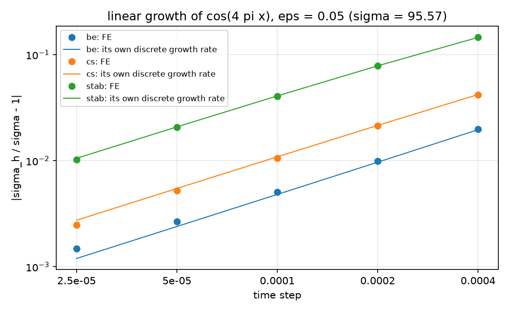
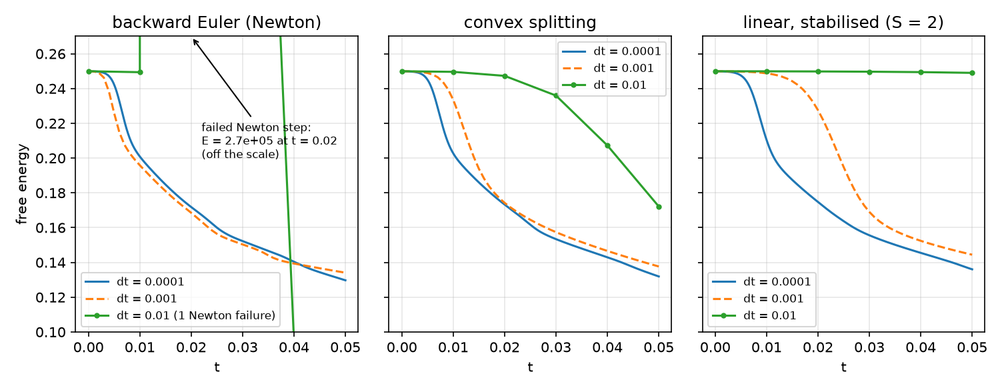
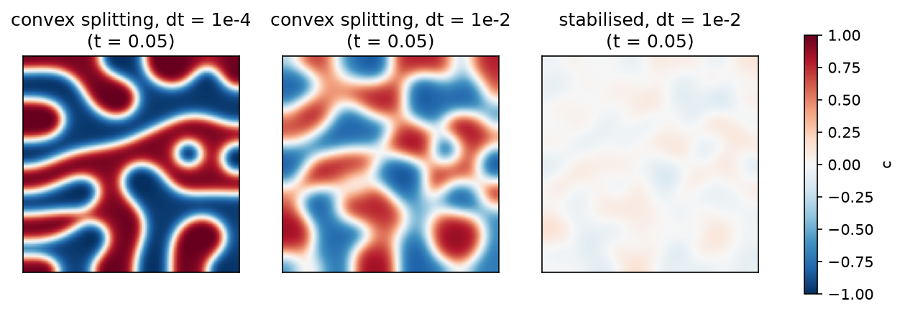
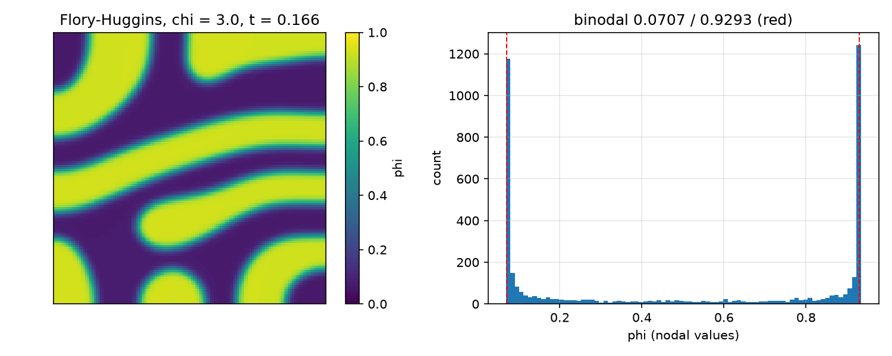
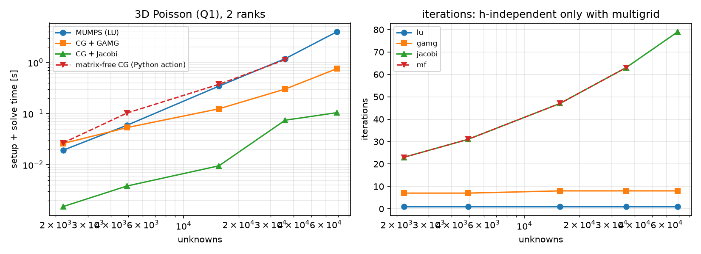
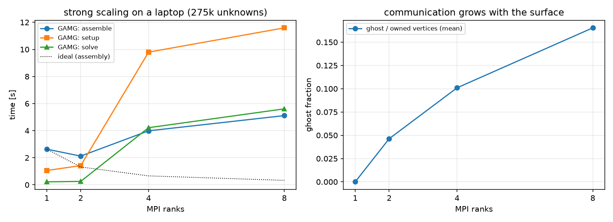
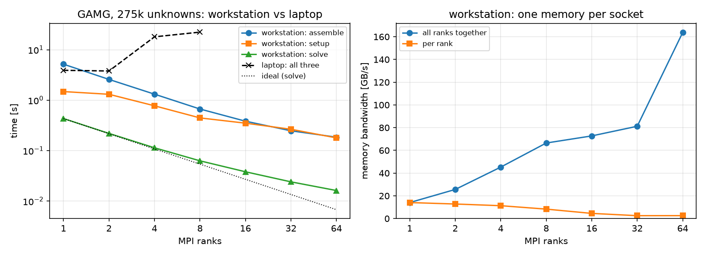
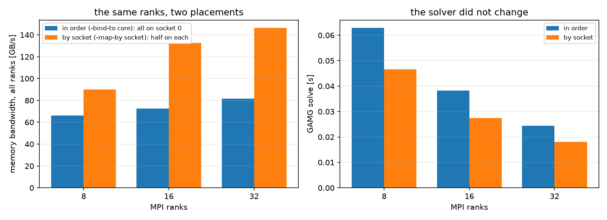

## Today

| Part | Topic | Time |
|---|---|:---:|
| | Quiz on Week 13 (closed-AI) | 10 min |
| **A** | Cahn–Hilliard extended — linear stability, three schemes, large steps, the interface | 35 min |
| **B** | Flory–Huggins — binodal, spinodal, a logarithmic free energy | 15 min |
| **C** | Parallel performance — where the time goes, solvers, ghosts, scaling, reuse | 40 min |
| **D** | LLM pitfalls · HW13 | 10 min |

::: {.box}
Lab: `W14_lab.ipynb` (≈ 80 min) · Homework: `W14_HW13.ipynb` (due before Week 15) · Applications: spinodal decomposition in alloys and polymer blends, membrane formation by phase inversion, emulsions
(AMPS I Week 10: Cahn–Hilliard with the θ-method, energy and mass — this week the schemes, the checks with a known answer, and the cost)
:::

# Part A · Cahn–Hilliard extended {background-color="#1f3864"}

## The model

$$
c_t=\nabla\cdot(M\nabla\mu),\qquad\mu=f'(c)-\varepsilon^2\Delta c,\qquad E(c)=\int_\Omega f(c)+\frac{\varepsilon^2}{2}|\nabla c|^2\,dx,\qquad f=\tfrac14(c^2-1)^2 .
$$

- No-flux walls: mass $\int c$ conserved, $\frac{dE}{dt}=-\int M|\nabla\mu|^2\le0$.
- Mixed P1 × P1 for $(c,\mu)$; nonlinear through $f'(c)=c^3-c$.
- Two time scales: fast spinodal growth ($\sigma_{\max}=M/(4\varepsilon^2)$), then slow coarsening ($\ell\sim t^{1/3}$) — the reason one wants large time steps.

## Linear stability: a known answer

About $c_0=0$ a mode $\cos kx$ grows like $e^{\sigma t}$:

$$
\sigma(k)=Mk^2\big(1-\varepsilon^2k^2\big),\qquad k_{\max}=\frac1{\sqrt2\,\varepsilon},\qquad\sigma_{\max}=\frac{M}{4\varepsilon^2}.
$$

Each time scheme multiplies the mode by its own factor $g$ per step ($a=\Delta tMk^2$, $b=\varepsilon^2k^2$):

| scheme | $\mu^{n+1}$ | $g$ |
|---|---|---|
| backward Euler (BE) | $f'(c^{n+1})-\varepsilon^2\Delta c^{n+1}$ | $1/(1-\Delta t\sigma)$ |
| convex splitting (CS) | $(c^{n+1})^3-c^n-\varepsilon^2\Delta c^{n+1}$ | $(1+a)/(1+ab)$ |
| linear stabilized (S) | $f'(c^n)+S(c^{n+1}-c^n)-\varepsilon^2\Delta c^{n+1}$ | $(1+a(1+S))/(1+a(S+b))$ |

A code is verified when it reproduces **its own** $g$; the scheme is accurate when $g\approx e^{\sigma\Delta t}$.

## Each scheme against its own prediction

{width=72% fig-align="center"}

Strip $128\times2$, $\varepsilon=0.05$, $k=4\pi$ ($\sigma=95.57$). Every scheme is first order in $\Delta t$; the FE rate sits on its own discrete rate to 0.03 %. Stabilization costs accuracy: $-4$ % at $\Delta t=10^{-4}$ (BE +0.5 %, CS −1.1 %).

## The last 0.03 %: the mesh's wavenumber

- On a uniform P1/Q1 mesh $\cos kx$ is an eigenvector of the mass and stiffness matrices, with $k_h^2=\frac{6}{h^2}\frac{1-\cos kh}{2+\cos kh}=k^2\big(1-\frac{(kh)^2}{12}+\dots\big)$ instead of $k^2$.
- Per step, the FE factor differs from $g(k)$ by $1.0\times10^{-5}$, $2.5\times10^{-6}$, $6.3\times10^{-7}$ (64, 128, 256 cells: second order) — and from $g(k_h)$ by at most $6.3\times10^{-9}$ for all schemes and steps.
- What is left is the cubic term the linear analysis drops: an initial amplitude $10^{-5}$ instead of $10^{-4}$ reduces it from $1.3\times10^{-9}$ to $1.3\times10^{-11}$ — the factor 100 of a term in (amplitude)².
- Code, scheme and spatial discretization are separated **exactly**: every part of the error has a formula.

## Three schemes, three properties

| | BE | CS (Eyre) | stabilized |
|---|---|---|---|
| system | nonlinear (Newton) | nonlinear (Newton) | **linear** |
| solvable for every $\Delta t$ | no ($\Delta t\sigma<1$) | yes | yes |
| energy decreases for every $\Delta t$ | no | yes (proof: HW13 Q1) | yes for $S\ge\frac12\max|f''|$ |
| matrix | changes every iteration | changes every iteration | **constant** — factorize once |
| growth error at $\Delta t=10^{-4}$ | +0.5 % | −1.1 % | −4.1 % |

## Large time steps: the energy

{width=100% fig-align="center"}

Green: $\Delta t=10^{-2}$ — BE leaves the scale after a failed Newton step, CS lags, the stabilized scheme hardly moves.

## Large time steps: the field at $t=0.05$

{width=82% fig-align="center"}

## Large time steps: what the figures say

$64\times64$, $\varepsilon=0.02$; reference $E(0.05)=0.12970$ (BE, $\Delta t=10^{-4}$). The reference itself, checked: $\Delta t=5\times10^{-5}$, $2.5\times10^{-5}$ give 0.12981, 0.12987 (order 1.0), extrapolated 0.12993 — the
reference is 0.17 % off in time. The mesh matters more: $32^2$ / $128^2$ give 0.13223 / 0.12902 (about 0.5 % at $64^2$). All runs below share the mesh: they compare the **time schemes** only.

| $\Delta t$ | BE | CS | stabilized |
|---|:---:|:---:|:---:|
| $10^{-3}$ | 0.13407 | 0.13765 | 0.14442 |
| $10^{-2}$ | **1 Newton failure**, $E\to2.7\times10^5$, ends at 0.0793 | 0.17215, monotone | 0.24899 — frozen, monotone |

- BE fails **loudly** — if the reason is checked. Unchecked, the loop continues from garbage and ends *below* the reference.
- CS and the stabilized scheme fail **quietly**: energy stability guarantees that nothing blows up, not that anything is right.
- Use large steps where the dynamics are slow (late coarsening), with an adaptive $\Delta t$, and measure the accuracy separately.

## The equilibrium interface

A 1D interface relaxes to $c=\tanh\frac{x}{\sqrt2\varepsilon}$ with interfacial energy $\gamma=\frac{2\sqrt2}{3}\varepsilon$ — a second known answer.

Started twice as wide; convex splitting, $\Delta t=10^{-3}$ to $t=0.4$, then $10^{-2}$ to $t=2$:

| cells on $[-1,1]$ ($\varepsilon=0.05$) | 50 | 100 | 200 | 400 |
|---|:---:|:---:|:---:|:---:|
| cells per $\sqrt2\varepsilon$ | 1.8 | 3.5 | 7.1 | 14 |
| profile error (nodes), $t=0.4$ | 5.1e-3 | 2.8e-3 | 2.8e-3 | 2.8e-3 |
| profile error (nodes), $t=2$ | 5.7e-3 | 1.5e-3 | 3.8e-4 | 9.4e-5 |
| $\gamma$ error, $t=2$ | +1.04 % | +0.27 % | +0.067 % | +0.017 % |

- At $t=0.4$ the profile error **does not fall with the mesh**: not a discretization error — the interface is still relaxing (diffusion through the bulk is slow). Relaxed ($t=2$; to $t=10$ nothing changes), profile and $\gamma$ are second order (2.0).
- A test against an equilibrium needs the equilibrium. $64\times64$ at $\varepsilon=0.02$ has 1.8 cells per interface width: fine for the pattern, 1 % in the interfacial energy.

# Part B · Flory–Huggins {background-color="#1f3864"}

## A logarithmic free energy

Polymer blends and solutions (volume fraction $\phi$, lattice units):

$$
f(\phi)=\frac{\phi}{N_1}\ln\phi+\frac{1-\phi}{N_2}\ln(1-\phi)+\chi\,\phi(1-\phi).
$$

- Symmetric ($N_1=N_2=1$): binodal $\ln\frac{\phi}{1-\phi}+\chi(1-2\phi)=0$, spinodal $\phi(1-\phi)=\frac1{2\chi}$, separation for $\chi>2$. $\chi=3$: binodal 0.0707 / 0.9293.
- $f'$ is singular at 0 and 1: every iterate must stay inside $(0,1)$.
- Convex splitting: the logarithms implicit (convex), $\chi\phi(1-\phi)$ explicit (concave).

## Flory–Huggins: the separated blend

{width=88% fig-align="center"}

$\chi=3$, $64\times64$, $\Delta t$ ramped $10^{-5}\to10^{-3}$, $t=0.166$: the composition of each phase — the maximum of a smoothed density of the nodal $\phi$ (Gaussian kernel, width $10^{-3}$; a histogram peak moves
by $\sim10^{-3}$ with the bins) — is 0.0720 / 0.9294 against the binodal 0.0707 / 0.9293; 28 % / 43 % of the nodes lie within 0.002 of it (65 % / 78 % at $t=1.5$, textbook). Mass drift $1\times10^{-15}$.
Single nodes overshoot (0.0684 / 0.9337: no maximum principle, small curved domains) — extremes or percentiles of the nodal values are a poor test.

One step of $\Delta t=10^{-3}$ from the start: BE **reason −4** after 2 iterations, CS converges in 2. The first two BE iterates stay in $[0.18, 0.84]$; the **third** Newton update overshoots to $[-2.26, 3.87]$ —
1877 of 4225 nodes outside $(0,1)$, the logarithm is NaN.

# Part C · Parallel performance {background-color="#1f3864"}

## Where the time goes

A solve has three parts with different costs and different parallel behavior:

| part | cost | parallel |
|---|---|---|
| assembly | $O(n)$, local per cell | ideal (no communication but the ghost update) |
| preconditioner setup | LU: $O(n^{1.5\ldots2})$ in 3D; AMG: $O(n)$ with a large constant | LU poorly, AMG reasonably |
| solve | LU: triangular solves; Krylov: iterations × (product + reductions) | Krylov: one neighbor exchange and global reductions per iteration |

- The **first** call includes the JIT compilation of the forms (seconds): warm up before timing.
- Time with `comm.Barrier(); MPI.Wtime()` and report the **maximum** over ranks.

## Four solvers for one problem

{width=100% fig-align="center"}

## Four solvers: what the figure says

Setup + solve time (iterations), 2 ranks:

| $N$ (unknowns) | MUMPS LU | CG + GAMG | CG + Jacobi | matrix-free CG |
|---|:---:|:---:|:---:|:---:|
| 12 (2197) | 0.019 s (1) | 0.026 s (7) | 0.002 s (23) | 0.027 s (23) |
| 16 (4913) | 0.059 s (1) | 0.053 s (7) | 0.004 s (31) | 0.103 s (31) |
| 24 (15625) | 0.345 s (1) | 0.124 s (8) | 0.010 s (47) | 0.374 s (47) |
| 32 (35937) | 1.186 s (1) | 0.302 s (8) | 0.074 s (63) | 1.134 s (63) |
| 40 (68921) | 3.982 s (1) | 0.757 s (8) | 0.104 s (79) | — |

- Iterations: Jacobi and matrix-free CG grow like $N\propto h^{-1}$ (condition number $h^{-2}$), GAMG stays at 7–8, LU is exact. On these sizes Jacobi is still the fastest — multigrid wins as $n$ grows.
- Matrix-free CG stores no matrix (0 against $1.8\times10^6$ nonzeros at $N=40$) but assembles the action of the form in Python at every iteration: slow here. Production matrix-free codes use compiled, sum-factorized kernels (high order).
- Uniform hexahedra and $f\propto$ a product of sines: the right-hand side is an eigenvector of the discrete operator and CG converges in **one** iteration — a benchmark that measures nothing.

## Communication: ghosts and neighbors

$N=64$ (275 k unknowns), vertices per rank:

| ranks | owned vertices | ghost vertices | ghost / owned | neighbors |
|:---:|:---:|:---:|:---:|:---:|
| 1 | 274625 | 0 | 0.000 | 0 |
| 2 | 137312 | 6356 | 0.046 | 1 |
| 4 | 68656 | 6931 | 0.101 | 3 |
| 8 | 34328 | 5676 | 0.165 | 7 |

- Each matrix–vector product exchanges the ghost values with the neighbors; each inner product is a global reduction.
- Ghost fraction $\propto$ surface/volume $\sim p^{1/3}/N$: it grows with the rank count and falls with the problem size — keep $\gtrsim10^4$–$10^5$ unknowns per rank.

## Strong scaling on a laptop

{width=100% fig-align="center"}

## Scaling: what the measurement says

Laptop, $N=64$ (275 k unknowns), `OMP_NUM_THREADS=1`:

| ranks | GAMG: assembly / setup / solve [s] | LU ($N=40$): setup [s] | Jacobi: solve [s] | GAMG its |
|:---:|:---:|:---:|:---:|:---:|
| 1 | 2.63 / 1.06 / 0.22 | 2.66 | 0.56 | 8 |
| 2 | 2.12 / 1.42 / 0.25 | 3.48 | 0.58 | 8 |
| 4 | 3.99 / 9.80 / 4.22 | 16.26 | 5.72 | 8 |
| 8 | 5.11 / 11.59 / 5.61 | 30.09 | 5.14 | 8 |

- The iterations do not change with the rank count (GAMG 8, Jacobi 127): the algorithm scales; the machine does not.
- This laptop (Apple M1: 4 performance + 4 efficiency cores, fanless, MPICH over shared memory) is slower with 4 and 8 ranks than with 1–2. We measured that ranks launched by `mpirun` ran about 2× slower each already at 4 ranks even for pure Python loops — the slowdown comes from the machine and its MPI launch, before any DOLFINx code runs.
- Colab gives 2 virtual CPUs. The same script on a two-socket workstation: next slides — **measure, don't assume**.

## Strong scaling on a workstation

{width=100% fig-align="center"}

## Workstation: what the measurement says

2 × Intel Xeon Gold 6430 (2 sockets × 32 cores, one memory per socket), each rank pinned to a core (`mpirun -bind-to core`), `OMP_NUM_THREADS=1`, same script and problem:

| ranks | GAMG: assembly / setup / solve [s] | LU ($N=40$): setup [s] | Jacobi: solve [s] | GAMG / Jacobi its |
|:---:|:---:|:---:|:---:|:---:|
| 1 | 5.17 / 1.48 / 0.432 | 2.44 | 1.045 | 8 / 127 |
| 4 | 1.32 / 0.774 / 0.114 | 2.35 | 0.264 | 8 / 127 |
| 16 | 0.383 / 0.350 / 0.038 | 1.36 | 0.087 | 8 / 127 |
| 64 | 0.185 / 0.179 / 0.016 | 1.33 | 0.031 | 8 / 127 |

- Same iterations; now the machine scales too: from 1 to 64 ranks the GAMG solve is 27×, assembly 28×, Jacobi 34× faster — but the GAMG setup only 8×, the LU setup 1.8×, and at 64 ranks each rank owns only 4,300 unknowns.
- One workstation core is not faster than the laptop's. The memory is the limit: 14 GB/s for one rank; all ranks together 66 GB/s at 8, 81 at 32, 164 at 64 — the jump at 64 is the second socket's memory.

## The same ranks, two placements

{width=100% fig-align="center"}

## Placement: what the measurement says

- Each rank recorded its CPUs and NUMA node: `-bind-to core` fills the cores in order — all 32 ranks on socket 0; `-map-by socket` puts 16 + 16.
- Same 32 ranks: memory bandwidth 82 → 146 GB/s, GAMG solve 0.024 → 0.018 s (26 % faster); 16 ranks: 72 → 132 GB/s, 28 % faster.
- Nothing in the solver changed, only where its ranks run. A scaling claim needs the machine, the placement and a measurement.

## Reuse one factorization

The stabilized scheme's matrix is constant: assemble and factorize it **once**, then every step is a right-hand side and two triangular solves.

| per step, 2 ranks | $64	imes64$ | $128	imes128$ |
|---|:---:|:---:|
| backward Euler (Newton) | 72.4 ms | 264.1 ms |
| stabilized, Newton | 44.2 ms | 117.3 ms |
| stabilized, linear, re-factorized | 39.6 ms | 110.1 ms |
| stabilized, **one factorization** | 8.8 ms | 16.4 ms |

Same energy to all printed digits for the three stabilized variants. Backward Euler cannot reuse anything: its Jacobian contains $3c^2$. Cost per unit of simulated time = (time per step)/$\Delta t$ — weigh it against the accuracy per step (HW13 Q6).

## Math → DOLFINx 0.11

| Task | Code |
|---|---|
| mixed $(c,\mu)$ | `W = functionspace(msh, basix.ufl.mixed_element([P1, P1]))`; `V0, dofs = W.sub(0).collapse()` — `dofs` is a **list** with one array |
| initial field | `cf.interpolate(lambda x: ...)` (a function of the coordinates: the same on every partition) |
| constant matrix | `A = assemble_matrix(form(a)); A.assemble()`; `ksp.setOperators(A)` once; per step `assemble_vector(b, form(L))`, `ksp.solve(b, x)` |
| matrix-free operator | `PETSc.Mat().createPython(sizes, Shell())`, `mult`: `assemble_vector(y, form(action(a, w)))` into a ghosted vector |
| timings | `comm.Barrier(); t = MPI.Wtime()`; the maximum over ranks; warm up the JIT |
| ghosts | `msh.topology.index_map(0).num_ghosts`, `.owners` (neighbor ranks) |

# Part D · LLM · HW13 {background-color="#1f3864"}

## What goes wrong in phase-field and performance studies

| Pitfall | Measured symptom (this week) |
|---|---|
| A failed Newton step not checked | $E\to2.7\times10^5$, the run continues and ends below the reference |
| "Energy-stable" taken for "accurate" | stabilized scheme frozen at $\Delta t=10^{-2}$ ($E$ 0.249 vs 0.130) |
| `len(dofs)` with `dofs` from `collapse()` | 1: a "random" start that is one constant — nothing happens |
| A log free energy with fully implicit Newton | an iterate outside $(0,1)$: NaN, reason −4 |
| A profile compared with the equilibrium before it has relaxed | an error that does not fall with the mesh (2.8e-3 on 100–400 cells) |
| Phases judged by nodal extremes or percentiles | overshoot beyond the binodal (0.0684 / 0.9337) — use the maximum of a smoothed density |
| A sine right-hand side on a uniform mesh | CG converges in 1 iteration |
| Timing the first call | includes the JIT compilation |
| Scaling measured on a laptop | 4 ranks slower than 1 (a workstation: 27× faster at 64 ranks) |
| Ranks placed in order on a two-socket machine | one socket's memory: 26 % slower solve at 32 ranks than spread over both |

## HW13 (due before Week 15)

Theory (linear stability, amplification factors, convex splitting, the common tangent) · growth rates in time and space · the tanh interface · Flory–Huggins binodal and a failing Newton step · solvers, memory and
ghosts · accuracy per cost · an LLM-generated Cahn–Hilliard script with defects. About seven minutes locally, 25 on Colab.

## Summary

| Concept | Key point | DOLFINx 0.11 |
|---|---|---|
| Known answers | linear growth rate (each scheme's own $g$), tanh interface, binodal | `mode(k)`, `tanh_profile`, `fh_binodal` |
| Schemes | BE (accurate, conditionally solvable), CS (stable), stabilized (stable, linear) | `scheme="be" / "cs" / "stab"` |
| Stability ≠ accuracy | large steps: stable, failing or frozen | check the reason, compare with a reference |
| Cost | assembly / setup / solve; JIT; maxima over ranks | `MPI.Wtime`, `Barrier` |
| Solvers | LU $\to$ AMG as $n$ grows; Jacobi iterations $\propto h^{-1}$ | `pc_type`: `lu`, `gamg`, `jacobi`; `createPython` |
| Parallel | ghosts $\sim$ surface/volume; iterations independent of ranks | `index_map.num_ghosts`, `.owners` |
| Reuse | constant matrix → factorize once | `assemble_matrix` once, `ksp.solve` per step |

**Next week:** project workshop — individual code reviews and 5-minute progress presentations.
