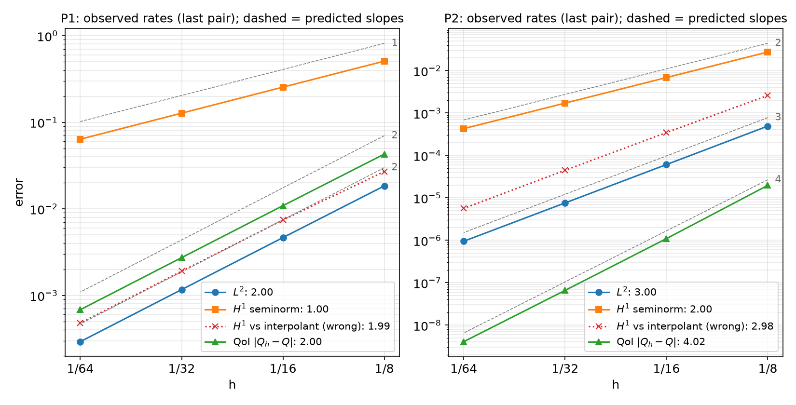
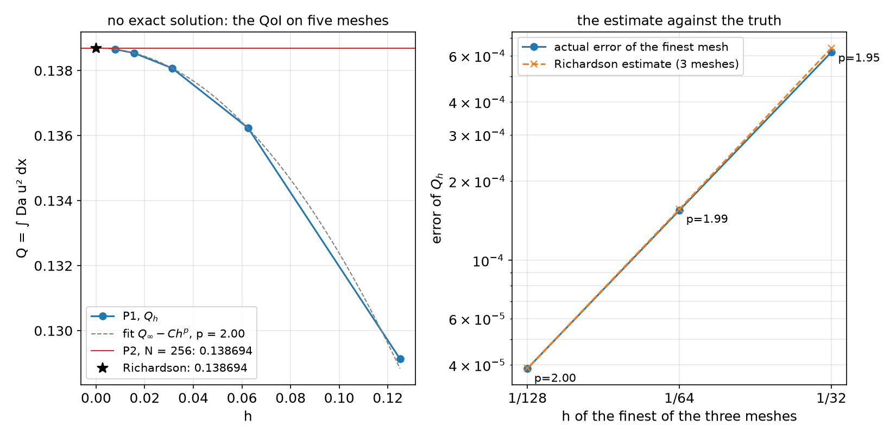

## Today

| Part | Topic | Time |
|---|---|:---:|
| | Quiz on Week 14 (closed-AI) | 10 min |
| **A** | The workshop: what happens today, what is graded | 5 min |
| **B** | The progress talk: four slides in five minutes | 5 min |
| **C** | Verification at mid-project: predict, measure, extrapolate, compare, budget | 25 min |
| **D** | The code review · if you are behind | 10 min |
| | **Progress talks + code reviews** — 10 min per student | ≈ 120 min |

::: {.box}
Lab: `W15_lab.ipynb` — a verification kit (`projkit.py`) and a worked example; work on it and on your project while the others present.
No homework this week. Week 16: final presentations; the final report and code follow one week later.
:::

# Part A · The workshop {background-color="#1f3864"}

## What happens today

| Block | Who | What |
|---|---|---|
| Slides (this deck) | everyone | how the talk and the code review are graded; the verification you need by Week 16 |
| **Talk + review**, 10 min each, in the announced order | one student at a time | **5 min talk** (your slides), then **5 min code review**: your `project.ipynb` open on the screen, two questions |
| Workshop | everyone else | `W15_lab.ipynb` §1–7 (≈ 45 min), then §8 on your own project; ask questions between talks |

**Before the session** (by the evening before): upload your slides (PDF or HTML) and your current `project.ipynb` **with outputs** (*Restart session and run all* first).

## The term project — where you are

| Part | Weight | When |
|---|:---:|---|
| Proposal | 5 % | before Week 9 — done |
| **Progress talk + code review** | **5 %** | **today** |
| Final presentation (with live code questions) | 10 % | Week 16 |
| Final report (Quarto) and code | 20 % | one week after Week 16 |

The progress talk is graded on **evidence**, not on how far you are. "MMS gives rate 1.0 where I predicted 2, and here is what I checked" scores better than a beautiful result without a convergence plot.

# Part B · The progress talk {background-color="#1f3864"}

## Four slides in five minutes

| Slide | Content | Time |
|---|---|:---:|
| 1 · Problem | topic (A–J or own), the model in one line of equations, the **QoI**, the dimensionless numbers | 1 min |
| 2 · Status | the milestones of your proposal: done / partial / not started, each with its evidence (a cell, a number, a figure) | 1 min |
| 3 · Verification | **one convergence plot with predicted slopes** (exact or manufactured solution, ≥ 3 meshes) and the state of your topic's physical check | 1.5 min |
| 4 · Problem and plan | the one thing that blocks you, with its evidence (reason, rate, figure); what you will do — and what you will **cut** — before Week 16 | 1.5 min |

Optional Quarto template: `talk_template/` (this layout). Any tool, PDF or HTML. Five minutes is strict: the code review starts at 5:00.

# Part C · Verification at mid-project {background-color="#1f3864"}

## C1 · Predict, then measure

A convergence study is a **test only if the predicted rate is written down first.**

| Quantity | P$p$, smooth solution | Why |
|---|:---:|---|
| $\lVert u-u_h\rVert_{L^2}$ | $p+1$ | Aubin–Nitsche (duality) |
| $\lvert u-u_h\rvert_{H^1}$ | $p$ | Céa + interpolation |
| a smooth functional $Q(u)$ | $2p$ | error ≈ (energy error)² — duality again |
| a flux / gradient at a boundary | $p$ | unless computed from the residual (consistent flux, Weeks 1, 11) |
| time stepping, order $q$ | $q$ in $\Delta t$ | refine $\Delta t$ with $h$ fixed fine (or together, $\Delta t\propto h^{(p+1)/q}$) |

Worked example (lab §2): $-\nabla\cdot((1+u^2)\nabla u)+\mathrm{Da}\,u^2=f$ on the unit square, Newton, manufactured $u=e^{x}\sin\pi y+\tfrac12y^2$, QoI $Q=\int\mathrm{Da}\,u^2\,dx$.

## C1 · The convergence figure for slide 3

{width=100% fig-align="center"}

## C1 · What the figure says

| P$p$ | $L^2$ | $H^1$ | $Q$ |
|---|:---:|:---:|:---:|
| P1 observed (predicted) | 2.00 (2) | 1.00 (1) | 2.00 (2) |
| P2 observed (predicted) | 3.00 (3) | 2.00 (2) | 4.02 (4) |

- All three rates as predicted, on four meshes ($N=8\ldots64$), Newton converged (reason 2) on every mesh in six iterations.
- Log–log axes, **dashed lines = predicted slopes**, observed rates in the legend: the reader checks the claim in one glance.
- The QoI of P2 converges at rate 4: report the rate of the **quantity you report**, not only of the field.

## C2 · The wrong yardstick

The red dotted line in the figure: $u_h$ compared with the **interpolant** $I_hu$ in the same space — `u_ex = fem.Function(V); u_ex.interpolate(...)`, then the norm of the difference.

| $H^1$ error at $N=64$ | P1 | P2 |
|---|:---:|:---:|
| $\lvert u-u_h\rvert_{1}$ (exact expression, raised quadrature) | $6.37\times10^{-2}$, rate 1.00 | $4.29\times10^{-4}$, rate 2.00 |
| $\lvert I_hu-u_h\rvert_{1}$ | $4.79\times10^{-4}$, rate **1.99** | $5.66\times10^{-6}$, rate **2.98** |
| ratio | **133** | 76 |

- $u-u_h=(u-I_hu)+(I_hu-u_h)$: the interpolation error carries the rate $p$ and is left out; the remainder is **superconvergent** on structured meshes.
- A rate **better** than predicted is a failed test too. Measure $u-u_h$ with `ufl.SpatialCoordinate` and `metadata={"quadrature_degree": 2p + 6}` (or interpolate $u$ into degree $\ge p+2$).

## C3 · No exact solution: Richardson and the GCI

Your production QoI has no exact value. Three meshes $h,\,h/2,\,h/4$, **monotone** differences:
$$p_\text{obs}=\frac{\ln\big((Q_1-Q_2)/(Q_2-Q_3)\big)}{\ln 2},\qquad Q_\infty\approx Q_3+\frac{Q_3-Q_2}{2^{p}-1},\qquad \mathrm{GCI}=1.25\,\frac{|Q_3-Q_2|}{(2^{p}-1)|Q_3|}$$

- The test: $p_\text{obs}$ ≈ the **predicted** rate. Only then is $|Q_3-Q_\infty|$ an error estimate.
- Differences of opposite sign: not asymptotic (unresolved layer, a point that moves, a loose solver tolerance) — Richardson does not apply; refine, or report the spread.
- $p_\text{obs}$ far below the prediction: pre-asymptotic, a singularity (corner, coefficient jump off mesh lines) — or an error. Find out which.

Example (lab §5): the same equation with $f=10$, $g=0$; P1 on $N=8\ldots128$; an independent check with P2 on $N=256$.

## C3 · The estimate against the truth

{width=100% fig-align="center"}

## C3 · What the figure says

| Meshes | $p_\text{obs}$ | $Q_\infty$ | estimated error | actual error | GCI |
|---|:---:|:---:|:---:|:---:|:---:|
| 8–16–32 | 1.950 | 0.1387170 | $6.42\times10^{-4}$ | $6.19\times10^{-4}$ | 0.58 % |
| 16–32–64 | 1.987 | 0.1386954 | $1.57\times10^{-4}$ | $1.55\times10^{-4}$ | 0.14 % |
| 32–64–128 | 1.997 | 0.1386940 | $3.89\times10^{-5}$ | $3.88\times10^{-5}$ | 0.035 % |

- "Actual" = against P2 on $N=256$ ($Q=0.1386939$): the estimate is within 4 % of the true error already on the three coarsest meshes, because $p_\text{obs}\approx2$ as predicted.
- In the report: "$Q=0.13866$ (P1, $N=128$), $p_\text{obs}=2.00$ (predicted 2), GCI 0.035 %; P2 $N=256$: 0.1386939."

## C4 · `-np 1` = `-np 2`

Run the same cell twice; `record(tag, comm, Q=...)` writes one JSON file per process count; `compare_np(tag)` in an ordinary cell.

```text
           Q: np1 0.138538849341  np2 0.138538849341  relative difference 1.2e-14  ok
        dofs: np1 4225  np2 4225  relative difference 0.0e+00  ok
  newton_its: np1 5  np2 5  relative difference 0.0e+00  ok
```

| Different values usually mean | Where it came from in this course |
|---|---|
| random numbers drawn per rank | Week 14, HW13 Q7 (start from a function of the coordinates, `noise(x)`) |
| a sum or a maximum not reduced over ranks | every week (`comm.allreduce`) |
| a point value read from a ghost cell | use an owned cell, as `line()` in Week 14 does |
| interior-facet terms with arbitrary `'+'` sides | Week 10 (order the sides explicitly) |

Exceptions you must explain: branching 1D meshes (Week 7), Gmsh meshes that differ between machines (Week 2), iteration counts of AMG.

## C5 · A run-time budget

The final notebook must run on Colab in **at most 30 minutes** (Week 16 guide).

| Lab §7 (local, 2 ranks, P2, min of 3; ±10 % between runs) | $N=32$ | 64 | 128 | 256 |
|---|:---:|:---:|:---:|:---:|
| unknowns | 4 225 | 16 641 | 66 049 | 263 169 |
| one Newton solve | 0.11 s | 0.32 s | 1.31 s | 5.64 s |

- Fit $t\propto n^{p}$ on the last two points ($p=1.06$ here) and extrapolate to your final mesh; Colab took 3.5–4 times longer for the same cell (0.42 s → 23.9 s for $N=32\ldots256$; $p=1.05$).
- Exclude the **first** call of a new form: P3 on $N=16$ took 4.7 s the first time in a fresh runtime, 0.22 s the second (JIT compilation, then cached on disk).
- Too long? The convergence study for one parameter value, the sweep on the mesh it justifies; save results to `/tmp/fnx/*.npz` and plot from the file; continue from the previous solution; a reduced cell that reproduces the trend.

# Part D · The code review {background-color="#1f3864"}

## Five minutes with your notebook on the screen

You are the author of record (syllabus, *Academic Integrity*): every line, whoever generated it. Two questions, one of each kind:

| Kind | Examples |
|---|---|
| **Show where** | where the Dirichlet condition enters; where the Jacobian is made; where the reason is printed; where the QoI is reduced over ranks; where the manufactured source is built |
| **Predict a change** | halve $h$: what happens to each error? P2 → P1? remove the stabilization? a time step half as large? `-np 4`? start Newton from zero? |

Prepare: *Restart and run all* the evening before; one section per verification step; the reason of every solve printed; your AI-usage log up to date — "which part did the LLM write, and which test checked it?" is a fair question.

## If you are behind

Cut the **scope**, never the verification:

| Instead of | Do |
|---|---|
| 3D | 2D, axisymmetric or plane strain — with the reason it is valid |
| two-way coupling | one-way (solve A, then B with A's field) and estimate the neglected effect |
| transient | the steady state (or a single time-step study) |
| a sweep of 10 parameter values | 3–4 values, on the mesh your convergence study justifies |
| your own geometry first | the verification case first (exact solution), then the geometry |

The topic pages (`projects/`) list required tasks and stretch goals: finish the required tasks with full verification before any stretch goal.

## Summary

| Step | Evidence for the progress talk | Tool (`projkit.py`) |
|---|---|---|
| Predict, then measure | rates on ≥ 3 meshes against predicted slopes | `rate_table`, `rate_plot` |
| The right yardstick | $u-u_h$ with the exact expression and raised quadrature | (your error integral) |
| QoI without an exact value | $p_\text{obs}$, $Q_\infty$, GCI | `richardson` |
| Parallel consistency | same QoI with `-np 1` and `-np 2` | `record`, `compare_np` |
| Cost | time per solve vs unknowns, Colab factor | `budget` |

**Next week:** final presentations (12 min: 8 talk + 4 questions on your code). The final report (Quarto) and code are due one week later — the Week 16 guide gives the sections and the checklist.
