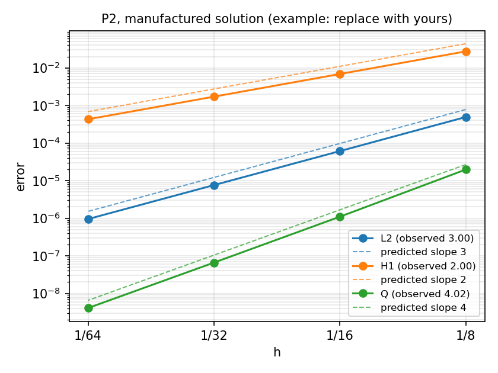

## 1 · Problem

- **Topic:** A–J or own — one line on the application
- **Model:** the governing equation(s) in one line, e.g. $-\nabla\cdot(k\nabla u)+r(u)=f$ in $\Omega$, boundary conditions in words
- **QoI:** what you report, with units (e.g. effectiveness factor, Nusselt number, peak stress, breakthrough time)
- **Dimensionless numbers:** values for your base case (Pe, Da, Thiele, Ra, stiffness ratio, …)

## 2 · Status against the proposal

| Milestone (from your proposal) | Status | Evidence |
|---|:---:|---|
| M1 … | done | `project.ipynb` §2, reason 2 on all meshes |
| M2 … | partial | rate 1.6 where 2 predicted — see slide 4 |
| M3 … | not started | — |

## 3 · Verification so far

:::: {.columns}
::: {.column width="58%"}
{width=100%}
:::
::: {.column width="42%"}
- Exact / manufactured solution: …
- Predicted rates: $L^2$ …, $H^1$ …, QoI …
- Observed: …
- Topic's physical check: … (status, deviation in %)
- `-np 1` vs `-np 2`: QoI relative difference …
:::
::::

## 4 · Problem and plan

- **What blocks me:** one problem, with its evidence (a reason code, a rate, a figure)
- **What I tried / what I will try:** …
- **Plan to Week 16:** the remaining required tasks, in order
- **What I will cut if needed:** (scope, never the verification)
- **Run-time budget of the final study on Colab:** … min
